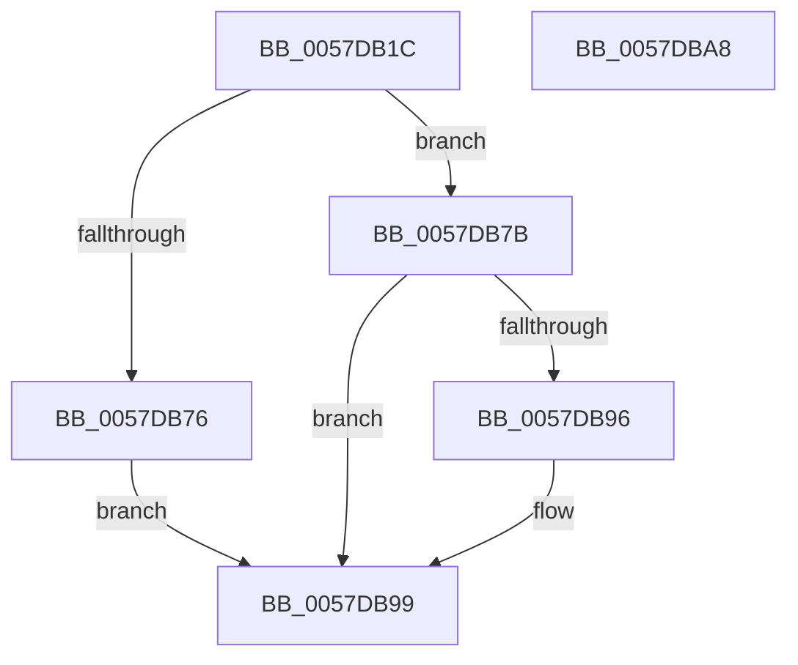

# CcAdjustThrottleForExternalCache

- RVA: `0x0057DB1C`–`0x0057DBA9` (길이 `141` bytes)
- VA: `0x000000014057DB1C`
- 실행 섹션: `.text`
- PDB 이름 있음: `예`; PDB Function 태그: `아니요`
- unwind 정보 RVA: `0x000DB714`
- 디코드: `35`개 명령, `141/141` bytes 표시
- 미해석 바이트: `0` (있으면 어셈블리에 `.byte`로 보존)

> 이 문서는 커널 이미지의 기계어와 PDB 기호를 분석해 생성했습니다. 4번과 5번은 함수 원형과 자료형을 바이너리 사용 방식에서 추정한 C 해석이며 원본 소스 복구 결과는 아닙니다.

## 1. Dependencies

- 직접 호출 지점: **0**; 고유 호출 대상: **0**
- 직접 호출자로 확인된 함수: **1**
- RIP 상대 이미지 참조: **1**

### Outgoing calls
- 직접 디코드된 call 명령이 없습니다.

### Direct callers
- [CcAdjustThrottleForVolume](../4B/CcAdjustThrottleForVolume_function_004BD5D0.md) at `0x004BD6A7`

### Static image references
- `0x0057DB1C` → RVA `0x00FC521C` (`ALMOSTRO`; read)

## 2. Other-region calls and transfers

- 다른 실행 섹션으로 향하는 call: **0**
- 별도 외부 분기/꼬리 이동을 확인하지 못했습니다.

## 3. Assembly (complete function range)

```asm
0057DB1C  44 8A 05 F9 76 A4 00            mov r8b, byte ptr [rip + 0xa476f9]
0057DB23  4C 8B D1                        mov r10, rcx
0057DB26  48 83 A1 48 04 00 00 00         and qword ptr [rcx + 0x448], 0
0057DB2E  48 8B 81 40 04 00 00            mov rax, qword ptr [rcx + 0x440]
0057DB35  48 03 81 38 04 00 00            add rax, qword ptr [rcx + 0x438]
0057DB3C  4C 8B C8                        mov r9, rax
0057DB3F  48 D1 E8                        shr rax, 1
0057DB42  49 C1 E9 02                     shr r9, 2
0057DB46  45 84 C0                        test r8b, r8b
0057DB49  49 8B D1                        mov rdx, r9
0057DB4C  48 0F 45 D0                     cmovne rdx, rax
0057DB50  48 B8 CD CC CC CC CC CC CC CC   movabs rax, 0xcccccccccccccccd
0057DB5A  48 C1 E2 02                     shl rdx, 2
0057DB5E  48 F7 E2                        mul rdx
0057DB61  B8 00 02 00 00                  mov eax, 0x200
0057DB66  48 C1 EA 02                     shr rdx, 2
0057DB6A  4C 3B CA                        cmp r9, rdx
0057DB6D  49 0F 42 D1                     cmovb rdx, r9
0057DB71  48 3B D0                        cmp rdx, rax
0057DB74  73 05                           jae 0x14057db7b
0057DB76  8D 48 80                        lea ecx, [rax - 0x80]
0057DB79  EB 1E                           jmp 0x14057db99
0057DB7B  48 8B C2                        mov rax, rdx
0057DB7E  48 8B CA                        mov rcx, rdx
0057DB81  48 C1 E8 02                     shr rax, 2
0057DB85  41 B8 FF FF FF FF               mov r8d, 0xffffffff
0057DB8B  48 2B C8                        sub rcx, rax
0057DB8E  48 8B C2                        mov rax, rdx
0057DB91  49 3B C8                        cmp rcx, r8
0057DB94  76 03                           jbe 0x14057db99
0057DB96  41 8B C8                        mov ecx, r8d
0057DB99  49 89 82 F8 03 00 00            mov qword ptr [r10 + 0x3f8], rax
0057DBA0  41 89 8A 10 04 00 00            mov dword ptr [r10 + 0x410], ecx
0057DBA7  C3                              ret
0057DBA8  CC                              int3
```

## 4. C-style interpretation (structured pseudocode)

```c
__int64 __fastcall CcAdjustThrottleForExternalCache(__int64 a1)
{
    __int64 result;

    result = (*(unsigned __int64 *)(a1 + 1088)) + (*(unsigned __int64 *)(a1 + 1080));
    result = (result) >> (1);
    a4 = (result) >> (2);
    if ((unsigned __int8)(*(unsigned __int8 *)(v_rip + 10778361)) != 0) { a4 = result; }
    a2 = (a4) << (2);
    a2 = (a2) >> (2);
    if (a4 < a2) { a2 = a4; }
    if (a2 >= 512) goto loc_0057DB7B;
    goto loc_0057DB99;
loc_0057DB7B:
    result = (a2) >> (2);
    a1 = (a2) - (result);
    if (a1 >= = ((unsigned int)(0xFFFFFFFFULL))) {
        a1 = (unsigned int)((unsigned int)(0xFFFFFFFFULL));
    }
    *(unsigned __int64 *)(a1 + 1016) = a2;
    *(unsigned int *)(a1 + 1040) = (unsigned int)(a1);
    return a2;
}
```

## 5. (Beta) C Style

```c
int64_t CcAdjustThrottleForExternalCache(void *Arg1)
{
    uint8_t *arg1 = (uint8_t *)Arg1;

    int64_t result;

    result = (*(uint64_t *)(arg1 + 0x440)) + (*(uint64_t *)(arg1 + 0x438));
    result = (result) >> (1);
    a4 = (result) >> (2);
    if ((uint8_t)(*(uint8_t *)(v_rip + 0xA476F9)) != 0) { a4 = result; }
    a2 = (a4) << (2);
    a2 = (a2) >> (2);
    if (a4 < a2) { a2 = a4; }
    if (a2 >= 512) goto loc_0057DB7B;
    goto loc_0057DB99;
loc_0057DB7B:
    result = (a2) >> (2);
    Arg1 = (a2) - (result);
    if (Arg1 >= = ((uint32_t)(0xFFFFFFFFULL))) {
        Arg1 = (uint32_t)((uint32_t)(0xFFFFFFFFULL));
    }
    *(uint64_t *)(arg1 + 0x3F8) = a2;
    *(uint32_t *)(arg1 + 0x410) = (uint32_t)(Arg1);
    return a2;
}
```

### 관측된 메모리 오프셋

구조체 형식이 확인되지 않은 접근은 인자 기준의 오프셋으로만 기록했습니다.

| 기준 인자 | 오프셋 표현 | 폭 (bit) | 접근 |
|---|---:|---:|---|
| `Arg1` | `+ 0x3F8` | `64` | `W` |
| `Arg1` | `+ 0x410` | `32` | `W` |
| `Arg1` | `+ 0x438` | `64` | `R` |
| `Arg1` | `+ 0x440` | `64` | `R` |
| `Arg1` | `+ 0x448` | `64` | `R/W` |

## 6. Execution-region graph

[열기: 2D/3D 그래프와 함수 탐색 컨트롤 패널](../../../control-panel.html?section=text&rva=0x0057DB1C&view=graph)

- 2D 그래프는 위에서 아래로 흐르고, 3D 그래프는 빈 공간을 드래그해 회전합니다. Shift+드래그는 이동, 휠은 확대·축소, 함수 노드 선택은 대상 보고서 이동입니다.

### Static fallback


