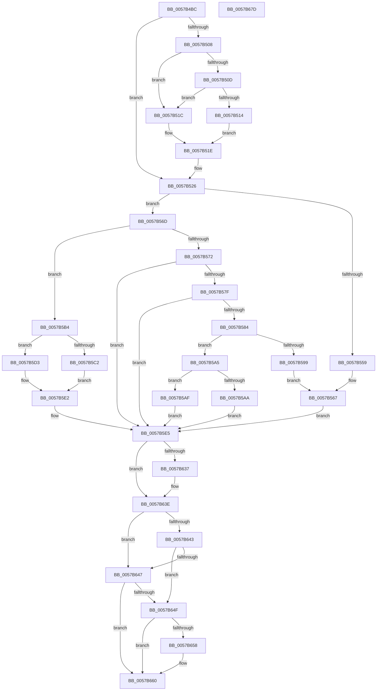

# CcAdjustThrottleForPartition

- RVA: `0x0057B4BC`–`0x0057B67E` (길이 `450` bytes)
- VA: `0x000000014057B4BC`
- 실행 섹션: `.text`
- PDB 이름 있음: `예`; PDB Function 태그: `아니요`
- unwind 정보 RVA: `0x000C3E7C`
- 디코드: `139`개 명령, `450/450` bytes 표시
- 미해석 바이트: `0` (있으면 어셈블리에 `.byte`로 보존)

> 이 문서는 커널 이미지의 기계어와 PDB 기호를 분석해 생성했습니다. 4번과 5번은 함수 원형과 자료형을 바이너리 사용 방식에서 추정한 C 해석이며 원본 소스 복구 결과는 아닙니다.

## 1. Dependencies

- 직접 호출 지점: **0**; 고유 호출 대상: **0**
- 직접 호출자로 확인된 함수: **1**
- RIP 상대 이미지 참조: **2**

### Outgoing calls
- 직접 디코드된 call 명령이 없습니다.

### Direct callers
- [CcLazyWriteScan](../3C/CcLazyWriteScan_function_003C9394.md) at `0x003C9596`

### Static image references
- `0x0057B619` → RVA `0x00FC521C` (`ALMOSTRO`; read)
- `0x0057B64F` → RVA `0x00E65B90` (`.data`; read)

## 2. Other-region calls and transfers

- 다른 실행 섹션으로 향하는 call: **0**
- 별도 외부 분기/꼬리 이동을 확인하지 못했습니다.

## 3. Assembly (complete function range)

```asm
0057B4BC  48 8B C4                        mov rax, rsp
0057B4BF  48 89 58 08                     mov qword ptr [rax + 8], rbx
0057B4C3  48 89 68 10                     mov qword ptr [rax + 0x10], rbp
0057B4C7  48 89 70 18                     mov qword ptr [rax + 0x18], rsi
0057B4CB  48 89 78 20                     mov qword ptr [rax + 0x20], rdi
0057B4CF  41 54                           push r12
0057B4D1  41 55                           push r13
0057B4D3  41 56                           push r14
0057B4D5  41 57                           push r15
0057B4D7  48 8B 3A                        mov rdi, qword ptr [rdx]
0057B4DA  48 8B F1                        mov rsi, rcx
0057B4DD  4C 8B 72 08                     mov r14, qword ptr [rdx + 8]
0057B4E1  41 BD FF FF FF FF               mov r13d, 0xffffffff
0057B4E7  8B 52 10                        mov edx, dword ptr [rdx + 0x10]
0057B4EA  48 8B 89 88 04 00 00            mov rcx, qword ptr [rcx + 0x488]
0057B4F1  41 2B D1                        sub edx, r9d
0057B4F4  45 8B 78 18                     mov r15d, dword ptr [r8 + 0x18]
0057B4F8  4D 8B 10                        mov r10, qword ptr [r8]
0057B4FB  4D 8B 58 08                     mov r11, qword ptr [r8 + 8]
0057B4FF  49 8B 68 10                     mov rbp, qword ptr [r8 + 0x10]
0057B503  48 85 C9                        test rcx, rcx
0057B506  74 1E                           je 0x14057b526
0057B508  49 3B CD                        cmp rcx, r13
0057B50B  77 0F                           ja 0x14057b51c
0057B50D  8B C2                           mov eax, edx
0057B50F  48 3B C1                        cmp rax, rcx
0057B512  76 08                           jbe 0x14057b51c
0057B514  2B 96 88 04 00 00               sub edx, dword ptr [rsi + 0x488]
0057B51A  EB 02                           jmp 0x14057b51e
0057B51C  33 D2                           xor edx, edx
0057B51E  48 83 A6 88 04 00 00 00         and qword ptr [rsi + 0x488], 0
0057B526  41 BC 00 02 00 00               mov r12d, 0x200
0057B52C  8B CA                           mov ecx, edx
0057B52E  41 3B D4                        cmp edx, r12d
0057B531  41 8B DA                        mov ebx, r10d
0057B534  41 0F 42 CC                     cmovb ecx, r12d
0057B538  C1 E9 02                        shr ecx, 2
0057B53B  8B C1                           mov eax, ecx
0057B53D  49 3B C2                        cmp rax, r10
0057B540  49 8B C2                        mov rax, r10
0057B543  0F 46 D9                        cmovbe ebx, ecx
0057B546  49 2B C7                        sub rax, r15
0057B549  48 8D 0C 40                     lea rcx, [rax + rax*2]
0057B54D  48 C1 E9 02                     shr rcx, 2
0057B551  49 03 CF                        add rcx, r15
0057B554  48 3B F9                        cmp rdi, rcx
0057B557  72 14                           jb 0x14057b56d
0057B559  8B C3                           mov eax, ebx
0057B55B  4C 2B D0                        sub r10, rax
0057B55E  49 8B C2                        mov rax, r10
0057B561  4C 8B D5                        mov r10, rbp
0057B564  48 3B C5                        cmp rax, rbp
0057B567  4C 0F 47 D0                     cmova r10, rax
0057B56B  EB 78                           jmp 0x14057b5e5
0057B56D  4D 3B DA                        cmp r11, r10
0057B570  72 42                           jb 0x14057b5b4
0057B572  8B D3                           mov edx, ebx
0057B574  49 8B C2                        mov rax, r10
0057B577  48 2B C2                        sub rax, rdx
0057B57A  48 3B F8                        cmp rdi, rax
0057B57D  73 66                           jae 0x14057b5e5
0057B57F  4D 3B F2                        cmp r14, r10
0057B582  77 61                           ja 0x14057b5e5
0057B584  49 8B CA                        mov rcx, r10
0057B587  4D 8B CB                        mov r9, r11
0057B58A  48 2B CF                        sub rcx, rdi
0057B58D  4D 2B CA                        sub r9, r10
0057B590  48 C1 E9 03                     shr rcx, 3
0057B594  48 3B CA                        cmp rcx, rdx
0057B597  76 0C                           jbe 0x14057b5a5
0057B599  4A 8D 04 11                     lea rax, [rcx + r10]
0057B59D  4C 3B C9                        cmp r9, rcx
0057B5A0  4D 8B D3                        mov r10, r11
0057B5A3  EB C2                           jmp 0x14057b567
0057B5A5  4C 3B CA                        cmp r9, rdx
0057B5A8  77 05                           ja 0x14057b5af
0057B5AA  4D 8B D3                        mov r10, r11
0057B5AD  EB 36                           jmp 0x14057b5e5
0057B5AF  4C 03 D2                        add r10, rdx
0057B5B2  EB 31                           jmp 0x14057b5e5
0057B5B4  4D 8B CA                        mov r9, r10
0057B5B7  4D 2B CB                        sub r9, r11
0057B5BA  41 3B D4                        cmp edx, r12d
0057B5BD  49 8B D1                        mov rdx, r9
0057B5C0  73 11                           jae 0x14057b5d3
0057B5C2  48 C1 EA 02                     shr rdx, 2
0057B5C6  48 81 FA 00 50 00 00            cmp rdx, 0x5000
0057B5CD  49 0F 46 D1                     cmovbe rdx, r9
0057B5D1  EB 0F                           jmp 0x14057b5e2
0057B5D3  8B CB                           mov ecx, ebx
0057B5D5  49 8B C2                        mov rax, r10
0057B5D8  48 2B C1                        sub rax, rcx
0057B5DB  49 3B C3                        cmp rax, r11
0057B5DE  48 0F 43 D1                     cmovae rdx, rcx
0057B5E2  4C 2B D2                        sub r10, rdx
0057B5E5  4D 89 58 08                     mov qword ptr [r8 + 8], r11
0057B5E9  49 8B CA                        mov rcx, r10
0057B5EC  48 C1 E9 02                     shr rcx, 2
0057B5F0  49 8B C2                        mov rax, r10
0057B5F3  48 D1 E8                        shr rax, 1
0057B5F6  48 03 C8                        add rcx, rax
0057B5F9  49 89 68 10                     mov qword ptr [r8 + 0x10], rbp
0057B5FD  49 3B CD                        cmp rcx, r13
0057B600  4D 89 10                        mov qword ptr [r8], r10
0057B603  49 0F 47 CD                     cmova rcx, r13
0057B607  41 89 48 18                     mov dword ptr [r8 + 0x18], ecx
0057B60B  48 8B 86 80 04 00 00            mov rax, qword ptr [rsi + 0x480]
0057B612  48 03 86 78 04 00 00            add rax, qword ptr [rsi + 0x478]
0057B619  0F B6 15 FC 9B A4 00            movzx edx, byte ptr [rip + 0xa49bfc]
0057B620  48 D1 E8                        shr rax, 1
0057B623  48 8B C8                        mov rcx, rax
0057B626  49 89 40 08                     mov qword ptr [r8 + 8], rax
0057B62A  48 C1 E9 02                     shr rcx, 2
0057B62E  49 89 48 10                     mov qword ptr [r8 + 0x10], rcx
0057B632  49 3B CC                        cmp rcx, r12
0057B635  73 07                           jae 0x14057b63e
0057B637  4D 89 60 10                     mov qword ptr [r8 + 0x10], r12
0057B63B  49 8B CC                        mov rcx, r12
0057B63E  48 3B C1                        cmp rax, rcx
0057B641  72 04                           jb 0x14057b647
0057B643  85 D2                           test edx, edx
0057B645  75 08                           jne 0x14057b64f
0057B647  49 89 48 08                     mov qword ptr [r8 + 8], rcx
0057B64B  85 D2                           test edx, edx
0057B64D  74 11                           je 0x14057b660
0057B64F  83 3D 3A A5 8E 00 01            cmp dword ptr [rip + 0x8ea53a], 1
0057B656  77 08                           ja 0x14057b660
0057B658  49 89 40 10                     mov qword ptr [r8 + 0x10], rax
0057B65C  49 89 40 08                     mov qword ptr [r8 + 8], rax
0057B660  48 8B 5C 24 28                  mov rbx, qword ptr [rsp + 0x28]
0057B665  48 8B 6C 24 30                  mov rbp, qword ptr [rsp + 0x30]
0057B66A  48 8B 74 24 38                  mov rsi, qword ptr [rsp + 0x38]
0057B66F  48 8B 7C 24 40                  mov rdi, qword ptr [rsp + 0x40]
0057B674  41 5F                           pop r15
0057B676  41 5E                           pop r14
0057B678  41 5D                           pop r13
0057B67A  41 5C                           pop r12
0057B67C  C3                              ret
0057B67D  CC                              int3
```

## 4. C-style interpretation (structured pseudocode)

```c
__int64 __fastcall CcAdjustThrottleForPartition(__int64 a1, __int64 a2, __int64 a3, int a4)
{
    __int64 result;
    __int64 v_r10;
    __int64 v_rbx;
    unsigned __int64 v_stack_p10;
    unsigned __int64 v_stack_p18;
    unsigned __int64 v_stack_p20;
    unsigned __int64 v_stack_p8;

    *(unsigned __int64 *)(v_rsp + 8) = v_rbx;
    *(unsigned __int64 *)(v_rsp + 16) = v_rbp;
    *(unsigned __int64 *)(v_rsp + 24) = v_rsi;
    *(unsigned __int64 *)(v_rsp + 32) = v_rdi;
    a2 = (unsigned int)(((unsigned int)(*(unsigned int *)(a2 + 16))) - (a4));
    if (*(unsigned __int64 *)(a1 + 1160) == 0) goto loc_0057B526;
    if ((*(unsigned __int64 *)(a1 + 1160)) > ((unsigned int)(0xFFFFFFFFULL))) goto loc_0057B51C;
    if (((unsigned int)((unsigned int)(a2))) <= (*(unsigned __int64 *)(a1 + 1160))) goto loc_0057B51C;
    a2 = (unsigned int)((a2) - (*(unsigned int *)(a1 + 1160)));
    goto loc_0057B51E;
loc_0057B51C:
    a2 = 0;
loc_0057B51E:
loc_0057B526:
    a1 = 0;
    if (0 < 512) { a1 = 512; }
    a1 = (unsigned int)((a1) >> (2));
    v_rbx = (unsigned int)((unsigned int)(*(unsigned __int64 *)(a3)));
    if (((unsigned int)((unsigned int)(a1))) <= (*(unsigned __int64 *)(a3))) { v_rbx = (unsigned int)(a1); }
    result = (*(unsigned __int64 *)(a3)) - ((unsigned int)(*(unsigned int *)(a3 + 24)));
    a1 = (result + result * 2) >> (2);
    a1 = (a1) + ((unsigned int)(*(unsigned int *)(a3 + 24)));
    if ((*(unsigned __int64 *)(a2)) < a1) goto loc_0057B56D;
    v_r10 = (*(unsigned __int64 *)(a3)) - ((unsigned int)((unsigned int)(v_rbx)));
loc_0057B567:
    v_r10 = *(unsigned __int64 *)(a3 + 16);
    if (v_r10 > (*(unsigned __int64 *)(a3 + 16))) { v_r10 = v_r10; }
    goto loc_0057B5E5;
loc_0057B56D:
    if ((*(unsigned __int64 *)(a3 + 8)) < v_r10) goto loc_0057B5B4;
    result = (v_r10) - ((unsigned int)((unsigned int)(v_rbx)));
    if ((*(unsigned __int64 *)(a2)) >= result) goto loc_0057B5E5;
    if ((*(unsigned __int64 *)(a2 + 8)) > v_r10) goto loc_0057B5E5;
    a1 = (v_r10) - (*(unsigned __int64 *)(a2));
    a4 = (*(unsigned __int64 *)(a3 + 8)) - (v_r10);
    a1 = (a1) >> (3);
    if (a1 <= ((unsigned int)((unsigned int)(v_rbx)))) goto loc_0057B5A5;
    goto loc_0057B567;
loc_0057B5A5:
    if (a4 > ((unsigned int)((unsigned int)(v_rbx)))) goto loc_0057B5AF;
    goto loc_0057B5E5;
loc_0057B5AF:
    v_r10 = (*(unsigned __int64 *)(a3 + 8)) + ((unsigned int)((unsigned int)(v_rbx)));
    goto loc_0057B5E5;
loc_0057B5B4:
    a4 = (v_r10) - (*(unsigned __int64 *)(a3 + 8));
    if (((unsigned int)((unsigned int)((unsigned int)(v_rbx)))) >= 512) goto loc_0057B5D3;
    a2 = (a4) >> (2);
    if (a2 <= 0x5000ULL) { a2 = a4; }
    goto loc_0057B5E2;
loc_0057B5D3:
    result = (v_r10) - ((unsigned int)((unsigned int)(v_rbx)));
    if (result >= (*(unsigned __int64 *)(a3 + 8))) { a2 = (unsigned int)((unsigned int)(v_rbx)); }
loc_0057B5E2:
    v_r10 = (v_r10) - (a2);
loc_0057B5E5:
    *(unsigned __int64 *)(a3 + 8) = *(unsigned __int64 *)(a3 + 8);
    a1 = (v_r10) >> (2);
    result = (v_r10) >> (1);
    a1 = (a1) + (result);
    *(unsigned __int64 *)(a3 + 16) = *(unsigned __int64 *)(a3 + 16);
    *(unsigned __int64 *)(a3) = v_r10;
    if (a1 > ((unsigned int)(0xFFFFFFFFULL))) { a1 = (unsigned int)(0xFFFFFFFFULL); }
    *(unsigned int *)(a3 + 24) = (unsigned int)(a1);
    result = (*(unsigned __int64 *)(a1 + 1152)) + (*(unsigned __int64 *)(a1 + 1144));
    result = (result) >> (1);
    *(unsigned __int64 *)(a3 + 8) = result;
    a1 = (result) >> (2);
    *(unsigned __int64 *)(a3 + 16) = a1;
    if (a1 < 512) {
        *(unsigned __int64 *)(a3 + 16) = 512;
        a1 = 512;
    }
    if (result < a1) goto loc_0057B647;
    if ((unsigned int)(*(unsigned __int8 *)(v_rip + 10787836)) != 0) goto loc_0057B64F;
loc_0057B647:
    *(unsigned __int64 *)(a3 + 8) = a1;
    if ((unsigned int)(*(unsigned __int8 *)(v_rip + 10787836)) == 0) goto loc_0057B660;
loc_0057B64F:
    if ((*(unsigned int *)(v_rip + 9348410)) <= 1) {
        *(unsigned __int64 *)(a3 + 16) = result;
        *(unsigned __int64 *)(a3 + 8) = result;
    }
    return result;
}
```

## 5. (Beta) C Style

```c
int64_t CcAdjustThrottleForPartition(void *Arg1, void *Arg2, void *Arg3, int32_t Arg4)
{
    uint8_t *arg1 = (uint8_t *)Arg1;
    uint8_t *arg2 = (uint8_t *)Arg2;
    uint8_t *arg3 = (uint8_t *)Arg3;

    int64_t result;
    int64_t local_r10;
    int64_t local_rbx;
    uint64_t v_stack_p10;
    uint64_t v_stack_p18;
    uint64_t v_stack_p20;
    uint64_t v_stack_p8;

    *(uint64_t *)(local_rsp + 0x8) = local_rbx;
    *(uint64_t *)(local_rsp + 0x10) = local_rbp;
    *(uint64_t *)(local_rsp + 0x18) = local_rsi;
    *(uint64_t *)(local_rsp + 0x20) = local_rdi;
    Arg2 = (uint32_t)(((uint32_t)(*(uint32_t *)(arg2 + 0x10))) - (Arg4));
    if (*(uint64_t *)(arg1 + 0x488) == 0) goto loc_0057B526;
    if ((*(uint64_t *)(arg1 + 0x488)) > ((uint32_t)(0xFFFFFFFFULL))) goto loc_0057B51C;
    if (((uint32_t)((uint32_t)(Arg2))) <= (*(uint64_t *)(arg1 + 0x488))) goto loc_0057B51C;
    Arg2 = (uint32_t)((Arg2) - (*(uint32_t *)(arg1 + 0x488)));
    goto loc_0057B51E;
loc_0057B51C:
    Arg2 = 0;
loc_0057B51E:
loc_0057B526:
    Arg1 = 0;
    if (0 < 512) { Arg1 = 512; }
    Arg1 = (uint32_t)((Arg1) >> (2));
    local_rbx = (uint32_t)((uint32_t)(*(uint64_t *)(arg3)));
    if (((uint32_t)((uint32_t)(Arg1))) <= (*(uint64_t *)(arg3))) { local_rbx = (uint32_t)(Arg1); }
    result = (*(uint64_t *)(arg3)) - ((uint32_t)(*(uint32_t *)(arg3 + 0x18)));
    Arg1 = (result + result * 2) >> (2);
    Arg1 = (Arg1) + ((uint32_t)(*(uint32_t *)(arg3 + 0x18)));
    if ((*(uint64_t *)(arg2)) < Arg1) goto loc_0057B56D;
    local_r10 = (*(uint64_t *)(arg3)) - ((uint32_t)((uint32_t)(local_rbx)));
loc_0057B567:
    local_r10 = *(uint64_t *)(arg3 + 0x10);
    if (local_r10 > (*(uint64_t *)(arg3 + 0x10))) { local_r10 = local_r10; }
    goto loc_0057B5E5;
loc_0057B56D:
    if ((*(uint64_t *)(arg3 + 0x8)) < local_r10) goto loc_0057B5B4;
    result = (local_r10) - ((uint32_t)((uint32_t)(local_rbx)));
    if ((*(uint64_t *)(arg2)) >= result) goto loc_0057B5E5;
    if ((*(uint64_t *)(arg2 + 0x8)) > local_r10) goto loc_0057B5E5;
    Arg1 = (local_r10) - (*(uint64_t *)(arg2));
    Arg4 = (*(uint64_t *)(arg3 + 0x8)) - (local_r10);
    Arg1 = (Arg1) >> (3);
    if (Arg1 <= ((uint32_t)((uint32_t)(local_rbx)))) goto loc_0057B5A5;
    goto loc_0057B567;
loc_0057B5A5:
    if (Arg4 > ((uint32_t)((uint32_t)(local_rbx)))) goto loc_0057B5AF;
    goto loc_0057B5E5;
loc_0057B5AF:
    local_r10 = (*(uint64_t *)(arg3 + 0x8)) + ((uint32_t)((uint32_t)(local_rbx)));
    goto loc_0057B5E5;
loc_0057B5B4:
    Arg4 = (local_r10) - (*(uint64_t *)(arg3 + 0x8));
    if (((uint32_t)((uint32_t)((uint32_t)(local_rbx)))) >= 512) goto loc_0057B5D3;
    Arg2 = (Arg4) >> (2);
    if (Arg2 <= 0x5000ULL) { Arg2 = Arg4; }
    goto loc_0057B5E2;
loc_0057B5D3:
    result = (local_r10) - ((uint32_t)((uint32_t)(local_rbx)));
    if (result >= (*(uint64_t *)(arg3 + 0x8))) { Arg2 = (uint32_t)((uint32_t)(local_rbx)); }
loc_0057B5E2:
    local_r10 = (local_r10) - (Arg2);
loc_0057B5E5:
    *(uint64_t *)(arg3 + 0x8) = *(uint64_t *)(arg3 + 0x8);
    Arg1 = (local_r10) >> (2);
    result = (local_r10) >> (1);
    Arg1 = (Arg1) + (result);
    *(uint64_t *)(arg3 + 0x10) = *(uint64_t *)(arg3 + 0x10);
    *(uint64_t *)(arg3) = local_r10;
    if (Arg1 > ((uint32_t)(0xFFFFFFFFULL))) { Arg1 = (uint32_t)(0xFFFFFFFFULL); }
    *(uint32_t *)(arg3 + 0x18) = (uint32_t)(Arg1);
    result = (*(uint64_t *)(arg1 + 0x480)) + (*(uint64_t *)(arg1 + 0x478));
    result = (result) >> (1);
    *(uint64_t *)(arg3 + 0x8) = result;
    Arg1 = (result) >> (2);
    *(void **)(arg3 + 0x10) = Arg1;
    if (Arg1 < 512) {
        *(uint64_t *)(arg3 + 0x10) = 512;
        Arg1 = 512;
    }
    if (result < Arg1) goto loc_0057B647;
    if ((uint32_t)(*(uint8_t *)(v_rip + 0xA49BFC)) != 0) goto loc_0057B64F;
loc_0057B647:
    *(void **)(arg3 + 0x8) = Arg1;
    if ((uint32_t)(*(uint8_t *)(v_rip + 0xA49BFC)) == 0) goto loc_0057B660;
loc_0057B64F:
    if ((*(uint32_t *)(v_rip + 0x8EA53A)) <= 1) {
        *(uint64_t *)(arg3 + 0x10) = result;
        *(uint64_t *)(arg3 + 0x8) = result;
    }
    return result;
}
```

### 관측된 메모리 오프셋

구조체 형식이 확인되지 않은 접근은 인자 기준의 오프셋으로만 기록했습니다.

| 기준 인자 | 오프셋 표현 | 폭 (bit) | 접근 |
|---|---:|---:|---|
| `Arg1` | `+ 0x478` | `64` | `R` |
| `Arg1` | `+ 0x480` | `64` | `R` |
| `Arg1` | `+ 0x488` | `32` | `R` |
| `Arg1` | `+ 0x488` | `64` | `R` |
| `Arg1` | `+ 0x488` | `64` | `R/W` |
| `Arg2` | `+ 0x0` | `64` | `R` |
| `Arg2` | `+ 0x8` | `64` | `R` |
| `Arg2` | `+ 0x10` | `32` | `R` |
| `Arg3` | `+ 0x0` | `64` | `R` |
| `Arg3` | `+ 0x0` | `64` | `W` |
| `Arg3` | `+ 0x8` | `64` | `R` |
| `Arg3` | `+ 0x8` | `64` | `W` |
| `Arg3` | `+ 0x10` | `64` | `R` |
| `Arg3` | `+ 0x10` | `64` | `W` |
| `Arg3` | `+ 0x18` | `32` | `R` |
| `Arg3` | `+ 0x18` | `32` | `W` |

## 6. Execution-region graph

[열기: 2D/3D 그래프와 함수 탐색 컨트롤 패널](../../../control-panel.html?section=text&rva=0x0057B4BC&view=graph)

- 2D 그래프는 위에서 아래로 흐르고, 3D 그래프는 빈 공간을 드래그해 회전합니다. Shift+드래그는 이동, 휠은 확대·축소, 함수 노드 선택은 대상 보고서 이동입니다.

### Static fallback


