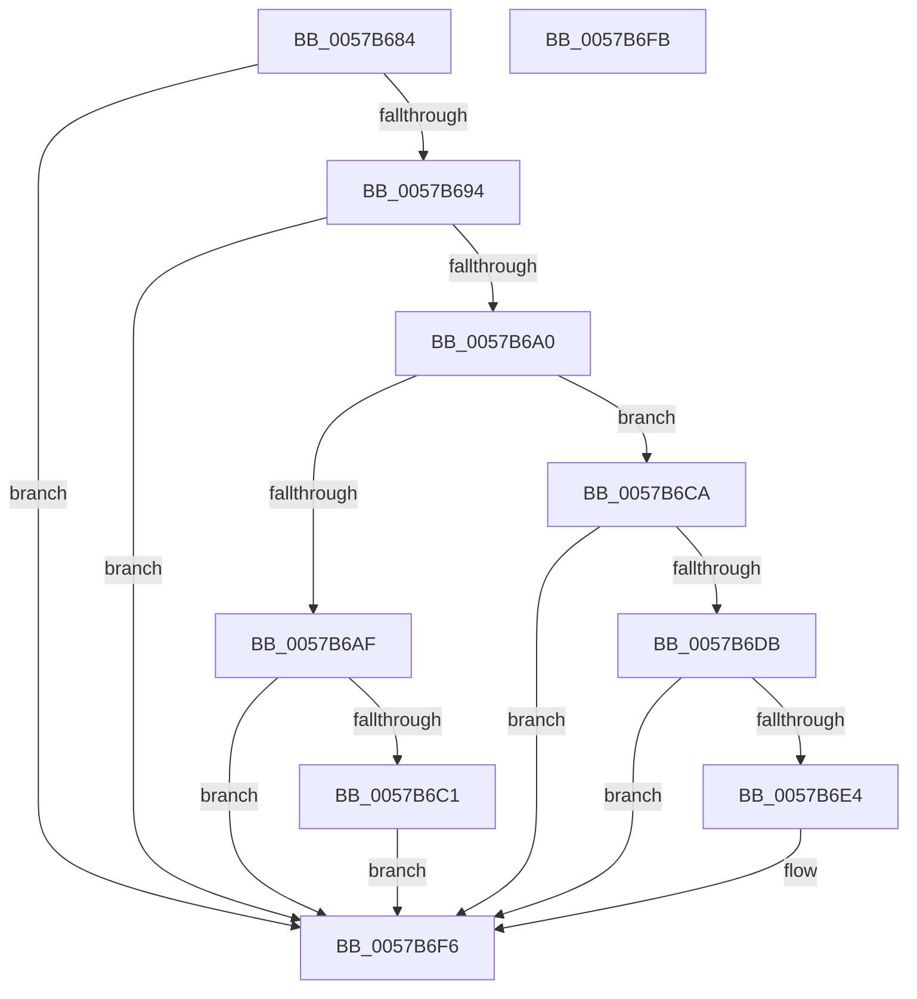

# CcAdjustWriteBehindThreadPool

- RVA: `0x0057B684`–`0x0057B6FC` (길이 `120` bytes)
- VA: `0x000000014057B684`
- 실행 섹션: `.text`
- PDB 이름 있음: `예`; PDB Function 태그: `아니요`
- unwind 정보 RVA: `0x0005C788`
- 디코드: `32`개 명령, `120/120` bytes 표시
- 미해석 바이트: `0` (있으면 어셈블리에 `.byte`로 보존)

> 이 문서는 커널 이미지의 기계어와 PDB 기호를 분석해 생성했습니다. 4번과 5번은 함수 원형과 자료형을 바이너리 사용 방식에서 추정한 C 해석이며 원본 소스 복구 결과는 아닙니다.

## 1. Dependencies

- 직접 호출 지점: **4**; 고유 호출 대상: **3**
- 직접 호출자로 확인된 함수: **1**
- RIP 상대 이미지 참조: **2**

### Outgoing calls
- `0x0057B6A2` → [CcGetCurrentNumaNode](../49/CcGetCurrentNumaNode_function_004967F0.md) (function, `0x004967F0`)
- `0x0057B6B3` → [CcSetMaxNumberOfWriteBehindThreads](CcSetMaxNumberOfWriteBehindThreads_function_0057C380.md) (function, `0x0057C380`)
- `0x0057B6CD` → [CcSetMaxNumberOfWriteBehindThreads](CcSetMaxNumberOfWriteBehindThreads_function_0057C380.md) (function, `0x0057C380`)
- `0x0057B6F1` → [CcReEngageWorkerThreads](CcReEngageWorkerThreads_function_0057BEB0.md) (function, `0x0057BEB0`)

### Direct callers
- [sub_006E4CFE](../6E/Unknown_function_006E4CFE.md) at `0x006E4D39`
- [sub_006E4CFE](../6E/Unknown_function_006E4CFE.md) at `0x006E4D4E`

### Static image references
- `0x0057B688` → RVA `0x00E0A874` (`.data`; read)
- `0x0057B697` → RVA `0x00E65B88` (`.data`; read)

## 2. Other-region calls and transfers

- 다른 실행 섹션으로 향하는 call: **0**
- 별도 외부 분기/꼬리 이동을 확인하지 못했습니다.

## 3. Assembly (complete function range)

```asm
0057B684  48 83 EC 28                     sub rsp, 0x28
0057B688  83 3D E5 F1 88 00 01            cmp dword ptr [rip + 0x88f1e5], 1
0057B68F  44 8A CA                        mov r9b, dl
0057B692  77 62                           ja 0x14057b6f6
0057B694  45 33 DB                        xor r11d, r11d
0057B697  44 38 1D EA A4 8E 00            cmp byte ptr [rip + 0x8ea4ea], r11b
0057B69E  75 56                           jne 0x14057b6f6
0057B6A0  33 D2                           xor edx, edx
0057B6A2  E8 49 B1 F1 FF                  call 0x1404967f0
0057B6A7  4C 8B D0                        mov r10, rax
0057B6AA  45 84 C9                        test r9b, r9b
0057B6AD  74 1B                           je 0x14057b6ca
0057B6AF  41 8D 53 01                     lea edx, [r11 + 1]
0057B6B3  E8 C8 0C 00 00                  call 0x14057c380
0057B6B8  44 38 98 E0 00 00 00            cmp byte ptr [rax + 0xe0], r11b
0057B6BF  74 35                           je 0x14057b6f6
0057B6C1  44 88 98 E0 00 00 00            mov byte ptr [rax + 0xe0], r11b
0057B6C8  EB 2C                           jmp 0x14057b6f6
0057B6CA  83 CA FF                        or edx, 0xffffffff
0057B6CD  E8 AE 0C 00 00                  call 0x14057c380
0057B6D2  48 83 C0 68                     add rax, 0x68
0057B6D6  48 39 00                        cmp qword ptr [rax], rax
0057B6D9  74 1B                           je 0x14057b6f6
0057B6DB  45 38 9A C4 00 00 00            cmp byte ptr [r10 + 0xc4], r11b
0057B6E2  75 12                           jne 0x14057b6f6
0057B6E4  44 8B 81 48 03 00 00            mov r8d, dword ptr [rcx + 0x348]
0057B6EB  45 33 C9                        xor r9d, r9d
0057B6EE  49 8B D2                        mov rdx, r10
0057B6F1  E8 BA 07 00 00                  call 0x14057beb0
0057B6F6  48 83 C4 28                     add rsp, 0x28
0057B6FA  C3                              ret
0057B6FB  CC                              int3
```

## 4. C-style interpretation (structured pseudocode)

```c
__int64 __fastcall CcAdjustWriteBehindThreadPool(__int64 a1, int a2)
{
    __int64 result;
    __int64 v_r11;
    __int64 v_rsp;

    v_rsp = (v_rsp) - (40);
    if ((*(unsigned int *)(v_rip + 8974821)) > 1) goto loc_0057B6F6;
    v_r11 = 0;
    if ((*(unsigned __int8 *)(v_rip + 9348330)) != 0) goto loc_0057B6F6;
    a2 = 0;
    result = CcGetCurrentNumaNode(a1, a2, a3, (unsigned __int8)(a2));
    if ((unsigned __int8)((unsigned __int8)(a2)) == 0) goto loc_0057B6CA;
    result = CcSetMaxNumberOfWriteBehindThreads(a1, v_r11 + 1, a3, (unsigned __int8)(a2));
    if ((*(unsigned __int8 *)(result + 224)) == 0) goto loc_0057B6F6;
    *(unsigned __int8 *)(result + 224) = 0;
    goto loc_0057B6F6;
loc_0057B6CA:
    a2 = (unsigned int)((v_r11 + 1) | (0xFFFFFFFFULL));
    result = CcSetMaxNumberOfWriteBehindThreads(a1, a2, a3, (unsigned __int8)(a2));
    result = (result) + (104);
    if ((*(unsigned __int64 *)(result)) == result) goto loc_0057B6F6;
    if ((*(unsigned __int8 *)(result + 196)) == 0) {
        a3 = *(unsigned int *)(a1 + 840);
        a4 = 0;
        a2 = result;
        result = CcReEngageWorkerThreads(a1, a2, a3, a4);
    }
    v_rsp = (v_rsp) + (40);
    return result;
}
```

## 5. (Beta) C Style

```c
int64_t CcAdjustWriteBehindThreadPool(int64_t Arg1, int32_t Arg2)
{
    int64_t result;
    int64_t local_r11;
    int64_t local_rsp;

    local_rsp = (local_rsp) - (40);
    if ((*(uint32_t *)(v_rip + 0x88F1E5)) > 1) goto loc_0057B6F6;
    local_r11 = 0;
    if ((*(uint8_t *)(v_rip + 0x8EA4EA)) != 0) goto loc_0057B6F6;
    Arg2 = 0;
    result = CcGetCurrentNumaNode(Arg1, Arg2, a3, (uint8_t)(Arg2));
    if ((uint8_t)((uint8_t)(Arg2)) == 0) goto loc_0057B6CA;
    result = CcSetMaxNumberOfWriteBehindThreads(Arg1, local_r11 + 1, a3, (uint8_t)(Arg2));
    if ((*(uint8_t *)(result + 0xE0)) == 0) goto loc_0057B6F6;
    *(uint8_t *)(result + 0xE0) = 0;
    goto loc_0057B6F6;
loc_0057B6CA:
    Arg2 = (uint32_t)((local_r11 + 1) | (0xFFFFFFFFULL));
    result = CcSetMaxNumberOfWriteBehindThreads(Arg1, Arg2, a3, (uint8_t)(Arg2));
    result = (result) + (104);
    if ((*(uint64_t *)(result)) == result) goto loc_0057B6F6;
    if ((*(uint8_t *)(result + 0xC4)) == 0) {
        a3 = *(uint32_t *)(Arg1 + 0x348);
        a4 = 0;
        Arg2 = result;
        result = CcReEngageWorkerThreads(Arg1, Arg2, a3, a4);
    }
    local_rsp = (local_rsp) + (40);
    return result;
}
```

## 6. Execution-region graph

[열기: 2D/3D 그래프와 함수 탐색 컨트롤 패널](../../../control-panel.html?section=text&rva=0x0057B684&view=graph)

- 2D 그래프는 위에서 아래로 흐르고, 3D 그래프는 빈 공간을 드래그해 회전합니다. Shift+드래그는 이동, 휠은 확대·축소, 함수 노드 선택은 대상 보고서 이동입니다.

### Static fallback


