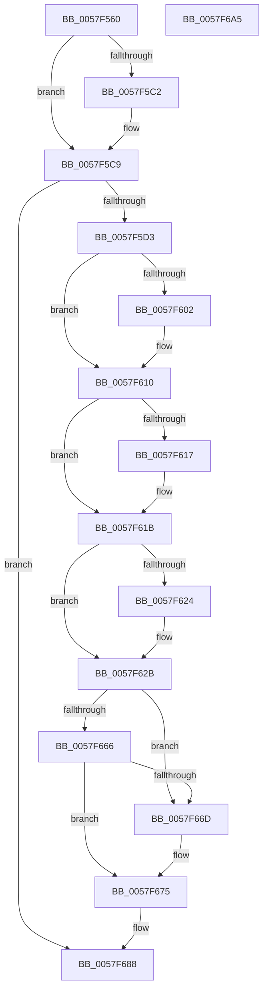

# CcAsyncReadWorkerThread

- RVA: `0x0057F560`–`0x0057F6A6` (길이 `326` bytes)
- VA: `0x000000014057F560`
- 실행 섹션: `.text`
- PDB 이름 있음: `예`; PDB Function 태그: `아니요`
- unwind 정보 RVA: `0x0005D79C`
- 디코드: `89`개 명령, `326/326` bytes 표시
- 미해석 바이트: `0` (있으면 어셈블리에 `.byte`로 보존)

> 이 문서는 커널 이미지의 기계어와 PDB 기호를 분석해 생성했습니다. 4번과 5번은 함수 원형과 자료형을 바이너리 사용 방식에서 추정한 C 해석이며 원본 소스 복구 결과는 아닙니다.

## 1. Dependencies

- 직접 호출 지점: **6**; 고유 호출 대상: **6**
- 직접 호출자로 확인된 함수: **0**
- RIP 상대 이미지 참조: **1**

### Outgoing calls
- `0x0057F5DD` → [CcAsyncReadWorker](../45/CcAsyncReadWorker_function_0045DB10.md) (function, `0x0045DB10`)
- `0x0057F5F2` → [KeAbPreAcquire](../21/KeAbPreAcquire_function_00210230.md) (function, `0x00210230`)
- `0x0057F60B` → [ExfAcquirePushLockExclusiveEx](../20/ExfAcquirePushLockExclusiveEx_function_0020FC90.md) (function, `0x0020FC90`)
- `0x0057F670` → [ExfReleasePushLock](../26/ExfReleasePushLock_function_002638D0.md) (function, `0x002638D0`)
- `0x0057F678` → [KeAbPostRelease](../2E/KeAbPostRelease_function_002E1600.md) (function, `0x002E1600`)
- `0x0057F683` → [CcDereferencePartitionAndPrivateVolumeCacheMap](../38/CcDereferencePartitionAndPrivateVolumeCacheMap_function_0038B94C.md) (function, `0x0038B94C`)

### Direct callers
- 이 함수 시작 RVA로 연결되는 직접 call은 확인되지 않았습니다. 간접 호출은 완전히 역산할 수 없습니다.

### Static image references
- `0x0057F5B5` → RVA `0x00E65B88` (`.data`; read)

## 2. Other-region calls and transfers

- 다른 실행 섹션으로 향하는 call: **0**
- 별도 외부 분기/꼬리 이동을 확인하지 못했습니다.

## 3. Assembly (complete function range)

```asm
0057F560  48 89 5C 24 10                  mov qword ptr [rsp + 0x10], rbx
0057F565  48 89 6C 24 18                  mov qword ptr [rsp + 0x18], rbp
0057F56A  48 89 74 24 20                  mov qword ptr [rsp + 0x20], rsi
0057F56F  57                              push rdi
0057F570  41 54                           push r12
0057F572  41 55                           push r13
0057F574  41 56                           push r14
0057F576  41 57                           push r15
0057F578  48 83 EC 20                     sub rsp, 0x20
0057F57C  48 8B 41 48                     mov rax, qword ptr [rcx + 0x48]
0057F580  48 8B F9                        mov rdi, rcx
0057F583  44 8B 79 24                     mov r15d, dword ptr [rcx + 0x24]
0057F587  4C 8B 61 40                     mov r12, qword ptr [rcx + 0x40]
0057F58B  41 8B F7                        mov esi, r15d
0057F58E  4C 8B 69 38                     mov r13, qword ptr [rcx + 0x38]
0057F592  33 C9                           xor ecx, ecx
0057F594  4D 69 F7 94 01 00 00            imul r14, r15, 0x194
0057F59B  48 C1 E6 04                     shl rsi, 4
0057F59F  49 8D 9C 24 88 04 00 00         lea rbx, [r12 + 0x488]
0057F5A7  4C 03 B0 18 01 00 00            add r14, qword ptr [rax + 0x118]
0057F5AE  48 03 B0 E8 00 00 00            add rsi, qword ptr [rax + 0xe8]
0057F5B5  38 0D CD 65 8E 00               cmp byte ptr [rip + 0x8e65cd], cl
0057F5BB  48 89 44 24 50                  mov qword ptr [rsp + 0x50], rax
0057F5C0  75 07                           jne 0x14057f5c9
0057F5C2  49 8D 9D C8 04 00 00            lea rbx, [r13 + 0x4c8]
0057F5C9  83 7F 20 03                     cmp dword ptr [rdi + 0x20], 3
0057F5CD  0F 85 B5 00 00 00               jne 0x14057f688
0057F5D3  8B 47 28                        mov eax, dword ptr [rdi + 0x28]
0057F5D6  41 89 0C 86                     mov dword ptr [r14 + rax*4], ecx
0057F5DA  48 8B CF                        mov rcx, rdi
0057F5DD  E8 2E E5 ED FF                  call 0x14045db10
0057F5E2  8B 47 28                        mov eax, dword ptr [rdi + 0x28]
0057F5E5  45 33 C0                        xor r8d, r8d
0057F5E8  33 D2                           xor edx, edx
0057F5EA  48 8B CB                        mov rcx, rbx
0057F5ED  41 83 0C 86 FF                  or dword ptr [r14 + rax*4], 0xffffffff
0057F5F2  E8 39 0C C9 FF                  call 0x140210230
0057F5F7  F0 48 0F BA 2B 00               lock bts qword ptr [rbx], 0
0057F5FD  48 8B E8                        mov rbp, rax
0057F600  73 0E                           jae 0x14057f610
0057F602  4C 8B C3                        mov r8, rbx
0057F605  48 8B D0                        mov rdx, rax
0057F608  48 8B CB                        mov rcx, rbx
0057F60B  E8 80 06 C9 FF                  call 0x14020fc90
0057F610  33 D2                           xor edx, edx
0057F612  48 85 ED                        test rbp, rbp
0057F615  74 04                           je 0x14057f61b
0057F617  C6 45 0A 01                     mov byte ptr [rbp + 0xa], 1
0057F61B  48 8B 46 08                     mov rax, qword ptr [rsi + 8]
0057F61F  48 39 30                        cmp qword ptr [rax], rsi
0057F622  74 07                           je 0x14057f62b
0057F624  B9 03 00 00 00                  mov ecx, 3
0057F629  CD 29                           int 0x29
0057F62B  48 89 47 08                     mov qword ptr [rdi + 8], rax
0057F62F  48 89 37                        mov qword ptr [rdi], rsi
0057F632  48 89 38                        mov qword ptr [rax], rdi
0057F635  48 8B 44 24 50                  mov rax, qword ptr [rsp + 0x50]
0057F63A  48 89 7E 08                     mov qword ptr [rsi + 8], rdi
0057F63E  48 8B 80 F0 00 00 00            mov rax, qword ptr [rax + 0xf0]
0057F645  42 FF 0C B8                     dec dword ptr [rax + r15*4]
0057F649  0F 0D 0B                        prefetchw byte ptr [rbx]
0057F64C  48 8B 03                        mov rax, qword ptr [rbx]
0057F64F  48 8B C8                        mov rcx, rax
0057F652  48 83 E1 F0                     and rcx, 0xfffffffffffffff0
0057F656  48 83 F9 10                     cmp rcx, 0x10
0057F65A  4C 8D 40 F0                     lea r8, [rax - 0x10]
0057F65E  4C 0F 46 C2                     cmovbe r8, rdx
0057F662  A8 02                           test al, 2
0057F664  75 07                           jne 0x14057f66d
0057F666  F0 4C 0F B1 03                  lock cmpxchg qword ptr [rbx], r8
0057F66B  74 08                           je 0x14057f675
0057F66D  48 8B CB                        mov rcx, rbx
0057F670  E8 5B 42 CE FF                  call 0x1402638d0
0057F675  48 8B CB                        mov rcx, rbx
0057F678  E8 83 1F D6 FF                  call 0x1402e1600
0057F67D  49 8B D4                        mov rdx, r12
0057F680  49 8B CD                        mov rcx, r13
0057F683  E8 C4 C2 E0 FF                  call 0x14038b94c
0057F688  48 8B 5C 24 58                  mov rbx, qword ptr [rsp + 0x58]
0057F68D  48 8B 6C 24 60                  mov rbp, qword ptr [rsp + 0x60]
0057F692  48 8B 74 24 68                  mov rsi, qword ptr [rsp + 0x68]
0057F697  48 83 C4 20                     add rsp, 0x20
0057F69B  41 5F                           pop r15
0057F69D  41 5E                           pop r14
0057F69F  41 5D                           pop r13
0057F6A1  41 5C                           pop r12
0057F6A3  5F                              pop rdi
0057F6A4  C3                              ret
0057F6A5  CC                              int3
```

## 4. C-style interpretation (structured pseudocode)

```c
__int64 __fastcall CcAsyncReadWorkerThread(__int64 a1, int a2, int a3)
{
    __int64 result;
    __int64 v_r14;
    __int64 v_rbx;
    __int64 v_rsi;
    __int64 v_rsp;
    unsigned __int64 v_stack_p10;
    unsigned __int64 v_stack_p18;
    unsigned __int64 v_stack_p20;
    unsigned __int64 v_stack_p8;

    v_stack_p10 = v_rbx;
    v_stack_p18 = v_rbp;
    v_stack_p20 = v_rsi;
    v_rsp = (v_rsp) - (32);
    a1 = 0;
    v_r14 = (v_r14) * ((unsigned int)(*(unsigned int *)(a1 + 36)));
    v_rsi = ((unsigned int)((unsigned int)((unsigned int)(*(unsigned int *)(a1 + 36))))) << (4);
    v_r14 = (v_r14) + (*(unsigned __int64 *)(*(unsigned __int64 *)(a1 + 72) + 280));
    v_rsi = (v_rsi) + (*(unsigned __int64 *)(*(unsigned __int64 *)(a1 + 72) + 232));
    v_stack_p8 = *(unsigned __int64 *)(a1 + 72);
    v_rbx = *(unsigned __int64 *)(a1 + 64) + 1160;
    if ((*(unsigned __int8 *)(v_rip + 9332173)) == 0) {
        v_rbx = *(unsigned __int64 *)(a1 + 56) + 1224;
    }
    if ((*(unsigned int *)(a1 + 32)) != 3) goto loc_0057F688;
    *(unsigned int *)(v_r14 + (unsigned int)(*(unsigned int *)(a1 + 40)) * 4) = 0;
    result = CcAsyncReadWorker(0, a2, a3, a4);
    a3 = 0;
    a2 = 0;
    result = KeAbPreAcquire(v_rbx, a2, a3, a4);
    if (!(condition_is_above_or_equal)) {
        a3 = v_rbx;
        a2 = result;
        a1 = v_rbx;
        result = ExfAcquirePushLockExclusiveEx(a1, a2, a3, a4);
    }
    a2 = 0;
    if (result != 0) {
        *(unsigned __int8 *)(result + 10) = 1;
    }
    if ((*(unsigned __int64 *)(*(unsigned __int64 *)(v_rsi + 8))) != v_rsi) {
        a1 = 3;
    }
    *(unsigned __int64 *)(a1 + 8) = *(unsigned __int64 *)(v_rsi + 8);
    *(unsigned __int64 *)(a1) = v_rsi;
    *(unsigned __int64 *)(*(unsigned __int64 *)(v_rsi + 8)) = a1;
    *(unsigned __int64 *)(v_rsi + 8) = a1;
    a1 = (*(unsigned __int64 *)(v_rbx)) & (-16);
    a3 = *(unsigned __int64 *)(v_rbx) - 16;
    if (a1 <= 16) { a3 = 0; }
    if ((((unsigned __int8)(*(unsigned __int64 *)(v_rbx))) & (2)) != 0) goto loc_0057F66D;
    result = *(unsigned __int64 *)(v_rbx);
    if ((((unsigned __int8)(*(unsigned __int64 *)(v_rbx))) & (2)) != 0) {
        a1 = v_rbx;
        result = ExfReleasePushLock(a1, a2, a3, a4);
    }
    result = KeAbPostRelease(v_rbx, a2, a3, a4);
    result = CcDereferencePartitionAndPrivateVolumeCacheMap(*(unsigned __int64 *)(a1 + 56), *(unsigned __int64 *)(a1 + 64), a3, a4);
loc_0057F688:
    v_rsp = (v_rsp) + (32);
    return result;
}
```

## 5. (Beta) C Style

```c
int64_t CcAsyncReadWorkerThread(void *Arg1, int32_t Arg2, int32_t Arg3)
{
    uint8_t *arg1 = (uint8_t *)Arg1;

    int64_t result;
    int64_t local_r14;
    int64_t local_rbx;
    int64_t local_rsi;
    int64_t local_rsp;
    uint64_t v_stack_p10;
    uint64_t v_stack_p18;
    uint64_t v_stack_p20;
    uint64_t v_stack_p8;

    v_stack_p10 = local_rbx;
    v_stack_p18 = local_rbp;
    v_stack_p20 = local_rsi;
    local_rsp = (local_rsp) - (32);
    Arg1 = 0;
    local_r14 = (local_r14) * ((uint32_t)(*(uint32_t *)(arg1 + 0x24)));
    local_rsi = ((uint32_t)((uint32_t)((uint32_t)(*(uint32_t *)(arg1 + 0x24))))) << (4);
    local_r14 = (local_r14) + (*(uint64_t *)(*(uint64_t *)(arg1 + 0x48) + 0x118));
    local_rsi = (local_rsi) + (*(uint64_t *)(*(uint64_t *)(arg1 + 0x48) + 0xE8));
    v_stack_p8 = *(uint64_t *)(arg1 + 0x48);
    local_rbx = *(uint64_t *)(arg1 + 0x40) + 1160;
    if ((*(uint8_t *)(v_rip + 0x8E65CD)) == 0) {
        local_rbx = *(uint64_t *)(arg1 + 0x38) + 1224;
    }
    if ((*(uint32_t *)(arg1 + 0x20)) != 3) goto loc_0057F688;
    *(uint32_t *)(local_r14 + (uint32_t)(*(uint32_t *)(arg1 + 0x28)) * 4) = 0;
    result = CcAsyncReadWorker(0, Arg2, Arg3, a4);
    Arg3 = 0;
    Arg2 = 0;
    result = KeAbPreAcquire(local_rbx, Arg2, Arg3, a4);
    if (!(condition_is_above_or_equal)) {
        Arg3 = local_rbx;
        Arg2 = result;
        Arg1 = local_rbx;
        result = ExfAcquirePushLockExclusiveEx(Arg1, Arg2, Arg3, a4);
    }
    Arg2 = 0;
    if (result != 0) {
        *(uint8_t *)(result + 0xA) = 1;
    }
    if ((*(uint64_t *)(*(uint64_t *)(local_rsi + 0x8))) != local_rsi) {
        Arg1 = 3;
    }
    *(uint64_t *)(arg1 + 0x8) = *(uint64_t *)(local_rsi + 0x8);
    *(uint64_t *)(arg1) = local_rsi;
    *(void **)(*(uint64_t *)(local_rsi + 0x8)) = Arg1;
    *(void **)(local_rsi + 0x8) = Arg1;
    Arg1 = (*(uint64_t *)(local_rbx)) & (-16);
    Arg3 = *(uint64_t *)(local_rbx) - 16;
    if (Arg1 <= 16) { Arg3 = 0; }
    if ((((uint8_t)(*(uint64_t *)(local_rbx))) & (2)) != 0) goto loc_0057F66D;
    result = *(uint64_t *)(local_rbx);
    if ((((uint8_t)(*(uint64_t *)(local_rbx))) & (2)) != 0) {
        Arg1 = local_rbx;
        result = ExfReleasePushLock(Arg1, Arg2, Arg3, a4);
    }
    result = KeAbPostRelease(local_rbx, Arg2, Arg3, a4);
    result = CcDereferencePartitionAndPrivateVolumeCacheMap(*(uint64_t *)(arg1 + 0x38), *(uint64_t *)(arg1 + 0x40), Arg3, a4);
loc_0057F688:
    local_rsp = (local_rsp) + (32);
    return result;
}
```

### 관측된 메모리 오프셋

구조체 형식이 확인되지 않은 접근은 인자 기준의 오프셋으로만 기록했습니다.

| 기준 인자 | 오프셋 표현 | 폭 (bit) | 접근 |
|---|---:|---:|---|
| `Arg1` | `+ 0x0` | `64` | `W` |
| `Arg1` | `+ 0x8` | `64` | `W` |
| `Arg1` | `+ 0x20` | `32` | `R` |
| `Arg1` | `+ 0x24` | `32` | `R` |
| `Arg1` | `+ 0x28` | `32` | `R` |
| `Arg1` | `+ 0x38` | `64` | `R` |
| `Arg1` | `+ 0x40` | `64` | `R` |
| `Arg1` | `+ 0x48` | `64` | `R` |

## 6. Execution-region graph

[열기: 2D/3D 그래프와 함수 탐색 컨트롤 패널](../../../control-panel.html?section=text&rva=0x0057F560&view=graph)

- 2D 그래프는 위에서 아래로 흐르고, 3D 그래프는 빈 공간을 드래그해 회전합니다. Shift+드래그는 이동, 휠은 확대·축소, 함수 노드 선택은 대상 보고서 이동입니다.

### Static fallback


