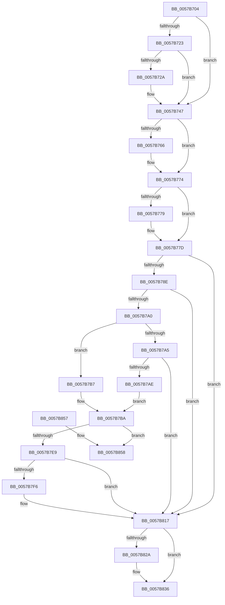

# CcBoostLowPriorityWorkerThread

- RVA: `0x0057B704`–`0x0057B877` (길이 `371` bytes)
- VA: `0x000000014057B704`
- 실행 섹션: `.text`
- PDB 이름 있음: `예`; PDB Function 태그: `아니요`
- unwind 정보 RVA: `0x0005FEC4`
- 디코드: `95`개 명령, `371/371` bytes 표시
- 미해석 바이트: `0` (있으면 어셈블리에 `.byte`로 보존)

> 이 문서는 커널 이미지의 기계어와 PDB 기호를 분석해 생성했습니다. 4번과 5번은 함수 원형과 자료형을 바이너리 사용 방식에서 추정한 C 해석이며 원본 소스 복구 결과는 아닙니다.

## 1. Dependencies

- 직접 호출 지점: **11**; 고유 호출 대상: **10**
- 직접 호출자로 확인된 함수: **2**
- RIP 상대 이미지 참조: **0**

### Outgoing calls
- `0x0057B741` → [KeBugCheckEx](../4F/KeBugCheckEx_function_004FD660.md) (function, `0x004FD660`)
- `0x0057B756` → [KeAbPreAcquire](../21/KeAbPreAcquire_function_00210230.md) (function, `0x00210230`)
- `0x0057B76F` → [ExfAcquirePushLockExclusiveEx](../20/ExfAcquirePushLockExclusiveEx_function_0020FC90.md) (function, `0x0020FC90`)
- `0x0057B797` → [PsGetIoPriorityThread](../34/PsGetIoPriorityThread_function_00343930.md) (function, `0x00343930`)
- `0x0057B7C4` → [IoBoostThreadIoPriority](../21/IoBoostThreadIoPriority_function_00216110.md) (function, `0x00216110`)
- `0x0057B7D1` → [KeSetPriorityThread](../2C/KeSetPriorityThread_function_002C76E0.md) (function, `0x002C76E0`)
- `0x0057B801` → [PsBoostThreadIoEx](../39/PsBoostThreadIoEx_function_00392C00.md) (function, `0x00392C00`)
- `0x0057B812` → [CcUpdateSharedCacheMapFlag](../45/CcUpdateSharedCacheMapFlag_function_0045EC14.md) (function, `0x0045EC14`)
- `0x0057B831` → [ExfTryToWakePushLock](../26/ExfTryToWakePushLock_function_00265DD0.md) (function, `0x00265DD0`)
- `0x0057B83D` → [KeAbPostRelease](../2E/KeAbPostRelease_function_002E1600.md) (function, `0x002E1600`)
- `0x0057B871` → [KeBugCheckEx](../4F/KeBugCheckEx_function_004FD660.md) (function, `0x004FD660`)

### Direct callers
- [CcFlushCachePreProcess](../35/CcFlushCachePreProcess_function_0035A9B0.md) at `0x0035AEDE`
- [sub_006E4CFE](../6E/Unknown_function_006E4CFE.md) at `0x006E4D7A`

### Static image references
- 디코드된 RIP-relative 메모리 참조가 없습니다.

## 2. Other-region calls and transfers

- 다른 실행 섹션으로 향하는 call: **0**
- 별도 외부 분기/꼬리 이동을 확인하지 못했습니다.

## 3. Assembly (complete function range)

```asm
0057B704  4C 8B DC                        mov r11, rsp
0057B707  49 89 5B 08                     mov qword ptr [r11 + 8], rbx
0057B70B  49 89 6B 10                     mov qword ptr [r11 + 0x10], rbp
0057B70F  49 89 73 18                     mov qword ptr [r11 + 0x18], rsi
0057B713  57                              push rdi
0057B714  48 83 EC 30                     sub rsp, 0x30
0057B718  48 8B FA                        mov rdi, rdx
0057B71B  48 8B D9                        mov rbx, rcx
0057B71E  48 85 D2                        test rdx, rdx
0057B721  74 24                           je 0x14057b747
0057B723  8B 42 04                        mov eax, dword ptr [rdx + 4]
0057B726  85 C0                           test eax, eax
0057B728  75 1D                           jne 0x14057b747
0057B72A  49 83 63 E8 00                  and qword ptr [r11 - 0x18], 0
0057B72F  8D 48 34                        lea ecx, [rax + 0x34]
0057B732  45 33 C9                        xor r9d, r9d
0057B735  BA AD 05 00 00                  mov edx, 0x5ad
0057B73A  49 C7 C0 20 04 00 C0            mov r8, 0xffffffffc0000420
0057B741  E8 1A 1F F8 FF                  call 0x1404fd660
0057B746  CC                              int3
0057B747  48 8D B1 00 05 00 00            lea rsi, [rcx + 0x500]
0057B74E  45 33 C0                        xor r8d, r8d
0057B751  48 8B CE                        mov rcx, rsi
0057B754  33 D2                           xor edx, edx
0057B756  E8 D5 4A C9 FF                  call 0x140210230
0057B75B  F0 48 0F BA 2E 00               lock bts qword ptr [rsi], 0
0057B761  48 8B E8                        mov rbp, rax
0057B764  73 0E                           jae 0x14057b774
0057B766  4C 8B C6                        mov r8, rsi
0057B769  48 8B D0                        mov rdx, rax
0057B76C  48 8B CE                        mov rcx, rsi
0057B76F  E8 1C 45 C9 FF                  call 0x14020fc90
0057B774  48 85 ED                        test rbp, rbp
0057B777  74 04                           je 0x14057b77d
0057B779  C6 45 0A 01                     mov byte ptr [rbp + 0xa], 1
0057B77D  48 8D B3 E8 04 00 00            lea rsi, [rbx + 0x4e8]
0057B784  48 83 3E 00                     cmp qword ptr [rsi], 0
0057B788  0F 84 89 00 00 00               je 0x14057b817
0057B78E  65 48 8B 0C 25 88 01 00 00      mov rcx, qword ptr gs:[0x188]
0057B797  E8 94 81 DC FF                  call 0x140343930
0057B79C  85 C0                           test eax, eax
0057B79E  7E 77                           jle 0x14057b817
0057B7A0  48 85 FF                        test rdi, rdi
0057B7A3  74 12                           je 0x14057b7b7
0057B7A5  48 3B BB F0 04 00 00            cmp rdi, qword ptr [rbx + 0x4f0]
0057B7AC  75 69                           jne 0x14057b817
0057B7AE  48 8D BB E8 04 00 00            lea rdi, [rbx + 0x4e8]
0057B7B5  EB 03                           jmp 0x14057b7ba
0057B7B7  48 8B FE                        mov rdi, rsi
0057B7BA  48 8B 0E                        mov rcx, qword ptr [rsi]
0057B7BD  45 33 C0                        xor r8d, r8d
0057B7C0  41 8D 50 02                     lea edx, [r8 + 2]
0057B7C4  E8 47 A9 C9 FF                  call 0x140216110
0057B7C9  48 8B 0E                        mov rcx, qword ptr [rsi]
0057B7CC  BA 0D 00 00 00                  mov edx, 0xd
0057B7D1  E8 0A BF D4 FF                  call 0x1402c76e0
0057B7D6  89 83 F8 04 00 00               mov dword ptr [rbx + 0x4f8], eax
0057B7DC  48 8B 83 F0 04 00 00            mov rax, qword ptr [rbx + 0x4f0]
0057B7E3  83 78 04 00                     cmp dword ptr [rax + 4], 0
0057B7E7  76 6F                           jbe 0x14057b858
0057B7E9  BE 00 00 00 20                  mov esi, 0x20000000
0057B7EE  85 B0 98 00 00 00               test dword ptr [rax + 0x98], esi
0057B7F4  75 21                           jne 0x14057b817
0057B7F6  48 8B 0F                        mov rcx, qword ptr [rdi]
0057B7F9  45 33 C9                        xor r9d, r9d
0057B7FC  45 33 C0                        xor r8d, r8d
0057B7FF  33 D2                           xor edx, edx
0057B801  E8 FA 73 E1 FF                  call 0x140392c00
0057B806  48 8B 8B F0 04 00 00            mov rcx, qword ptr [rbx + 0x4f0]
0057B80D  41 B0 01                        mov r8b, 1
0057B810  8B D6                           mov edx, esi
0057B812  E8 FD 33 EE FF                  call 0x14045ec14
0057B817  48 83 C8 FF                     or rax, 0xffffffffffffffff
0057B81B  F0 48 0F C1 83 00 05 00 00      lock xadd qword ptr [rbx + 0x500], rax
0057B824  24 06                           and al, 6
0057B826  3C 02                           cmp al, 2
0057B828  75 0C                           jne 0x14057b836
0057B82A  48 8D 8B 00 05 00 00            lea rcx, [rbx + 0x500]
0057B831  E8 9A A5 CE FF                  call 0x140265dd0
0057B836  48 8D 8B 00 05 00 00            lea rcx, [rbx + 0x500]
0057B83D  E8 BE 5D D6 FF                  call 0x1402e1600
0057B842  48 8B 5C 24 40                  mov rbx, qword ptr [rsp + 0x40]
0057B847  48 8B 6C 24 48                  mov rbp, qword ptr [rsp + 0x48]
0057B84C  48 8B 74 24 50                  mov rsi, qword ptr [rsp + 0x50]
0057B851  48 83 C4 30                     add rsp, 0x30
0057B855  5F                              pop rdi
0057B856  C3                              ret
0057B857  CC                              int3
0057B858  48 83 64 24 20 00               and qword ptr [rsp + 0x20], 0
0057B85E  45 33 C9                        xor r9d, r9d
0057B861  BA DA 05 00 00                  mov edx, 0x5da
0057B866  49 C7 C0 20 04 00 C0            mov r8, 0xffffffffc0000420
0057B86D  41 8D 49 34                     lea ecx, [r9 + 0x34]
0057B871  E8 EA 1D F8 FF                  call 0x1404fd660
0057B876  CC                              int3
```

## 4. C-style interpretation (structured pseudocode)

```c
__int64 __fastcall CcBoostLowPriorityWorkerThread(__int64 a1, __int64 a2, __int64 a3, int a4)
{
    __int64 result;
    __int64 v_rsp;
    unsigned __int64 v_stack_p10;
    unsigned __int64 v_stack_p18;
    unsigned __int64 v_stack_p20;
    unsigned __int64 v_stack_p8;

    *(unsigned __int64 *)(v_rsp + 8) = v_rbx;
    *(unsigned __int64 *)(v_rsp + 16) = v_rbp;
    *(unsigned __int64 *)(v_rsp + 24) = v_rsi;
    v_rsp = (v_rsp) - (48);
    if (a2 == 0) goto loc_0057B747;
    result = (unsigned int)(*(unsigned int *)(a2 + 4));
    if ((unsigned int)((unsigned int)(*(unsigned int *)(a2 + 4))) == 0) {
        a1 = (unsigned int)(*(unsigned int *)(a2 + 4)) + 52;
        a4 = 0;
        a2 = 0x5ADULL;
        a3 = 0xFFFFFFFFC0000420ULL;
        result = KeBugCheckEx(a1, a2, a3, a4);
    }
    a3 = 0;
    a2 = 0;
    result = KeAbPreAcquire(a1 + 1280, a2, a3, a4);
    if (!(condition_is_above_or_equal)) {
        a3 = a1 + 1280;
        a2 = result;
        a1 = a1 + 1280;
        result = ExfAcquirePushLockExclusiveEx(a1, a2, a3, a4);
    }
    if (result != 0) {
        *(unsigned __int8 *)(result + 10) = 1;
    }
    if ((*(unsigned __int64 *)(a1 + 1256)) == 0) goto loc_0057B817;
    result = PsGetIoPriorityThread(*(unsigned __int64 *)(gs_base + (0 + 392)), a2, a3, a4);
    if (condition_is_less_or_equal) goto loc_0057B817;
    if (a2 == 0) goto loc_0057B7B7;
    if (a2 != (*(unsigned __int64 *)(a1 + 1264))) goto loc_0057B817;
    goto loc_0057B7BA;
loc_0057B7B7:
loc_0057B7BA:
    a3 = 0;
    result = IoBoostThreadIoPriority(*(unsigned __int64 *)(a1 + 1256), a3 + 2, a3, a4);
    result = KeSetPriorityThread(*(unsigned __int64 *)(a1 + 1256), 13, a3, a4);
    *(unsigned int *)(a1 + 1272) = (unsigned int)(result);
    if ((*(unsigned int *)(*(unsigned __int64 *)(a1 + 1264) + 4)) <= 0) goto loc_0057B858;
    result = *(unsigned __int64 *)(a1 + 1264);
    if (((*(unsigned int *)(*(unsigned __int64 *)(a1 + 1264) + 152)) & ((unsigned int)((unsigned int)(0x20000000ULL)))) == 0) {
        a1 = *(unsigned __int64 *)(a1 + 1256);
        a4 = 0;
        a3 = 0;
        a2 = 0;
        result = PsBoostThreadIoEx(a1, a2, a3, a4);
        a1 = *(unsigned __int64 *)(a1 + 1264);
        a3 = 1;
        a2 = (unsigned int)((unsigned int)(0x20000000ULL));
        result = CcUpdateSharedCacheMapFlag(a1, a2, a3, a4);
    }
    result = (result) | (-1);
    result = (unsigned __int8)((result) & (6));
    if (((unsigned __int8)(result)) == 2) {
        a1 = a1 + 1280;
        result = ExfTryToWakePushLock(a1, a2, a3, a4);
    }
    result = KeAbPostRelease(a1 + 1280, a2, a3, a4);
    v_rsp = (v_rsp) + (48);
    return result;
loc_0057B858:
    a4 = 0;
    result = KeBugCheckEx(a4 + 52, (unsigned int)(0x5DAULL), 0xFFFFFFFFC0000420ULL, a4);
    return result;
}
```

## 5. (Beta) C Style

```c
int64_t CcBoostLowPriorityWorkerThread(void *Arg1, int64_t Arg2, int64_t Arg3, int32_t Arg4)
{
    uint8_t *arg1 = (uint8_t *)Arg1;

    int64_t result;
    int64_t local_rsp;
    uint64_t v_stack_p10;
    uint64_t v_stack_p18;
    uint64_t v_stack_p20;
    uint64_t v_stack_p8;

    *(uint64_t *)(local_rsp + 0x8) = local_rbx;
    *(uint64_t *)(local_rsp + 0x10) = local_rbp;
    *(uint64_t *)(local_rsp + 0x18) = local_rsi;
    local_rsp = (local_rsp) - (48);
    if (Arg2 == 0) goto loc_0057B747;
    result = (uint32_t)(*(uint32_t *)(Arg2 + 0x4));
    if ((uint32_t)((uint32_t)(*(uint32_t *)(Arg2 + 0x4))) == 0) {
        Arg1 = (uint32_t)(*(uint32_t *)(Arg2 + 0x4)) + 52;
        Arg4 = 0;
        Arg2 = 0x5ADULL;
        Arg3 = 0xFFFFFFFFC0000420ULL;
        result = KeBugCheckEx(Arg1, Arg2, Arg3, Arg4);
    }
    Arg3 = 0;
    Arg2 = 0;
    result = KeAbPreAcquire(Arg1 + 1280, Arg2, Arg3, Arg4);
    if (!(condition_is_above_or_equal)) {
        Arg3 = Arg1 + 1280;
        Arg2 = result;
        Arg1 = Arg1 + 1280;
        result = ExfAcquirePushLockExclusiveEx(Arg1, Arg2, Arg3, Arg4);
    }
    if (result != 0) {
        *(uint8_t *)(result + 0xA) = 1;
    }
    if ((*(uint64_t *)(arg1 + 0x4E8)) == 0) goto loc_0057B817;
    result = PsGetIoPriorityThread(*(uint64_t *)(gs_base + (0 + 0x188)), Arg2, Arg3, Arg4);
    if (condition_is_less_or_equal) goto loc_0057B817;
    if (Arg2 == 0) goto loc_0057B7B7;
    if (Arg2 != (*(uint64_t *)(arg1 + 0x4F0))) goto loc_0057B817;
    goto loc_0057B7BA;
loc_0057B7B7:
loc_0057B7BA:
    Arg3 = 0;
    result = IoBoostThreadIoPriority(*(uint64_t *)(arg1 + 0x4E8), Arg3 + 2, Arg3, Arg4);
    result = KeSetPriorityThread(*(uint64_t *)(arg1 + 0x4E8), 13, Arg3, Arg4);
    *(uint32_t *)(arg1 + 0x4F8) = (uint32_t)(result);
    if ((*(uint32_t *)(*(uint64_t *)(arg1 + 0x4F0) + 0x4)) <= 0) goto loc_0057B858;
    result = *(uint64_t *)(arg1 + 0x4F0);
    if (((*(uint32_t *)(*(uint64_t *)(arg1 + 0x4F0) + 0x98)) & ((uint32_t)((uint32_t)(0x20000000ULL)))) == 0) {
        Arg1 = *(uint64_t *)(arg1 + 0x4E8);
        Arg4 = 0;
        Arg3 = 0;
        Arg2 = 0;
        result = PsBoostThreadIoEx(Arg1, Arg2, Arg3, Arg4);
        Arg1 = *(uint64_t *)(arg1 + 0x4F0);
        Arg3 = 1;
        Arg2 = (uint32_t)((uint32_t)(0x20000000ULL));
        result = CcUpdateSharedCacheMapFlag(Arg1, Arg2, Arg3, Arg4);
    }
    result = (result) | (-1);
    result = (uint8_t)((result) & (6));
    if (((uint8_t)(result)) == 2) {
        Arg1 = Arg1 + 1280;
        result = ExfTryToWakePushLock(Arg1, Arg2, Arg3, Arg4);
    }
    result = KeAbPostRelease(Arg1 + 1280, Arg2, Arg3, Arg4);
    local_rsp = (local_rsp) + (48);
    return result;
loc_0057B858:
    Arg4 = 0;
    result = KeBugCheckEx(Arg4 + 52, (uint32_t)(0x5DAULL), 0xFFFFFFFFC0000420ULL, Arg4);
    return result;
}
```

### 관측된 메모리 오프셋

구조체 형식이 확인되지 않은 접근은 인자 기준의 오프셋으로만 기록했습니다.

| 기준 인자 | 오프셋 표현 | 폭 (bit) | 접근 |
|---|---:|---:|---|
| `Arg1` | `+ 0x0` | `64` | `R` |
| `Arg1` | `+ 0x4E8` | `64` | `R` |
| `Arg1` | `+ 0x4F0` | `64` | `R` |
| `Arg1` | `+ 0x4F8` | `32` | `W` |
| `Arg1` | `+ 0x500` | `64` | `R` |
| `Arg1` | `+ 0x500` | `64` | `R/W` |

## 6. Execution-region graph

[열기: 2D/3D 그래프와 함수 탐색 컨트롤 패널](../../../control-panel.html?section=text&rva=0x0057B704&view=graph)

- 2D 그래프는 위에서 아래로 흐르고, 3D 그래프는 빈 공간을 드래그해 회전합니다. Shift+드래그는 이동, 휠은 확대·축소, 함수 노드 선택은 대상 보고서 이동입니다.

### Static fallback


