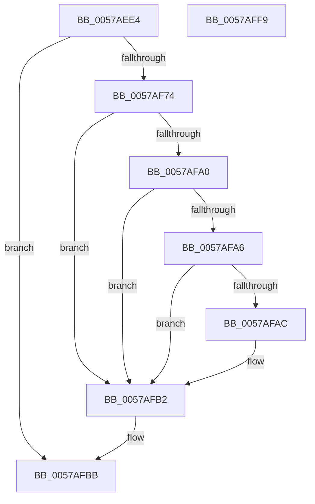

# CcCheckContainerWaitForRestore

- RVA: `0x0057AEE4`–`0x0057AFFA` (길이 `278` bytes)
- VA: `0x000000014057AEE4`
- 실행 섹션: `.text`
- PDB 이름 있음: `예`; PDB Function 태그: `아니요`
- unwind 정보 RVA: `0x000BE908`
- 디코드: `67`개 명령, `278/278` bytes 표시
- 미해석 바이트: `0` (있으면 어셈블리에 `.byte`로 보존)

> 이 문서는 커널 이미지의 기계어와 PDB 기호를 분석해 생성했습니다. 4번과 5번은 함수 원형과 자료형을 바이너리 사용 방식에서 추정한 C 해석이며 원본 소스 복구 결과는 아닙니다.

## 1. Dependencies

- 직접 호출 지점: **5**; 고유 호출 대상: **5**
- 직접 호출자로 확인된 함수: **1**
- RIP 상대 이미지 참조: **4**

### Outgoing calls
- `0x0057AF69` → [ZwOpenKey](../6A/ZwOpenKey_function_006AD310.md) (function, `0x006AD310`)
- `0x0057AF95` → [ZwQueryValueKey](../6A/ZwQueryValueKey_function_006AD3B0.md) (function, `0x006AD3B0`)
- `0x0057AFB6` → [ZwClose](../6A/ZwClose_function_006AD2B0.md) (function, `0x006AD2B0`)
- `0x0057AFD1` → [DbgPrintEx](../35/DbgPrintEx_function_00359290.md) (function, `0x00359290`)
- `0x0057AFDF` → [_security_check_cookie](../6A/_security_check_cookie_function_006AC640.md) (function, `0x006AC640`)

### Direct callers
- [CcRegisterForContainerRestore](CcRegisterForContainerRestore_function_0057B220.md) at `0x0057B224`

### Static image references
- `0x0057AEFB` → RVA `0x00E0A740` (`.data`; read)
- `0x0057AF13` → RVA `0x006C7850` (` ?? ::FNODOBFM::`string'`; read)
- `0x0057AF2A` → RVA `0x006C7B10` (` ?? ::FNODOBFM::`string'`; read)
- `0x0057AFC7` → RVA `0x006C7B30` (` ?? ::FNODOBFM::`string'`; read)

## 2. Other-region calls and transfers

- 다른 실행 섹션으로 향하는 call: **0**
- 별도 외부 분기/꼬리 이동을 확인하지 못했습니다.

## 3. Assembly (complete function range)

```asm
0057AEE4  48 89 5C 24 08                  mov qword ptr [rsp + 8], rbx
0057AEE9  48 89 7C 24 10                  mov qword ptr [rsp + 0x10], rdi
0057AEEE  55                              push rbp
0057AEEF  48 8D 6C 24 A9                  lea rbp, [rsp - 0x57]
0057AEF4  48 81 EC B0 00 00 00            sub rsp, 0xb0
0057AEFB  48 8B 05 3E F8 88 00            mov rax, qword ptr [rip + 0x88f83e]
0057AF02  48 33 C4                        xor rax, rsp
0057AF05  48 89 45 4F                     mov qword ptr [rbp + 0x4f], rax
0057AF09  33 DB                           xor ebx, ebx
0057AF0B  48 C7 45 E7 92 00 94 00         mov qword ptr [rbp - 0x19], 0x940092
0057AF13  48 8D 05 36 C9 14 00            lea rax, [rip + 0x14c936]
0057AF1A  48 C7 45 F7 1C 00 1E 00         mov qword ptr [rbp - 9], 0x1e001c
0057AF22  48 89 45 EF                     mov qword ptr [rbp - 0x11], rax
0057AF26  4C 8D 45 07                     lea r8, [rbp + 7]
0057AF2A  48 8D 05 DF CB 14 00            lea rax, [rip + 0x14cbdf]
0057AF31  48 C7 45 07 30 00 00 00         mov qword ptr [rbp + 7], 0x30
0057AF39  48 89 45 FF                     mov qword ptr [rbp - 1], rax
0057AF3D  48 8D 4D DF                     lea rcx, [rbp - 0x21]
0057AF41  48 8D 45 E7                     lea rax, [rbp - 0x19]
0057AF45  48 C7 45 1F 40 02 00 00         mov qword ptr [rbp + 0x1f], 0x240
0057AF4D  0F 57 C0                        xorps xmm0, xmm0
0057AF50  48 89 45 17                     mov qword ptr [rbp + 0x17], rax
0057AF54  BA 19 00 02 00                  mov edx, 0x20019
0057AF59  48 89 5D DF                     mov qword ptr [rbp - 0x21], rbx
0057AF5D  89 5D D7                        mov dword ptr [rbp - 0x29], ebx
0057AF60  48 89 5D 0F                     mov qword ptr [rbp + 0xf], rbx
0057AF64  F3 0F 7F 45 27                  movdqu xmmword ptr [rbp + 0x27], xmm0
0057AF69  E8 A2 23 13 00                  call 0x1406ad310
0057AF6E  8B F8                           mov edi, eax
0057AF70  85 C0                           test eax, eax
0057AF72  78 47                           js 0x14057afbb
0057AF74  48 8B 4D DF                     mov rcx, qword ptr [rbp - 0x21]
0057AF78  48 8D 45 D7                     lea rax, [rbp - 0x29]
0057AF7C  48 89 44 24 28                  mov qword ptr [rsp + 0x28], rax
0057AF81  4C 8D 4D 37                     lea r9, [rbp + 0x37]
0057AF85  44 8D 43 02                     lea r8d, [rbx + 2]
0057AF89  C7 44 24 20 14 00 00 00         mov dword ptr [rsp + 0x20], 0x14
0057AF91  48 8D 55 F7                     lea rdx, [rbp - 9]
0057AF95  E8 16 24 13 00                  call 0x1406ad3b0
0057AF9A  8B F8                           mov edi, eax
0057AF9C  85 C0                           test eax, eax
0057AF9E  78 12                           js 0x14057afb2
0057AFA0  83 7D 3B 04                     cmp dword ptr [rbp + 0x3b], 4
0057AFA4  75 0C                           jne 0x14057afb2
0057AFA6  83 7D 3F 04                     cmp dword ptr [rbp + 0x3f], 4
0057AFAA  75 06                           jne 0x14057afb2
0057AFAC  38 5D 43                        cmp byte ptr [rbp + 0x43], bl
0057AFAF  0F 95 C3                        setne bl
0057AFB2  48 8B 4D DF                     mov rcx, qword ptr [rbp - 0x21]
0057AFB6  E8 F5 22 13 00                  call 0x1406ad2b0
0057AFBB  BA 03 00 00 00                  mov edx, 3
0057AFC0  89 5C 24 20                     mov dword ptr [rsp + 0x20], ebx
0057AFC4  44 8B CF                        mov r9d, edi
0057AFC7  4C 8D 05 62 CB 14 00            lea r8, [rip + 0x14cb62]
0057AFCE  8D 4A 7C                        lea ecx, [rdx + 0x7c]
0057AFD1  E8 BA E2 DD FF                  call 0x140359290
0057AFD6  8B C3                           mov eax, ebx
0057AFD8  48 8B 4D 4F                     mov rcx, qword ptr [rbp + 0x4f]
0057AFDC  48 33 CC                        xor rcx, rsp
0057AFDF  E8 5C 16 13 00                  call 0x1406ac640
0057AFE4  4C 8D 9C 24 B0 00 00 00         lea r11, [rsp + 0xb0]
0057AFEC  49 8B 5B 10                     mov rbx, qword ptr [r11 + 0x10]
0057AFF0  49 8B 7B 18                     mov rdi, qword ptr [r11 + 0x18]
0057AFF4  49 8B E3                        mov rsp, r11
0057AFF7  5D                              pop rbp
0057AFF8  C3                              ret
0057AFF9  CC                              int3
```

## 4. C-style interpretation (structured pseudocode)

```c
__int64 __fastcall CcCheckContainerWaitForRestore(void)
{
    __int64 result;
    __int64 v_rbx;
    __int64 v_rsp;
    unsigned __int64 v_stack_m10;
    unsigned __int8 v_stack_m1C;
    unsigned int v_stack_m20;
    unsigned int v_stack_m24;
    unsigned __int64 v_stack_m28;
    unsigned __int64 v_stack_m38;
    unsigned __int64 v_stack_m40;
    unsigned __int64 v_stack_m48;
    unsigned __int64 v_stack_m50;
    unsigned __int64 v_stack_m58;
    unsigned __int64 v_stack_m5F;
    unsigned __int64 v_stack_m60;
    unsigned __int64 v_stack_m68;
    unsigned __int64 v_stack_m70;
    unsigned __int64 v_stack_m78;
    unsigned __int64 v_stack_m8;
    unsigned __int64 v_stack_m80;
    unsigned int v_stack_m88;
    unsigned __int64 v_stack_m90;
    unsigned int v_stack_m98;
    unsigned __int64 v_stack_p10;
    unsigned __int64 v_stack_p8;

    v_stack_p8 = v_rbx;
    v_stack_p10 = v_rdi;
    v_rsp = (v_rsp) - (176);
    result = (*(unsigned __int64 *)(v_rip + 8976446)) ^ (v_rsp);
    v_stack_m10 = result;
    v_rbx = 0;
    v_stack_m78 = 0x940092ULL;
    v_stack_m68 = 0x1E001CULL;
    v_stack_m70 = v_rip + 1362230;
    v_stack_m58 = 48;
    v_stack_m60 = v_rip + 1362911;
    v_stack_m40 = 576;
    v_stack_m48 = v_stack_m78;
    v_stack_m80 = 0;
    v_stack_m88 = 0;
    v_stack_m50 = 0;
    v_stack_m38 = v_xmm0;
    result = ZwOpenKey(v_stack_m80, (unsigned int)(0x20019ULL), v_stack_m58, a4);
    if (sign_flag) goto loc_0057AFBB;
    v_stack_m90 = v_stack_m88;
    v_stack_m98 = 20;
    result = ZwQueryValueKey(v_stack_m80, v_stack_m68, v_rbx + 2, v_stack_m28);
    if (sign_flag) goto loc_0057AFB2;
    if (v_stack_m24 != 4) goto loc_0057AFB2;
    if (v_stack_m20 == 4) {
        v_rbx = (v_stack_m1C != 0) ? 1 : 0;
    }
    result = ZwClose(v_stack_m80, v_stack_m68, v_rbx + 2, v_stack_m28);
loc_0057AFBB:
    v_stack_m98 = (unsigned int)(v_rbx);
    result = DbgPrintEx(3 + 124, 3, v_rip + 1362786, (unsigned int)((unsigned int)((unsigned int)((unsigned int)(result)))));
    a1 = (v_stack_m10) ^ (v_rsp);
    result = _security_check_cookie(a1, 3, v_rip + 1362786, (unsigned int)((unsigned int)((unsigned int)((unsigned int)(result)))));
    return result;
}
```

## 5. (Beta) C Style

```c
void CcCheckContainerWaitForRestore(void)
{
    int64_t result;
    int64_t local_rbx;
    int64_t local_rsp;
    uint64_t v_stack_m10;
    uint8_t v_stack_m1C;
    uint32_t v_stack_m20;
    uint32_t v_stack_m24;
    uint64_t v_stack_m28;
    uint64_t v_stack_m38;
    uint64_t v_stack_m40;
    uint64_t v_stack_m48;
    uint64_t v_stack_m50;
    uint64_t v_stack_m58;
    uint64_t v_stack_m5F;
    uint64_t v_stack_m60;
    uint64_t v_stack_m68;
    uint64_t v_stack_m70;
    uint64_t v_stack_m78;
    uint64_t v_stack_m8;
    uint64_t v_stack_m80;
    uint32_t v_stack_m88;
    uint64_t v_stack_m90;
    uint32_t v_stack_m98;
    uint64_t v_stack_p10;
    uint64_t v_stack_p8;

    v_stack_p8 = local_rbx;
    v_stack_p10 = local_rdi;
    local_rsp = (local_rsp) - (176);
    result = (*(uint64_t *)(v_rip + 0x88F83E)) ^ (local_rsp);
    v_stack_m10 = result;
    local_rbx = 0;
    v_stack_m78 = 0x940092ULL;
    v_stack_m68 = 0x1E001CULL;
    v_stack_m70 = v_rip + 1362230;
    v_stack_m58 = 48;
    v_stack_m60 = v_rip + 1362911;
    v_stack_m40 = 576;
    v_stack_m48 = v_stack_m78;
    v_stack_m80 = 0;
    v_stack_m88 = 0;
    v_stack_m50 = 0;
    v_stack_m38 = v_xmm0;
    result = ZwOpenKey(v_stack_m80, (uint32_t)(0x20019ULL), v_stack_m58, a4);
    if (sign_flag) goto loc_0057AFBB;
    v_stack_m90 = v_stack_m88;
    v_stack_m98 = 20;
    result = ZwQueryValueKey(v_stack_m80, v_stack_m68, local_rbx + 2, v_stack_m28);
    if (sign_flag) goto loc_0057AFB2;
    if (v_stack_m24 != 4) goto loc_0057AFB2;
    if (v_stack_m20 == 4) {
        local_rbx = (v_stack_m1C != 0) ? 1 : 0;
    }
    result = ZwClose(v_stack_m80, v_stack_m68, local_rbx + 2, v_stack_m28);
loc_0057AFBB:
    v_stack_m98 = (uint32_t)(local_rbx);
    result = DbgPrintEx(3 + 124, 3, v_rip + 1362786, (uint32_t)((uint32_t)((uint32_t)((uint32_t)(result)))));
    a1 = (v_stack_m10) ^ (local_rsp);
    result = _security_check_cookie(a1, 3, v_rip + 1362786, (uint32_t)((uint32_t)((uint32_t)((uint32_t)(result)))));
    return result;
}
```

## 6. Execution-region graph

[열기: 2D/3D 그래프와 함수 탐색 컨트롤 패널](../../../control-panel.html?section=text&rva=0x0057AEE4&view=graph)

- 2D 그래프는 위에서 아래로 흐르고, 3D 그래프는 빈 공간을 드래그해 회전합니다. Shift+드래그는 이동, 휠은 확대·축소, 함수 노드 선택은 대상 보고서 이동입니다.

### Static fallback


