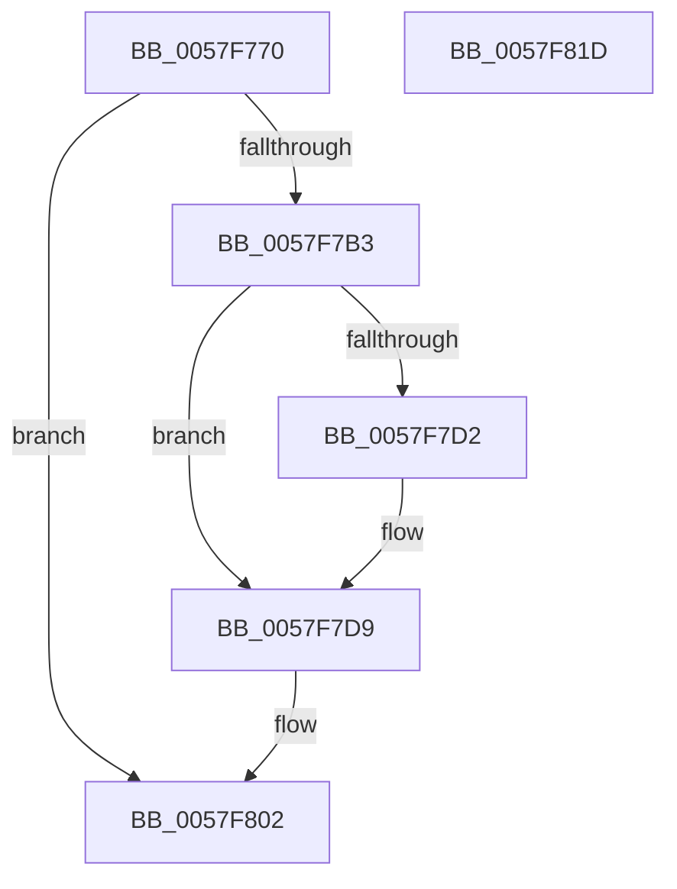

# CcCompleteAsyncLazywriteWorkerThread

- RVA: `0x0057F770`–`0x0057F81E` (길이 `174` bytes)
- VA: `0x000000014057F770`
- 실행 섹션: `.text`
- PDB 이름 있음: `예`; PDB Function 태그: `아니요`
- unwind 정보 RVA: `0x00060130`
- 디코드: `45`개 명령, `174/174` bytes 표시
- 미해석 바이트: `0` (있으면 어셈블리에 `.byte`로 보존)

> 이 문서는 커널 이미지의 기계어와 PDB 기호를 분석해 생성했습니다. 4번과 5번은 함수 원형과 자료형을 바이너리 사용 방식에서 추정한 C 해석이며 원본 소스 복구 결과는 아닙니다.

## 1. Dependencies

- 직접 호출 지점: **4**; 고유 호출 대상: **4**
- 직접 호출자로 확인된 함수: **0**
- RIP 상대 이미지 참조: **0**

### Outgoing calls
- `0x0057F7B3` → [CcCompleteAsyncLazywriteWorker](CcCompleteAsyncLazywriteWorker_function_0057F6AC.md) (function, `0x0057F6AC`)
- `0x0057F7C4` → [KeAcquireInStackQueuedSpinLock](../27/KeAcquireInStackQueuedSpinLock_function_002757A0.md) (function, `0x002757A0`)
- `0x0057F7F2` → [KeReleaseInStackQueuedSpinLock](../34/KeReleaseInStackQueuedSpinLock_function_00342CE0.md) (function, `0x00342CE0`)
- `0x0057F7FD` → [CcDereferencePartitionAndPrivateVolumeCacheMap](../38/CcDereferencePartitionAndPrivateVolumeCacheMap_function_0038B94C.md) (function, `0x0038B94C`)

### Direct callers
- 이 함수 시작 RVA로 연결되는 직접 call은 확인되지 않았습니다. 간접 호출은 완전히 역산할 수 없습니다.

### Static image references
- 디코드된 RIP-relative 메모리 참조가 없습니다.

## 2. Other-region calls and transfers

- 다른 실행 섹션으로 향하는 call: **0**
- 별도 외부 분기/꼬리 이동을 확인하지 못했습니다.

## 3. Assembly (complete function range)

```asm
0057F770  4C 8B DC                        mov r11, rsp
0057F773  49 89 5B 08                     mov qword ptr [r11 + 8], rbx
0057F777  49 89 6B 10                     mov qword ptr [r11 + 0x10], rbp
0057F77B  49 89 73 18                     mov qword ptr [r11 + 0x18], rsi
0057F77F  49 89 7B 20                     mov qword ptr [r11 + 0x20], rdi
0057F783  41 56                           push r14
0057F785  48 83 EC 40                     sub rsp, 0x40
0057F789  48 8B 71 48                     mov rsi, qword ptr [rcx + 0x48]
0057F78D  33 C0                           xor eax, eax
0057F78F  83 79 20 08                     cmp dword ptr [rcx + 0x20], 8
0057F793  0F 57 C0                        xorps xmm0, xmm0
0057F796  48 8B 69 38                     mov rbp, qword ptr [rcx + 0x38]
0057F79A  48 8B D9                        mov rbx, rcx
0057F79D  4C 8B 71 40                     mov r14, qword ptr [rcx + 0x40]
0057F7A1  0F 11 44 24 20                  movups xmmword ptr [rsp + 0x20], xmm0
0057F7A6  48 8D BE 68 01 00 00            lea rdi, [rsi + 0x168]
0057F7AD  49 89 43 E8                     mov qword ptr [r11 - 0x18], rax
0057F7B1  75 4F                           jne 0x14057f802
0057F7B3  E8 F4 FE FF FF                  call 0x14057f6ac
0057F7B8  48 8D 8D 40 03 00 00            lea rcx, [rbp + 0x340]
0057F7BF  48 8D 54 24 20                  lea rdx, [rsp + 0x20]
0057F7C4  E8 D7 5F CF FF                  call 0x1402757a0
0057F7C9  48 8B 47 08                     mov rax, qword ptr [rdi + 8]
0057F7CD  48 39 38                        cmp qword ptr [rax], rdi
0057F7D0  74 07                           je 0x14057f7d9
0057F7D2  B9 03 00 00 00                  mov ecx, 3
0057F7D7  CD 29                           int 0x29
0057F7D9  48 89 3B                        mov qword ptr [rbx], rdi
0057F7DC  48 8D 4C 24 20                  lea rcx, [rsp + 0x20]
0057F7E1  48 89 43 08                     mov qword ptr [rbx + 8], rax
0057F7E5  48 89 18                        mov qword ptr [rax], rbx
0057F7E8  48 89 5F 08                     mov qword ptr [rdi + 8], rbx
0057F7EC  FF 8E 78 01 00 00               dec dword ptr [rsi + 0x178]
0057F7F2  E8 E9 34 DC FF                  call 0x140342ce0
0057F7F7  49 8B D6                        mov rdx, r14
0057F7FA  48 8B CD                        mov rcx, rbp
0057F7FD  E8 4A C1 E0 FF                  call 0x14038b94c
0057F802  48 8B 5C 24 50                  mov rbx, qword ptr [rsp + 0x50]
0057F807  48 8B 6C 24 58                  mov rbp, qword ptr [rsp + 0x58]
0057F80C  48 8B 74 24 60                  mov rsi, qword ptr [rsp + 0x60]
0057F811  48 8B 7C 24 68                  mov rdi, qword ptr [rsp + 0x68]
0057F816  48 83 C4 40                     add rsp, 0x40
0057F81A  41 5E                           pop r14
0057F81C  C3                              ret
0057F81D  CC                              int3
```

## 4. C-style interpretation (structured pseudocode)

```c
__int64 __fastcall CcCompleteAsyncLazywriteWorkerThread(__int64 a1)
{
    __int64 result;
    __int64 v_rsp;
    unsigned __int64 v_stack_m28;
    unsigned __int64 v_stack_p10;
    unsigned __int64 v_stack_p18;
    unsigned __int64 v_stack_p20;
    unsigned __int64 v_stack_p8;

    *(unsigned __int64 *)(v_rsp + 8) = v_rbx;
    *(unsigned __int64 *)(v_rsp + 16) = v_rbp;
    *(unsigned __int64 *)(v_rsp + 24) = v_rsi;
    *(unsigned __int64 *)(v_rsp + 32) = v_rdi;
    v_rsp = (v_rsp) - (64);
    result = 0;
    v_stack_m28 = v_xmm0;
    *(unsigned __int64 *)(v_rsp - 24) = 0;
    if ((*(unsigned int *)(a1 + 32)) != 8) goto loc_0057F802;
    result = CcCompleteAsyncLazywriteWorker(a1, a2, a3, a4);
    result = KeAcquireInStackQueuedSpinLock(*(unsigned __int64 *)(a1 + 56) + 832, v_stack_m28, a3, a4);
    if ((*(unsigned __int64 *)(*(unsigned __int64 *)(*(unsigned __int64 *)(a1 + 72) + 360 + 8))) != (*(unsigned __int64 *)(a1 + 72) + 360)) {
        a1 = 3;
    }
    *(unsigned __int64 *)(a1) = *(unsigned __int64 *)(a1 + 72) + 360;
    *(unsigned __int64 *)(a1 + 8) = *(unsigned __int64 *)(*(unsigned __int64 *)(a1 + 72) + 360 + 8);
    *(unsigned __int64 *)(*(unsigned __int64 *)(*(unsigned __int64 *)(a1 + 72) + 360 + 8)) = a1;
    *(unsigned __int64 *)(*(unsigned __int64 *)(a1 + 72) + 360 + 8) = a1;
    result = KeReleaseInStackQueuedSpinLock(v_stack_m28, v_stack_m28, a3, a4);
    result = CcDereferencePartitionAndPrivateVolumeCacheMap(*(unsigned __int64 *)(a1 + 56), *(unsigned __int64 *)(a1 + 64), a3, a4);
loc_0057F802:
    v_rsp = (v_rsp) + (64);
    return result;
}
```

## 5. (Beta) C Style

```c
int64_t CcCompleteAsyncLazywriteWorkerThread(void *Arg1)
{
    uint8_t *arg1 = (uint8_t *)Arg1;

    int64_t result;
    int64_t local_rsp;
    uint64_t v_stack_m28;
    uint64_t v_stack_p10;
    uint64_t v_stack_p18;
    uint64_t v_stack_p20;
    uint64_t v_stack_p8;

    *(uint64_t *)(local_rsp + 0x8) = local_rbx;
    *(uint64_t *)(local_rsp + 0x10) = local_rbp;
    *(uint64_t *)(local_rsp + 0x18) = local_rsi;
    *(uint64_t *)(local_rsp + 0x20) = local_rdi;
    local_rsp = (local_rsp) - (64);
    result = 0;
    v_stack_m28 = v_xmm0;
    *(uint64_t *)(local_rsp - 0x18) = 0;
    if ((*(uint32_t *)(arg1 + 0x20)) != 8) goto loc_0057F802;
    result = CcCompleteAsyncLazywriteWorker(Arg1, a2, a3, a4);
    result = KeAcquireInStackQueuedSpinLock(*(uint64_t *)(arg1 + 0x38) + 832, v_stack_m28, a3, a4);
    if ((*(uint64_t *)(*(uint64_t *)(*(uint64_t *)(arg1 + 0x48) + 0x168 + 0x8))) != (*(uint64_t *)(arg1 + 0x48) + 360)) {
        Arg1 = 3;
    }
    *(uint64_t *)(arg1) = *(uint64_t *)(arg1 + 0x48) + 360;
    *(uint64_t *)(arg1 + 0x8) = *(uint64_t *)(*(uint64_t *)(arg1 + 0x48) + 0x168 + 0x8);
    *(void **)(*(uint64_t *)(*(uint64_t *)(arg1 + 0x48) + 0x168 + 0x8)) = Arg1;
    *(void **)(*(uint64_t *)(arg1 + 0x48) + 0x168 + 0x8) = Arg1;
    result = KeReleaseInStackQueuedSpinLock(v_stack_m28, v_stack_m28, a3, a4);
    result = CcDereferencePartitionAndPrivateVolumeCacheMap(*(uint64_t *)(arg1 + 0x38), *(uint64_t *)(arg1 + 0x40), a3, a4);
loc_0057F802:
    local_rsp = (local_rsp) + (64);
    return result;
}
```

### 관측된 메모리 오프셋

구조체 형식이 확인되지 않은 접근은 인자 기준의 오프셋으로만 기록했습니다.

| 기준 인자 | 오프셋 표현 | 폭 (bit) | 접근 |
|---|---:|---:|---|
| `Arg1` | `+ 0x0` | `64` | `W` |
| `Arg1` | `+ 0x8` | `64` | `W` |
| `Arg1` | `+ 0x20` | `32` | `R` |
| `Arg1` | `+ 0x38` | `64` | `R` |
| `Arg1` | `+ 0x40` | `64` | `R` |
| `Arg1` | `+ 0x48` | `64` | `R` |

## 6. Execution-region graph

[열기: 2D/3D 그래프와 함수 탐색 컨트롤 패널](../../../control-panel.html?section=text&rva=0x0057F770&view=graph)

- 2D 그래프는 위에서 아래로 흐르고, 3D 그래프는 빈 공간을 드래그해 회전합니다. Shift+드래그는 이동, 휠은 확대·축소, 함수 노드 선택은 대상 보고서 이동입니다.

### Static fallback


