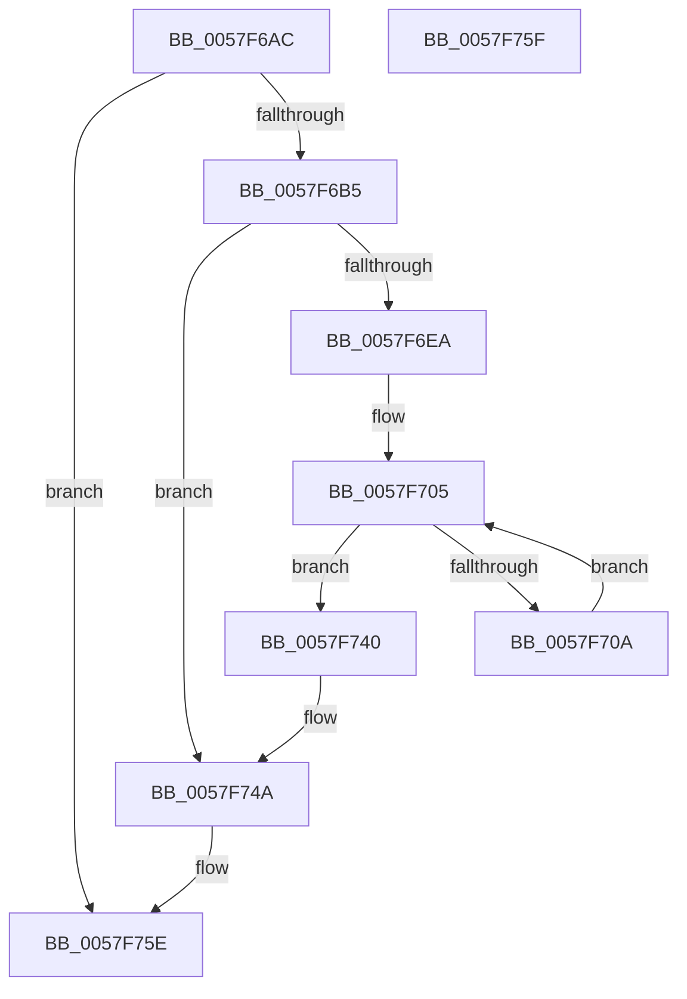

# CcCompleteAsyncLazywriteWorker

- RVA: `0x0057F6AC`–`0x0057F760` (길이 `180` bytes)
- VA: `0x000000014057F6AC`
- 실행 섹션: `.text`
- PDB 이름 있음: `예`; PDB Function 태그: `아니요`
- unwind 정보 RVA: `0x000C58E4`
- 디코드: `46`개 명령, `180/180` bytes 표시
- 미해석 바이트: `0` (있으면 어셈블리에 `.byte`로 보존)

> 이 문서는 커널 이미지의 기계어와 PDB 기호를 분석해 생성했습니다. 4번과 5번은 함수 원형과 자료형을 바이너리 사용 방식에서 추정한 C 해석이며 원본 소스 복구 결과는 아닙니다.

## 1. Dependencies

- 직접 호출 지점: **6**; 고유 호출 대상: **4**
- 직접 호출자로 확인된 함수: **1**
- RIP 상대 이미지 참조: **0**

### Outgoing calls
- `0x0057F6F9` → [KeAcquireInStackQueuedSpinLock](../27/KeAcquireInStackQueuedSpinLock_function_002757A0.md) (function, `0x002757A0`)
- `0x0057F710` → [CcFindNextWorkQueueEntry](../35/CcFindNextWorkQueueEntry_function_00356BFC.md) (function, `0x00356BFC`)
- `0x0057F71D` → [KeReleaseInStackQueuedSpinLock](../34/KeReleaseInStackQueuedSpinLock_function_00342CE0.md) (function, `0x00342CE0`)
- `0x0057F728` → [CcCompleteAsyncWriteBehind](CcCompleteAsyncWriteBehind_function_0057F824.md) (function, `0x0057F824`)
- `0x0057F739` → [KeAcquireInStackQueuedSpinLock](../27/KeAcquireInStackQueuedSpinLock_function_002757A0.md) (function, `0x002757A0`)
- `0x0057F745` → [KeReleaseInStackQueuedSpinLock](../34/KeReleaseInStackQueuedSpinLock_function_00342CE0.md) (function, `0x00342CE0`)

### Direct callers
- [CcCompleteAsyncLazywriteWorkerThread](CcCompleteAsyncLazywriteWorkerThread_function_0057F770.md) at `0x0057F7B3`

### Static image references
- 디코드된 RIP-relative 메모리 참조가 없습니다.

## 2. Other-region calls and transfers

- 다른 실행 섹션으로 향하는 call: **0**
- 별도 외부 분기/꼬리 이동을 확인하지 못했습니다.

## 3. Assembly (complete function range)

```asm
0057F6AC  48 85 C9                        test rcx, rcx
0057F6AF  0F 84 A9 00 00 00               je 0x14057f75e
0057F6B5  4C 8B DC                        mov r11, rsp
0057F6B8  49 89 5B 08                     mov qword ptr [r11 + 8], rbx
0057F6BC  49 89 6B 10                     mov qword ptr [r11 + 0x10], rbp
0057F6C0  49 89 73 18                     mov qword ptr [r11 + 0x18], rsi
0057F6C4  57                              push rdi
0057F6C5  48 83 EC 40                     sub rsp, 0x40
0057F6C9  48 8B 71 48                     mov rsi, qword ptr [rcx + 0x48]
0057F6CD  33 C0                           xor eax, eax
0057F6CF  0F 57 C0                        xorps xmm0, xmm0
0057F6D2  0F 11 44 24 20                  movups xmmword ptr [rsp + 0x20], xmm0
0057F6D7  49 89 43 E8                     mov qword ptr [r11 - 0x18], rax
0057F6DB  48 8B 41 40                     mov rax, qword ptr [rcx + 0x40]
0057F6DF  8B 90 4C 06 00 00               mov edx, dword ptr [rax + 0x64c]
0057F6E5  39 51 28                        cmp dword ptr [rcx + 0x28], edx
0057F6E8  73 60                           jae 0x14057f74a
0057F6EA  48 8B 69 38                     mov rbp, qword ptr [rcx + 0x38]
0057F6EE  49 8D 53 D8                     lea rdx, [r11 - 0x28]
0057F6F2  48 8D 8D 40 03 00 00            lea rcx, [rbp + 0x340]
0057F6F9  E8 A2 60 CF FF                  call 0x1402757a0
0057F6FE  48 8D BE 80 01 00 00            lea rdi, [rsi + 0x180]
0057F705  48 39 3F                        cmp qword ptr [rdi], rdi
0057F708  74 36                           je 0x14057f740
0057F70A  4C 8B C7                        mov r8, rdi
0057F70D  48 8B D6                        mov rdx, rsi
0057F710  E8 E7 74 DD FF                  call 0x140356bfc
0057F715  48 8D 4C 24 20                  lea rcx, [rsp + 0x20]
0057F71A  48 8B D8                        mov rbx, rax
0057F71D  E8 BE 35 DC FF                  call 0x140342ce0
0057F722  8A 53 48                        mov dl, byte ptr [rbx + 0x48]
0057F725  48 8B CB                        mov rcx, rbx
0057F728  E8 F7 00 00 00                  call 0x14057f824
0057F72D  48 8D 54 24 20                  lea rdx, [rsp + 0x20]
0057F732  48 8D 8D 40 03 00 00            lea rcx, [rbp + 0x340]
0057F739  E8 62 60 CF FF                  call 0x1402757a0
0057F73E  EB C5                           jmp 0x14057f705
0057F740  48 8D 4C 24 20                  lea rcx, [rsp + 0x20]
0057F745  E8 96 35 DC FF                  call 0x140342ce0
0057F74A  48 8B 5C 24 50                  mov rbx, qword ptr [rsp + 0x50]
0057F74F  48 8B 6C 24 58                  mov rbp, qword ptr [rsp + 0x58]
0057F754  48 8B 74 24 60                  mov rsi, qword ptr [rsp + 0x60]
0057F759  48 83 C4 40                     add rsp, 0x40
0057F75D  5F                              pop rdi
0057F75E  C3                              ret
0057F75F  CC                              int3
```

## 4. C-style interpretation (structured pseudocode)

```c
__int64 __fastcall CcCompleteAsyncLazywriteWorker(__int64 a1)
{
    __int64 result;
    __int64 v_rsp;
    unsigned __int64 v_stack_m28;
    unsigned __int64 v_stack_p10;
    unsigned __int64 v_stack_p18;
    unsigned __int64 v_stack_p8;

    if (a1 == 0) goto loc_0057F75E;
    *(unsigned __int64 *)(v_rsp + 8) = v_rbx;
    *(unsigned __int64 *)(v_rsp + 16) = v_rbp;
    *(unsigned __int64 *)(v_rsp + 24) = v_rsi;
    v_rsp = (v_rsp) - (64);
    result = 0;
    v_stack_m28 = v_xmm0;
    *(unsigned __int64 *)(v_rsp - 24) = 0;
    if ((*(unsigned int *)(a1 + 40)) >= ((unsigned int)((unsigned int)(*(unsigned int *)(*(unsigned __int64 *)(a1 + 64) + 1612))))) goto loc_0057F74A;
    result = KeAcquireInStackQueuedSpinLock(*(unsigned __int64 *)(a1 + 56) + 832, v_rsp - 40, a3, a4);
loc_0057F705:
    if ((*(unsigned __int64 *)(*(unsigned __int64 *)(a1 + 72) + 384)) == (*(unsigned __int64 *)(a1 + 72) + 384)) goto loc_0057F740;
    result = CcFindNextWorkQueueEntry(*(unsigned __int64 *)(a1 + 56) + 832, *(unsigned __int64 *)(a1 + 72), *(unsigned __int64 *)(a1 + 72) + 384, a4);
    result = KeReleaseInStackQueuedSpinLock(v_stack_m28, *(unsigned __int64 *)(a1 + 72), *(unsigned __int64 *)(a1 + 72) + 384, a4);
    result = CcCompleteAsyncWriteBehind(result, *(unsigned __int8 *)(result + 72), *(unsigned __int64 *)(a1 + 72) + 384, a4);
    result = KeAcquireInStackQueuedSpinLock(*(unsigned __int64 *)(a1 + 56) + 832, v_stack_m28, *(unsigned __int64 *)(a1 + 72) + 384, a4);
    goto loc_0057F705;
loc_0057F740:
    result = KeReleaseInStackQueuedSpinLock(v_stack_m28, v_stack_m28, *(unsigned __int64 *)(a1 + 72) + 384, a4);
loc_0057F74A:
    v_rsp = (v_rsp) + (64);
loc_0057F75E:
    return result;
}
```

## 5. (Beta) C Style

```c
int64_t CcCompleteAsyncLazywriteWorker(int64_t Arg1)
{
    int64_t result;
    int64_t local_rsp;
    uint64_t v_stack_m28;
    uint64_t v_stack_p10;
    uint64_t v_stack_p18;
    uint64_t v_stack_p8;

    if (Arg1 == 0) goto loc_0057F75E;
    *(uint64_t *)(local_rsp + 0x8) = local_rbx;
    *(uint64_t *)(local_rsp + 0x10) = local_rbp;
    *(uint64_t *)(local_rsp + 0x18) = local_rsi;
    local_rsp = (local_rsp) - (64);
    result = 0;
    v_stack_m28 = v_xmm0;
    *(uint64_t *)(local_rsp - 0x18) = 0;
    if ((*(uint32_t *)(Arg1 + 0x28)) >= ((uint32_t)((uint32_t)(*(uint32_t *)(*(uint64_t *)(Arg1 + 0x40) + 0x64C))))) goto loc_0057F74A;
    result = KeAcquireInStackQueuedSpinLock(*(uint64_t *)(Arg1 + 0x38) + 832, local_rsp - 40, a3, a4);
loc_0057F705:
    if ((*(uint64_t *)(*(uint64_t *)(Arg1 + 0x48) + 0x180)) == (*(uint64_t *)(Arg1 + 0x48) + 384)) goto loc_0057F740;
    result = CcFindNextWorkQueueEntry(*(uint64_t *)(Arg1 + 0x38) + 832, *(uint64_t *)(Arg1 + 0x48), *(uint64_t *)(Arg1 + 0x48) + 384, a4);
    result = KeReleaseInStackQueuedSpinLock(v_stack_m28, *(uint64_t *)(Arg1 + 0x48), *(uint64_t *)(Arg1 + 0x48) + 384, a4);
    result = CcCompleteAsyncWriteBehind(result, *(uint8_t *)(result + 0x48), *(uint64_t *)(Arg1 + 0x48) + 384, a4);
    result = KeAcquireInStackQueuedSpinLock(*(uint64_t *)(Arg1 + 0x38) + 832, v_stack_m28, *(uint64_t *)(Arg1 + 0x48) + 384, a4);
    goto loc_0057F705;
loc_0057F740:
    result = KeReleaseInStackQueuedSpinLock(v_stack_m28, v_stack_m28, *(uint64_t *)(Arg1 + 0x48) + 384, a4);
loc_0057F74A:
    local_rsp = (local_rsp) + (64);
loc_0057F75E:
    return result;
}
```

## 6. Execution-region graph

[열기: 2D/3D 그래프와 함수 탐색 컨트롤 패널](../../../control-panel.html?section=text&rva=0x0057F6AC&view=graph)

- 2D 그래프는 위에서 아래로 흐르고, 3D 그래프는 빈 공간을 드래그해 회전합니다. Shift+드래그는 이동, 휠은 확대·축소, 함수 노드 선택은 대상 보고서 이동입니다.

### Static fallback


