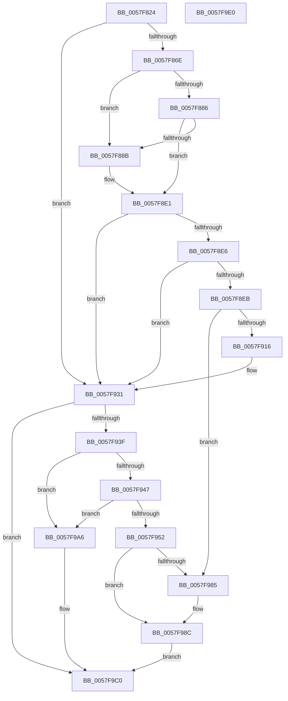

# CcCompleteAsyncWriteBehind

- RVA: `0x0057F824`–`0x0057F9E1` (길이 `445` bytes)
- VA: `0x000000014057F824`
- 실행 섹션: `.text`
- PDB 이름 있음: `예`; PDB Function 태그: `아니요`
- unwind 정보 RVA: `0x000C4294`
- 디코드: `112`개 명령, `445/445` bytes 표시
- 미해석 바이트: `0` (있으면 어셈블리에 `.byte`로 보존)

> 이 문서는 커널 이미지의 기계어와 PDB 기호를 분석해 생성했습니다. 4번과 5번은 함수 원형과 자료형을 바이너리 사용 방식에서 추정한 C 해석이며 원본 소스 복구 결과는 아닙니다.

## 1. Dependencies

- 직접 호출 지점: **8**; 고유 호출 대상: **6**
- 직접 호출자로 확인된 함수: **1**
- RIP 상대 이미지 참조: **1**

### Outgoing calls
- `0x0057F873` → [CcWriteBehindPostProcess](../35/CcWriteBehindPostProcess_function_00357BB4.md) (function, `0x00357BB4`)
- `0x0057F8DC` → [DbgPrintEx](../35/DbgPrintEx_function_00359290.md) (function, `0x00359290`)
- `0x0057F901` → [KeAcquireInStackQueuedSpinLock](../27/KeAcquireInStackQueuedSpinLock_function_002757A0.md) (function, `0x002757A0`)
- `0x0057F929` → [KeReleaseInStackQueuedSpinLock](../34/KeReleaseInStackQueuedSpinLock_function_00342CE0.md) (function, `0x00342CE0`)
- `0x0057F970` → [KeAcquireInStackQueuedSpinLock](../27/KeAcquireInStackQueuedSpinLock_function_002757A0.md) (function, `0x002757A0`)
- `0x0057F99F` → [KeReleaseInStackQueuedSpinLock](../34/KeReleaseInStackQueuedSpinLock_function_00342CE0.md) (function, `0x00342CE0`)
- `0x0057F9AE` → [ExFreePoolWithTag](../../poolcode/B8/ExFreePoolWithTag_function_00B82870.md) (function, `0x00B82870`)
- `0x0057F9BB` → [CcFreeWorkQueueEntry](../35/CcFreeWorkQueueEntry_function_0035723C.md) (function, `0x0035723C`)

### Direct callers
- [CcCompleteAsyncLazywriteWorker](CcCompleteAsyncLazywriteWorker_function_0057F6AC.md) at `0x0057F728`

### Static image references
- `0x0057F894` → RVA `0x006C9140` (` ?? ::FNODOBFM::`string'`; read)

## 2. Other-region calls and transfers

- 다른 실행 섹션으로 향하는 call: **1**
  - `0x0057F9AE` → [ExFreePoolWithTag](../../poolcode/B8/ExFreePoolWithTag_function_00B82870.md) (`.text` → `POOLCODE`)
- 별도 외부 분기/꼬리 이동을 확인하지 못했습니다.

## 3. Assembly (complete function range)

```asm
0057F824  4C 8B DC                        mov r11, rsp
0057F827  49 89 5B 08                     mov qword ptr [r11 + 8], rbx
0057F82B  49 89 6B 10                     mov qword ptr [r11 + 0x10], rbp
0057F82F  49 89 73 18                     mov qword ptr [r11 + 0x18], rsi
0057F833  57                              push rdi
0057F834  41 54                           push r12
0057F836  41 55                           push r13
0057F838  41 56                           push r14
0057F83A  41 57                           push r15
0057F83C  48 83 EC 70                     sub rsp, 0x70
0057F840  48 8B 79 10                     mov rdi, qword ptr [rcx + 0x10]
0057F844  33 C0                           xor eax, eax
0057F846  4C 8B B9 98 00 00 00            mov r15, qword ptr [rcx + 0x98]
0057F84D  0F 57 C0                        xorps xmm0, xmm0
0057F850  0F 11 44 24 50                  movups xmmword ptr [rsp + 0x50], xmm0
0057F855  49 89 43 C8                     mov qword ptr [r11 - 0x38], rax
0057F859  45 32 F6                        xor r14b, r14b
0057F85C  4C 8B 2F                        mov r13, qword ptr [rdi]
0057F85F  48 8B D9                        mov rbx, rcx
0057F862  4C 8B 67 70                     mov r12, qword ptr [rdi + 0x70]
0057F866  84 D2                           test dl, dl
0057F868  0F 84 C3 00 00 00               je 0x14057f931
0057F86E  B2 01                           mov dl, 1
0057F870  48 8B CF                        mov rcx, rdi
0057F873  E8 3C 83 DD FF                  call 0x140357bb4
0057F878  0F B6 E8                        movzx ebp, al
0057F87B  48 8D B7 89 00 00 00            lea rsi, [rdi + 0x89]
0057F882  84 C0                           test al, al
0057F884  74 05                           je 0x14057f88b
0057F886  44 38 36                        cmp byte ptr [rsi], r14b
0057F889  74 56                           je 0x14057f8e1
0057F88B  65 4C 8B 14 25 88 01 00 00      mov r10, qword ptr gs:[0x188]
0057F894  4C 8D 05 A5 98 14 00            lea r8, [rip + 0x1498a5]
0057F89B  48 8B 8B 90 00 00 00            mov rcx, qword ptr [rbx + 0x90]
0057F8A2  65 4C 8B 0C 25 88 01 00 00      mov r9, qword ptr gs:[0x188]
0057F8AB  0F B6 16                        movzx edx, byte ptr [rsi]
0057F8AE  8B 41 18                        mov eax, dword ptr [rcx + 0x18]
0057F8B1  45 8B 89 08 05 00 00            mov r9d, dword ptr [r9 + 0x508]
0057F8B8  89 44 24 40                     mov dword ptr [rsp + 0x40], eax
0057F8BC  41 8B 82 10 05 00 00            mov eax, dword ptr [r10 + 0x510]
0057F8C3  48 89 4C 24 38                  mov qword ptr [rsp + 0x38], rcx
0057F8C8  89 54 24 30                     mov dword ptr [rsp + 0x30], edx
0057F8CC  BA 03 00 00 00                  mov edx, 3
0057F8D1  89 6C 24 28                     mov dword ptr [rsp + 0x28], ebp
0057F8D5  89 44 24 20                     mov dword ptr [rsp + 0x20], eax
0057F8D9  8D 4A 7C                        lea ecx, [rdx + 0x7c]
0057F8DC  E8 AF 99 DD FF                  call 0x140359290
0057F8E1  40 84 ED                        test bpl, bpl
0057F8E4  75 4B                           jne 0x14057f931
0057F8E6  44 38 36                        cmp byte ptr [rsi], r14b
0057F8E9  74 46                           je 0x14057f931
0057F8EB  49 8D 8D 40 03 00 00            lea rcx, [r13 + 0x340]
0057F8F2  C7 83 80 00 00 00 07 00 00 00   mov dword ptr [rbx + 0x80], 7
0057F8FC  48 8D 54 24 50                  lea rdx, [rsp + 0x50]
0057F901  E8 9A 5E CF FF                  call 0x1402757a0
0057F906  49 8D 87 38 01 00 00            lea rax, [r15 + 0x138]
0057F90D  48 8B 08                        mov rcx, qword ptr [rax]
0057F910  48 39 41 08                     cmp qword ptr [rcx + 8], rax
0057F914  75 6F                           jne 0x14057f985
0057F916  48 89 0B                        mov qword ptr [rbx], rcx
0057F919  48 89 43 08                     mov qword ptr [rbx + 8], rax
0057F91D  48 89 59 08                     mov qword ptr [rcx + 8], rbx
0057F921  48 8D 4C 24 50                  lea rcx, [rsp + 0x50]
0057F926  48 89 18                        mov qword ptr [rax], rbx
0057F929  E8 B2 33 DC FF                  call 0x140342ce0
0057F92E  41 B6 01                        mov r14b, 1
0057F931  49 8B 44 24 08                  mov rax, qword ptr [r12 + 8]
0057F936  45 84 F6                        test r14b, r14b
0057F939  0F 85 81 00 00 00               jne 0x14057f9c0
0057F93F  48 3D 5E 8A 00 00               cmp rax, 0x8a5e
0057F945  75 5F                           jne 0x14057f9a6
0057F947  8B 87 00 01 00 00               mov eax, dword ptr [rdi + 0x100]
0057F94D  83 F8 0A                        cmp eax, 0xa
0057F950  73 54                           jae 0x14057f9a6
0057F952  FF C0                           inc eax
0057F954  49 8D 8D 40 03 00 00            lea rcx, [r13 + 0x340]
0057F95B  89 87 00 01 00 00               mov dword ptr [rdi + 0x100], eax
0057F961  48 8D 54 24 50                  lea rdx, [rsp + 0x50]
0057F966  C7 83 80 00 00 00 07 00 00 00   mov dword ptr [rbx + 0x80], 7
0057F970  E8 2B 5E CF FF                  call 0x1402757a0
0057F975  49 8D 87 38 01 00 00            lea rax, [r15 + 0x138]
0057F97C  48 8B 10                        mov rdx, qword ptr [rax]
0057F97F  48 39 42 08                     cmp qword ptr [rdx + 8], rax
0057F983  74 07                           je 0x14057f98c
0057F985  B9 03 00 00 00                  mov ecx, 3
0057F98A  CD 29                           int 0x29
0057F98C  48 89 13                        mov qword ptr [rbx], rdx
0057F98F  48 8D 4C 24 50                  lea rcx, [rsp + 0x50]
0057F994  48 89 43 08                     mov qword ptr [rbx + 8], rax
0057F998  48 89 5A 08                     mov qword ptr [rdx + 8], rbx
0057F99C  48 89 18                        mov qword ptr [rax], rbx
0057F99F  E8 3C 33 DC FF                  call 0x140342ce0
0057F9A4  EB 1A                           jmp 0x14057f9c0
0057F9A6  BA 43 63 57 42                  mov edx, 0x42576343
0057F9AB  48 8B CF                        mov rcx, rdi
0057F9AE  E8 BD 2E 60 00                  call 0x140b82870
0057F9B3  48 83 63 10 00                  and qword ptr [rbx + 0x10], 0
0057F9B8  48 8B CB                        mov rcx, rbx
0057F9BB  E8 7C 78 DD FF                  call 0x14035723c
0057F9C0  4C 8D 5C 24 70                  lea r11, [rsp + 0x70]
0057F9C5  B0 01                           mov al, 1
0057F9C7  49 8B 5B 30                     mov rbx, qword ptr [r11 + 0x30]
0057F9CB  49 8B 6B 38                     mov rbp, qword ptr [r11 + 0x38]
0057F9CF  49 8B 73 40                     mov rsi, qword ptr [r11 + 0x40]
0057F9D3  49 8B E3                        mov rsp, r11
0057F9D6  41 5F                           pop r15
0057F9D8  41 5E                           pop r14
0057F9DA  41 5D                           pop r13
0057F9DC  41 5C                           pop r12
0057F9DE  5F                              pop rdi
0057F9DF  C3                              ret
0057F9E0  CC                              int3
```

## 4. C-style interpretation (structured pseudocode)

```c
__int64 __fastcall CcCompleteAsyncWriteBehind(__int64 a1, unsigned __int8 a2)
{
    __int64 result;
    __int64 v_r10;
    __int64 v_r14;
    __int64 v_rsp;
    unsigned __int64 v_stack_m28;
    unsigned __int64 v_stack_m48;
    unsigned int v_stack_m58;
    unsigned __int64 v_stack_m60;
    unsigned int v_stack_m68;
    unsigned int v_stack_m70;
    unsigned int v_stack_m78;

    *(unsigned __int64 *)(v_rsp + 8) = v_rbx;
    *(unsigned __int64 *)(v_rsp + 16) = v_rbp;
    *(unsigned __int64 *)(v_rsp + 24) = v_rsi;
    v_rsp = (v_rsp) - (112);
    result = 0;
    v_stack_m48 = v_xmm0;
    *(unsigned __int64 *)(v_rsp - 56) = 0;
    v_r14 = 0;
    if (a2 == 0) goto loc_0057F931;
    result = CcWriteBehindPostProcess(*(unsigned __int64 *)(a1 + 16), 1, a3, a4);
    if ((unsigned __int8)(result) == 0) goto loc_0057F88B;
    if ((*(unsigned __int8 *)(*(unsigned __int64 *)(a1 + 16) + 137)) != 0) {
        v_r10 = *(unsigned __int64 *)(gs_base + (0 + 392));
        a3 = v_rip + 1349797;
        a1 = *(unsigned __int64 *)(a1 + 144);
        a4 = *(unsigned __int64 *)(gs_base + (0 + 392));
        a2 = *(unsigned __int8 *)(*(unsigned __int64 *)(a1 + 16) + 137);
        result = *(unsigned int *)(a1 + 24);
        a4 = *(unsigned int *)(a4 + 1288);
        v_stack_m58 = (unsigned int)(result);
        result = *(unsigned int *)(v_r10 + 1296);
        v_stack_m60 = a1;
        v_stack_m68 = a2;
        a2 = 3;
        v_stack_m70 = (unsigned int)((unsigned __int8)(result));
        v_stack_m78 = (unsigned int)(result);
        a1 = a2 + 124;
        result = DbgPrintEx(a1, a2, a3, a4);
    }
    if ((unsigned __int8)((unsigned __int8)(result)) != 0) goto loc_0057F931;
    if ((*(unsigned __int8 *)(*(unsigned __int64 *)(a1 + 16) + 137)) == 0) goto loc_0057F931;
    *(unsigned int *)(a1 + 128) = 7;
    result = KeAcquireInStackQueuedSpinLock(*(unsigned __int64 *)(*(unsigned __int64 *)(a1 + 16)) + 832, v_stack_m48, a3, a4);
    if ((*(unsigned __int64 *)(*(unsigned __int64 *)(*(unsigned __int64 *)(a1 + 152) + 312) + 8)) != (*(unsigned __int64 *)(a1 + 152) + 312)) goto loc_0057F985;
    *(unsigned __int64 *)(a1) = *(unsigned __int64 *)(*(unsigned __int64 *)(a1 + 152) + 312);
    *(unsigned __int64 *)(a1 + 8) = *(unsigned __int64 *)(a1 + 152) + 312;
    *(unsigned __int64 *)(*(unsigned __int64 *)(*(unsigned __int64 *)(a1 + 152) + 312) + 8) = a1;
    *(unsigned __int64 *)(*(unsigned __int64 *)(a1 + 152) + 312) = a1;
    result = KeReleaseInStackQueuedSpinLock(v_stack_m48, v_stack_m48, a3, a4);
loc_0057F931:
    if (1 != 0) goto loc_0057F9C0;
    if ((*(unsigned __int64 *)(*(unsigned __int64 *)(*(unsigned __int64 *)(a1 + 16) + 112) + 8)) != 0x8A5EULL) goto loc_0057F9A6;
    if (((unsigned int)((unsigned int)(*(unsigned int *)(*(unsigned __int64 *)(a1 + 16) + 256)))) >= 10) goto loc_0057F9A6;
    result = (unsigned int)(((unsigned int)(*(unsigned int *)(*(unsigned __int64 *)(a1 + 16) + 256))) + 1);
    *(unsigned int *)(*(unsigned __int64 *)(a1 + 16) + 256) = (unsigned int)(result);
    *(unsigned int *)(a1 + 128) = 7;
    result = KeAcquireInStackQueuedSpinLock(*(unsigned __int64 *)(*(unsigned __int64 *)(a1 + 16)) + 832, v_stack_m48, a3, a4);
    if ((*(unsigned __int64 *)(*(unsigned __int64 *)(*(unsigned __int64 *)(a1 + 152) + 312) + 8)) != (*(unsigned __int64 *)(a1 + 152) + 312)) {
        a1 = 3;
    }
    *(unsigned __int64 *)(a1) = *(unsigned __int64 *)(*(unsigned __int64 *)(a1 + 152) + 312);
    *(unsigned __int64 *)(a1 + 8) = *(unsigned __int64 *)(a1 + 152) + 312;
    *(unsigned __int64 *)(*(unsigned __int64 *)(*(unsigned __int64 *)(a1 + 152) + 312) + 8) = a1;
    *(unsigned __int64 *)(*(unsigned __int64 *)(a1 + 152) + 312) = a1;
    result = KeReleaseInStackQueuedSpinLock(v_stack_m48, *(unsigned __int64 *)(*(unsigned __int64 *)(a1 + 152) + 312), a3, a4);
    goto loc_0057F9C0;
loc_0057F9A6:
    result = ExFreePoolWithTag(*(unsigned __int64 *)(a1 + 16), (unsigned int)(0x42576343ULL), a3, a4);
    result = CcFreeWorkQueueEntry(a1, (unsigned int)(0x42576343ULL), a3, a4);
loc_0057F9C0:
    return 1;
}
```

## 5. (Beta) C Style

```c
int64_t CcCompleteAsyncWriteBehind(void *Arg1, uint8_t Arg2)
{
    uint8_t *arg1 = (uint8_t *)Arg1;

    int64_t result;
    int64_t local_r10;
    int64_t local_r14;
    int64_t local_rsp;
    uint64_t v_stack_m28;
    uint64_t v_stack_m48;
    uint32_t v_stack_m58;
    uint64_t v_stack_m60;
    uint32_t v_stack_m68;
    uint32_t v_stack_m70;
    uint32_t v_stack_m78;

    *(uint64_t *)(local_rsp + 0x8) = local_rbx;
    *(uint64_t *)(local_rsp + 0x10) = local_rbp;
    *(uint64_t *)(local_rsp + 0x18) = local_rsi;
    local_rsp = (local_rsp) - (112);
    result = 0;
    v_stack_m48 = v_xmm0;
    *(uint64_t *)(local_rsp - 0x38) = 0;
    local_r14 = 0;
    if (Arg2 == 0) goto loc_0057F931;
    result = CcWriteBehindPostProcess(*(uint64_t *)(arg1 + 0x10), 1, a3, a4);
    if ((uint8_t)(result) == 0) goto loc_0057F88B;
    if ((*(uint8_t *)(*(uint64_t *)(arg1 + 0x10) + 0x89)) != 0) {
        local_r10 = *(uint64_t *)(gs_base + (0 + 0x188));
        a3 = v_rip + 1349797;
        Arg1 = *(uint64_t *)(arg1 + 0x90);
        a4 = *(uint64_t *)(gs_base + (0 + 0x188));
        Arg2 = *(uint8_t *)(*(uint64_t *)(arg1 + 0x10) + 0x89);
        result = *(uint32_t *)(arg1 + 0x18);
        a4 = *(uint32_t *)(a4 + 0x508);
        v_stack_m58 = (uint32_t)(result);
        result = *(uint32_t *)(local_r10 + 0x510);
        v_stack_m60 = Arg1;
        v_stack_m68 = Arg2;
        Arg2 = 3;
        v_stack_m70 = (uint32_t)((uint8_t)(result));
        v_stack_m78 = (uint32_t)(result);
        Arg1 = Arg2 + 124;
        result = DbgPrintEx(Arg1, Arg2, a3, a4);
    }
    if ((uint8_t)((uint8_t)(result)) != 0) goto loc_0057F931;
    if ((*(uint8_t *)(*(uint64_t *)(arg1 + 0x10) + 0x89)) == 0) goto loc_0057F931;
    *(uint32_t *)(arg1 + 0x80) = 7;
    result = KeAcquireInStackQueuedSpinLock(*(uint64_t *)(*(uint64_t *)(arg1 + 0x10)) + 832, v_stack_m48, a3, a4);
    if ((*(uint64_t *)(*(uint64_t *)(*(uint64_t *)(arg1 + 0x98) + 0x138) + 0x8)) != (*(uint64_t *)(arg1 + 0x98) + 312)) goto loc_0057F985;
    *(uint64_t *)(arg1) = *(uint64_t *)(*(uint64_t *)(arg1 + 0x98) + 0x138);
    *(uint64_t *)(arg1 + 0x8) = *(uint64_t *)(arg1 + 0x98) + 312;
    *(void **)(*(uint64_t *)(*(uint64_t *)(arg1 + 0x98) + 0x138) + 0x8) = Arg1;
    *(void **)(*(uint64_t *)(arg1 + 0x98) + 0x138) = Arg1;
    result = KeReleaseInStackQueuedSpinLock(v_stack_m48, v_stack_m48, a3, a4);
loc_0057F931:
    if (1 != 0) goto loc_0057F9C0;
    if ((*(uint64_t *)(*(uint64_t *)(*(uint64_t *)(arg1 + 0x10) + 0x70) + 0x8)) != 0x8A5EULL) goto loc_0057F9A6;
    if (((uint32_t)((uint32_t)(*(uint32_t *)(*(uint64_t *)(arg1 + 0x10) + 0x100)))) >= 10) goto loc_0057F9A6;
    result = (uint32_t)(((uint32_t)(*(uint32_t *)(*(uint64_t *)(arg1 + 0x10) + 0x100))) + 1);
    *(uint32_t *)(*(uint64_t *)(arg1 + 0x10) + 0x100) = (uint32_t)(result);
    *(uint32_t *)(arg1 + 0x80) = 7;
    result = KeAcquireInStackQueuedSpinLock(*(uint64_t *)(*(uint64_t *)(arg1 + 0x10)) + 832, v_stack_m48, a3, a4);
    if ((*(uint64_t *)(*(uint64_t *)(*(uint64_t *)(arg1 + 0x98) + 0x138) + 0x8)) != (*(uint64_t *)(arg1 + 0x98) + 312)) {
        Arg1 = 3;
    }
    *(uint64_t *)(arg1) = *(uint64_t *)(*(uint64_t *)(arg1 + 0x98) + 0x138);
    *(uint64_t *)(arg1 + 0x8) = *(uint64_t *)(arg1 + 0x98) + 312;
    *(void **)(*(uint64_t *)(*(uint64_t *)(arg1 + 0x98) + 0x138) + 0x8) = Arg1;
    *(void **)(*(uint64_t *)(arg1 + 0x98) + 0x138) = Arg1;
    result = KeReleaseInStackQueuedSpinLock(v_stack_m48, *(uint64_t *)(*(uint64_t *)(arg1 + 0x98) + 0x138), a3, a4);
    goto loc_0057F9C0;
loc_0057F9A6:
    result = ExFreePoolWithTag(*(uint64_t *)(arg1 + 0x10), (uint32_t)(0x42576343ULL), a3, a4);
    result = CcFreeWorkQueueEntry(Arg1, (uint32_t)(0x42576343ULL), a3, a4);
loc_0057F9C0:
    return 1;
}
```

### 관측된 메모리 오프셋

구조체 형식이 확인되지 않은 접근은 인자 기준의 오프셋으로만 기록했습니다.

| 기준 인자 | 오프셋 표현 | 폭 (bit) | 접근 |
|---|---:|---:|---|
| `Arg1` | `+ 0x0` | `64` | `W` |
| `Arg1` | `+ 0x8` | `64` | `W` |
| `Arg1` | `+ 0x10` | `64` | `R` |
| `Arg1` | `+ 0x10` | `64` | `R/W` |
| `Arg1` | `+ 0x80` | `32` | `W` |
| `Arg1` | `+ 0x90` | `64` | `R` |
| `Arg1` | `+ 0x98` | `64` | `R` |

## 6. Execution-region graph

[열기: 2D/3D 그래프와 함수 탐색 컨트롤 패널](../../../control-panel.html?section=text&rva=0x0057F824&view=graph)

- 2D 그래프는 위에서 아래로 흐르고, 3D 그래프는 빈 공간을 드래그해 회전합니다. Shift+드래그는 이동, 휠은 확대·축소, 함수 노드 선택은 대상 보고서 이동입니다.

### Static fallback


