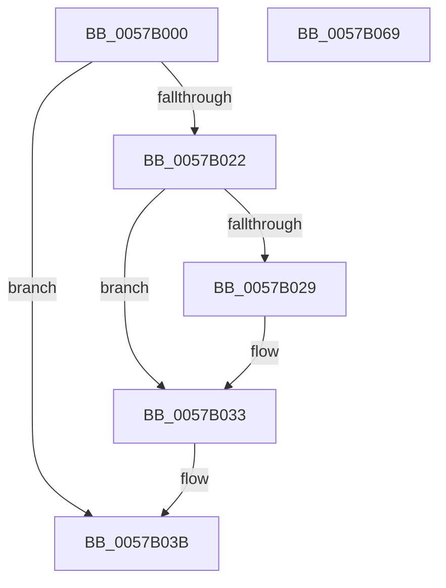

# CcContainerRestoreCallBack

- RVA: `0x0057B000`–`0x0057B06A` (길이 `106` bytes)
- VA: `0x000000014057B000`
- 실행 섹션: `.text`
- PDB 이름 있음: `예`; PDB Function 태그: `아니요`
- unwind 정보 RVA: `0x00065960`
- 디코드: `28`개 명령, `106/106` bytes 표시
- 미해석 바이트: `0` (있으면 어셈블리에 `.byte`로 보존)

> 이 문서는 커널 이미지의 기계어와 PDB 기호를 분석해 생성했습니다. 4번과 5번은 함수 원형과 자료형을 바이너리 사용 방식에서 추정한 C 해석이며 원본 소스 복구 결과는 아닙니다.

## 1. Dependencies

- 직접 호출 지점: **3**; 고유 호출 대상: **3**
- 직접 호출자로 확인된 함수: **0**
- RIP 상대 이미지 참조: **3**

### Outgoing calls
- `0x0057B017` → [CcGetContainerPolicyForDTP](CcGetContainerPolicyForDTP_function_0057B0D8.md) (function, `0x0057B0D8`)
- `0x0057B036` → [ExUnsubscribeWnfStateChange](../../page/A7/ExUnsubscribeWnfStateChange_function_00A7BE50.md) (function, `0x00A7BE50`)
- `0x0057B057` → [DbgPrintEx](../35/DbgPrintEx_function_00359290.md) (function, `0x00359290`)

### Direct callers
- 이 함수 시작 RVA로 연결되는 직접 call은 확인되지 않았습니다. 간접 호출은 완전히 역산할 수 없습니다.

### Static image references
- `0x0057B029` → RVA `0x00E0A878` (`.data`; write)
- `0x0057B03B` → RVA `0x00E0A878` (`.data`; read)
- `0x0057B041` → RVA `0x006C7820` (` ?? ::FNODOBFM::`string'`; read)

## 2. Other-region calls and transfers

- 다른 실행 섹션으로 향하는 call: **1**
  - `0x0057B036` → [ExUnsubscribeWnfStateChange](../../page/A7/ExUnsubscribeWnfStateChange_function_00A7BE50.md) (`.text` → `PAGE`)
- 별도 외부 분기/꼬리 이동을 확인하지 못했습니다.

## 3. Assembly (complete function range)

```asm
0057B000  48 89 5C 24 08                  mov qword ptr [rsp + 8], rbx
0057B005  57                              push rdi
0057B006  48 83 EC 40                     sub rsp, 0x40
0057B00A  83 64 24 30 00                  and dword ptr [rsp + 0x30], 0
0057B00F  48 8B F9                        mov rdi, rcx
0057B012  48 8D 4C 24 30                  lea rcx, [rsp + 0x30]
0057B017  E8 BC 00 00 00                  call 0x14057b0d8
0057B01C  8B D8                           mov ebx, eax
0057B01E  85 C0                           test eax, eax
0057B020  78 19                           js 0x14057b03b
0057B022  83 7C 24 30 00                  cmp dword ptr [rsp + 0x30], 0
0057B027  74 0A                           je 0x14057b033
0057B029  C7 05 45 F8 88 00 04 00 00 00   mov dword ptr [rip + 0x88f845], 4
0057B033  48 8B CF                        mov rcx, rdi
0057B036  E8 15 0E 50 00                  call 0x140a7be50
0057B03B  8B 0D 37 F8 88 00               mov ecx, dword ptr [rip + 0x88f837]
0057B041  4C 8D 05 D8 C7 14 00            lea r8, [rip + 0x14c7d8]
0057B048  BA 03 00 00 00                  mov edx, 3
0057B04D  89 4C 24 20                     mov dword ptr [rsp + 0x20], ecx
0057B051  44 8B CB                        mov r9d, ebx
0057B054  8D 4A 7C                        lea ecx, [rdx + 0x7c]
0057B057  E8 34 E2 DD FF                  call 0x140359290
0057B05C  8B C3                           mov eax, ebx
0057B05E  48 8B 5C 24 50                  mov rbx, qword ptr [rsp + 0x50]
0057B063  48 83 C4 40                     add rsp, 0x40
0057B067  5F                              pop rdi
0057B068  C3                              ret
0057B069  CC                              int3
```

## 4. C-style interpretation (structured pseudocode)

```c
__int64 __fastcall CcContainerRestoreCallBack(__int64 a1)
{
    __int64 result;
    __int64 v_rsp;
    unsigned int v_stack_m18;
    unsigned int v_stack_m28;
    unsigned __int64 v_stack_p8;

    v_stack_p8 = v_rbx;
    v_rsp = (v_rsp) - (64);
    result = CcGetContainerPolicyForDTP(v_stack_m18, a2, a3, a4);
    if (sign_flag) goto loc_0057B03B;
    if (v_stack_m18 != 0) {
        *(unsigned int *)(v_rip + 8976453) = 4;
    }
    result = ExUnsubscribeWnfStateChange(a1, a2, a3, a4);
loc_0057B03B:
    v_stack_m28 = (unsigned int)((unsigned int)(*(unsigned int *)(v_rip + 8976439)));
    result = DbgPrintEx(3 + 124, 3, v_rip + 1361880, (unsigned int)((unsigned int)((unsigned int)((unsigned int)(result)))));
    v_rsp = (v_rsp) + (64);
    return (unsigned int)((unsigned int)((unsigned int)((unsigned int)(result))));
}
```

## 5. (Beta) C Style

```c
int64_t CcContainerRestoreCallBack(int64_t Arg1)
{
    int64_t result;
    int64_t local_rsp;
    uint32_t v_stack_m18;
    uint32_t v_stack_m28;
    uint64_t v_stack_p8;

    v_stack_p8 = local_rbx;
    local_rsp = (local_rsp) - (64);
    result = CcGetContainerPolicyForDTP(v_stack_m18, a2, a3, a4);
    if (sign_flag) goto loc_0057B03B;
    if (v_stack_m18 != 0) {
        *(uint32_t *)(v_rip + 0x88F845) = 4;
    }
    result = ExUnsubscribeWnfStateChange(Arg1, a2, a3, a4);
loc_0057B03B:
    v_stack_m28 = (uint32_t)((uint32_t)(*(uint32_t *)(v_rip + 0x88F837)));
    result = DbgPrintEx(3 + 124, 3, v_rip + 1361880, (uint32_t)((uint32_t)((uint32_t)((uint32_t)(result)))));
    local_rsp = (local_rsp) + (64);
    return (uint32_t)((uint32_t)((uint32_t)((uint32_t)(result))));
}
```

## 6. Execution-region graph

[열기: 2D/3D 그래프와 함수 탐색 컨트롤 패널](../../../control-panel.html?section=text&rva=0x0057B000&view=graph)

- 2D 그래프는 위에서 아래로 흐르고, 3D 그래프는 빈 공간을 드래그해 회전합니다. Shift+드래그는 이동, 휠은 확대·축소, 함수 노드 선택은 대상 보고서 이동입니다.

### Static fallback


