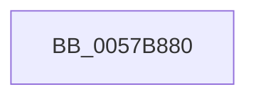

# CcDebugExceptionFilter

- RVA: `0x0057B880`–`0x0057B8A4` (길이 `36` bytes)
- VA: `0x000000014057B880`
- 실행 섹션: `.text`
- PDB 이름 있음: `예`; PDB Function 태그: `아니요`
- unwind 정보 RVA: `0x000622F0`
- 디코드: `9`개 명령, `36/36` bytes 표시
- 미해석 바이트: `0` (있으면 어셈블리에 `.byte`로 보존)

> 이 문서는 커널 이미지의 기계어와 PDB 기호를 분석해 생성했습니다. 4번과 5번은 함수 원형과 자료형을 바이너리 사용 방식에서 추정한 C 해석이며 원본 소스 복구 결과는 아닙니다.

## 1. Dependencies

- 직접 호출 지점: **1**; 고유 호출 대상: **1**
- 직접 호출자로 확인된 함수: **3**
- RIP 상대 이미지 참조: **0**

### Outgoing calls
- `0x0057B89E` → [KeBugCheckEx](../4F/KeBugCheckEx_function_004FD660.md) (function, `0x004FD660`)

### Direct callers
- [CcAsyncLazywriteWorker$filt$0](../6D/CcAsyncLazywriteWorker_filt_0_function_006D2242.md) at `0x006D2252`
- [CcCachemapUninitWorkerThread$filt$0](../6D/CcCachemapUninitWorkerThread_filt_0_function_006D2265.md) at `0x006D2272`
- [CcWorkerThread$filt$0](../6D/CcWorkerThread_filt_0_function_006D38C0.md) at `0x006D38D0`

### Static image references
- 디코드된 RIP-relative 메모리 참조가 없습니다.

## 2. Other-region calls and transfers

- 다른 실행 섹션으로 향하는 call: **0**
- 별도 외부 분기/꼬리 이동을 확인하지 못했습니다.

## 3. Assembly (complete function range)

```asm
0057B880  48 83 EC 38                     sub rsp, 0x38
0057B884  4C 8B 01                        mov r8, qword ptr [rcx]
0057B887  BA 5F 15 05 00                  mov edx, 0x5155f
0057B88C  4C 8B 49 08                     mov r9, qword ptr [rcx + 8]
0057B890  B9 34 00 00 00                  mov ecx, 0x34
0057B895  49 8B 40 10                     mov rax, qword ptr [r8 + 0x10]
0057B899  48 89 44 24 20                  mov qword ptr [rsp + 0x20], rax
0057B89E  E8 BD 1D F8 FF                  call 0x1404fd660
0057B8A3  CC                              int3
```

## 4. C-style interpretation (structured pseudocode)

```c
__int64 __fastcall CcDebugExceptionFilter(__int64 a1)
{
    __int64 result;
    __int64 v_rsp;
    unsigned __int64 v_stack_m18;

    v_rsp = (v_rsp) - (56);
    v_stack_m18 = *(unsigned __int64 *)(*(unsigned __int64 *)(a1) + 16);
    result = KeBugCheckEx(52, (unsigned int)(0x5155FULL), *(unsigned __int64 *)(a1), *(unsigned __int64 *)(a1 + 8));
    return result;
}
```

## 5. (Beta) C Style

```c
int64_t CcDebugExceptionFilter(void *Arg1)
{
    uint8_t *arg1 = (uint8_t *)Arg1;

    int64_t result;
    int64_t local_rsp;
    uint64_t v_stack_m18;

    local_rsp = (local_rsp) - (56);
    v_stack_m18 = *(uint64_t *)(*(uint64_t *)(arg1) + 0x10);
    result = KeBugCheckEx(52, (uint32_t)(0x5155FULL), *(uint64_t *)(arg1), *(uint64_t *)(arg1 + 0x8));
    return result;
}
```

### 관측된 메모리 오프셋

구조체 형식이 확인되지 않은 접근은 인자 기준의 오프셋으로만 기록했습니다.

| 기준 인자 | 오프셋 표현 | 폭 (bit) | 접근 |
|---|---:|---:|---|
| `Arg1` | `+ 0x0` | `64` | `R` |
| `Arg1` | `+ 0x8` | `64` | `R` |

## 6. Execution-region graph

[열기: 2D/3D 그래프와 함수 탐색 컨트롤 패널](../../../control-panel.html?section=text&rva=0x0057B880&view=graph)

- 2D 그래프는 위에서 아래로 흐르고, 3D 그래프는 빈 공간을 드래그해 회전합니다. Shift+드래그는 이동, 휠은 확대·축소, 함수 노드 선택은 대상 보고서 이동입니다.

### Static fallback


