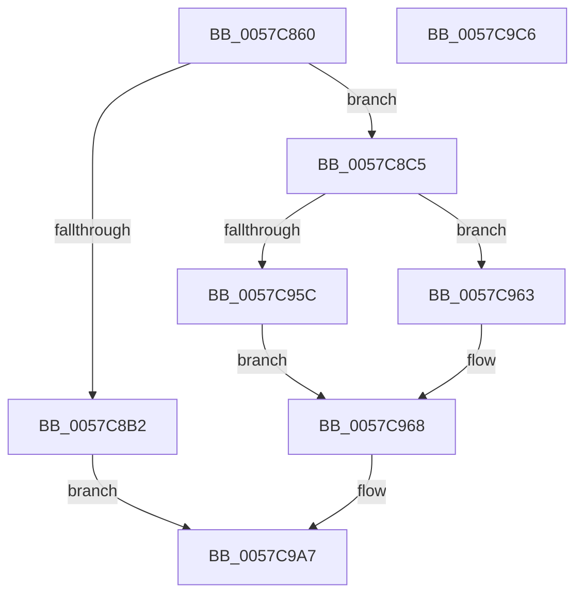

# CcDeferWrite

- RVA: `0x0057C860`–`0x0057C9C7` (길이 `359` bytes)
- VA: `0x000000014057C860`
- 실행 섹션: `.text`
- PDB 이름 있음: `예`; PDB Function 태그: `아니요`
- unwind 정보 RVA: `0x0008A668`
- 디코드: `90`개 명령, `359/359` bytes 표시
- 미해석 바이트: `0` (있으면 어셈블리에 `.byte`로 보존)

> 이 문서는 커널 이미지의 기계어와 PDB 기호를 분석해 생성했습니다. 4번과 5번은 함수 원형과 자료형을 바이너리 사용 방식에서 추정한 C 해석이며 원본 소스 복구 결과는 아닙니다.

## 1. Dependencies

- 직접 호출 지점: **14**; 고유 호출 대상: **14**
- 직접 호출자로 확인된 함수: **1**
- RIP 상대 이미지 참조: **0**

### Outgoing calls
- `0x0057C8A5` → [ExAllocatePoolWithTag](../../poolcode/B8/ExAllocatePoolWithTag_function_00B82010.md) (function, `0x00B82010`)
- `0x0057C8BB` → [guard_dispatch_icall](../6B/guard_dispatch_icall_function_006BAAD0.md) (function, `0x006BAAD0`)
- `0x0057C8C5` → [KeRcuReadLock](../38/KeRcuReadLock_function_0038A1A0.md) (function, `0x0038A1A0`)
- `0x0057C8CD` → [CcReferencePartitionFromFileObject](../38/CcReferencePartitionFromFileObject_function_00388200.md) (function, `0x00388200`)
- `0x0057C8DB` → [CcGetPrivateVolumeCacheMapFromFileObject](../38/CcGetPrivateVolumeCacheMapFromFileObject_function_00388794.md) (function, `0x00388794`)
- `0x0057C8E3` → [KeRcuReadUnlock](../38/KeRcuReadUnlock_function_0038A070.md) (function, `0x0038A070`)
- `0x0057C8EE` → [CcReferencePartitionAndPrivateVolumeCacheMap](../38/CcReferencePartitionAndPrivateVolumeCacheMap_function_0038B9E0.md) (function, `0x0038B9E0`)
- `0x0057C95C` → [ExInterlockedInsertHeadList](../38/ExInterlockedInsertHeadList_function_00386680.md) (function, `0x00386680`)
- `0x0057C963` → [ExInterlockedInsertTailList](../38/ExInterlockedInsertTailList_function_00386700.md) (function, `0x00386700`)
- `0x0057C96E` → [CcPostDeferredWrites](../35/CcPostDeferredWrites_function_003590FC.md) (function, `0x003590FC`)
- `0x0057C97F` → [KeAcquireInStackQueuedSpinLock](../27/KeAcquireInStackQueuedSpinLock_function_002757A0.md) (function, `0x002757A0`)
- `0x0057C990` → [CcScheduleLazyWriteScan](../3C/CcScheduleLazyWriteScan_function_003CBD20.md) (function, `0x003CBD20`)
- `0x0057C99A` → [KeReleaseInStackQueuedSpinLock](../34/KeReleaseInStackQueuedSpinLock_function_00342CE0.md) (function, `0x00342CE0`)
- `0x0057C9A2` → [CcDereferencePartition](../35/CcDereferencePartition_function_003572F0.md) (function, `0x003572F0`)

### Direct callers
- [DifCcDeferWriteWrapper](../61/DifCcDeferWriteWrapper_function_0061C450.md) at `0x0061C55D`

### Static image references
- 디코드된 RIP-relative 메모리 참조가 없습니다.

## 2. Other-region calls and transfers

- 다른 실행 섹션으로 향하는 call: **1**
  - `0x0057C8A5` → [ExAllocatePoolWithTag](../../poolcode/B8/ExAllocatePoolWithTag_function_00B82010.md) (`.text` → `POOLCODE`)
- 별도 외부 분기/꼬리 이동을 확인하지 못했습니다.

## 3. Assembly (complete function range)

```asm
0057C860  4C 8B DC                        mov r11, rsp
0057C863  49 89 5B 08                     mov qword ptr [r11 + 8], rbx
0057C867  49 89 6B 10                     mov qword ptr [r11 + 0x10], rbp
0057C86B  49 89 73 18                     mov qword ptr [r11 + 0x18], rsi
0057C86F  49 89 7B 20                     mov qword ptr [r11 + 0x20], rdi
0057C873  41 54                           push r12
0057C875  41 56                           push r14
0057C877  41 57                           push r15
0057C879  48 83 EC 40                     sub rsp, 0x40
0057C87D  33 C0                           xor eax, eax
0057C87F  0F 57 C0                        xorps xmm0, xmm0
0057C882  4D 8B F0                        mov r14, r8
0057C885  4C 8B FA                        mov r15, rdx
0057C888  4C 8B E1                        mov r12, rcx
0057C88B  41 B8 43 63 44 77               mov r8d, 0x77446343
0057C891  0F 11 44 24 20                  movups xmmword ptr [rsp + 0x20], xmm0
0057C896  8D 50 68                        lea edx, [rax + 0x68]
0057C899  49 89 43 D8                     mov qword ptr [r11 - 0x28], rax
0057C89D  B9 00 02 00 00                  mov ecx, 0x200
0057C8A2  49 8B E9                        mov rbp, r9
0057C8A5  E8 66 57 60 00                  call 0x140b82010
0057C8AA  48 8B F8                        mov rdi, rax
0057C8AD  48 85 C0                        test rax, rax
0057C8B0  75 13                           jne 0x14057c8c5
0057C8B2  48 8B D5                        mov rdx, rbp
0057C8B5  49 8B CE                        mov rcx, r14
0057C8B8  49 8B C7                        mov rax, r15
0057C8BB  E8 10 E2 13 00                  call 0x1406baad0
0057C8C0  E9 E2 00 00 00                  jmp 0x14057c9a7
0057C8C5  E8 D6 D8 E0 FF                  call 0x14038a1a0
0057C8CA  49 8B CC                        mov rcx, r12
0057C8CD  E8 2E B9 E0 FF                  call 0x140388200
0057C8D2  48 8B D0                        mov rdx, rax
0057C8D5  49 8B CC                        mov rcx, r12
0057C8D8  48 8B D8                        mov rbx, rax
0057C8DB  E8 B4 BE E0 FF                  call 0x140388794
0057C8E0  48 8B F0                        mov rsi, rax
0057C8E3  E8 88 D7 E0 FF                  call 0x14038a070
0057C8E8  48 8B D6                        mov rdx, rsi
0057C8EB  48 8B CB                        mov rcx, rbx
0057C8EE  E8 ED F0 E0 FF                  call 0x14038b9e0
0057C8F3  48 83 67 28 00                  and qword ptr [rdi + 0x28], 0
0057C8F8  4C 8D 83 C0 04 00 00            lea r8, [rbx + 0x4c0]
0057C8FF  8B 8C 24 80 00 00 00            mov ecx, dword ptr [rsp + 0x80]
0057C906  48 8D 57 18                     lea rdx, [rdi + 0x18]
0057C90A  89 4F 10                        mov dword ptr [rdi + 0x10], ecx
0057C90D  48 85 F6                        test rsi, rsi
0057C910  48 89 5F 48                     mov qword ptr [rdi + 0x48], rbx
0057C914  48 8D 8E 50 04 00 00            lea rcx, [rsi + 0x450]
0057C91B  48 89 77 50                     mov qword ptr [rdi + 0x50], rsi
0057C91F  C7 07 FC 02 68 00               mov dword ptr [rdi], 0x6802fc
0057C925  4C 89 67 08                     mov qword ptr [rdi + 8], r12
0057C929  4C 89 7F 30                     mov qword ptr [rdi + 0x30], r15
0057C92D  4C 89 77 38                     mov qword ptr [rdi + 0x38], r14
0057C931  48 89 6F 40                     mov qword ptr [rdi + 0x40], rbp
0057C935  48 A1 20 03 00 00 80 F7 FF FF   movabs rax, qword ptr [0xfffff78000000320]
0057C93F  48 89 47 60                     mov qword ptr [rdi + 0x60], rax
0057C943  48 8D 83 90 04 00 00            lea rax, [rbx + 0x490]
0057C94A  48 0F 44 C8                     cmove rcx, rax
0057C94E  C6 47 58 00                     mov byte ptr [rdi + 0x58], 0
0057C952  80 BC 24 88 00 00 00 00         cmp byte ptr [rsp + 0x88], 0
0057C95A  74 07                           je 0x14057c963
0057C95C  E8 1F 9D E0 FF                  call 0x140386680
0057C961  EB 05                           jmp 0x14057c968
0057C963  E8 98 9D E0 FF                  call 0x140386700
0057C968  48 8B D6                        mov rdx, rsi
0057C96B  48 8B CB                        mov rcx, rbx
0057C96E  E8 89 C7 DD FF                  call 0x1403590fc
0057C973  48 8D 8B 00 03 00 00            lea rcx, [rbx + 0x300]
0057C97A  48 8D 54 24 20                  lea rdx, [rsp + 0x20]
0057C97F  E8 1C 8E CF FF                  call 0x1402757a0
0057C984  45 33 C9                        xor r9d, r9d
0057C987  41 B0 01                        mov r8b, 1
0057C98A  48 8B D6                        mov rdx, rsi
0057C98D  48 8B CB                        mov rcx, rbx
0057C990  E8 8B F3 E4 FF                  call 0x1403cbd20
0057C995  48 8D 4C 24 20                  lea rcx, [rsp + 0x20]
0057C99A  E8 41 63 DC FF                  call 0x140342ce0
0057C99F  48 8B CB                        mov rcx, rbx
0057C9A2  E8 49 A9 DD FF                  call 0x1403572f0
0057C9A7  48 8B 5C 24 60                  mov rbx, qword ptr [rsp + 0x60]
0057C9AC  48 8B 6C 24 68                  mov rbp, qword ptr [rsp + 0x68]
0057C9B1  48 8B 74 24 70                  mov rsi, qword ptr [rsp + 0x70]
0057C9B6  48 8B 7C 24 78                  mov rdi, qword ptr [rsp + 0x78]
0057C9BB  48 83 C4 40                     add rsp, 0x40
0057C9BF  41 5F                           pop r15
0057C9C1  41 5E                           pop r14
0057C9C3  41 5C                           pop r12
0057C9C5  C3                              ret
0057C9C6  CC                              int3
```

## 4. C-style interpretation (structured pseudocode)

```c
__int64 __fastcall CcDeferWrite(__int64 a1, __int64 a2, __int64 a3, __int64 a4, unsigned int a5, unsigned __int8 a6)
{
    __int64 result;
    __int64 v_rsp;
    unsigned __int64 v_stack_m38;
    unsigned __int64 v_stack_p10;
    unsigned __int64 v_stack_p18;
    unsigned __int64 v_stack_p20;
    unsigned __int64 v_stack_p8;

    *(unsigned __int64 *)(v_rsp + 8) = v_rbx;
    *(unsigned __int64 *)(v_rsp + 16) = v_rbp;
    *(unsigned __int64 *)(v_rsp + 24) = v_rsi;
    *(unsigned __int64 *)(v_rsp + 32) = v_rdi;
    v_rsp = (v_rsp) - (64);
    result = 0;
    v_stack_m38 = v_xmm0;
    *(unsigned __int64 *)(v_rsp - 40) = 0;
    result = ExAllocatePoolWithTag(512, result + 104, (unsigned int)(0x77446343ULL), a4);
    if (result != 0) goto loc_0057C8C5;
    result = guard_dispatch_icall(a3, a4, (unsigned int)(0x77446343ULL), a4);
    goto loc_0057C9A7;
loc_0057C8C5:
    result = KeRcuReadLock(a3, a4, (unsigned int)(0x77446343ULL), a4);
    result = CcReferencePartitionFromFileObject(a1, a4, (unsigned int)(0x77446343ULL), a4);
    result = CcGetPrivateVolumeCacheMapFromFileObject(a1, result, (unsigned int)(0x77446343ULL), a4);
    result = KeRcuReadUnlock(a1, result, (unsigned int)(0x77446343ULL), a4);
    result = CcReferencePartitionAndPrivateVolumeCacheMap(result, result, (unsigned int)(0x77446343ULL), a4);
    *(unsigned int *)(result + 16) = (unsigned int)((unsigned int)(a5));
    *(unsigned __int64 *)(result + 72) = result;
    *(unsigned __int64 *)(result + 80) = result;
    *(unsigned int *)(result) = 0x6802FCULL;
    *(unsigned __int64 *)(result + 8) = a1;
    *(unsigned __int64 *)(result + 48) = a2;
    *(unsigned __int64 *)(result + 56) = a3;
    *(unsigned __int64 *)(result + 64) = a4;
    *(unsigned __int64 *)(result + 96) = result;
    a1 = result + 1104;
    if (result == 0) { a1 = result + 1168; }
    *(unsigned __int8 *)(result + 88) = 0;
    if (a6 == 0) goto loc_0057C963;
    result = ExInterlockedInsertHeadList(a1, result + 24, result + 1216, a4);
    goto loc_0057C968;
loc_0057C963:
    result = ExInterlockedInsertTailList(a1, result + 24, result + 1216, a4);
loc_0057C968:
    result = CcPostDeferredWrites(result, result, result + 1216, a4);
    result = KeAcquireInStackQueuedSpinLock(result + 768, v_stack_m38, result + 1216, a4);
    a4 = 0;
    result = CcScheduleLazyWriteScan(result, result, 1, a4);
    result = KeReleaseInStackQueuedSpinLock(v_stack_m38, result, 1, a4);
    result = CcDereferencePartition(result, result, 1, a4);
loc_0057C9A7:
    v_rsp = (v_rsp) + (64);
    return result;
}
```

## 5. (Beta) C Style

```c
int64_t CcDeferWrite(int64_t Arg1, int64_t Arg2, int64_t Arg3, int64_t Arg4, uint32_t Arg5, uint8_t Arg6)
{
    int64_t result;
    int64_t local_rsp;
    uint64_t v_stack_m38;
    uint64_t v_stack_p10;
    uint64_t v_stack_p18;
    uint64_t v_stack_p20;
    uint64_t v_stack_p8;

    *(uint64_t *)(local_rsp + 0x8) = local_rbx;
    *(uint64_t *)(local_rsp + 0x10) = local_rbp;
    *(uint64_t *)(local_rsp + 0x18) = local_rsi;
    *(uint64_t *)(local_rsp + 0x20) = local_rdi;
    local_rsp = (local_rsp) - (64);
    result = 0;
    v_stack_m38 = v_xmm0;
    *(uint64_t *)(local_rsp - 0x28) = 0;
    result = ExAllocatePoolWithTag(512, result + 104, (uint32_t)(0x77446343ULL), Arg4);
    if (result != 0) goto loc_0057C8C5;
    result = guard_dispatch_icall(Arg3, Arg4, (uint32_t)(0x77446343ULL), Arg4);
    goto loc_0057C9A7;
loc_0057C8C5:
    result = KeRcuReadLock(Arg3, Arg4, (uint32_t)(0x77446343ULL), Arg4);
    result = CcReferencePartitionFromFileObject(Arg1, Arg4, (uint32_t)(0x77446343ULL), Arg4);
    result = CcGetPrivateVolumeCacheMapFromFileObject(Arg1, result, (uint32_t)(0x77446343ULL), Arg4);
    result = KeRcuReadUnlock(Arg1, result, (uint32_t)(0x77446343ULL), Arg4);
    result = CcReferencePartitionAndPrivateVolumeCacheMap(result, result, (uint32_t)(0x77446343ULL), Arg4);
    *(uint32_t *)(result + 0x10) = (uint32_t)((uint32_t)(Arg5));
    *(uint64_t *)(result + 0x48) = result;
    *(uint64_t *)(result + 0x50) = result;
    *(uint32_t *)(result) = 0x6802FCULL;
    *(uint64_t *)(result + 0x8) = Arg1;
    *(uint64_t *)(result + 0x30) = Arg2;
    *(uint64_t *)(result + 0x38) = Arg3;
    *(uint64_t *)(result + 0x40) = Arg4;
    *(uint64_t *)(result + 0x60) = result;
    Arg1 = result + 1104;
    if (result == 0) { Arg1 = result + 1168; }
    *(uint8_t *)(result + 0x58) = 0;
    if (Arg6 == 0) goto loc_0057C963;
    result = ExInterlockedInsertHeadList(Arg1, result + 24, result + 1216, Arg4);
    goto loc_0057C968;
loc_0057C963:
    result = ExInterlockedInsertTailList(Arg1, result + 24, result + 1216, Arg4);
loc_0057C968:
    result = CcPostDeferredWrites(result, result, result + 1216, Arg4);
    result = KeAcquireInStackQueuedSpinLock(result + 768, v_stack_m38, result + 1216, Arg4);
    Arg4 = 0;
    result = CcScheduleLazyWriteScan(result, result, 1, Arg4);
    result = KeReleaseInStackQueuedSpinLock(v_stack_m38, result, 1, Arg4);
    result = CcDereferencePartition(result, result, 1, Arg4);
loc_0057C9A7:
    local_rsp = (local_rsp) + (64);
    return result;
}
```

## 6. Execution-region graph

[열기: 2D/3D 그래프와 함수 탐색 컨트롤 패널](../../../control-panel.html?section=text&rva=0x0057C860&view=graph)

- 2D 그래프는 위에서 아래로 흐르고, 3D 그래프는 빈 공간을 드래그해 회전합니다. Shift+드래그는 이동, 휠은 확대·축소, 함수 노드 선택은 대상 보고서 이동입니다.

### Static fallback


