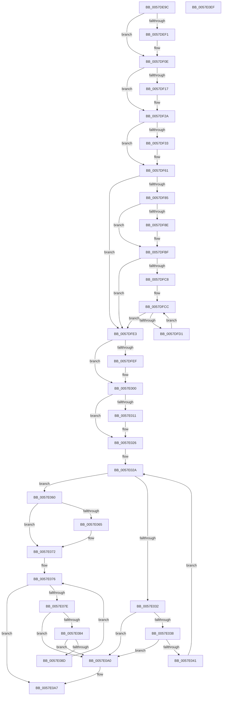

# CcDeletePartition

- RVA: `0x0057DE9C`–`0x0057E0F0` (길이 `596` bytes)
- VA: `0x000000014057DE9C`
- 실행 섹션: `.text`
- PDB 이름 있음: `예`; PDB Function 태그: `아니요`
- unwind 정보 RVA: `0x00091ECC`
- 디코드: `147`개 명령, `596/596` bytes 표시
- 미해석 바이트: `0` (있으면 어셈블리에 `.byte`로 보존)

> 이 문서는 커널 이미지의 기계어와 PDB 기호를 분석해 생성했습니다. 4번과 5번은 함수 원형과 자료형을 바이너리 사용 방식에서 추정한 C 해석이며 원본 소스 복구 결과는 아닙니다.

## 1. Dependencies

- 직접 호출 지점: **21**; 고유 호출 대상: **17**
- 직접 호출자로 확인된 함수: **3**
- RIP 상대 이미지 참조: **6**

### Outgoing calls
- `0x0057DED8` → [KeSetEvent](../33/KeSetEvent_function_0033F310.md) (function, `0x0033F310`)
- `0x0057DEE0` → [CcDereferencePartition](../35/CcDereferencePartition_function_003572F0.md) (function, `0x003572F0`)
- `0x0057DEF6` → [ZwWaitForSingleObject](../6A/ZwWaitForSingleObject_function_006AD150.md) (function, `0x006AD150`)
- `0x0057DF02` → [ZwClose](../6A/ZwClose_function_006AD2B0.md) (function, `0x006AD2B0`)
- `0x0057DF25` → [KeCancelTimer](../23/KeCancelTimer_function_002327E0.md) (function, `0x002327E0`)
- `0x0057DF3A` → [KeAcquireSpinLockRaiseToDpc](../20/KeAcquireSpinLockRaiseToDpc_function_00208470.md) (function, `0x00208470`)
- `0x0057DF5C` → [KeReleaseSpinLock](../39/KeReleaseSpinLock_function_00392BA0.md) (function, `0x00392BA0`)
- `0x0057DF68` → [KeCancelTimer](../23/KeCancelTimer_function_002327E0.md) (function, `0x002327E0`)
- `0x0057DF77` → [CcDrainDelayDeleteForPartitionExit](CcDrainDelayDeleteForPartitionExit_function_0057DBB0.md) (function, `0x0057DBB0`)
- `0x0057DF9F` → [KeWaitForSingleObject](../20/KeWaitForSingleObject_function_0020E6B0.md) (function, `0x0020E6B0`)
- `0x0057DFB0` → [KeAcquireInStackQueuedSpinLock](../27/KeAcquireInStackQueuedSpinLock_function_002757A0.md) (function, `0x002757A0`)
- `0x0057DFBA` → [KeReleaseInStackQueuedSpinLock](../34/KeReleaseInStackQueuedSpinLock_function_00342CE0.md) (function, `0x00342CE0`)
- `0x0057DFDC` → [KeDelayExecutionThread](../20/KeDelayExecutionThread_function_00209550.md) (function, `0x00209550`)
- `0x0057DFF4` → [ExFreePoolWithTag](../../poolcode/B8/ExFreePoolWithTag_function_00B82870.md) (function, `0x00B82870`)
- `0x0057E003` → [CcUninitializePartitionVacbs](CcUninitializePartitionVacbs_function_0057EC70.md) (function, `0x0057EC70`)
- `0x0057E021` → [CcForEachNumaNode](../3C/CcForEachNumaNode_function_003CF070.md) (function, `0x003CF070`)
- `0x0057E04F` → [CcDeleteNumaNode](../3C/CcDeleteNumaNode_function_003CEF5C.md) (function, `0x003CEF5C`)
- `0x0057E06D` → [ExFreePoolWithTag](../../poolcode/B8/ExFreePoolWithTag_function_00B82870.md) (function, `0x00B82870`)
- `0x0057E099` → [ExFreePoolWithTag](../../poolcode/B8/ExFreePoolWithTag_function_00B82870.md) (function, `0x00B82870`)
- `0x0057E0C2` → [DbgPrintEx](../35/DbgPrintEx_function_00359290.md) (function, `0x00359290`)
- `0x0057E0CF` → [ExFreePoolWithTag](../../poolcode/B8/ExFreePoolWithTag_function_00B82870.md) (function, `0x00B82870`)

### Direct callers
- [CcCreatePartition](CcCreatePartition_function_0057DE10.md) at `0x0057DE80`
- [CcExitPartition](CcExitPartition_function_0057E340.md) at `0x0057E4B5`
- [sub_006E8790](../6E/Unknown_function_006E8790.md) at `0x006E882D`

### Static image references
- `0x0057DF33` → RVA `0x00F8F510` (`.data`; read)
- `0x0057DF4B` → RVA `0x00F8F518` (`.data`; read/write)
- `0x0057DF7C` → RVA `0x00E65B88` (`.data`; read)
- `0x0057DFD1` → RVA `0x00E0A848` (`.data`; read)
- `0x0057E014` → RVA `0x0049E600` (`CcUnInitializeAsyncReadForNodeHelper`; read)
- `0x0057E0AB` → RVA `0x006C8D50` (` ?? ::FNODOBFM::`string'`; read)

## 2. Other-region calls and transfers

- 다른 실행 섹션으로 향하는 call: **4**
  - `0x0057DFF4` → [ExFreePoolWithTag](../../poolcode/B8/ExFreePoolWithTag_function_00B82870.md) (`.text` → `POOLCODE`)
  - `0x0057E06D` → [ExFreePoolWithTag](../../poolcode/B8/ExFreePoolWithTag_function_00B82870.md) (`.text` → `POOLCODE`)
  - `0x0057E099` → [ExFreePoolWithTag](../../poolcode/B8/ExFreePoolWithTag_function_00B82870.md) (`.text` → `POOLCODE`)
  - `0x0057E0CF` → [ExFreePoolWithTag](../../poolcode/B8/ExFreePoolWithTag_function_00B82870.md) (`.text` → `POOLCODE`)
- 별도 외부 분기/꼬리 이동을 확인하지 못했습니다.

## 3. Assembly (complete function range)

```asm
0057DE9C  4C 8B DC                        mov r11, rsp
0057DE9F  49 89 5B 08                     mov qword ptr [r11 + 8], rbx
0057DEA3  49 89 6B 10                     mov qword ptr [r11 + 0x10], rbp
0057DEA7  49 89 73 18                     mov qword ptr [r11 + 0x18], rsi
0057DEAB  49 89 7B 20                     mov qword ptr [r11 + 0x20], rdi
0057DEAF  41 56                           push r14
0057DEB1  48 83 EC 50                     sub rsp, 0x50
0057DEB5  0F 57 C0                        xorps xmm0, xmm0
0057DEB8  48 8B F9                        mov rdi, rcx
0057DEBB  33 C0                           xor eax, eax
0057DEBD  45 33 F6                        xor r14d, r14d
0057DEC0  0F 11 44 24 30                  movups xmmword ptr [rsp + 0x30], xmm0
0057DEC5  48 81 C1 18 05 00 00            add rcx, 0x518
0057DECC  49 89 43 E8                     mov qword ptr [r11 - 0x18], rax
0057DED0  45 33 C0                        xor r8d, r8d
0057DED3  33 D2                           xor edx, edx
0057DED5  41 8B EE                        mov ebp, r14d
0057DED8  E8 33 14 DC FF                  call 0x14033f310
0057DEDD  48 8B CF                        mov rcx, rdi
0057DEE0  E8 0B 94 DD FF                  call 0x1403572f0
0057DEE5  48 8B 8F 48 05 00 00            mov rcx, qword ptr [rdi + 0x548]
0057DEEC  48 85 C9                        test rcx, rcx
0057DEEF  74 1D                           je 0x14057df0e
0057DEF1  45 33 C0                        xor r8d, r8d
0057DEF4  33 D2                           xor edx, edx
0057DEF6  E8 55 F2 12 00                  call 0x1406ad150
0057DEFB  48 8B 8F 48 05 00 00            mov rcx, qword ptr [rdi + 0x548]
0057DF02  E8 A9 F3 12 00                  call 0x1406ad2b0
0057DF07  4C 89 B7 48 05 00 00            mov qword ptr [rdi + 0x548], r14
0057DF0E  44 38 B7 18 04 00 00            cmp byte ptr [rdi + 0x418], r14b
0057DF15  74 13                           je 0x14057df2a
0057DF17  48 8D 8F D8 03 00 00            lea rcx, [rdi + 0x3d8]
0057DF1E  44 88 B7 18 04 00 00            mov byte ptr [rdi + 0x418], r14b
0057DF25  E8 B6 48 CB FF                  call 0x1402327e0
0057DF2A  44 38 B7 0D 05 00 00            cmp byte ptr [rdi + 0x50d], r14b
0057DF31  74 2E                           je 0x14057df61
0057DF33  48 8D 0D D6 15 A1 00            lea rcx, [rip + 0xa115d6]
0057DF3A  E8 31 A5 C8 FF                  call 0x140208470
0057DF3F  BA FF FF 00 00                  mov edx, 0xffff
0057DF44  48 8D 0D C5 15 A1 00            lea rcx, [rip + 0xa115c5]
0057DF4B  66 01 15 C6 15 A1 00            add word ptr [rip + 0xa115c6], dx
0057DF52  48 8B 57 08                     mov rdx, qword ptr [rdi + 8]
0057DF56  4C 89 72 08                     mov qword ptr [rdx + 8], r14
0057DF5A  8A D0                           mov dl, al
0057DF5C  E8 3F 4C E1 FF                  call 0x140392ba0
0057DF61  48 8D 8F 60 05 00 00            lea rcx, [rdi + 0x560]
0057DF68  E8 73 48 CB FF                  call 0x1402327e0
0057DF6D  48 8B CF                        mov rcx, rdi
0057DF70  44 88 B7 E0 05 00 00            mov byte ptr [rdi + 0x5e0], r14b
0057DF77  E8 34 FC FF FF                  call 0x14057dbb0
0057DF7C  44 38 35 05 7C 8E 00            cmp byte ptr [rip + 0x8e7c05], r14b
0057DF83  74 5E                           je 0x14057dfe3
0057DF85  4C 39 B7 10 05 00 00            cmp qword ptr [rdi + 0x510], r14
0057DF8C  74 31                           je 0x14057dfbf
0057DF8E  48 8D 4F 38                     lea rcx, [rdi + 0x38]
0057DF92  4C 89 74 24 20                  mov qword ptr [rsp + 0x20], r14
0057DF97  45 33 C9                        xor r9d, r9d
0057DF9A  45 33 C0                        xor r8d, r8d
0057DF9D  33 D2                           xor edx, edx
0057DF9F  E8 0C 07 C9 FF                  call 0x14020e6b0
0057DFA4  48 8D 8F 00 03 00 00            lea rcx, [rdi + 0x300]
0057DFAB  48 8D 54 24 30                  lea rdx, [rsp + 0x30]
0057DFB0  E8 EB 77 CF FF                  call 0x1402757a0
0057DFB5  48 8D 4C 24 30                  lea rcx, [rsp + 0x30]
0057DFBA  E8 21 4D DC FF                  call 0x140342ce0
0057DFBF  44 38 35 C2 7B 8E 00            cmp byte ptr [rip + 0x8e7bc2], r14b
0057DFC6  74 1B                           je 0x14057dfe3
0057DFC8  48 8D 5F 60                     lea rbx, [rdi + 0x60]
0057DFCC  48 39 1B                        cmp qword ptr [rbx], rbx
0057DFCF  75 12                           jne 0x14057dfe3
0057DFD1  4C 8D 05 70 C8 88 00            lea r8, [rip + 0x88c870]
0057DFD8  33 D2                           xor edx, edx
0057DFDA  33 C9                           xor ecx, ecx
0057DFDC  E8 6F B5 C8 FF                  call 0x140209550
0057DFE1  EB E9                           jmp 0x14057dfcc
0057DFE3  48 8B 8F 70 04 00 00            mov rcx, qword ptr [rdi + 0x470]
0057DFEA  48 85 C9                        test rcx, rcx
0057DFED  74 11                           je 0x14057e000
0057DFEF  BA 43 63 54 70                  mov edx, 0x70546343
0057DFF4  E8 77 48 60 00                  call 0x140b82870
0057DFF9  4C 89 B7 70 04 00 00            mov qword ptr [rdi + 0x470], r14
0057E000  48 8B CF                        mov rcx, rdi
0057E003  E8 68 0C 00 00                  call 0x14057ec70
0057E008  44 38 35 79 7B 8E 00            cmp byte ptr [rip + 0x8e7b79], r14b
0057E00F  75 15                           jne 0x14057e026
0057E011  45 33 C9                        xor r9d, r9d
0057E014  48 8D 0D E5 05 F2 FF            lea rcx, [rip - 0xdfa1b]
0057E01B  45 33 C0                        xor r8d, r8d
0057E01E  48 8B D7                        mov rdx, rdi
0057E021  E8 4A 10 E5 FF                  call 0x1403cf070
0057E026  48 8D 77 10                     lea rsi, [rdi + 0x10]
0057E02A  48 8B 1E                        mov rbx, qword ptr [rsi]
0057E02D  48 3B DE                        cmp rbx, rsi
0057E030  74 2E                           je 0x14057e060
0057E032  48 39 73 08                     cmp qword ptr [rbx + 8], rsi
0057E036  75 68                           jne 0x14057e0a0
0057E038  48 8B 03                        mov rax, qword ptr [rbx]
0057E03B  48 39 58 08                     cmp qword ptr [rax + 8], rbx
0057E03F  75 5F                           jne 0x14057e0a0
0057E041  48 89 06                        mov qword ptr [rsi], rax
0057E044  48 83 C3 E0                     add rbx, -0x20
0057E048  48 8B CB                        mov rcx, rbx
0057E04B  48 89 70 08                     mov qword ptr [rax + 8], rsi
0057E04F  E8 08 0F E5 FF                  call 0x1403cef5c
0057E054  48 85 ED                        test rbp, rbp
0057E057  48 0F 45 DD                     cmovne rbx, rbp
0057E05B  48 8B EB                        mov rbp, rbx
0057E05E  EB CA                           jmp 0x14057e02a
0057E060  48 85 ED                        test rbp, rbp
0057E063  74 0D                           je 0x14057e072
0057E065  BA 43 63 4E 75                  mov edx, 0x754e6343
0057E06A  48 8B CD                        mov rcx, rbp
0057E06D  E8 FE 47 60 00                  call 0x140b82870
0057E072  48 8D 5F 60                     lea rbx, [rdi + 0x60]
0057E076  48 8B 0B                        mov rcx, qword ptr [rbx]
0057E079  48 3B CB                        cmp rcx, rbx
0057E07C  74 29                           je 0x14057e0a7
0057E07E  48 39 59 08                     cmp qword ptr [rcx + 8], rbx
0057E082  75 1C                           jne 0x14057e0a0
0057E084  48 8B 01                        mov rax, qword ptr [rcx]
0057E087  48 39 48 08                     cmp qword ptr [rax + 8], rcx
0057E08B  75 13                           jne 0x14057e0a0
0057E08D  48 89 03                        mov qword ptr [rbx], rax
0057E090  BA 43 63 57 71                  mov edx, 0x71576343
0057E095  48 89 58 08                     mov qword ptr [rax + 8], rbx
0057E099  E8 D2 47 60 00                  call 0x140b82870
0057E09E  EB D6                           jmp 0x14057e076
0057E0A0  B9 03 00 00 00                  mov ecx, 3
0057E0A5  CD 29                           int 0x29
0057E0A7  48 8B 47 08                     mov rax, qword ptr [rdi + 8]
0057E0AB  4C 8D 05 9E AC 14 00            lea r8, [rip + 0x14ac9e]
0057E0B2  BA 02 00 00 00                  mov edx, 2
0057E0B7  48 89 44 24 20                  mov qword ptr [rsp + 0x20], rax
0057E0BC  4C 8B CF                        mov r9, rdi
0057E0BF  8D 4A 7D                        lea ecx, [rdx + 0x7d]
0057E0C2  E8 C9 B1 DD FF                  call 0x140359290
0057E0C7  BA 43 63 50 72                  mov edx, 0x72506343
0057E0CC  48 8B CF                        mov rcx, rdi
0057E0CF  E8 9C 47 60 00                  call 0x140b82870
0057E0D4  48 8B 5C 24 60                  mov rbx, qword ptr [rsp + 0x60]
0057E0D9  48 8B 6C 24 68                  mov rbp, qword ptr [rsp + 0x68]
0057E0DE  48 8B 74 24 70                  mov rsi, qword ptr [rsp + 0x70]
0057E0E3  48 8B 7C 24 78                  mov rdi, qword ptr [rsp + 0x78]
0057E0E8  48 83 C4 50                     add rsp, 0x50
0057E0EC  41 5E                           pop r14
0057E0EE  C3                              ret
0057E0EF  CC                              int3
```

## 4. C-style interpretation (structured pseudocode)

```c
__int64 __fastcall CcDeletePartition(__int64 a1, int a2, int a3, int a4)
{
    __int64 result;
    __int64 v_r14;
    __int64 v_rbx;
    __int64 v_rsp;
    unsigned __int64 v_stack_m28;
    unsigned __int64 v_stack_m38;
    unsigned __int64 v_stack_p10;
    unsigned __int64 v_stack_p18;
    unsigned __int64 v_stack_p20;
    unsigned __int64 v_stack_p8;

    *(unsigned __int64 *)(v_rsp + 8) = v_rbx;
    *(unsigned __int64 *)(v_rsp + 16) = v_rbp;
    *(unsigned __int64 *)(v_rsp + 24) = v_rsi;
    *(unsigned __int64 *)(v_rsp + 32) = v_rdi;
    v_rsp = (v_rsp) - (80);
    result = 0;
    v_r14 = 0;
    v_stack_m28 = v_xmm0;
    a1 = (a1) + (0x518ULL);
    *(unsigned __int64 *)(v_rsp - 24) = 0;
    a3 = 0;
    a2 = 0;
    result = KeSetEvent(a1, a2, a3, a4);
    result = CcDereferencePartition(a1, a2, a3, a4);
    if (*(unsigned __int64 *)(a1 + 1352) != 0) {
        a3 = 0;
        a2 = 0;
        result = ZwWaitForSingleObject(*(unsigned __int64 *)(a1 + 1352), a2, a3, a4);
        a1 = *(unsigned __int64 *)(a1 + 1352);
        result = ZwClose(a1, a2, a3, a4);
        *(unsigned __int64 *)(a1 + 1352) = 0;
    }
    if ((*(unsigned __int8 *)(a1 + 1048)) != 0) {
        a1 = a1 + 984;
        *(unsigned __int8 *)(a1 + 1048) = 0;
        result = KeCancelTimer(a1, a2, a3, a4);
    }
    if ((*(unsigned __int8 *)(a1 + 1293)) != 0) {
        a1 = v_rip + 10556886;
        result = KeAcquireSpinLockRaiseToDpc(a1, a2, a3, a4);
        a2 = 0xFFFFULL;
        a1 = v_rip + 10556869;
        a2 = *(unsigned __int64 *)(a1 + 8);
        *(unsigned __int64 *)(a2 + 8) = 0;
        a2 = (unsigned __int8)(result);
        result = KeReleaseSpinLock(a1, a2, a3, a4);
    }
    result = KeCancelTimer(a1 + 1376, a2, a3, a4);
    *(unsigned __int8 *)(a1 + 1504) = 0;
    result = CcDrainDelayDeleteForPartitionExit(a1, a2, a3, a4);
    if ((*(unsigned __int8 *)(v_rip + 9337861)) == 0) goto loc_0057DFE3;
    if ((*(unsigned __int64 *)(a1 + 1296)) != 0) {
        a1 = a1 + 56;
        v_stack_m38 = 0;
        a4 = 0;
        a3 = 0;
        a2 = 0;
        result = KeWaitForSingleObject(a1, a2, a3, a4);
        a1 = a1 + 768;
        a2 = v_stack_m28;
        result = KeAcquireInStackQueuedSpinLock(a1, a2, a3, a4);
        a1 = v_stack_m28;
        result = KeReleaseInStackQueuedSpinLock(a1, a2, a3, a4);
    }
    if ((*(unsigned __int8 *)(v_rip + 9337794)) == 0) goto loc_0057DFE3;
loc_0057DFCC:
    if ((*(unsigned __int64 *)(a1 + 96)) != (a1 + 96)) goto loc_0057DFE3;
    a2 = 0;
    a1 = 0;
    result = KeDelayExecutionThread(a1, a2, v_rip + 8964208, a4);
    goto loc_0057DFCC;
loc_0057DFE3:
    if (*(unsigned __int64 *)(a1 + 1136) != 0) {
        a2 = 0x70546343ULL;
        result = ExFreePoolWithTag(*(unsigned __int64 *)(a1 + 1136), a2, v_rip + 8964208, a4);
        *(unsigned __int64 *)(a1 + 1136) = 0;
    }
    result = CcUninitializePartitionVacbs(0, a2, v_rip + 8964208, a4);
    if ((*(unsigned __int8 *)(v_rip + 9337721)) == 0) {
        a4 = 0;
        a1 = v_rip - 915995;
        a3 = 0;
        a2 = a1;
        result = CcForEachNumaNode(a1, a2, a3, a4);
    }
loc_0057E02A:
    if ((*(unsigned __int64 *)(a1 + 16)) == (a1 + 16)) goto loc_0057E060;
    if ((*(unsigned __int64 *)(*(unsigned __int64 *)(a1 + 16) + 8)) != (a1 + 16)) goto loc_0057E0A0;
    if ((*(unsigned __int64 *)(*(unsigned __int64 *)(*(unsigned __int64 *)(a1 + 16)) + 8)) != (*(unsigned __int64 *)(a1 + 16))) goto loc_0057E0A0;
    *(unsigned __int64 *)(a1 + 16) = *(unsigned __int64 *)(*(unsigned __int64 *)(a1 + 16));
    v_rbx = (*(unsigned __int64 *)(a1 + 16)) + (-32);
    *(unsigned __int64 *)(*(unsigned __int64 *)(*(unsigned __int64 *)(a1 + 16)) + 8) = a1 + 16;
    result = CcDeleteNumaNode(v_rbx, a2, a3, a4);
    if (0 != 0) { v_rbx = 0; }
    goto loc_0057E02A;
loc_0057E060:
    if (v_rbx != 0) {
        a2 = 0x754E6343ULL;
        a1 = v_rbx;
        result = ExFreePoolWithTag(a1, a2, a3, a4);
    }
loc_0057E076:
    if ((*(unsigned __int64 *)(a1 + 96)) == (a1 + 96)) goto loc_0057E0A7;
    if ((*(unsigned __int64 *)(*(unsigned __int64 *)(a1 + 96) + 8)) != (a1 + 96)) goto loc_0057E0A0;
    if ((*(unsigned __int64 *)(*(unsigned __int64 *)(*(unsigned __int64 *)(a1 + 96)) + 8)) != (*(unsigned __int64 *)(a1 + 96))) goto loc_0057E0A0;
    *(unsigned __int64 *)(a1 + 96) = *(unsigned __int64 *)(*(unsigned __int64 *)(a1 + 96));
    *(unsigned __int64 *)(*(unsigned __int64 *)(*(unsigned __int64 *)(a1 + 96)) + 8) = a1 + 96;
    result = ExFreePoolWithTag(*(unsigned __int64 *)(a1 + 96), (unsigned int)(0x71576343ULL), a3, a4);
    goto loc_0057E076;
loc_0057E0A0:
loc_0057E0A7:
    v_stack_m38 = *(unsigned __int64 *)(a1 + 8);
    result = DbgPrintEx(2 + 125, 2, v_rip + 1354910, a1);
    result = ExFreePoolWithTag(a1, (unsigned int)(0x72506343ULL), v_rip + 1354910, a1);
    v_rsp = (v_rsp) + (80);
    return result;
}
```

## 5. (Beta) C Style

```c
int64_t CcDeletePartition(void *Arg1, int32_t Arg2, int32_t Arg3, int32_t Arg4)
{
    uint8_t *arg1 = (uint8_t *)Arg1;

    int64_t result;
    int64_t local_r14;
    int64_t local_rbx;
    int64_t local_rsp;
    uint64_t v_stack_m28;
    uint64_t v_stack_m38;
    uint64_t v_stack_p10;
    uint64_t v_stack_p18;
    uint64_t v_stack_p20;
    uint64_t v_stack_p8;

    *(uint64_t *)(local_rsp + 0x8) = local_rbx;
    *(uint64_t *)(local_rsp + 0x10) = local_rbp;
    *(uint64_t *)(local_rsp + 0x18) = local_rsi;
    *(uint64_t *)(local_rsp + 0x20) = local_rdi;
    local_rsp = (local_rsp) - (80);
    result = 0;
    local_r14 = 0;
    v_stack_m28 = v_xmm0;
    Arg1 = (Arg1) + (0x518ULL);
    *(uint64_t *)(local_rsp - 0x18) = 0;
    Arg3 = 0;
    Arg2 = 0;
    result = KeSetEvent(Arg1, Arg2, Arg3, Arg4);
    result = CcDereferencePartition(Arg1, Arg2, Arg3, Arg4);
    if (*(uint64_t *)(arg1 + 0x548) != 0) {
        Arg3 = 0;
        Arg2 = 0;
        result = ZwWaitForSingleObject(*(uint64_t *)(arg1 + 0x548), Arg2, Arg3, Arg4);
        Arg1 = *(uint64_t *)(arg1 + 0x548);
        result = ZwClose(Arg1, Arg2, Arg3, Arg4);
        *(uint64_t *)(arg1 + 0x548) = 0;
    }
    if ((*(uint8_t *)(arg1 + 0x418)) != 0) {
        Arg1 = Arg1 + 984;
        *(uint8_t *)(arg1 + 0x418) = 0;
        result = KeCancelTimer(Arg1, Arg2, Arg3, Arg4);
    }
    if ((*(uint8_t *)(arg1 + 0x50D)) != 0) {
        Arg1 = v_rip + 10556886;
        result = KeAcquireSpinLockRaiseToDpc(Arg1, Arg2, Arg3, Arg4);
        Arg2 = 0xFFFFULL;
        Arg1 = v_rip + 10556869;
        Arg2 = *(uint64_t *)(arg1 + 0x8);
        *(uint64_t *)(Arg2 + 0x8) = 0;
        Arg2 = (uint8_t)(result);
        result = KeReleaseSpinLock(Arg1, Arg2, Arg3, Arg4);
    }
    result = KeCancelTimer(Arg1 + 1376, Arg2, Arg3, Arg4);
    *(uint8_t *)(arg1 + 0x5E0) = 0;
    result = CcDrainDelayDeleteForPartitionExit(Arg1, Arg2, Arg3, Arg4);
    if ((*(uint8_t *)(v_rip + 0x8E7C05)) == 0) goto loc_0057DFE3;
    if ((*(uint64_t *)(arg1 + 0x510)) != 0) {
        Arg1 = Arg1 + 56;
        v_stack_m38 = 0;
        Arg4 = 0;
        Arg3 = 0;
        Arg2 = 0;
        result = KeWaitForSingleObject(Arg1, Arg2, Arg3, Arg4);
        Arg1 = Arg1 + 768;
        Arg2 = v_stack_m28;
        result = KeAcquireInStackQueuedSpinLock(Arg1, Arg2, Arg3, Arg4);
        Arg1 = v_stack_m28;
        result = KeReleaseInStackQueuedSpinLock(Arg1, Arg2, Arg3, Arg4);
    }
    if ((*(uint8_t *)(v_rip + 0x8E7BC2)) == 0) goto loc_0057DFE3;
loc_0057DFCC:
    if ((*(uint64_t *)(arg1 + 0x60)) != (Arg1 + 96)) goto loc_0057DFE3;
    Arg2 = 0;
    Arg1 = 0;
    result = KeDelayExecutionThread(Arg1, Arg2, v_rip + 8964208, Arg4);
    goto loc_0057DFCC;
loc_0057DFE3:
    if (*(uint64_t *)(arg1 + 0x470) != 0) {
        Arg2 = 0x70546343ULL;
        result = ExFreePoolWithTag(*(uint64_t *)(arg1 + 0x470), Arg2, v_rip + 8964208, Arg4);
        *(uint64_t *)(arg1 + 0x470) = 0;
    }
    result = CcUninitializePartitionVacbs(0, Arg2, v_rip + 8964208, Arg4);
    if ((*(uint8_t *)(v_rip + 0x8E7B79)) == 0) {
        Arg4 = 0;
        Arg1 = v_rip - 915995;
        Arg3 = 0;
        Arg2 = Arg1;
        result = CcForEachNumaNode(Arg1, Arg2, Arg3, Arg4);
    }
loc_0057E02A:
    if ((*(uint64_t *)(arg1 + 0x10)) == (Arg1 + 16)) goto loc_0057E060;
    if ((*(uint64_t *)(*(uint64_t *)(arg1 + 0x10) + 0x8)) != (Arg1 + 16)) goto loc_0057E0A0;
    if ((*(uint64_t *)(*(uint64_t *)(*(uint64_t *)(arg1 + 0x10)) + 0x8)) != (*(uint64_t *)(arg1 + 0x10))) goto loc_0057E0A0;
    *(uint64_t *)(arg1 + 0x10) = *(uint64_t *)(*(uint64_t *)(arg1 + 0x10));
    local_rbx = (*(uint64_t *)(arg1 + 0x10)) + (-32);
    *(void **)(*(uint64_t *)(*(uint64_t *)(arg1 + 0x10)) + 0x8) = Arg1 + 16;
    result = CcDeleteNumaNode(local_rbx, Arg2, Arg3, Arg4);
    if (0 != 0) { local_rbx = 0; }
    goto loc_0057E02A;
loc_0057E060:
    if (local_rbx != 0) {
        Arg2 = 0x754E6343ULL;
        Arg1 = local_rbx;
        result = ExFreePoolWithTag(Arg1, Arg2, Arg3, Arg4);
    }
loc_0057E076:
    if ((*(uint64_t *)(arg1 + 0x60)) == (Arg1 + 96)) goto loc_0057E0A7;
    if ((*(uint64_t *)(*(uint64_t *)(arg1 + 0x60) + 0x8)) != (Arg1 + 96)) goto loc_0057E0A0;
    if ((*(uint64_t *)(*(uint64_t *)(*(uint64_t *)(arg1 + 0x60)) + 0x8)) != (*(uint64_t *)(arg1 + 0x60))) goto loc_0057E0A0;
    *(uint64_t *)(arg1 + 0x60) = *(uint64_t *)(*(uint64_t *)(arg1 + 0x60));
    *(void **)(*(uint64_t *)(*(uint64_t *)(arg1 + 0x60)) + 0x8) = Arg1 + 96;
    result = ExFreePoolWithTag(*(uint64_t *)(arg1 + 0x60), (uint32_t)(0x71576343ULL), Arg3, Arg4);
    goto loc_0057E076;
loc_0057E0A0:
loc_0057E0A7:
    v_stack_m38 = *(uint64_t *)(arg1 + 0x8);
    result = DbgPrintEx(2 + 125, 2, v_rip + 1354910, Arg1);
    result = ExFreePoolWithTag(Arg1, (uint32_t)(0x72506343ULL), v_rip + 1354910, Arg1);
    local_rsp = (local_rsp) + (80);
    return result;
}
```

### 관측된 메모리 오프셋

구조체 형식이 확인되지 않은 접근은 인자 기준의 오프셋으로만 기록했습니다.

| 기준 인자 | 오프셋 표현 | 폭 (bit) | 접근 |
|---|---:|---:|---|
| `Arg1` | `+ 0x0` | `64` | `R` |
| `Arg1` | `+ 0x0` | `64` | `W` |
| `Arg1` | `+ 0x8` | `64` | `R` |
| `Arg1` | `+ 0x10` | `64` | `R` |
| `Arg1` | `+ 0x38` | `64` | `R` |
| `Arg1` | `+ 0x60` | `64` | `R` |
| `Arg1` | `+ 0x300` | `64` | `R` |
| `Arg1` | `+ 0x3D8` | `64` | `R` |
| `Arg1` | `+ 0x418` | `8` | `R` |
| `Arg1` | `+ 0x418` | `8` | `W` |
| `Arg1` | `+ 0x470` | `64` | `R` |
| `Arg1` | `+ 0x470` | `64` | `W` |
| `Arg1` | `+ 0x50D` | `8` | `R` |
| `Arg1` | `+ 0x510` | `64` | `R` |
| `Arg1` | `+ 0x548` | `64` | `R` |
| `Arg1` | `+ 0x548` | `64` | `W` |
| `Arg1` | `+ 0x560` | `64` | `R` |
| `Arg1` | `+ 0x5E0` | `8` | `W` |

## 6. Execution-region graph

[열기: 2D/3D 그래프와 함수 탐색 컨트롤 패널](../../../control-panel.html?section=text&rva=0x0057DE9C&view=graph)

- 2D 그래프는 위에서 아래로 흐르고, 3D 그래프는 빈 공간을 드래그해 회전합니다. Shift+드래그는 이동, 휠은 확대·축소, 함수 노드 선택은 대상 보고서 이동입니다.

### Static fallback


