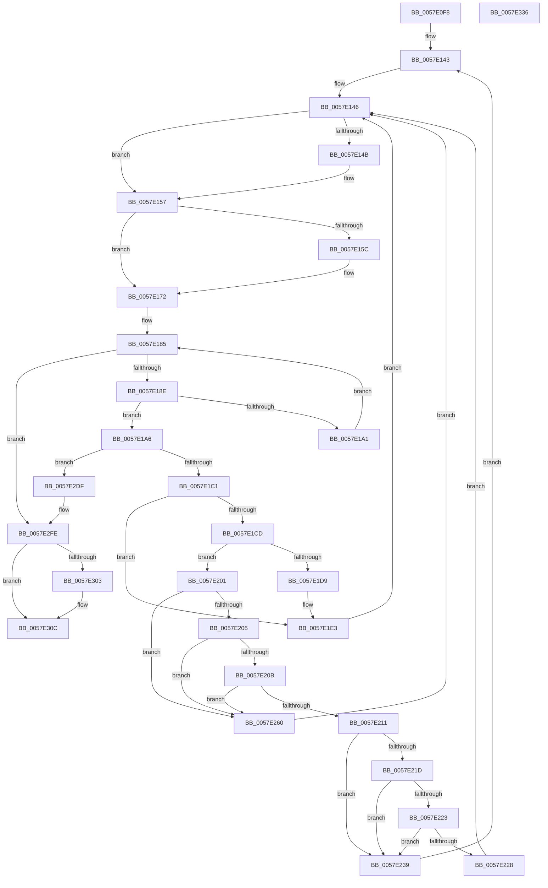

# CcDeleteSectionsForPartition

- RVA: `0x0057E0F8`–`0x0057E337` (길이 `575` bytes)
- VA: `0x000000014057E0F8`
- 실행 섹션: `.text`
- PDB 이름 있음: `예`; PDB Function 태그: `아니요`
- unwind 정보 RVA: `0x000BD490`
- 디코드: `148`개 명령, `575/575` bytes 표시
- 미해석 바이트: `0` (있으면 어셈블리에 `.byte`로 보존)

> 이 문서는 커널 이미지의 기계어와 PDB 기호를 분석해 생성했습니다. 4번과 5번은 함수 원형과 자료형을 바이너리 사용 방식에서 추정한 C 해석이며 원본 소스 복구 결과는 아닙니다.

## 1. Dependencies

- 직접 호출 지점: **15**; 고유 호출 대상: **9**
- 직접 호출자로 확인된 함수: **2**
- RIP 상대 이미지 참조: **2**

### Outgoing calls
- `0x0057E14F` → [KeReleaseInStackQueuedSpinLock](../34/KeReleaseInStackQueuedSpinLock_function_00342CE0.md) (function, `0x00342CE0`)
- `0x0057E16A` → [KeAcquireInStackQueuedSpinLock](../27/KeAcquireInStackQueuedSpinLock_function_002757A0.md) (function, `0x002757A0`)
- `0x0057E17D` → [KeAcquireInStackQueuedSpinLock](../27/KeAcquireInStackQueuedSpinLock_function_002757A0.md) (function, `0x002757A0`)
- `0x0057E1B2` → [MmGetControlAreaPartition](../38/MmGetControlAreaPartition_function_0038B80C.md) (function, `0x0038B80C`)
- `0x0057E1E7` → [KeReleaseInStackQueuedSpinLock](../34/KeReleaseInStackQueuedSpinLock_function_00342CE0.md) (function, `0x00342CE0`)
- `0x0057E1F7` → [KeDelayExecutionThread](../20/KeDelayExecutionThread_function_00209550.md) (function, `0x00209550`)
- `0x0057E22F` → [KeReleaseInStackQueuedSpinLock](../34/KeReleaseInStackQueuedSpinLock_function_00342CE0.md) (function, `0x00342CE0`)
- `0x0057E256` → [CcDeleteSharedCacheMap](../38/CcDeleteSharedCacheMap_function_0038A804.md) (function, `0x0038A804`)
- `0x0057E295` → [CcGetPrivateVolumeCacheMap](../38/CcGetPrivateVolumeCacheMap_function_0038B930.md) (function, `0x0038B930`)
- `0x0057E2B5` → [CcScheduleLazyWriteScan](../3C/CcScheduleLazyWriteScan_function_003CBD20.md) (function, `0x003CBD20`)
- `0x0057E2BE` → [KeReleaseInStackQueuedSpinLock](../34/KeReleaseInStackQueuedSpinLock_function_00342CE0.md) (function, `0x00342CE0`)
- `0x0057E2D5` → [KeWaitForSingleObject](../20/KeWaitForSingleObject_function_0020E6B0.md) (function, `0x0020E6B0`)
- `0x0057E2F8` → [KeBugCheckEx](../4F/KeBugCheckEx_function_004FD660.md) (function, `0x004FD660`)
- `0x0057E307` → [KeReleaseInStackQueuedSpinLock](../34/KeReleaseInStackQueuedSpinLock_function_00342CE0.md) (function, `0x00342CE0`)
- `0x0057E310` → [KeReleaseInStackQueuedSpinLock](../34/KeReleaseInStackQueuedSpinLock_function_00342CE0.md) (function, `0x00342CE0`)

### Direct callers
- [CcReapPrivateVolumeCachemap](../3C/CcReapPrivateVolumeCachemap_function_003CF1B8.md) at `0x003CF269`
- [CcReapPrivateVolumeCachemap](../3C/CcReapPrivateVolumeCachemap_function_003CF1B8.md) at `0x003CF274`
- [CcExitPartition](CcExitPartition_function_0057E340.md) at `0x0057E424`
- [CcExitPartition](CcExitPartition_function_0057E340.md) at `0x0057E42F`

### Static image references
- `0x0057E163` → RVA `0x00E11CC0` (`.data`; read)
- `0x0057E1EC` → RVA `0x00E0A858` (`.data`; read)

## 2. Other-region calls and transfers

- 다른 실행 섹션으로 향하는 call: **0**
- 별도 외부 분기/꼬리 이동을 확인하지 못했습니다.

## 3. Assembly (complete function range)

```asm
0057E0F8  48 8B C4                        mov rax, rsp
0057E0FB  48 89 58 08                     mov qword ptr [rax + 8], rbx
0057E0FF  48 89 70 10                     mov qword ptr [rax + 0x10], rsi
0057E103  48 89 78 18                     mov qword ptr [rax + 0x18], rdi
0057E107  4C 89 60 20                     mov qword ptr [rax + 0x20], r12
0057E10B  55                              push rbp
0057E10C  41 56                           push r14
0057E10E  41 57                           push r15
0057E110  48 8B EC                        mov rbp, rsp
0057E113  48 81 EC 80 00 00 00            sub rsp, 0x80
0057E11A  0F 57 C0                        xorps xmm0, xmm0
0057E11D  33 C0                           xor eax, eax
0057E11F  0F 57 C9                        xorps xmm1, xmm1
0057E122  48 89 45 C0                     mov qword ptr [rbp - 0x40], rax
0057E126  0F 11 45 B0                     movups xmmword ptr [rbp - 0x50], xmm0
0057E12A  48 89 45 D8                     mov qword ptr [rbp - 0x28], rax
0057E12E  40 32 F6                        xor sil, sil
0057E131  0F 11 4D C8                     movups xmmword ptr [rbp - 0x38], xmm1
0057E135  4C 8B FA                        mov r15, rdx
0057E138  4C 8B F1                        mov r14, rcx
0057E13B  0F 11 45 E0                     movups xmmword ptr [rbp - 0x20], xmm0
0057E13F  0F 11 45 F0                     movups xmmword ptr [rbp - 0x10], xmm0
0057E143  40 32 FF                        xor dil, dil
0057E146  40 84 FF                        test dil, dil
0057E149  74 0C                           je 0x14057e157
0057E14B  48 8D 4D C8                     lea rcx, [rbp - 0x38]
0057E14F  E8 8C 4B DC FF                  call 0x140342ce0
0057E154  40 32 FF                        xor dil, dil
0057E157  40 84 F6                        test sil, sil
0057E15A  74 16                           je 0x14057e172
0057E15C  40 32 F6                        xor sil, sil
0057E15F  48 8D 55 C8                     lea rdx, [rbp - 0x38]
0057E163  48 8D 0D 56 3B 89 00            lea rcx, [rip + 0x893b56]
0057E16A  E8 31 76 CF FF                  call 0x1402757a0
0057E16F  40 B7 01                        mov dil, 1
0057E172  48 8D 55 B0                     lea rdx, [rbp - 0x50]
0057E176  49 8D 8F 00 03 00 00            lea rcx, [r15 + 0x300]
0057E17D  E8 1E 76 CF FF                  call 0x1402757a0
0057E182  49 8B 0E                        mov rcx, qword ptr [r14]
0057E185  49 3B CE                        cmp rcx, r14
0057E188  0F 84 70 01 00 00               je 0x14057e2fe
0057E18E  48 8D 99 78 FF FF FF            lea rbx, [rcx - 0x88]
0057E195  F7 83 98 00 00 00 00 08 00 00   test dword ptr [rbx + 0x98], 0x800
0057E19F  74 05                           je 0x14057e1a6
0057E1A1  48 8B 09                        mov rcx, qword ptr [rcx]
0057E1A4  EB DF                           jmp 0x14057e185
0057E1A6  48 8B 4B 60                     mov rcx, qword ptr [rbx + 0x60]
0057E1AA  48 83 E1 F0                     and rcx, 0xfffffffffffffff0
0057E1AE  48 8B 49 28                     mov rcx, qword ptr [rcx + 0x28]
0057E1B2  E8 55 D6 E0 FF                  call 0x14038b80c
0057E1B7  49 3B 47 08                     cmp rax, qword ptr [r15 + 8]
0057E1BB  0F 85 1E 01 00 00               jne 0x14057e2df
0057E1C1  48 8D 83 E8 00 00 00            lea rax, [rbx + 0xe8]
0057E1C8  48 39 00                        cmp qword ptr [rax], rax
0057E1CB  75 16                           jne 0x14057e1e3
0057E1CD  8B 83 98 00 00 00               mov eax, dword ptr [rbx + 0x98]
0057E1D3  0F BA E0 0F                     bt eax, 0xf
0057E1D7  73 28                           jae 0x14057e201
0057E1D9  0F BA F0 0F                     btr eax, 0xf
0057E1DD  89 83 98 00 00 00               mov dword ptr [rbx + 0x98], eax
0057E1E3  48 8D 4D B0                     lea rcx, [rbp - 0x50]
0057E1E7  E8 F4 4A DC FF                  call 0x140342ce0
0057E1EC  4C 8D 05 65 C6 88 00            lea r8, [rip + 0x88c665]
0057E1F3  33 D2                           xor edx, edx
0057E1F5  33 C9                           xor ecx, ecx
0057E1F7  E8 54 B3 C8 FF                  call 0x140209550
0057E1FC  E9 45 FF FF FF                  jmp 0x14057e146
0057E201  A8 20                           test al, 0x20
0057E203  75 5B                           jne 0x14057e260
0057E205  83 7B 04 00                     cmp dword ptr [rbx + 4], 0
0057E209  75 55                           jne 0x14057e260
0057E20B  83 7B 70 00                     cmp dword ptr [rbx + 0x70], 0
0057E20F  75 4F                           jne 0x14057e260
0057E211  48 8B 83 58 02 00 00            mov rax, qword ptr [rbx + 0x258]
0057E218  48 85 C0                        test rax, rax
0057E21B  74 1C                           je 0x14057e239
0057E21D  83 78 04 01                     cmp dword ptr [rax + 4], 1
0057E221  75 16                           jne 0x14057e239
0057E223  40 84 FF                        test dil, dil
0057E226  75 11                           jne 0x14057e239
0057E228  48 8D 4D B0                     lea rcx, [rbp - 0x50]
0057E22C  40 B6 01                        mov sil, 1
0057E22F  E8 AC 4A DC FF                  call 0x140342ce0
0057E234  E9 0D FF FF FF                  jmp 0x14057e146
0057E239  40 F6 DF                        neg dil
0057E23C  48 8D 45 C8                     lea rax, [rbp - 0x38]
0057E240  4C 8D 45 B0                     lea r8, [rbp - 0x50]
0057E244  48 8B CB                        mov rcx, rbx
0057E247  48 1B D2                        sbb rdx, rdx
0057E24A  48 83 64 24 20 00               and qword ptr [rsp + 0x20], 0
0057E250  48 23 D0                        and rdx, rax
0057E253  45 33 C9                        xor r9d, r9d
0057E256  E8 A9 C5 E0 FF                  call 0x14038a804
0057E25B  E9 E3 FE FF FF                  jmp 0x14057e143
0057E260  0F BA E8 10                     bts eax, 0x10
0057E264  48 8B CB                        mov rcx, rbx
0057E267  89 83 98 00 00 00               mov dword ptr [rbx + 0x98], eax
0057E26D  48 8D 45 F0                     lea rax, [rbp - 0x10]
0057E271  66 83 65 E8 00                  and word ptr [rbp - 0x18], 0
0057E276  83 65 EC 00                     and dword ptr [rbp - 0x14], 0
0057E27A  48 89 45 F8                     mov qword ptr [rbp - 8], rax
0057E27E  48 8D 45 F0                     lea rax, [rbp - 0x10]
0057E282  48 89 45 F0                     mov qword ptr [rbp - 0x10], rax
0057E286  C6 45 EA 06                     mov byte ptr [rbp - 0x16], 6
0057E28A  48 8B 83 18 01 00 00            mov rax, qword ptr [rbx + 0x118]
0057E291  48 89 45 E0                     mov qword ptr [rbp - 0x20], rax
0057E295  E8 96 D6 E0 FF                  call 0x14038b930
0057E29A  41 B1 01                        mov r9b, 1
0057E29D  48 8D 4D E0                     lea rcx, [rbp - 0x20]
0057E2A1  48 83 C9 01                     or rcx, 1
0057E2A5  45 8A C1                        mov r8b, r9b
0057E2A8  48 89 8B 18 01 00 00            mov qword ptr [rbx + 0x118], rcx
0057E2AF  48 8B D0                        mov rdx, rax
0057E2B2  49 8B CF                        mov rcx, r15
0057E2B5  E8 66 DA E4 FF                  call 0x1403cbd20
0057E2BA  48 8D 4D B0                     lea rcx, [rbp - 0x50]
0057E2BE  E8 1D 4A DC FF                  call 0x140342ce0
0057E2C3  48 83 64 24 20 00               and qword ptr [rsp + 0x20], 0
0057E2C9  48 8D 4D E8                     lea rcx, [rbp - 0x18]
0057E2CD  45 33 C9                        xor r9d, r9d
0057E2D0  45 33 C0                        xor r8d, r8d
0057E2D3  33 D2                           xor edx, edx
0057E2D5  E8 D6 03 C9 FF                  call 0x14020e6b0
0057E2DA  E9 67 FE FF FF                  jmp 0x14057e146
0057E2DF  48 83 64 24 20 00               and qword ptr [rsp + 0x20], 0
0057E2E5  45 33 C9                        xor r9d, r9d
0057E2E8  BA BD 03 00 00                  mov edx, 0x3bd
0057E2ED  49 C7 C0 20 04 00 C0            mov r8, 0xffffffffc0000420
0057E2F4  41 8D 49 34                     lea ecx, [r9 + 0x34]
0057E2F8  E8 63 F3 F7 FF                  call 0x1404fd660
0057E2FD  CC                              int3
0057E2FE  40 84 FF                        test dil, dil
0057E301  74 09                           je 0x14057e30c
0057E303  48 8D 4D C8                     lea rcx, [rbp - 0x38]
0057E307  E8 D4 49 DC FF                  call 0x140342ce0
0057E30C  48 8D 4D B0                     lea rcx, [rbp - 0x50]
0057E310  E8 CB 49 DC FF                  call 0x140342ce0
0057E315  4C 8D 9C 24 80 00 00 00         lea r11, [rsp + 0x80]
0057E31D  49 8B 5B 20                     mov rbx, qword ptr [r11 + 0x20]
0057E321  49 8B 73 28                     mov rsi, qword ptr [r11 + 0x28]
0057E325  49 8B 7B 30                     mov rdi, qword ptr [r11 + 0x30]
0057E329  4D 8B 63 38                     mov r12, qword ptr [r11 + 0x38]
0057E32D  49 8B E3                        mov rsp, r11
0057E330  41 5F                           pop r15
0057E332  41 5E                           pop r14
0057E334  5D                              pop rbp
0057E335  C3                              ret
0057E336  CC                              int3
```

## 4. C-style interpretation (structured pseudocode)

```c
__int64 __fastcall CcDeleteSectionsForPartition(__int64 a1, __int64 a2, __int64 a3, int a4)
{
    __int64 result;
    __int64 v_rdi;
    __int64 v_rsi;
    __int64 v_rsp;
    unsigned __int64 v_stack_m18;
    unsigned __int64 v_stack_m20;
    unsigned __int64 v_stack_m28;
    unsigned int v_stack_m2C;
    unsigned __int8 v_stack_m2E;
    unsigned __int16 v_stack_m30;
    unsigned __int64 v_stack_m38;
    unsigned __int64 v_stack_m40;
    unsigned __int64 v_stack_m50;
    unsigned __int64 v_stack_m58;
    unsigned __int64 v_stack_m68;
    unsigned __int64 v_stack_m78;

    *(unsigned __int64 *)(v_rsp + 8) = v_rbx;
    *(unsigned __int64 *)(v_rsp + 16) = v_rsi;
    *(unsigned __int64 *)(v_rsp + 24) = v_rdi;
    *(unsigned __int64 *)(v_rsp + 32) = v_r12;
    v_rsp = (v_rsp) - (128);
    result = 0;
    v_stack_m58 = 0;
    v_stack_m68 = v_xmm0;
    v_stack_m40 = 0;
    v_rsi = 0;
    v_stack_m50 = v_xmm1;
    v_stack_m38 = v_xmm0;
    v_stack_m28 = v_xmm0;
loc_0057E143:
    v_rdi = 0;
loc_0057E146:
    if (0 != 0) {
        a1 = v_stack_m50;
        result = KeReleaseInStackQueuedSpinLock(a1, a2, a3, a4);
        v_rdi = 0;
    }
    if (0 != 0) {
        v_rsi = 0;
        a2 = v_stack_m50;
        a1 = v_rip + 8993622;
        result = KeAcquireInStackQueuedSpinLock(a1, a2, a3, a4);
        v_rdi = 1;
    }
    result = KeAcquireInStackQueuedSpinLock(a2 + 768, v_stack_m68, a3, a4);
loc_0057E185:
    if ((*(unsigned __int64 *)(a1)) == a1) goto loc_0057E2FE;
    if (((*(unsigned int *)(*(unsigned __int64 *)(a1) - 136 + 152)) & (0x800ULL)) == 0) goto loc_0057E1A6;
    goto loc_0057E185;
loc_0057E1A6:
    a1 = (*(unsigned __int64 *)(*(unsigned __int64 *)(a1) - 136 + 96)) & (-16);
    result = MmGetControlAreaPartition(*(unsigned __int64 *)(a1 + 40), v_stack_m68, a3, a4);
    if (result != (*(unsigned __int64 *)(a2 + 8))) goto loc_0057E2DF;
    if ((*(unsigned __int64 *)(*(unsigned __int64 *)(a1) - 136 + 232)) != (*(unsigned __int64 *)(a1) - 136 + 232)) goto loc_0057E1E3;
    if ((*(unsigned __int64 *)(*(unsigned __int64 *)(a1) - 136 + 232)) >= (*(unsigned __int64 *)(a1) - 136 + 232)) goto loc_0057E201;
    *(unsigned int *)(*(unsigned __int64 *)(a1) - 136 + 152) = (unsigned int)((unsigned int)(*(unsigned int *)(*(unsigned __int64 *)(a1) - 136 + 152)));
loc_0057E1E3:
    result = KeReleaseInStackQueuedSpinLock(v_stack_m68, v_stack_m68, a3, a4);
    a2 = 0;
    a1 = 0;
    result = KeDelayExecutionThread(a1, a2, v_rip + 8963685, a4);
    goto loc_0057E146;
loc_0057E201:
    if ((((unsigned __int8)(result)) & (32)) != 0) goto loc_0057E260;
    if ((*(unsigned int *)(*(unsigned __int64 *)(a1) - 136 + 4)) != 0) goto loc_0057E260;
    if ((*(unsigned int *)(*(unsigned __int64 *)(a1) - 136 + 112)) != 0) goto loc_0057E260;
    if (*(unsigned __int64 *)(*(unsigned __int64 *)(a1) - 136 + 600) == 0) goto loc_0057E239;
    if ((*(unsigned int *)(*(unsigned __int64 *)(*(unsigned __int64 *)(a1) - 136 + 600) + 4)) != 1) goto loc_0057E239;
    if ((unsigned __int8)(v_rdi) != 0) goto loc_0057E239;
    result = KeReleaseInStackQueuedSpinLock(v_stack_m68, a2, v_rip + 8963685, a4);
    goto loc_0057E146;
loc_0057E239:
    v_rdi = (unsigned __int8)(-(v_rdi));
    a2 = (a2) & (v_stack_m50);
    a4 = 0;
    result = CcDeleteSharedCacheMap(*(unsigned __int64 *)(a1) - 136, a2, v_stack_m68, a4);
    goto loc_0057E143;
loc_0057E260:
    *(unsigned int *)(*(unsigned __int64 *)(a1) - 136 + 152) = (unsigned int)(result);
    v_stack_m20 = v_stack_m28;
    v_stack_m28 = v_stack_m28;
    v_stack_m2E = 6;
    v_stack_m38 = *(unsigned __int64 *)(*(unsigned __int64 *)(a1) - 136 + 280);
    result = CcGetPrivateVolumeCacheMap(*(unsigned __int64 *)(a1) - 136, a2, v_stack_m68, a4);
    a1 = (v_stack_m38) | (1);
    *(unsigned __int64 *)(*(unsigned __int64 *)(a1) - 136 + 280) = a1;
    result = CcScheduleLazyWriteScan(a2, result, 1, 1);
    result = KeReleaseInStackQueuedSpinLock(v_stack_m68, result, 1, 1);
    a4 = 0;
    a3 = 0;
    a2 = 0;
    result = KeWaitForSingleObject(v_stack_m30, a2, a3, a4);
    goto loc_0057E146;
loc_0057E2DF:
    a4 = 0;
    result = KeBugCheckEx(a4 + 52, 957, 0xFFFFFFFFC0000420ULL, a4);
loc_0057E2FE:
    if ((unsigned __int8)(v_rdi) != 0) {
        a1 = v_stack_m50;
        result = KeReleaseInStackQueuedSpinLock(a1, 957, 0xFFFFFFFFC0000420ULL, a4);
    }
    result = KeReleaseInStackQueuedSpinLock(v_stack_m68, 957, 0xFFFFFFFFC0000420ULL, a4);
    return result;
}
```

## 5. (Beta) C Style

```c
int64_t CcDeleteSectionsForPartition(void *Arg1, void *Arg2, int64_t Arg3, int32_t Arg4)
{
    uint8_t *arg1 = (uint8_t *)Arg1;
    uint8_t *arg2 = (uint8_t *)Arg2;

    int64_t result;
    int64_t local_rdi;
    int64_t local_rsi;
    int64_t local_rsp;
    uint64_t v_stack_m18;
    uint64_t v_stack_m20;
    uint64_t v_stack_m28;
    uint32_t v_stack_m2C;
    uint8_t v_stack_m2E;
    uint16_t v_stack_m30;
    uint64_t v_stack_m38;
    uint64_t v_stack_m40;
    uint64_t v_stack_m50;
    uint64_t v_stack_m58;
    uint64_t v_stack_m68;
    uint64_t v_stack_m78;

    *(uint64_t *)(local_rsp + 0x8) = local_rbx;
    *(uint64_t *)(local_rsp + 0x10) = local_rsi;
    *(uint64_t *)(local_rsp + 0x18) = local_rdi;
    *(uint64_t *)(local_rsp + 0x20) = local_r12;
    local_rsp = (local_rsp) - (128);
    result = 0;
    v_stack_m58 = 0;
    v_stack_m68 = v_xmm0;
    v_stack_m40 = 0;
    local_rsi = 0;
    v_stack_m50 = v_xmm1;
    v_stack_m38 = v_xmm0;
    v_stack_m28 = v_xmm0;
loc_0057E143:
    local_rdi = 0;
loc_0057E146:
    if (0 != 0) {
        Arg1 = v_stack_m50;
        result = KeReleaseInStackQueuedSpinLock(Arg1, Arg2, Arg3, Arg4);
        local_rdi = 0;
    }
    if (0 != 0) {
        local_rsi = 0;
        Arg2 = v_stack_m50;
        Arg1 = v_rip + 8993622;
        result = KeAcquireInStackQueuedSpinLock(Arg1, Arg2, Arg3, Arg4);
        local_rdi = 1;
    }
    result = KeAcquireInStackQueuedSpinLock(Arg2 + 768, v_stack_m68, Arg3, Arg4);
loc_0057E185:
    if ((*(uint64_t *)(arg1)) == Arg1) goto loc_0057E2FE;
    if (((*(uint32_t *)(*(uint64_t *)(arg1) - 0x88 + 0x98)) & (0x800ULL)) == 0) goto loc_0057E1A6;
    goto loc_0057E185;
loc_0057E1A6:
    Arg1 = (*(uint64_t *)(*(uint64_t *)(arg1) - 0x88 + 0x60)) & (-16);
    result = MmGetControlAreaPartition(*(uint64_t *)(arg1 + 0x28), v_stack_m68, Arg3, Arg4);
    if (result != (*(uint64_t *)(arg2 + 0x8))) goto loc_0057E2DF;
    if ((*(uint64_t *)(*(uint64_t *)(arg1) - 0x88 + 0xE8)) != (*(uint64_t *)(arg1) - 136 + 232)) goto loc_0057E1E3;
    if ((*(uint64_t *)(*(uint64_t *)(arg1) - 0x88 + 0xE8)) >= (*(uint64_t *)(arg1) - 136 + 232)) goto loc_0057E201;
    *(uint32_t *)(*(uint64_t *)(arg1) - 0x88 + 0x98) = (uint32_t)((uint32_t)(*(uint32_t *)(*(uint64_t *)(arg1) - 0x88 + 0x98)));
loc_0057E1E3:
    result = KeReleaseInStackQueuedSpinLock(v_stack_m68, v_stack_m68, Arg3, Arg4);
    Arg2 = 0;
    Arg1 = 0;
    result = KeDelayExecutionThread(Arg1, Arg2, v_rip + 8963685, Arg4);
    goto loc_0057E146;
loc_0057E201:
    if ((((uint8_t)(result)) & (32)) != 0) goto loc_0057E260;
    if ((*(uint32_t *)(*(uint64_t *)(arg1) - 0x88 + 0x4)) != 0) goto loc_0057E260;
    if ((*(uint32_t *)(*(uint64_t *)(arg1) - 0x88 + 0x70)) != 0) goto loc_0057E260;
    if (*(uint64_t *)(*(uint64_t *)(arg1) - 0x88 + 0x258) == 0) goto loc_0057E239;
    if ((*(uint32_t *)(*(uint64_t *)(*(uint64_t *)(arg1) - 0x88 + 0x258) + 0x4)) != 1) goto loc_0057E239;
    if ((uint8_t)(local_rdi) != 0) goto loc_0057E239;
    result = KeReleaseInStackQueuedSpinLock(v_stack_m68, Arg2, v_rip + 8963685, Arg4);
    goto loc_0057E146;
loc_0057E239:
    local_rdi = (uint8_t)(-(local_rdi));
    Arg2 = (Arg2) & (v_stack_m50);
    Arg4 = 0;
    result = CcDeleteSharedCacheMap(*(uint64_t *)(arg1) - 136, Arg2, v_stack_m68, Arg4);
    goto loc_0057E143;
loc_0057E260:
    *(uint32_t *)(*(uint64_t *)(arg1) - 0x88 + 0x98) = (uint32_t)(result);
    v_stack_m20 = v_stack_m28;
    v_stack_m28 = v_stack_m28;
    v_stack_m2E = 6;
    v_stack_m38 = *(uint64_t *)(*(uint64_t *)(arg1) - 0x88 + 0x118);
    result = CcGetPrivateVolumeCacheMap(*(uint64_t *)(arg1) - 136, Arg2, v_stack_m68, Arg4);
    Arg1 = (v_stack_m38) | (1);
    *(void **)(*(uint64_t *)(arg1) - 0x88 + 0x118) = Arg1;
    result = CcScheduleLazyWriteScan(Arg2, result, 1, 1);
    result = KeReleaseInStackQueuedSpinLock(v_stack_m68, result, 1, 1);
    Arg4 = 0;
    Arg3 = 0;
    Arg2 = 0;
    result = KeWaitForSingleObject(v_stack_m30, Arg2, Arg3, Arg4);
    goto loc_0057E146;
loc_0057E2DF:
    Arg4 = 0;
    result = KeBugCheckEx(Arg4 + 52, 957, 0xFFFFFFFFC0000420ULL, Arg4);
loc_0057E2FE:
    if ((uint8_t)(local_rdi) != 0) {
        Arg1 = v_stack_m50;
        result = KeReleaseInStackQueuedSpinLock(Arg1, 957, 0xFFFFFFFFC0000420ULL, Arg4);
    }
    result = KeReleaseInStackQueuedSpinLock(v_stack_m68, 957, 0xFFFFFFFFC0000420ULL, Arg4);
    return result;
}
```

### 관측된 메모리 오프셋

구조체 형식이 확인되지 않은 접근은 인자 기준의 오프셋으로만 기록했습니다.

| 기준 인자 | 오프셋 표현 | 폭 (bit) | 접근 |
|---|---:|---:|---|
| `Arg1` | `+ 0x0` | `64` | `R` |
| `Arg2` | `+ 0x8` | `64` | `R` |
| `Arg2` | `+ 0x300` | `64` | `R` |

## 6. Execution-region graph

[열기: 2D/3D 그래프와 함수 탐색 컨트롤 패널](../../../control-panel.html?section=text&rva=0x0057E0F8&view=graph)

- 2D 그래프는 위에서 아래로 흐르고, 3D 그래프는 빈 공간을 드래그해 회전합니다. Shift+드래그는 이동, 휠은 확대·축소, 함수 노드 선택은 대상 보고서 이동입니다.

### Static fallback


