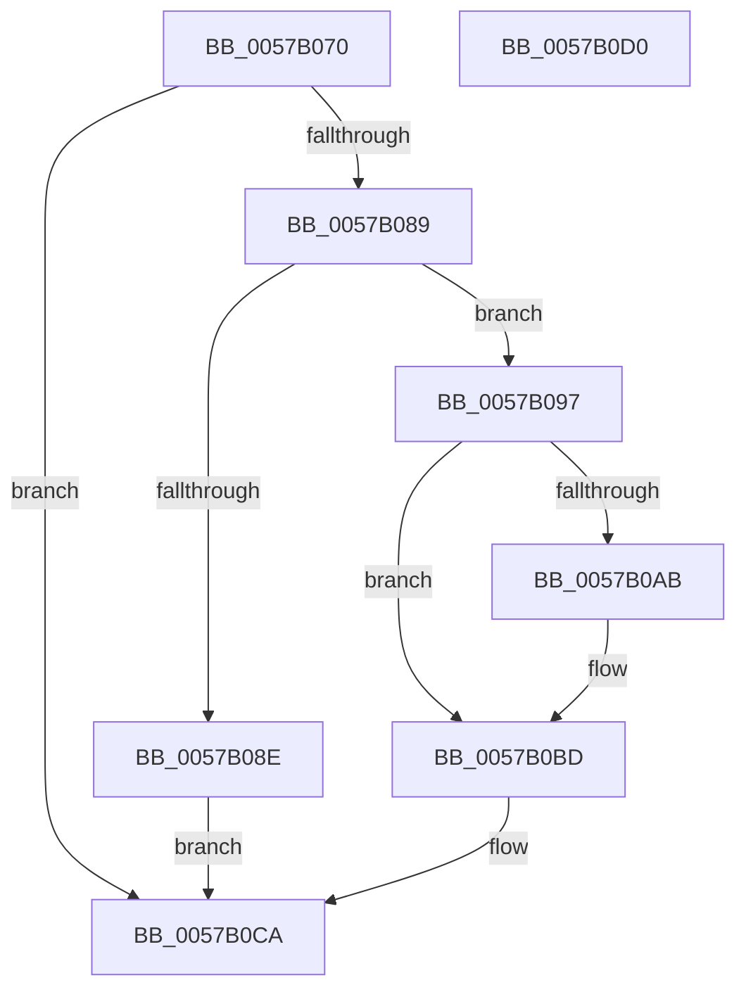

# CcDeleteVolumeCacheMap

- RVA: `0x0057B070`–`0x0057B0D1` (길이 `97` bytes)
- VA: `0x000000014057B070`
- 실행 섹션: `.text`
- PDB 이름 있음: `예`; PDB Function 태그: `아니요`
- unwind 정보 RVA: `0x0005CF00`
- 디코드: `26`개 명령, `97/97` bytes 표시
- 미해석 바이트: `0` (있으면 어셈블리에 `.byte`로 보존)

> 이 문서는 커널 이미지의 기계어와 PDB 기호를 분석해 생성했습니다. 4번과 5번은 함수 원형과 자료형을 바이너리 사용 방식에서 추정한 C 해석이며 원본 소스 복구 결과는 아닙니다.

## 1. Dependencies

- 직접 호출 지점: **2**; 고유 호출 대상: **2**
- 직접 호출자로 확인된 함수: **0**
- RIP 상대 이미지 참조: **1**

### Outgoing calls
- `0x0057B0B0` → [ObfDereferenceObjectWithTag](../2F/ObfDereferenceObjectWithTag_function_002F78E0.md) (function, `0x002F78E0`)
- `0x0057B0C5` → [ExFreePoolWithTag](../../poolcode/B8/ExFreePoolWithTag_function_00B82870.md) (function, `0x00B82870`)

### Direct callers
- 이 함수 시작 RVA로 연결되는 직접 call은 확인되지 않았습니다. 간접 호출은 완전히 역산할 수 없습니다.

### Static image references
- `0x0057B097` → RVA `0x00F8F2A8` (`.data`; read/write)

## 2. Other-region calls and transfers

- 다른 실행 섹션으로 향하는 call: **1**
  - `0x0057B0C5` → [ExFreePoolWithTag](../../poolcode/B8/ExFreePoolWithTag_function_00B82870.md) (`.text` → `POOLCODE`)
- 별도 외부 분기/꼬리 이동을 확인하지 못했습니다.

## 3. Assembly (complete function range)

```asm
0057B070  40 53                           push rbx
0057B072  48 83 EC 20                     sub rsp, 0x20
0057B076  48 8B D9                        mov rbx, rcx
0057B079  48 83 C8 FF                     or rax, 0xffffffffffffffff
0057B07D  F0 48 0F C1 41 08               lock xadd qword ptr [rcx + 8], rax
0057B083  48 83 E8 01                     sub rax, 1
0057B087  7F 41                           jg 0x14057b0ca
0057B089  48 85 C0                        test rax, rax
0057B08C  74 09                           je 0x14057b097
0057B08E  B9 0E 00 00 00                  mov ecx, 0xe
0057B093  CD 29                           int 0x29
0057B095  EB 33                           jmp 0x14057b0ca
0057B097  F0 48 FF 0D 09 42 A1 00         lock dec qword ptr [rip + 0xa14209]
0057B09F  48 8B 89 A8 00 00 00            mov rcx, qword ptr [rcx + 0xa8]
0057B0A6  48 85 C9                        test rcx, rcx
0057B0A9  74 12                           je 0x14057b0bd
0057B0AB  BA 44 66 6C 74                  mov edx, 0x746c6644
0057B0B0  E8 2B C8 D7 FF                  call 0x1402f78e0
0057B0B5  48 83 A3 A8 00 00 00 00         and qword ptr [rbx + 0xa8], 0
0057B0BD  BA 43 63 56 6D                  mov edx, 0x6d566343
0057B0C2  48 8B CB                        mov rcx, rbx
0057B0C5  E8 A6 77 60 00                  call 0x140b82870
0057B0CA  48 83 C4 20                     add rsp, 0x20
0057B0CE  5B                              pop rbx
0057B0CF  C3                              ret
0057B0D0  CC                              int3
```

## 4. C-style interpretation (structured pseudocode)

```c
__int64 __fastcall CcDeleteVolumeCacheMap(__int64 a1)
{
    __int64 result;
    __int64 v_rsp;

    v_rsp = (v_rsp) - (32);
    result = (result) | (-1);
    result = (result) - (1);
    if (condition_is_greater) goto loc_0057B0CA;
    if (result == 0) goto loc_0057B097;
    goto loc_0057B0CA;
loc_0057B097:
    if (*(unsigned __int64 *)(14 + 168) != 0) {
        a2 = 0x746C6644ULL;
        result = ObfDereferenceObjectWithTag(*(unsigned __int64 *)(14 + 168), a2, a3, a4);
    }
    result = ExFreePoolWithTag(a1, (unsigned int)(0x6D566343ULL), a3, a4);
loc_0057B0CA:
    v_rsp = (v_rsp) + (32);
    return result;
}
```

## 5. (Beta) C Style

```c
int64_t CcDeleteVolumeCacheMap(void *Arg1)
{
    uint8_t *arg1 = (uint8_t *)Arg1;

    int64_t result;
    int64_t local_rsp;

    local_rsp = (local_rsp) - (32);
    result = (result) | (-1);
    result = (result) - (1);
    if (condition_is_greater) goto loc_0057B0CA;
    if (result == 0) goto loc_0057B097;
    goto loc_0057B0CA;
loc_0057B097:
    if (*(uint64_t *)(14 + 0xA8) != 0) {
        a2 = 0x746C6644ULL;
        result = ObfDereferenceObjectWithTag(*(uint64_t *)(14 + 0xA8), a2, a3, a4);
    }
    result = ExFreePoolWithTag(Arg1, (uint32_t)(0x6D566343ULL), a3, a4);
loc_0057B0CA:
    local_rsp = (local_rsp) + (32);
    return result;
}
```

### 관측된 메모리 오프셋

구조체 형식이 확인되지 않은 접근은 인자 기준의 오프셋으로만 기록했습니다.

| 기준 인자 | 오프셋 표현 | 폭 (bit) | 접근 |
|---|---:|---:|---|
| `Arg1` | `+ 0x8` | `64` | `R/W` |
| `Arg1` | `+ 0xA8` | `64` | `R` |
| `Arg1` | `+ 0xA8` | `64` | `R/W` |

## 6. Execution-region graph

[열기: 2D/3D 그래프와 함수 탐색 컨트롤 패널](../../../control-panel.html?section=text&rva=0x0057B070&view=graph)

- 2D 그래프는 위에서 아래로 흐르고, 3D 그래프는 빈 공간을 드래그해 회전합니다. Shift+드래그는 이동, 휠은 확대·축소, 함수 노드 선택은 대상 보고서 이동입니다.

### Static fallback


