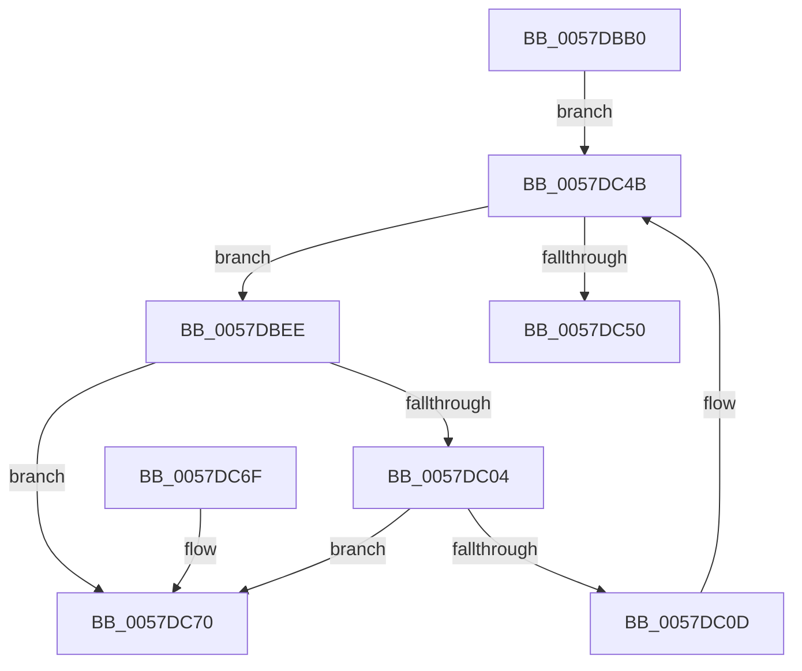

# CcDrainDelayDeleteForPartitionExit

- RVA: `0x0057DBB0`–`0x0057DC77` (길이 `199` bytes)
- VA: `0x000000014057DBB0`
- 실행 섹션: `.text`
- PDB 이름 있음: `예`; PDB Function 태그: `아니요`
- unwind 정보 RVA: `0x00073820`
- 디코드: `53`개 명령, `199/199` bytes 표시
- 미해석 바이트: `0` (있으면 어셈블리에 `.byte`로 보존)

> 이 문서는 커널 이미지의 기계어와 PDB 기호를 분석해 생성했습니다. 4번과 5번은 함수 원형과 자료형을 바이너리 사용 방식에서 추정한 C 해석이며 원본 소스 복구 결과는 아닙니다.

## 1. Dependencies

- 직접 호출 지점: **6**; 고유 호출 대상: **4**
- 직접 호출자로 확인된 함수: **1**
- RIP 상대 이미지 참조: **0**

### Outgoing calls
- `0x0057DBE4` → [KeAcquireInStackQueuedSpinLock](../27/KeAcquireInStackQueuedSpinLock_function_002757A0.md) (function, `0x002757A0`)
- `0x0057DC20` → [KeSetEvent](../33/KeSetEvent_function_0033F310.md) (function, `0x0033F310`)
- `0x0057DC31` → [KeReleaseInStackQueuedSpinLock](../34/KeReleaseInStackQueuedSpinLock_function_00342CE0.md) (function, `0x00342CE0`)
- `0x0057DC39` → [CcDeletePrivateVolumeCacheMap](../3C/CcDeletePrivateVolumeCacheMap_function_003CE950.md) (function, `0x003CE950`)
- `0x0057DC46` → [KeAcquireInStackQueuedSpinLock](../27/KeAcquireInStackQueuedSpinLock_function_002757A0.md) (function, `0x002757A0`)
- `0x0057DC55` → [KeReleaseInStackQueuedSpinLock](../34/KeReleaseInStackQueuedSpinLock_function_00342CE0.md) (function, `0x00342CE0`)

### Direct callers
- [CcDeletePartition](CcDeletePartition_function_0057DE9C.md) at `0x0057DF77`

### Static image references
- 디코드된 RIP-relative 메모리 참조가 없습니다.

## 2. Other-region calls and transfers

- 다른 실행 섹션으로 향하는 call: **0**
- 별도 외부 분기/꼬리 이동을 확인하지 못했습니다.

## 3. Assembly (complete function range)

```asm
0057DBB0  4C 8B DC                        mov r11, rsp
0057DBB3  49 89 5B 08                     mov qword ptr [r11 + 8], rbx
0057DBB7  49 89 6B 10                     mov qword ptr [r11 + 0x10], rbp
0057DBBB  49 89 73 18                     mov qword ptr [r11 + 0x18], rsi
0057DBBF  57                              push rdi
0057DBC0  48 83 EC 40                     sub rsp, 0x40
0057DBC4  0F 57 C0                        xorps xmm0, xmm0
0057DBC7  48 8D A9 00 03 00 00            lea rbp, [rcx + 0x300]
0057DBCE  48 8D 79 70                     lea rdi, [rcx + 0x70]
0057DBD2  33 C0                           xor eax, eax
0057DBD4  0F 11 44 24 20                  movups xmmword ptr [rsp + 0x20], xmm0
0057DBD9  48 8B CD                        mov rcx, rbp
0057DBDC  49 89 43 E8                     mov qword ptr [r11 - 0x18], rax
0057DBE0  49 8D 53 D8                     lea rdx, [r11 - 0x28]
0057DBE4  E8 B7 7B CF FF                  call 0x1402757a0
0057DBE9  48 8B 1F                        mov rbx, qword ptr [rdi]
0057DBEC  EB 5D                           jmp 0x14057dc4b
0057DBEE  48 8B 13                        mov rdx, qword ptr [rbx]
0057DBF1  48 8D B3 C0 FD FF FF            lea rsi, [rbx - 0x240]
0057DBF8  48 8B C3                        mov rax, rbx
0057DBFB  48 8B DA                        mov rbx, rdx
0057DBFE  48 39 42 08                     cmp qword ptr [rdx + 8], rax
0057DC02  75 6C                           jne 0x14057dc70
0057DC04  4C 8B 40 08                     mov r8, qword ptr [rax + 8]
0057DC08  49 39 00                        cmp qword ptr [r8], rax
0057DC0B  75 63                           jne 0x14057dc70
0057DC0D  49 89 10                        mov qword ptr [r8], rdx
0057DC10  48 8D 8E 98 04 00 00            lea rcx, [rsi + 0x498]
0057DC17  4C 89 42 08                     mov qword ptr [rdx + 8], r8
0057DC1B  45 33 C0                        xor r8d, r8d
0057DC1E  33 D2                           xor edx, edx
0057DC20  E8 EB 16 DC FF                  call 0x14033f310
0057DC25  83 8E 50 06 00 00 04            or dword ptr [rsi + 0x650], 4
0057DC2C  48 8D 4C 24 20                  lea rcx, [rsp + 0x20]
0057DC31  E8 AA 50 DC FF                  call 0x140342ce0
0057DC36  48 8B CE                        mov rcx, rsi
0057DC39  E8 12 0D E5 FF                  call 0x1403ce950
0057DC3E  48 8D 54 24 20                  lea rdx, [rsp + 0x20]
0057DC43  48 8B CD                        mov rcx, rbp
0057DC46  E8 55 7B CF FF                  call 0x1402757a0
0057DC4B  48 3B DF                        cmp rbx, rdi
0057DC4E  75 9E                           jne 0x14057dbee
0057DC50  48 8D 4C 24 20                  lea rcx, [rsp + 0x20]
0057DC55  E8 86 50 DC FF                  call 0x140342ce0
0057DC5A  48 8B 5C 24 50                  mov rbx, qword ptr [rsp + 0x50]
0057DC5F  48 8B 6C 24 58                  mov rbp, qword ptr [rsp + 0x58]
0057DC64  48 8B 74 24 60                  mov rsi, qword ptr [rsp + 0x60]
0057DC69  48 83 C4 40                     add rsp, 0x40
0057DC6D  5F                              pop rdi
0057DC6E  C3                              ret
0057DC6F  CC                              int3
0057DC70  B9 03 00 00 00                  mov ecx, 3
0057DC75  CD 29                           int 0x29
```

## 4. C-style interpretation (structured pseudocode)

```c
__int64 __fastcall CcDrainDelayDeleteForPartitionExit(__int64 a1)
{
    __int64 result;
    __int64 v_rsp;
    unsigned __int64 v_stack_m28;
    unsigned __int64 v_stack_p10;
    unsigned __int64 v_stack_p18;
    unsigned __int64 v_stack_p8;

    *(unsigned __int64 *)(v_rsp + 8) = v_rbx;
    *(unsigned __int64 *)(v_rsp + 16) = v_rbp;
    *(unsigned __int64 *)(v_rsp + 24) = v_rsi;
    v_rsp = (v_rsp) - (64);
    result = 0;
    v_stack_m28 = v_xmm0;
    *(unsigned __int64 *)(v_rsp - 24) = 0;
    result = KeAcquireInStackQueuedSpinLock(a1 + 768, v_rsp - 40, a3, a4);
    goto loc_0057DC4B;
loc_0057DBEE:
    if ((*(unsigned __int64 *)(*(unsigned __int64 *)(*(unsigned __int64 *)(a1 + 112)) + 8)) != (*(unsigned __int64 *)(a1 + 112))) goto loc_0057DC70;
    if ((*(unsigned __int64 *)(*(unsigned __int64 *)(*(unsigned __int64 *)(a1 + 112) + 8))) != (*(unsigned __int64 *)(a1 + 112))) goto loc_0057DC70;
    *(unsigned __int64 *)(*(unsigned __int64 *)(*(unsigned __int64 *)(a1 + 112) + 8)) = *(unsigned __int64 *)(*(unsigned __int64 *)(a1 + 112));
    *(unsigned __int64 *)(*(unsigned __int64 *)(*(unsigned __int64 *)(a1 + 112)) + 8) = *(unsigned __int64 *)(*(unsigned __int64 *)(a1 + 112) + 8);
    a3 = 0;
    a2 = 0;
    result = KeSetEvent(*(unsigned __int64 *)(a1 + 112) - 576 + 1176, a2, a3, a4);
    result = KeReleaseInStackQueuedSpinLock(v_stack_m28, a2, a3, a4);
    result = CcDeletePrivateVolumeCacheMap(*(unsigned __int64 *)(a1 + 112) - 576, a2, a3, a4);
    result = KeAcquireInStackQueuedSpinLock(a1 + 768, v_stack_m28, a3, a4);
loc_0057DC4B:
    if ((*(unsigned __int64 *)(*(unsigned __int64 *)(a1 + 112))) != (a1 + 112)) goto loc_0057DBEE;
    result = KeReleaseInStackQueuedSpinLock(v_stack_m28, v_stack_m28, a3, a4);
    v_rsp = (v_rsp) + (64);
    return result;
loc_0057DC70:
    return result;
}
```

## 5. (Beta) C Style

```c
int64_t CcDrainDelayDeleteForPartitionExit(void *Arg1)
{
    uint8_t *arg1 = (uint8_t *)Arg1;

    int64_t result;
    int64_t local_rsp;
    uint64_t v_stack_m28;
    uint64_t v_stack_p10;
    uint64_t v_stack_p18;
    uint64_t v_stack_p8;

    *(uint64_t *)(local_rsp + 0x8) = local_rbx;
    *(uint64_t *)(local_rsp + 0x10) = local_rbp;
    *(uint64_t *)(local_rsp + 0x18) = local_rsi;
    local_rsp = (local_rsp) - (64);
    result = 0;
    v_stack_m28 = v_xmm0;
    *(uint64_t *)(local_rsp - 0x18) = 0;
    result = KeAcquireInStackQueuedSpinLock(Arg1 + 768, local_rsp - 40, a3, a4);
    goto loc_0057DC4B;
loc_0057DBEE:
    if ((*(uint64_t *)(*(uint64_t *)(*(uint64_t *)(arg1 + 0x70)) + 0x8)) != (*(uint64_t *)(arg1 + 0x70))) goto loc_0057DC70;
    if ((*(uint64_t *)(*(uint64_t *)(*(uint64_t *)(arg1 + 0x70) + 0x8))) != (*(uint64_t *)(arg1 + 0x70))) goto loc_0057DC70;
    *(uint64_t *)(*(uint64_t *)(*(uint64_t *)(arg1 + 0x70) + 0x8)) = *(uint64_t *)(*(uint64_t *)(arg1 + 0x70));
    *(uint64_t *)(*(uint64_t *)(*(uint64_t *)(arg1 + 0x70)) + 0x8) = *(uint64_t *)(*(uint64_t *)(arg1 + 0x70) + 0x8);
    a3 = 0;
    a2 = 0;
    result = KeSetEvent(*(uint64_t *)(arg1 + 0x70) - 576 + 1176, a2, a3, a4);
    result = KeReleaseInStackQueuedSpinLock(v_stack_m28, a2, a3, a4);
    result = CcDeletePrivateVolumeCacheMap(*(uint64_t *)(arg1 + 0x70) - 576, a2, a3, a4);
    result = KeAcquireInStackQueuedSpinLock(Arg1 + 768, v_stack_m28, a3, a4);
loc_0057DC4B:
    if ((*(uint64_t *)(*(uint64_t *)(arg1 + 0x70))) != (Arg1 + 112)) goto loc_0057DBEE;
    result = KeReleaseInStackQueuedSpinLock(v_stack_m28, v_stack_m28, a3, a4);
    local_rsp = (local_rsp) + (64);
    return result;
loc_0057DC70:
    return result;
}
```

### 관측된 메모리 오프셋

구조체 형식이 확인되지 않은 접근은 인자 기준의 오프셋으로만 기록했습니다.

| 기준 인자 | 오프셋 표현 | 폭 (bit) | 접근 |
|---|---:|---:|---|
| `Arg1` | `+ 0x0` | `64` | `R` |
| `Arg1` | `+ 0x70` | `64` | `R` |
| `Arg1` | `+ 0x300` | `64` | `R` |

## 6. Execution-region graph

[열기: 2D/3D 그래프와 함수 탐색 컨트롤 패널](../../../control-panel.html?section=text&rva=0x0057DBB0&view=graph)

- 2D 그래프는 위에서 아래로 흐르고, 3D 그래프는 빈 공간을 드래그해 회전합니다. Shift+드래그는 이동, 휠은 확대·축소, 함수 노드 선택은 대상 보고서 이동입니다.

### Static fallback


