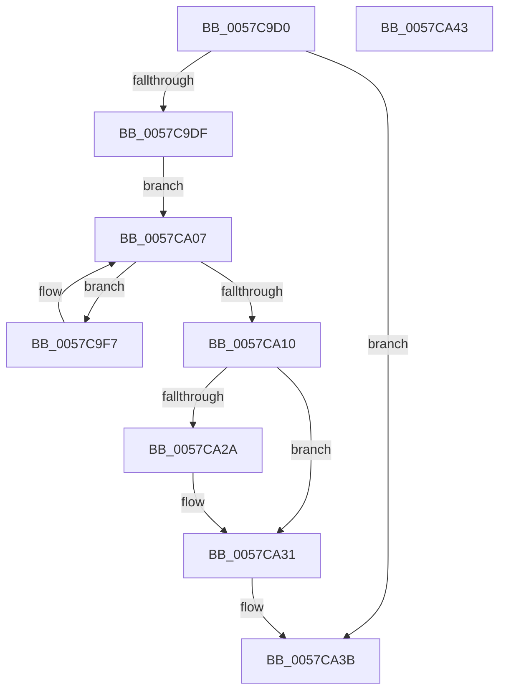

# CcErrorCallbackRoutine

- RVA: `0x0057C9D0`–`0x0057CA44` (길이 `116` bytes)
- VA: `0x000000014057C9D0`
- 실행 섹션: `.text`
- PDB 이름 있음: `예`; PDB Function 태그: `아니요`
- unwind 정보 RVA: `0x000697A4`
- 디코드: `29`개 명령, `116/116` bytes 표시
- 미해석 바이트: `0` (있으면 어셈블리에 `.byte`로 보존)

> 이 문서는 커널 이미지의 기계어와 PDB 기호를 분석해 생성했습니다. 4번과 5번은 함수 원형과 자료형을 바이너리 사용 방식에서 추정한 C 해석이며 원본 소스 복구 결과는 아닙니다.

## 1. Dependencies

- 직접 호출 지점: **3**; 고유 호출 대상: **3**
- 직접 호출자로 확인된 함수: **0**
- RIP 상대 이미지 참조: **6**

### Outgoing calls
- `0x0057CA02` → [KeDelayExecutionThread](../20/KeDelayExecutionThread_function_00209550.md) (function, `0x00209550`)
- `0x0057CA1C` → [KeAcquireInStackQueuedSpinLock](../27/KeAcquireInStackQueuedSpinLock_function_002757A0.md) (function, `0x002757A0`)
- `0x0057CA36` → [KeReleaseInStackQueuedSpinLock](../34/KeReleaseInStackQueuedSpinLock_function_00342CE0.md) (function, `0x00342CE0`)

### Direct callers
- 이 함수 시작 RVA로 연결되는 직접 call은 확인되지 않았습니다. 간접 호출은 완전히 역산할 수 없습니다.

### Static image references
- `0x0057C9DF` → RVA `0x00E65B40` (`.data`; read)
- `0x0057C9F7` → RVA `0x00E0A848` (`.data`; read)
- `0x0057CA07` → RVA `0x00E65B28` (`.data`; read)
- `0x0057CA15` → RVA `0x00E11CC0` (`.data`; read)
- `0x0057CA21` → RVA `0x00E65B38` (`.data`; read)
- `0x0057CA2A` → RVA `0x00E65B38` (`.data`; write)

## 2. Other-region calls and transfers

- 다른 실행 섹션으로 향하는 call: **0**
- 별도 외부 분기/꼬리 이동을 확인하지 못했습니다.

## 3. Assembly (complete function range)

```asm
0057C9D0  40 53                           push rbx
0057C9D2  48 83 EC 40                     sub rsp, 0x40
0057C9D6  81 79 04 08 A0 00 C0            cmp dword ptr [rcx + 4], 0xc000a008
0057C9DD  75 5C                           jne 0x14057ca3b
0057C9DF  48 8B 1D 5A 91 8E 00            mov rbx, qword ptr [rip + 0x8e915a]
0057C9E6  0F 57 C0                        xorps xmm0, xmm0
0057C9E9  33 C0                           xor eax, eax
0057C9EB  0F 11 44 24 20                  movups xmmword ptr [rsp + 0x20], xmm0
0057C9F0  48 89 44 24 30                  mov qword ptr [rsp + 0x30], rax
0057C9F5  EB 10                           jmp 0x14057ca07
0057C9F7  4C 8D 05 4A DE 88 00            lea r8, [rip + 0x88de4a]
0057C9FE  33 D2                           xor edx, edx
0057CA00  33 C9                           xor ecx, ecx
0057CA02  E8 49 CB C8 FF                  call 0x140209550
0057CA07  48 39 1D 1A 91 8E 00            cmp qword ptr [rip + 0x8e911a], rbx
0057CA0E  72 E7                           jb 0x14057c9f7
0057CA10  48 8D 54 24 20                  lea rdx, [rsp + 0x20]
0057CA15  48 8D 0D A4 52 89 00            lea rcx, [rip + 0x8952a4]
0057CA1C  E8 7F 8D CF FF                  call 0x1402757a0
0057CA21  48 39 1D 10 91 8E 00            cmp qword ptr [rip + 0x8e9110], rbx
0057CA28  73 07                           jae 0x14057ca31
0057CA2A  48 89 1D 07 91 8E 00            mov qword ptr [rip + 0x8e9107], rbx
0057CA31  48 8D 4C 24 20                  lea rcx, [rsp + 0x20]
0057CA36  E8 A5 62 DC FF                  call 0x140342ce0
0057CA3B  33 C0                           xor eax, eax
0057CA3D  48 83 C4 40                     add rsp, 0x40
0057CA41  5B                              pop rbx
0057CA42  C3                              ret
0057CA43  CC                              int3
```

## 4. C-style interpretation (structured pseudocode)

```c
__int64 __fastcall CcErrorCallbackRoutine(__int64 a1, int a2)
{
    __int64 result;
    __int64 v_rsp;
    unsigned __int64 v_stack_m18;
    unsigned __int64 v_stack_m28;

    v_rsp = (v_rsp) - (64);
    if ((*(unsigned int *)(a1 + 4)) != 0xC000A008ULL) goto loc_0057CA3B;
    result = 0;
    v_stack_m28 = v_xmm0;
    v_stack_m18 = 0;
    goto loc_0057CA07;
loc_0057C9F7:
    a2 = 0;
    a1 = 0;
    result = KeDelayExecutionThread(a1, a2, v_rip + 8969802, a4);
loc_0057CA07:
    if ((*(unsigned __int64 *)(v_rip + 9343258)) < (*(unsigned __int64 *)(v_rip + 9343322))) goto loc_0057C9F7;
    result = KeAcquireInStackQueuedSpinLock(v_rip + 8999588, v_stack_m28, v_rip + 8969802, a4);
    if ((*(unsigned __int64 *)(v_rip + 9343248)) < (*(unsigned __int64 *)(v_rip + 9343322))) {
        *(unsigned __int64 *)(v_rip + 9343239) = *(unsigned __int64 *)(v_rip + 9343322);
    }
    result = KeReleaseInStackQueuedSpinLock(v_stack_m28, v_stack_m28, v_rip + 8969802, a4);
loc_0057CA3B:
    result = 0;
    v_rsp = (v_rsp) + (64);
    return result;
}
```

## 5. (Beta) C Style

```c
int64_t CcErrorCallbackRoutine(void *Arg1, int32_t Arg2)
{
    uint8_t *arg1 = (uint8_t *)Arg1;

    int64_t result;
    int64_t local_rsp;
    uint64_t v_stack_m18;
    uint64_t v_stack_m28;

    local_rsp = (local_rsp) - (64);
    if ((*(uint32_t *)(arg1 + 0x4)) != 0xC000A008ULL) goto loc_0057CA3B;
    result = 0;
    v_stack_m28 = v_xmm0;
    v_stack_m18 = 0;
    goto loc_0057CA07;
loc_0057C9F7:
    Arg2 = 0;
    Arg1 = 0;
    result = KeDelayExecutionThread(Arg1, Arg2, v_rip + 8969802, a4);
loc_0057CA07:
    if ((*(uint64_t *)(v_rip + 0x8E911A)) < (*(uint64_t *)(v_rip + 0x8E915A))) goto loc_0057C9F7;
    result = KeAcquireInStackQueuedSpinLock(v_rip + 8999588, v_stack_m28, v_rip + 8969802, a4);
    if ((*(uint64_t *)(v_rip + 0x8E9110)) < (*(uint64_t *)(v_rip + 0x8E915A))) {
        *(uint64_t *)(v_rip + 0x8E9107) = *(uint64_t *)(v_rip + 0x8E915A);
    }
    result = KeReleaseInStackQueuedSpinLock(v_stack_m28, v_stack_m28, v_rip + 8969802, a4);
loc_0057CA3B:
    result = 0;
    local_rsp = (local_rsp) + (64);
    return result;
}
```

### 관측된 메모리 오프셋

구조체 형식이 확인되지 않은 접근은 인자 기준의 오프셋으로만 기록했습니다.

| 기준 인자 | 오프셋 표현 | 폭 (bit) | 접근 |
|---|---:|---:|---|
| `Arg1` | `+ 0x4` | `32` | `R` |

## 6. Execution-region graph

[열기: 2D/3D 그래프와 함수 탐색 컨트롤 패널](../../../control-panel.html?section=text&rva=0x0057C9D0&view=graph)

- 2D 그래프는 위에서 아래로 흐르고, 3D 그래프는 빈 공간을 드래그해 회전합니다. Shift+드래그는 이동, 휠은 확대·축소, 함수 노드 선택은 대상 보고서 이동입니다.

### Static fallback


