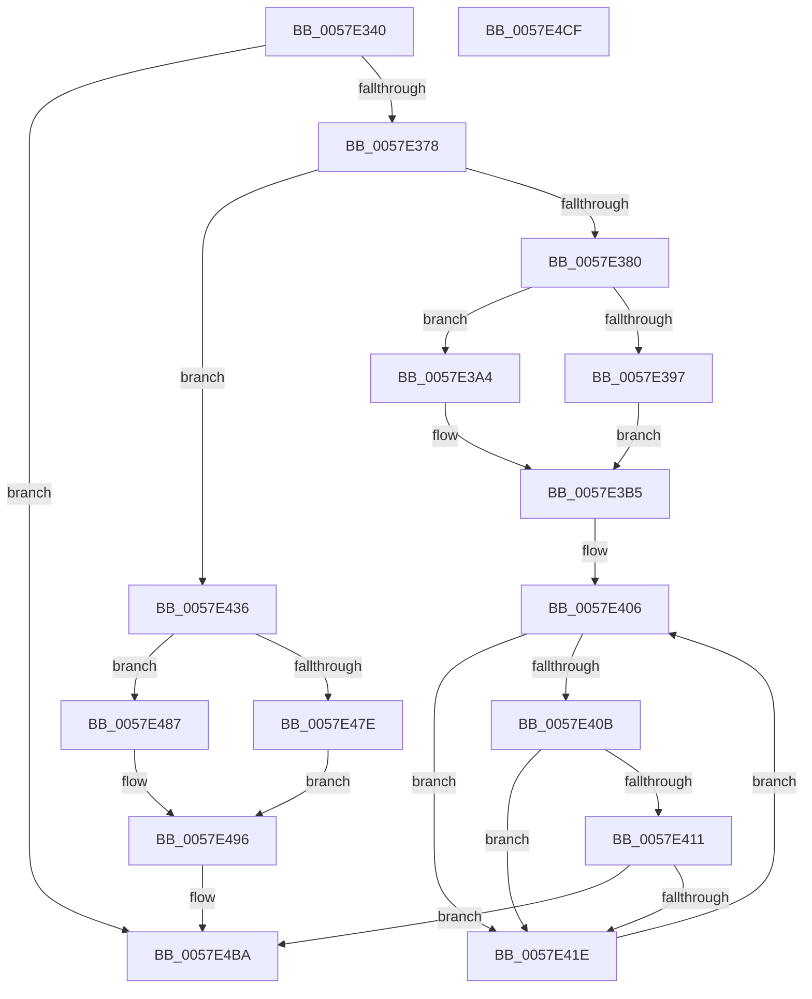

# CcExitPartition

- RVA: `0x0057E340`–`0x0057E4D0` (길이 `400` bytes)
- VA: `0x000000014057E340`
- 실행 섹션: `.text`
- PDB 이름 있음: `예`; PDB Function 태그: `아니요`
- unwind 정보 RVA: `0x000BE5F8`
- 디코드: `93`개 명령, `400/400` bytes 표시
- 미해석 바이트: `0` (있으면 어셈블리에 `.byte`로 보존)

> 이 문서는 커널 이미지의 기계어와 PDB 기호를 분석해 생성했습니다. 4번과 5번은 함수 원형과 자료형을 바이너리 사용 방식에서 추정한 C 해석이며 원본 소스 복구 결과는 아닙니다.

## 1. Dependencies

- 직접 호출 지점: **17**; 고유 호출 대상: **11**
- 직접 호출자로 확인된 함수: **1**
- RIP 상대 이미지 참조: **5**

### Outgoing calls
- `0x0057E386` → [CcNotifyWriteBehindInternal](../3C/CcNotifyWriteBehindInternal_function_003CC224.md) (function, `0x003CC224`)
- `0x0057E399` → [CcWaitForCurrentLazyWriterActivityOnPartition](CcWaitForCurrentLazyWriterActivityOnPartition_function_0057C7D4.md) (function, `0x0057C7D4`)
- `0x0057E3B0` → [CcForEachPrivateVolumeCacheMap](../38/CcForEachPrivateVolumeCacheMap_function_0038967C.md) (function, `0x0038967C`)
- `0x0057E3C1` → [KeAcquireInStackQueuedSpinLock](../27/KeAcquireInStackQueuedSpinLock_function_002757A0.md) (function, `0x002757A0`)
- `0x0057E3CD` → [KeAcquireSpinLockRaiseToDpc](../20/KeAcquireSpinLockRaiseToDpc_function_00208470.md) (function, `0x00208470`)
- `0x0057E3E2` → [KeReleaseSpinLock](../39/KeReleaseSpinLock_function_00392BA0.md) (function, `0x00392BA0`)
- `0x0057E3EC` → [KeReleaseInStackQueuedSpinLock](../34/KeReleaseInStackQueuedSpinLock_function_00342CE0.md) (function, `0x00342CE0`)
- `0x0057E424` → [CcDeleteSectionsForPartition](CcDeleteSectionsForPartition_function_0057E0F8.md) (function, `0x0057E0F8`)
- `0x0057E42F` → [CcDeleteSectionsForPartition](CcDeleteSectionsForPartition_function_0057E0F8.md) (function, `0x0057E0F8`)
- `0x0057E442` → [KeAcquireInStackQueuedSpinLock](../27/KeAcquireInStackQueuedSpinLock_function_002757A0.md) (function, `0x002757A0`)
- `0x0057E44E` → [KeAcquireSpinLockRaiseToDpc](../20/KeAcquireSpinLockRaiseToDpc_function_00208470.md) (function, `0x00208470`)
- `0x0057E463` → [KeReleaseSpinLock](../39/KeReleaseSpinLock_function_00392BA0.md) (function, `0x00392BA0`)
- `0x0057E46D` → [KeReleaseInStackQueuedSpinLock](../34/KeReleaseInStackQueuedSpinLock_function_00342CE0.md) (function, `0x00342CE0`)
- `0x0057E480` → [CcPostDeferredWrites](../35/CcPostDeferredWrites_function_003590FC.md) (function, `0x003590FC`)
- `0x0057E491` → [CcForEachPrivateVolumeCacheMap](../38/CcForEachPrivateVolumeCacheMap_function_0038967C.md) (function, `0x0038967C`)
- `0x0057E4AD` → [DbgPrintEx](../35/DbgPrintEx_function_00359290.md) (function, `0x00359290`)
- `0x0057E4B5` → [CcDeletePartition](CcDeletePartition_function_0057DE9C.md) (function, `0x0057DE9C`)

### Direct callers
- [MiDrainCrossPartitionUsage](../69/MiDrainCrossPartitionUsage_function_00690984.md) at `0x00690A33`
- [MiDrainCrossPartitionUsage](../69/MiDrainCrossPartitionUsage_function_00690984.md) at `0x00690AE9`

### Static image references
- `0x0057E38B` → RVA `0x00E65B88` (`.data`; read)
- `0x0057E3A9` → RVA `0x0057C5F0` (`CcWaitForCurrentLazyWriterActivityHelper`; read)
- `0x0057E3C6` → RVA `0x00F8F510` (`.data`; read)
- `0x0057E48A` → RVA `0x0057DCB0` (`CcPostDeferredWritesOnVolumeHelper`; read)
- `0x0057E4A3` → RVA `0x006C8DB0` (` ?? ::FNODOBFM::`string'`; read)

## 2. Other-region calls and transfers

- 다른 실행 섹션으로 향하는 call: **0**
- 별도 외부 분기/꼬리 이동을 확인하지 못했습니다.

## 3. Assembly (complete function range)

```asm
0057E340  48 8B C4                        mov rax, rsp
0057E343  48 89 58 10                     mov qword ptr [rax + 0x10], rbx
0057E347  48 89 68 18                     mov qword ptr [rax + 0x18], rbp
0057E34B  48 89 70 20                     mov qword ptr [rax + 0x20], rsi
0057E34F  57                              push rdi
0057E350  48 83 EC 50                     sub rsp, 0x50
0057E354  48 8B 59 08                     mov rbx, qword ptr [rcx + 8]
0057E358  33 F6                           xor esi, esi
0057E35A  89 70 08                        mov dword ptr [rax + 8], esi
0057E35D  0F 57 C0                        xorps xmm0, xmm0
0057E360  33 C0                           xor eax, eax
0057E362  48 8B F9                        mov rdi, rcx
0057E365  48 89 44 24 40                  mov qword ptr [rsp + 0x40], rax
0057E36A  0F 11 44 24 30                  movups xmmword ptr [rsp + 0x30], xmm0
0057E36F  48 85 DB                        test rbx, rbx
0057E372  0F 84 42 01 00 00               je 0x14057e4ba
0057E378  85 D2                           test edx, edx
0057E37A  0F 85 B6 00 00 00               jne 0x14057e436
0057E380  8D 56 02                        lea edx, [rsi + 2]
0057E383  48 8B CB                        mov rcx, rbx
0057E386  E8 99 DE E4 FF                  call 0x1403cc224
0057E38B  40 38 35 F6 77 8E 00            cmp byte ptr [rip + 0x8e77f6], sil
0057E392  48 8B CB                        mov rcx, rbx
0057E395  75 0D                           jne 0x14057e3a4
0057E397  33 D2                           xor edx, edx
0057E399  E8 36 E4 FF FF                  call 0x14057c7d4
0057E39E  89 44 24 60                     mov dword ptr [rsp + 0x60], eax
0057E3A2  EB 11                           jmp 0x14057e3b5
0057E3A4  4C 8D 44 24 60                  lea r8, [rsp + 0x60]
0057E3A9  48 8D 15 40 E2 FF FF            lea rdx, [rip - 0x1dc0]
0057E3B0  E8 C7 B2 E0 FF                  call 0x14038967c
0057E3B5  48 8D 8B 00 03 00 00            lea rcx, [rbx + 0x300]
0057E3BC  48 8D 54 24 30                  lea rdx, [rsp + 0x30]
0057E3C1  E8 DA 73 CF FF                  call 0x1402757a0
0057E3C6  48 8D 0D 43 11 A1 00            lea rcx, [rip + 0xa11143]
0057E3CD  E8 9E A0 C8 FF                  call 0x140208470
0057E3D2  8A D0                           mov dl, al
0057E3D4  C6 83 0E 05 00 00 01            mov byte ptr [rbx + 0x50e], 1
0057E3DB  48 8D 0D 2E 11 A1 00            lea rcx, [rip + 0xa1112e]
0057E3E2  E8 B9 47 E1 FF                  call 0x140392ba0
0057E3E7  48 8D 4C 24 30                  lea rcx, [rsp + 0x30]
0057E3EC  E8 EF 48 DC FF                  call 0x140342ce0
0057E3F1  48 8D AB A0 02 00 00            lea rbp, [rbx + 0x2a0]
0057E3F8  48 8D BB 80 02 00 00            lea rdi, [rbx + 0x280]
0057E3FF  48 8D B3 B8 02 00 00            lea rsi, [rbx + 0x2b8]
0057E406  48 39 3F                        cmp qword ptr [rdi], rdi
0057E409  75 13                           jne 0x14057e41e
0057E40B  48 39 75 00                     cmp qword ptr [rbp], rsi
0057E40F  75 0D                           jne 0x14057e41e
0057E411  48 39 B3 A8 02 00 00            cmp qword ptr [rbx + 0x2a8], rsi
0057E418  0F 84 9C 00 00 00               je 0x14057e4ba
0057E41E  48 8B D3                        mov rdx, rbx
0057E421  48 8B CD                        mov rcx, rbp
0057E424  E8 CF FC FF FF                  call 0x14057e0f8
0057E429  48 8B D3                        mov rdx, rbx
0057E42C  48 8B CF                        mov rcx, rdi
0057E42F  E8 C4 FC FF FF                  call 0x14057e0f8
0057E434  EB D0                           jmp 0x14057e406
0057E436  48 8D 8B 00 03 00 00            lea rcx, [rbx + 0x300]
0057E43D  48 8D 54 24 30                  lea rdx, [rsp + 0x30]
0057E442  E8 59 73 CF FF                  call 0x1402757a0
0057E447  48 8D 0D C2 10 A1 00            lea rcx, [rip + 0xa110c2]
0057E44E  E8 1D A0 C8 FF                  call 0x140208470
0057E453  8A D0                           mov dl, al
0057E455  C6 83 0E 05 00 00 02            mov byte ptr [rbx + 0x50e], 2
0057E45C  48 8D 0D AD 10 A1 00            lea rcx, [rip + 0xa110ad]
0057E463  E8 38 47 E1 FF                  call 0x140392ba0
0057E468  48 8D 4C 24 30                  lea rcx, [rsp + 0x30]
0057E46D  E8 6E 48 DC FF                  call 0x140342ce0
0057E472  40 38 35 0F 77 8E 00            cmp byte ptr [rip + 0x8e770f], sil
0057E479  48 8B CB                        mov rcx, rbx
0057E47C  75 09                           jne 0x14057e487
0057E47E  33 D2                           xor edx, edx
0057E480  E8 77 AC DD FF                  call 0x1403590fc
0057E485  EB 0F                           jmp 0x14057e496
0057E487  45 33 C0                        xor r8d, r8d
0057E48A  48 8D 15 1F F8 FF FF            lea rdx, [rip - 0x7e1]
0057E491  E8 E6 B1 E0 FF                  call 0x14038967c
0057E496  BA 02 00 00 00                  mov edx, 2
0057E49B  48 89 7C 24 20                  mov qword ptr [rsp + 0x20], rdi
0057E4A0  4C 8B CB                        mov r9, rbx
0057E4A3  4C 8D 05 06 A9 14 00            lea r8, [rip + 0x14a906]
0057E4AA  8D 4A 7D                        lea ecx, [rdx + 0x7d]
0057E4AD  E8 DE AD DD FF                  call 0x140359290
0057E4B2  48 8B CB                        mov rcx, rbx
0057E4B5  E8 E2 F9 FF FF                  call 0x14057de9c
0057E4BA  48 8B 5C 24 68                  mov rbx, qword ptr [rsp + 0x68]
0057E4BF  48 8B 6C 24 70                  mov rbp, qword ptr [rsp + 0x70]
0057E4C4  48 8B 74 24 78                  mov rsi, qword ptr [rsp + 0x78]
0057E4C9  48 83 C4 50                     add rsp, 0x50
0057E4CD  5F                              pop rdi
0057E4CE  C3                              ret
0057E4CF  CC                              int3
```

## 4. C-style interpretation (structured pseudocode)

```c
__int64 __fastcall CcExitPartition(__int64 a1, int a2)
{
    __int64 result;
    __int64 v_rsi;
    __int64 v_rsp;
    unsigned __int64 v_stack_m18;
    unsigned __int64 v_stack_m28;
    unsigned __int64 v_stack_m38;
    unsigned __int64 v_stack_p10;
    unsigned __int64 v_stack_p18;
    unsigned __int64 v_stack_p20;
    unsigned int v_stack_p8;

    *(unsigned __int64 *)(v_rsp + 16) = v_rbx;
    *(unsigned __int64 *)(v_rsp + 24) = v_rbp;
    *(unsigned __int64 *)(v_rsp + 32) = v_rsi;
    v_rsp = (v_rsp) - (80);
    v_rsi = 0;
    *(unsigned int *)(v_rsp + 8) = 0;
    result = 0;
    v_stack_m18 = 0;
    v_stack_m28 = v_xmm0;
    if (*(unsigned __int64 *)(a1 + 8) == 0) goto loc_0057E4BA;
    if (a2 != 0) goto loc_0057E436;
    result = CcNotifyWriteBehindInternal(*(unsigned __int64 *)(a1 + 8), v_rsi + 2, a3, a4);
    if ((*(unsigned __int8 *)(v_rip + 9336822)) != 0) goto loc_0057E3A4;
    a2 = 0;
    result = CcWaitForCurrentLazyWriterActivityOnPartition(*(unsigned __int64 *)(a1 + 8), a2, a3, a4);
    v_stack_p8 = (unsigned int)(result);
    goto loc_0057E3B5;
loc_0057E3A4:
    result = CcForEachPrivateVolumeCacheMap(*(unsigned __int64 *)(a1 + 8), v_rip - 7616, v_stack_p8, a4);
loc_0057E3B5:
    result = KeAcquireInStackQueuedSpinLock(*(unsigned __int64 *)(a1 + 8) + 768, v_stack_m28, v_stack_p8, a4);
    result = KeAcquireSpinLockRaiseToDpc(v_rip + 10555715, v_stack_m28, v_stack_p8, a4);
    *(unsigned __int8 *)(*(unsigned __int64 *)(a1 + 8) + 1294) = 1;
    result = KeReleaseSpinLock(v_rip + 10555694, (unsigned __int8)(result), v_stack_p8, a4);
    result = KeReleaseInStackQueuedSpinLock(v_stack_m28, (unsigned __int8)(result), v_stack_p8, a4);
loc_0057E406:
    if ((*(unsigned __int64 *)(*(unsigned __int64 *)(a1 + 8) + 640)) != (*(unsigned __int64 *)(a1 + 8) + 640)) goto loc_0057E41E;
    if ((*(unsigned __int64 *)(*(unsigned __int64 *)(a1 + 8) + 672)) != (*(unsigned __int64 *)(a1 + 8) + 696)) goto loc_0057E41E;
    if ((*(unsigned __int64 *)(*(unsigned __int64 *)(a1 + 8) + 680)) == (*(unsigned __int64 *)(a1 + 8) + 696)) goto loc_0057E4BA;
loc_0057E41E:
    result = CcDeleteSectionsForPartition(*(unsigned __int64 *)(a1 + 8) + 672, *(unsigned __int64 *)(a1 + 8), v_stack_p8, a4);
    result = CcDeleteSectionsForPartition(*(unsigned __int64 *)(a1 + 8) + 640, *(unsigned __int64 *)(a1 + 8), v_stack_p8, a4);
    goto loc_0057E406;
loc_0057E436:
    result = KeAcquireInStackQueuedSpinLock(*(unsigned __int64 *)(a1 + 8) + 768, v_stack_m28, v_stack_p8, a4);
    result = KeAcquireSpinLockRaiseToDpc(v_rip + 10555586, v_stack_m28, v_stack_p8, a4);
    *(unsigned __int8 *)(*(unsigned __int64 *)(a1 + 8) + 1294) = 2;
    result = KeReleaseSpinLock(v_rip + 10555565, (unsigned __int8)(result), v_stack_p8, a4);
    result = KeReleaseInStackQueuedSpinLock(v_stack_m28, (unsigned __int8)(result), v_stack_p8, a4);
    if ((*(unsigned __int8 *)(v_rip + 9336591)) != ((unsigned __int8)(*(unsigned __int64 *)(a1 + 8) + 696))) goto loc_0057E487;
    a2 = 0;
    result = CcPostDeferredWrites(*(unsigned __int64 *)(a1 + 8), a2, v_stack_p8, a4);
    goto loc_0057E496;
loc_0057E487:
    a3 = 0;
    result = CcForEachPrivateVolumeCacheMap(*(unsigned __int64 *)(a1 + 8), v_rip - 2017, a3, a4);
loc_0057E496:
    v_stack_m38 = *(unsigned __int64 *)(a1 + 8) + 640;
    result = DbgPrintEx(2 + 125, 2, v_rip + 1353990, *(unsigned __int64 *)(a1 + 8));
    result = CcDeletePartition(*(unsigned __int64 *)(a1 + 8), 2, v_rip + 1353990, *(unsigned __int64 *)(a1 + 8));
loc_0057E4BA:
    v_rsp = (v_rsp) + (80);
    return result;
}
```

## 5. (Beta) C Style

```c
int64_t CcExitPartition(void *Arg1, int32_t Arg2)
{
    uint8_t *arg1 = (uint8_t *)Arg1;

    int64_t result;
    int64_t local_rsi;
    int64_t local_rsp;
    uint64_t v_stack_m18;
    uint64_t v_stack_m28;
    uint64_t v_stack_m38;
    uint64_t v_stack_p10;
    uint64_t v_stack_p18;
    uint64_t v_stack_p20;
    uint32_t v_stack_p8;

    *(uint64_t *)(local_rsp + 0x10) = local_rbx;
    *(uint64_t *)(local_rsp + 0x18) = local_rbp;
    *(uint64_t *)(local_rsp + 0x20) = local_rsi;
    local_rsp = (local_rsp) - (80);
    local_rsi = 0;
    *(uint32_t *)(local_rsp + 0x8) = 0;
    result = 0;
    v_stack_m18 = 0;
    v_stack_m28 = v_xmm0;
    if (*(uint64_t *)(arg1 + 0x8) == 0) goto loc_0057E4BA;
    if (Arg2 != 0) goto loc_0057E436;
    result = CcNotifyWriteBehindInternal(*(uint64_t *)(arg1 + 0x8), local_rsi + 2, a3, a4);
    if ((*(uint8_t *)(v_rip + 0x8E77F6)) != 0) goto loc_0057E3A4;
    Arg2 = 0;
    result = CcWaitForCurrentLazyWriterActivityOnPartition(*(uint64_t *)(arg1 + 0x8), Arg2, a3, a4);
    v_stack_p8 = (uint32_t)(result);
    goto loc_0057E3B5;
loc_0057E3A4:
    result = CcForEachPrivateVolumeCacheMap(*(uint64_t *)(arg1 + 0x8), v_rip - 7616, v_stack_p8, a4);
loc_0057E3B5:
    result = KeAcquireInStackQueuedSpinLock(*(uint64_t *)(arg1 + 0x8) + 768, v_stack_m28, v_stack_p8, a4);
    result = KeAcquireSpinLockRaiseToDpc(v_rip + 10555715, v_stack_m28, v_stack_p8, a4);
    *(uint8_t *)(*(uint64_t *)(arg1 + 0x8) + 0x50E) = 1;
    result = KeReleaseSpinLock(v_rip + 10555694, (uint8_t)(result), v_stack_p8, a4);
    result = KeReleaseInStackQueuedSpinLock(v_stack_m28, (uint8_t)(result), v_stack_p8, a4);
loc_0057E406:
    if ((*(uint64_t *)(*(uint64_t *)(arg1 + 0x8) + 0x280)) != (*(uint64_t *)(arg1 + 0x8) + 640)) goto loc_0057E41E;
    if ((*(uint64_t *)(*(uint64_t *)(arg1 + 0x8) + 0x2A0)) != (*(uint64_t *)(arg1 + 0x8) + 696)) goto loc_0057E41E;
    if ((*(uint64_t *)(*(uint64_t *)(arg1 + 0x8) + 0x2A8)) == (*(uint64_t *)(arg1 + 0x8) + 696)) goto loc_0057E4BA;
loc_0057E41E:
    result = CcDeleteSectionsForPartition(*(uint64_t *)(arg1 + 0x8) + 672, *(uint64_t *)(arg1 + 0x8), v_stack_p8, a4);
    result = CcDeleteSectionsForPartition(*(uint64_t *)(arg1 + 0x8) + 640, *(uint64_t *)(arg1 + 0x8), v_stack_p8, a4);
    goto loc_0057E406;
loc_0057E436:
    result = KeAcquireInStackQueuedSpinLock(*(uint64_t *)(arg1 + 0x8) + 768, v_stack_m28, v_stack_p8, a4);
    result = KeAcquireSpinLockRaiseToDpc(v_rip + 10555586, v_stack_m28, v_stack_p8, a4);
    *(uint8_t *)(*(uint64_t *)(arg1 + 0x8) + 0x50E) = 2;
    result = KeReleaseSpinLock(v_rip + 10555565, (uint8_t)(result), v_stack_p8, a4);
    result = KeReleaseInStackQueuedSpinLock(v_stack_m28, (uint8_t)(result), v_stack_p8, a4);
    if ((*(uint8_t *)(v_rip + 0x8E770F)) != ((uint8_t)(*(uint64_t *)(arg1 + 0x8) + 696))) goto loc_0057E487;
    Arg2 = 0;
    result = CcPostDeferredWrites(*(uint64_t *)(arg1 + 0x8), Arg2, v_stack_p8, a4);
    goto loc_0057E496;
loc_0057E487:
    a3 = 0;
    result = CcForEachPrivateVolumeCacheMap(*(uint64_t *)(arg1 + 0x8), v_rip - 2017, a3, a4);
loc_0057E496:
    v_stack_m38 = *(uint64_t *)(arg1 + 0x8) + 640;
    result = DbgPrintEx(2 + 125, 2, v_rip + 1353990, *(uint64_t *)(arg1 + 0x8));
    result = CcDeletePartition(*(uint64_t *)(arg1 + 0x8), 2, v_rip + 1353990, *(uint64_t *)(arg1 + 0x8));
loc_0057E4BA:
    local_rsp = (local_rsp) + (80);
    return result;
}
```

### 관측된 메모리 오프셋

구조체 형식이 확인되지 않은 접근은 인자 기준의 오프셋으로만 기록했습니다.

| 기준 인자 | 오프셋 표현 | 폭 (bit) | 접근 |
|---|---:|---:|---|
| `Arg1` | `+ 0x8` | `64` | `R` |

## 6. Execution-region graph

[열기: 2D/3D 그래프와 함수 탐색 컨트롤 패널](../../../control-panel.html?section=text&rva=0x0057E340&view=graph)

- 2D 그래프는 위에서 아래로 흐르고, 3D 그래프는 빈 공간을 드래그해 회전합니다. Shift+드래그는 이동, 휠은 확대·축소, 함수 노드 선택은 대상 보고서 이동입니다.

### Static fallback


