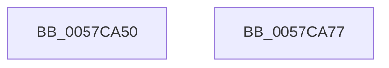

# CcFastCopyWrite

- RVA: `0x0057CA50`–`0x0057CA78` (길이 `40` bytes)
- VA: `0x000000014057CA50`
- 실행 섹션: `.text`
- PDB 이름 있음: `예`; PDB Function 태그: `아니요`
- unwind 정보 RVA: `0x00082420`
- 디코드: `12`개 명령, `40/40` bytes 표시
- 미해석 바이트: `0` (있으면 어셈블리에 `.byte`로 보존)

> 이 문서는 커널 이미지의 기계어와 PDB 기호를 분석해 생성했습니다. 4번과 5번은 함수 원형과 자료형을 바이너리 사용 방식에서 추정한 C 해석이며 원본 소스 복구 결과는 아닙니다.

## 1. Dependencies

- 직접 호출 지점: **1**; 고유 호출 대상: **1**
- 직접 호출자로 확인된 함수: **1**
- RIP 상대 이미지 참조: **0**

### Outgoing calls
- `0x0057CA6D` → [CcCopyWriteEx](../3C/CcCopyWriteEx_function_003CA4F0.md) (function, `0x003CA4F0`)

### Direct callers
- [DifCcFastCopyWriteWrapper](../61/DifCcFastCopyWriteWrapper_function_0061C5F0.md) at `0x0061C6DE`

### Static image references
- 디코드된 RIP-relative 메모리 참조가 없습니다.

## 2. Other-region calls and transfers

- 다른 실행 섹션으로 향하는 call: **0**
- 별도 외부 분기/꼬리 이동을 확인하지 못했습니다.

## 3. Assembly (complete function range)

```asm
0057CA50  4C 8B DC                        mov r11, rsp
0057CA53  48 83 EC 48                     sub rsp, 0x48
0057CA57  49 83 63 E0 00                  and qword ptr [r11 - 0x20], 0
0057CA5C  8B C2                           mov eax, edx
0057CA5E  49 8D 53 E8                     lea rdx, [r11 - 0x18]
0057CA62  4D 89 4B D8                     mov qword ptr [r11 - 0x28], r9
0057CA66  41 B1 01                        mov r9b, 1
0057CA69  49 89 43 E8                     mov qword ptr [r11 - 0x18], rax
0057CA6D  E8 7E DA E4 FF                  call 0x1403ca4f0
0057CA72  48 83 C4 48                     add rsp, 0x48
0057CA76  C3                              ret
0057CA77  CC                              int3
```

## 4. C-style interpretation (structured pseudocode)

```c
__int64 __fastcall CcFastCopyWrite(__int64 a1, int a2, __int64 a3, __int64 a4)
{
    __int64 result;
    __int64 v_rsp;

    v_rsp = (v_rsp) - (72);
    *(unsigned __int64 *)(v_rsp - 40) = a4;
    *(unsigned __int64 *)(v_rsp - 24) = (unsigned int)(a2);
    result = CcCopyWriteEx(a1, v_rsp - 24, a3, 1);
    v_rsp = (v_rsp) + (72);
    return result;
}
```

## 5. (Beta) C Style

```c
int64_t CcFastCopyWrite(int64_t Arg1, int32_t Arg2, int64_t Arg3, int64_t Arg4)
{
    int64_t result;
    int64_t local_rsp;

    local_rsp = (local_rsp) - (72);
    *(uint64_t *)(local_rsp - 0x28) = Arg4;
    *(uint64_t *)(local_rsp - 0x18) = (uint32_t)(Arg2);
    result = CcCopyWriteEx(Arg1, local_rsp - 24, Arg3, 1);
    local_rsp = (local_rsp) + (72);
    return result;
}
```

## 6. Execution-region graph

[열기: 2D/3D 그래프와 함수 탐색 컨트롤 패널](../../../control-panel.html?section=text&rva=0x0057CA50&view=graph)

- 2D 그래프는 위에서 아래로 흐르고, 3D 그래프는 빈 공간을 드래그해 회전합니다. Shift+드래그는 이동, 휠은 확대·축소, 함수 노드 선택은 대상 보고서 이동입니다.

### Static fallback


