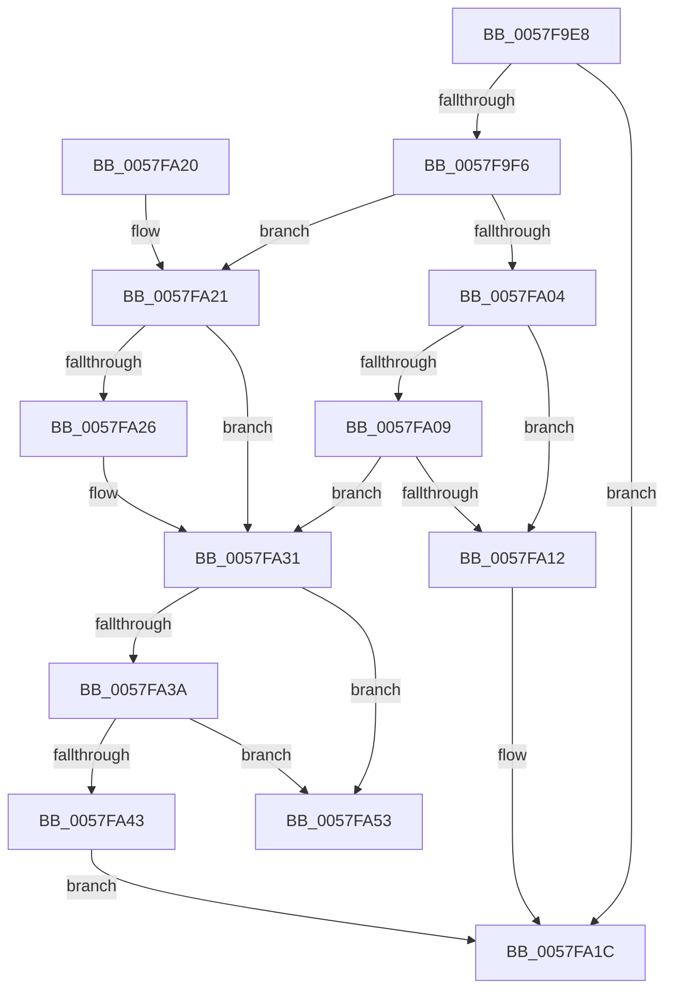

# CcFindNextWBWorkQueueEntry

- RVA: `0x0057F9E8`–`0x0057FA5A` (길이 `114` bytes)
- VA: `0x000000014057F9E8`
- 실행 섹션: `.text`
- PDB 이름 있음: `예`; PDB Function 태그: `아니요`
- unwind 정보 RVA: `0x000DB714`
- 디코드: `35`개 명령, `114/114` bytes 표시
- 미해석 바이트: `0` (있으면 어셈블리에 `.byte`로 보존)

> 이 문서는 커널 이미지의 기계어와 PDB 기호를 분석해 생성했습니다. 4번과 5번은 함수 원형과 자료형을 바이너리 사용 방식에서 추정한 C 해석이며 원본 소스 복구 결과는 아닙니다.

## 1. Dependencies

- 직접 호출 지점: **0**; 고유 호출 대상: **0**
- 직접 호출자로 확인된 함수: **1**
- RIP 상대 이미지 참조: **0**

### Outgoing calls
- 직접 디코드된 call 명령이 없습니다.

### Direct callers
- [CcAsyncLazywriteWorkerMulti](../4D/CcAsyncLazywriteWorkerMulti_function_004D1574.md) at `0x004D1868`

### Static image references
- 디코드된 RIP-relative 메모리 참조가 없습니다.

## 2. Other-region calls and transfers

- 다른 실행 섹션으로 향하는 call: **0**
- 별도 외부 분기/꼬리 이동을 확인하지 못했습니다.

## 3. Assembly (complete function range)

```asm
0057F9E8  49 8B 08                        mov rcx, qword ptr [r8]
0057F9EB  45 33 DB                        xor r11d, r11d
0057F9EE  45 8B D3                        mov r10d, r11d
0057F9F1  49 3B C8                        cmp rcx, r8
0057F9F4  74 26                           je 0x14057fa1c
0057F9F6  8B 81 80 00 00 00               mov eax, dword ptr [rcx + 0x80]
0057F9FC  4C 8B D1                        mov r10, rcx
0057F9FF  83 F8 04                        cmp eax, 4
0057FA02  75 1D                           jne 0x14057fa21
0057FA04  45 85 C9                        test r9d, r9d
0057FA07  75 09                           jne 0x14057fa12
0057FA09  83 BA 30 01 00 00 01            cmp dword ptr [rdx + 0x130], 1
0057FA10  76 1F                           jbe 0x14057fa31
0057FA12  C6 82 C4 00 00 00 01            mov byte ptr [rdx + 0xc4], 1
0057FA19  4D 8B D3                        mov r10, r11
0057FA1C  49 8B C2                        mov rax, r10
0057FA1F  C3                              ret
0057FA20  CC                              int3
0057FA21  83 F8 07                        cmp eax, 7
0057FA24  75 0B                           jne 0x14057fa31
0057FA26  48 8B 41 18                     mov rax, qword ptr [rcx + 0x18]
0057FA2A  4C 89 98 F8 01 00 00            mov qword ptr [rax + 0x1f8], r11
0057FA31  48 8B 01                        mov rax, qword ptr [rcx]
0057FA34  48 39 48 08                     cmp qword ptr [rax + 8], rcx
0057FA38  75 19                           jne 0x14057fa53
0057FA3A  48 8B 51 08                     mov rdx, qword ptr [rcx + 8]
0057FA3E  48 39 0A                        cmp qword ptr [rdx], rcx
0057FA41  75 10                           jne 0x14057fa53
0057FA43  48 89 02                        mov qword ptr [rdx], rax
0057FA46  48 89 50 08                     mov qword ptr [rax + 8], rdx
0057FA4A  4C 89 59 08                     mov qword ptr [rcx + 8], r11
0057FA4E  4C 89 19                        mov qword ptr [rcx], r11
0057FA51  EB C9                           jmp 0x14057fa1c
0057FA53  B9 03 00 00 00                  mov ecx, 3
0057FA58  CD 29                           int 0x29
```

## 4. C-style interpretation (structured pseudocode)

```c
__int64 __fastcall CcFindNextWBWorkQueueEntry(__int64 a1, __int64 a2, __int64 a3, int a4)
{
    __int64 result;
    __int64 v_r11;

    v_r11 = 0;
    if ((*(unsigned __int64 *)(a3)) == a3) goto loc_0057FA1C;
    if (((unsigned int)((unsigned int)(*(unsigned int *)(*(unsigned __int64 *)(a3) + 128)))) != 4) goto loc_0057FA21;
    if (a4 != 0) goto loc_0057FA12;
    if ((*(unsigned int *)(a2 + 304)) <= 1) goto loc_0057FA31;
loc_0057FA12:
    *(unsigned __int8 *)(a2 + 196) = 1;
loc_0057FA1C:
    return 0;
loc_0057FA21:
    result = 0;
    if (0 == 7) {
        result = *(unsigned __int64 *)(*(unsigned __int64 *)(a3) + 24);
        *(unsigned __int64 *)(result + 504) = 0;
    }
    if ((*(unsigned __int64 *)(*(unsigned __int64 *)(*(unsigned __int64 *)(a3)) + 8)) != (*(unsigned __int64 *)(a3))) goto loc_0057FA53;
    if ((*(unsigned __int64 *)(*(unsigned __int64 *)(*(unsigned __int64 *)(a3) + 8))) != (*(unsigned __int64 *)(a3))) goto loc_0057FA53;
    *(unsigned __int64 *)(*(unsigned __int64 *)(*(unsigned __int64 *)(a3) + 8)) = *(unsigned __int64 *)(*(unsigned __int64 *)(a3));
    *(unsigned __int64 *)(*(unsigned __int64 *)(*(unsigned __int64 *)(a3)) + 8) = *(unsigned __int64 *)(*(unsigned __int64 *)(a3) + 8);
    *(unsigned __int64 *)(*(unsigned __int64 *)(a3) + 8) = 0;
    *(unsigned __int64 *)(*(unsigned __int64 *)(a3)) = 0;
    goto loc_0057FA1C;
loc_0057FA53:
    return *(unsigned __int64 *)(*(unsigned __int64 *)(a3));
}
```

## 5. (Beta) C Style

```c
int64_t CcFindNextWBWorkQueueEntry(int64_t Arg1, void *Arg2, void *Arg3, int32_t Arg4)
{
    uint8_t *arg2 = (uint8_t *)Arg2;
    uint8_t *arg3 = (uint8_t *)Arg3;

    int64_t result;
    int64_t local_r11;

    local_r11 = 0;
    if ((*(uint64_t *)(arg3)) == Arg3) goto loc_0057FA1C;
    if (((uint32_t)((uint32_t)(*(uint32_t *)(*(uint64_t *)(arg3) + 0x80)))) != 4) goto loc_0057FA21;
    if (Arg4 != 0) goto loc_0057FA12;
    if ((*(uint32_t *)(arg2 + 0x130)) <= 1) goto loc_0057FA31;
loc_0057FA12:
    *(uint8_t *)(arg2 + 0xC4) = 1;
loc_0057FA1C:
    return 0;
loc_0057FA21:
    result = 0;
    if (0 == 7) {
        result = *(uint64_t *)(*(uint64_t *)(arg3) + 0x18);
        *(uint64_t *)(result + 0x1F8) = 0;
    }
    if ((*(uint64_t *)(*(uint64_t *)(*(uint64_t *)(arg3)) + 0x8)) != (*(uint64_t *)(arg3))) goto loc_0057FA53;
    if ((*(uint64_t *)(*(uint64_t *)(*(uint64_t *)(arg3) + 0x8))) != (*(uint64_t *)(arg3))) goto loc_0057FA53;
    *(uint64_t *)(*(uint64_t *)(*(uint64_t *)(arg3) + 0x8)) = *(uint64_t *)(*(uint64_t *)(arg3));
    *(uint64_t *)(*(uint64_t *)(*(uint64_t *)(arg3)) + 0x8) = *(uint64_t *)(*(uint64_t *)(arg3) + 0x8);
    *(uint64_t *)(*(uint64_t *)(arg3) + 0x8) = 0;
    *(uint64_t *)(*(uint64_t *)(arg3)) = 0;
    goto loc_0057FA1C;
loc_0057FA53:
    return *(uint64_t *)(*(uint64_t *)(arg3));
}
```

### 관측된 메모리 오프셋

구조체 형식이 확인되지 않은 접근은 인자 기준의 오프셋으로만 기록했습니다.

| 기준 인자 | 오프셋 표현 | 폭 (bit) | 접근 |
|---|---:|---:|---|
| `Arg2` | `+ 0xC4` | `8` | `W` |
| `Arg2` | `+ 0x130` | `32` | `R` |
| `Arg3` | `+ 0x0` | `64` | `R` |

## 6. Execution-region graph

[열기: 2D/3D 그래프와 함수 탐색 컨트롤 패널](../../../control-panel.html?section=text&rva=0x0057F9E8&view=graph)

- 2D 그래프는 위에서 아래로 흐르고, 3D 그래프는 빈 공간을 드래그해 회전합니다. Shift+드래그는 이동, 휠은 확대·축소, 함수 노드 선택은 대상 보고서 이동입니다.

### Static fallback


