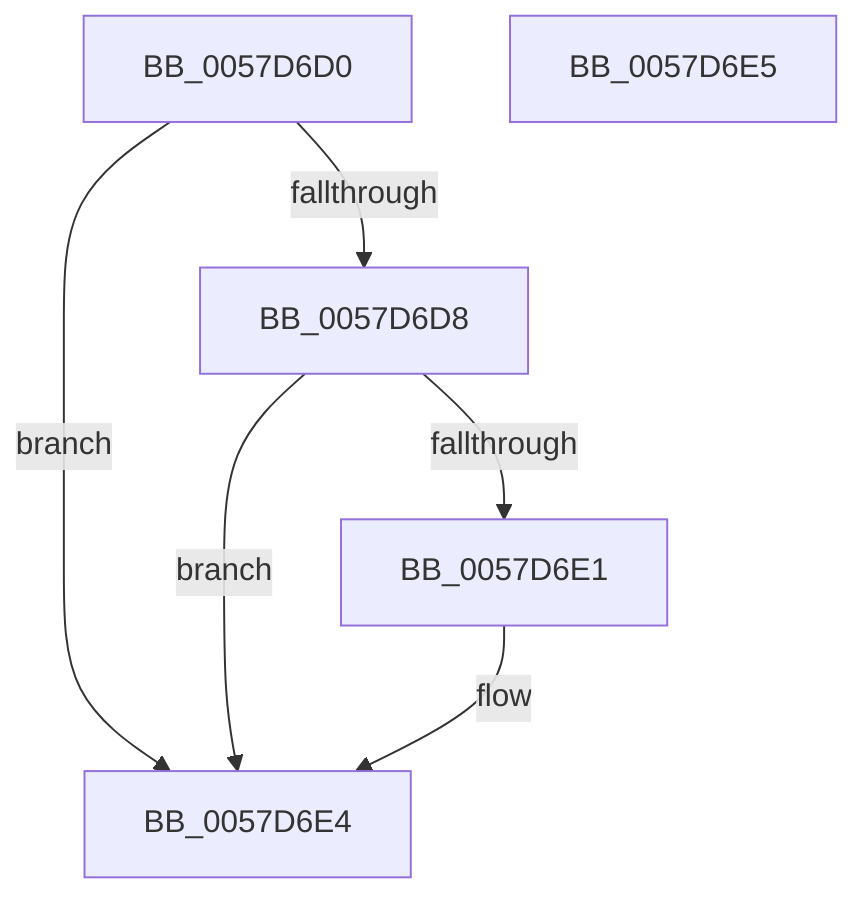

# CcGetCachedDirtyPageCountForFile

- RVA: `0x0057D6D0`–`0x0057D6E6` (길이 `22` bytes)
- VA: `0x000000014057D6D0`
- 실행 섹션: `.text`
- PDB 이름 있음: `예`; PDB Function 태그: `아니요`
- unwind 정보 RVA: `0x000DB714`
- 디코드: `9`개 명령, `22/22` bytes 표시
- 미해석 바이트: `0` (있으면 어셈블리에 `.byte`로 보존)

> 이 문서는 커널 이미지의 기계어와 PDB 기호를 분석해 생성했습니다. 4번과 5번은 함수 원형과 자료형을 바이너리 사용 방식에서 추정한 C 해석이며 원본 소스 복구 결과는 아닙니다.

## 1. Dependencies

- 직접 호출 지점: **0**; 고유 호출 대상: **0**
- 직접 호출자로 확인된 함수: **0**
- RIP 상대 이미지 참조: **0**

### Outgoing calls
- 직접 디코드된 call 명령이 없습니다.

### Direct callers
- 이 함수 시작 RVA로 연결되는 직접 call은 확인되지 않았습니다. 간접 호출은 완전히 역산할 수 없습니다.

### Static image references
- 디코드된 RIP-relative 메모리 참조가 없습니다.

## 2. Other-region calls and transfers

- 다른 실행 섹션으로 향하는 call: **0**
- 별도 외부 분기/꼬리 이동을 확인하지 못했습니다.

## 3. Assembly (complete function range)

```asm
0057D6D0  83 C8 FF                        or eax, 0xffffffff
0057D6D3  48 85 C9                        test rcx, rcx
0057D6D6  74 0C                           je 0x14057d6e4
0057D6D8  48 8B 49 08                     mov rcx, qword ptr [rcx + 8]
0057D6DC  48 85 C9                        test rcx, rcx
0057D6DF  74 03                           je 0x14057d6e4
0057D6E1  8B 41 70                        mov eax, dword ptr [rcx + 0x70]
0057D6E4  C3                              ret
0057D6E5  CC                              int3
```

## 4. C-style interpretation (structured pseudocode)

```c
__int64 __fastcall CcGetCachedDirtyPageCountForFile(__int64 a1)
{
    __int64 result;

    result = (unsigned int)((result) | (0xFFFFFFFFULL));
    if (a1 == 0) goto loc_0057D6E4;
    if (*(unsigned __int64 *)(a1 + 8) != 0) {
        result = *(unsigned int *)(*(unsigned __int64 *)(a1 + 8) + 112);
    }
    return result;
}
```

## 5. (Beta) C Style

```c
int64_t CcGetCachedDirtyPageCountForFile(int64_t Arg1)
{
    int64_t result;

    result = (uint32_t)((result) | (0xFFFFFFFFULL));
    if (Arg1 == 0) goto loc_0057D6E4;
    if (*(uint64_t *)(Arg1 + 0x8) != 0) {
        result = *(uint32_t *)(*(uint64_t *)(Arg1 + 0x8) + 0x70);
    }
    return result;
}
```

## 6. Execution-region graph

[열기: 2D/3D 그래프와 함수 탐색 컨트롤 패널](../../../control-panel.html?section=text&rva=0x0057D6D0&view=graph)

- 2D 그래프는 위에서 아래로 흐르고, 3D 그래프는 빈 공간을 드래그해 회전합니다. Shift+드래그는 이동, 휠은 확대·축소, 함수 노드 선택은 대상 보고서 이동입니다.

### Static fallback


