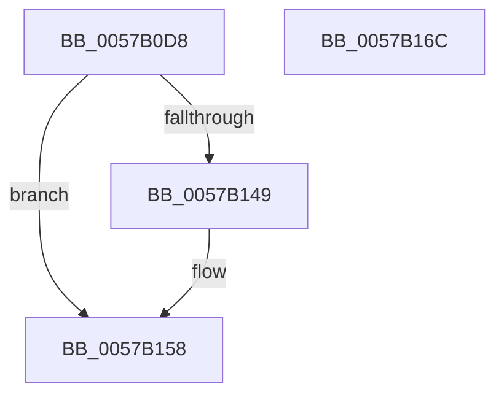

# CcGetContainerPolicyForDTP

- RVA: `0x0057B0D8`–`0x0057B16D` (길이 `149` bytes)
- VA: `0x000000014057B0D8`
- 실행 섹션: `.text`
- PDB 이름 있음: `예`; PDB Function 태그: `아니요`
- unwind 정보 RVA: `0x000C572C`
- 디코드: `37`개 명령, `149/149` bytes 표시
- 미해석 바이트: `0` (있으면 어셈블리에 `.byte`로 보존)

> 이 문서는 커널 이미지의 기계어와 PDB 기호를 분석해 생성했습니다. 4번과 5번은 함수 원형과 자료형을 바이너리 사용 방식에서 추정한 C 해석이며 원본 소스 복구 결과는 아닙니다.

## 1. Dependencies

- 직접 호출 지점: **2**; 고유 호출 대상: **2**
- 직접 호출자로 확인된 함수: **1**
- RIP 상대 이미지 참조: **1**

### Outgoing calls
- `0x0057B13E` → [ZwOpenKey](../6A/ZwOpenKey_function_006AD310.md) (function, `0x006AD310`)
- `0x0057B153` → [ZwClose](../6A/ZwClose_function_006AD2B0.md) (function, `0x006AD2B0`)

### Direct callers
- [CcContainerRestoreCallBack](CcContainerRestoreCallBack_function_0057B000.md) at `0x0057B017`

### Static image references
- `0x0057B0EE` → RVA `0x006C78F0` (` ?? ::FNODOBFM::`string'`; read)

## 2. Other-region calls and transfers

- 다른 실행 섹션으로 향하는 call: **0**
- 별도 외부 분기/꼬리 이동을 확인하지 못했습니다.

## 3. Assembly (complete function range)

```asm
0057B0D8  48 89 5C 24 08                  mov qword ptr [rsp + 8], rbx
0057B0DD  48 89 7C 24 18                  mov qword ptr [rsp + 0x18], rdi
0057B0E2  55                              push rbp
0057B0E3  48 8B EC                        mov rbp, rsp
0057B0E6  48 83 EC 60                     sub rsp, 0x60
0057B0EA  83 65 EC 00                     and dword ptr [rbp - 0x14], 0
0057B0EE  48 8D 05 FB C7 14 00            lea rax, [rip + 0x14c7fb]
0057B0F5  48 83 65 18 00                  and qword ptr [rbp + 0x18], 0
0057B0FA  4C 8D 45 D0                     lea r8, [rbp - 0x30]
0057B0FE  48 83 65 D8 00                  and qword ptr [rbp - 0x28], 0
0057B103  48 8B F9                        mov rdi, rcx
0057B106  48 89 45 C8                     mov qword ptr [rbp - 0x38], rax
0057B10A  48 8D 4D 18                     lea rcx, [rbp + 0x18]
0057B10E  48 8D 45 C0                     lea rax, [rbp - 0x40]
0057B112  48 C7 45 D0 30 00 00 00         mov qword ptr [rbp - 0x30], 0x30
0057B11A  83 65 D4 00                     and dword ptr [rbp - 0x2c], 0
0057B11E  0F 57 C0                        xorps xmm0, xmm0
0057B121  BA 19 00 02 00                  mov edx, 0x20019
0057B126  48 89 45 E0                     mov qword ptr [rbp - 0x20], rax
0057B12A  48 C7 45 C0 34 01 36 01         mov qword ptr [rbp - 0x40], 0x1360134
0057B132  C7 45 E8 40 02 00 00            mov dword ptr [rbp - 0x18], 0x240
0057B139  F3 0F 7F 45 F0                  movdqu xmmword ptr [rbp - 0x10], xmm0
0057B13E  E8 CD 21 13 00                  call 0x1406ad310
0057B143  8B D8                           mov ebx, eax
0057B145  85 C0                           test eax, eax
0057B147  78 0F                           js 0x14057b158
0057B149  48 8B 4D 18                     mov rcx, qword ptr [rbp + 0x18]
0057B14D  C7 07 01 00 00 00               mov dword ptr [rdi], 1
0057B153  E8 58 21 13 00                  call 0x1406ad2b0
0057B158  4C 8D 5C 24 60                  lea r11, [rsp + 0x60]
0057B15D  8B C3                           mov eax, ebx
0057B15F  49 8B 5B 10                     mov rbx, qword ptr [r11 + 0x10]
0057B163  49 8B 7B 20                     mov rdi, qword ptr [r11 + 0x20]
0057B167  49 8B E3                        mov rsp, r11
0057B16A  5D                              pop rbp
0057B16B  C3                              ret
0057B16C  CC                              int3
```

## 4. C-style interpretation (structured pseudocode)

```c
__int64 __fastcall CcGetContainerPolicyForDTP(__int64 a1)
{
    __int64 result;
    __int64 v_rsp;
    unsigned __int64 v_stack_m18;
    unsigned int v_stack_m1C;
    unsigned int v_stack_m20;
    unsigned __int64 v_stack_m28;
    unsigned __int64 v_stack_m30;
    unsigned int v_stack_m34;
    unsigned __int64 v_stack_m38;
    unsigned __int64 v_stack_m40;
    unsigned __int64 v_stack_m48;
    unsigned __int64 v_stack_m8;
    unsigned __int64 v_stack_p10;
    unsigned __int64 v_stack_p18;
    unsigned __int64 v_stack_p8;

    v_stack_p8 = v_rbx;
    v_stack_p18 = v_rdi;
    v_rsp = (v_rsp) - (96);
    v_stack_m40 = v_rip + 1361915;
    v_stack_m38 = 48;
    v_stack_m28 = v_stack_m48;
    v_stack_m48 = 0x1360134ULL;
    v_stack_m20 = 576;
    v_stack_m18 = v_xmm0;
    result = ZwOpenKey(v_stack_p10, (unsigned int)(0x20019ULL), v_stack_m38, a4);
    if (!(sign_flag)) {
        a1 = v_stack_p10;
        *(unsigned int *)(a1) = 1;
        result = ZwClose(a1, (unsigned int)(0x20019ULL), v_stack_m38, a4);
    }
    return (unsigned int)((unsigned int)((unsigned int)((unsigned int)(result))));
}
```

## 5. (Beta) C Style

```c
int64_t CcGetContainerPolicyForDTP(void *Arg1)
{
    uint8_t *arg1 = (uint8_t *)Arg1;

    int64_t result;
    int64_t local_rsp;
    uint64_t v_stack_m18;
    uint32_t v_stack_m1C;
    uint32_t v_stack_m20;
    uint64_t v_stack_m28;
    uint64_t v_stack_m30;
    uint32_t v_stack_m34;
    uint64_t v_stack_m38;
    uint64_t v_stack_m40;
    uint64_t v_stack_m48;
    uint64_t v_stack_m8;
    uint64_t v_stack_p10;
    uint64_t v_stack_p18;
    uint64_t v_stack_p8;

    v_stack_p8 = local_rbx;
    v_stack_p18 = local_rdi;
    local_rsp = (local_rsp) - (96);
    v_stack_m40 = v_rip + 1361915;
    v_stack_m38 = 48;
    v_stack_m28 = v_stack_m48;
    v_stack_m48 = 0x1360134ULL;
    v_stack_m20 = 576;
    v_stack_m18 = v_xmm0;
    result = ZwOpenKey(v_stack_p10, (uint32_t)(0x20019ULL), v_stack_m38, a4);
    if (!(sign_flag)) {
        Arg1 = v_stack_p10;
        *(uint32_t *)(arg1) = 1;
        result = ZwClose(Arg1, (uint32_t)(0x20019ULL), v_stack_m38, a4);
    }
    return (uint32_t)((uint32_t)((uint32_t)((uint32_t)(result))));
}
```

### 관측된 메모리 오프셋

구조체 형식이 확인되지 않은 접근은 인자 기준의 오프셋으로만 기록했습니다.

| 기준 인자 | 오프셋 표현 | 폭 (bit) | 접근 |
|---|---:|---:|---|
| `Arg1` | `+ 0x0` | `32` | `W` |

## 6. Execution-region graph

[열기: 2D/3D 그래프와 함수 탐색 컨트롤 패널](../../../control-panel.html?section=text&rva=0x0057B0D8&view=graph)

- 2D 그래프는 위에서 아래로 흐르고, 3D 그래프는 빈 공간을 드래그해 회전합니다. Shift+드래그는 이동, 휠은 확대·축소, 함수 노드 선택은 대상 보고서 이동입니다.

### Static fallback


