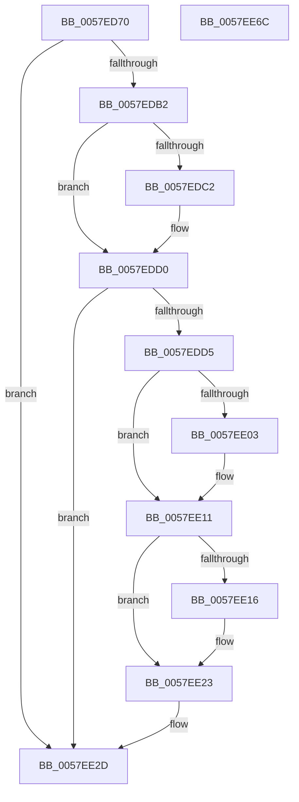

# CcGetDeviceGuidAsync

- RVA: `0x0057ED70`–`0x0057EE6D` (길이 `253` bytes)
- VA: `0x000000014057ED70`
- 실행 섹션: `.text`
- PDB 이름 있음: `예`; PDB Function 태그: `아니요`
- unwind 정보 RVA: `0x000C58C8`
- 디코드: `58`개 명령, `253/253` bytes 표시
- 미해석 바이트: `0` (있으면 어셈블리에 `.byte`로 보존)

> 이 문서는 커널 이미지의 기계어와 PDB 기호를 분석해 생성했습니다. 4번과 5번은 함수 원형과 자료형을 바이너리 사용 방식에서 추정한 C 해석이며 원본 소스 복구 결과는 아닙니다.

## 1. Dependencies

- 직접 호출 지점: **7**; 고유 호출 대상: **7**
- 직접 호출자로 확인된 함수: **0**
- RIP 상대 이미지 참조: **4**

### Outgoing calls
- `0x0057EDA2` → [CcGetDeviceGuid](../../page/AA/CcGetDeviceGuid_function_00AAFABC.md) (function, `0x00AAFABC`)
- `0x0057EDEE` → [KeAcquireInStackQueuedSpinLock](../27/KeAcquireInStackQueuedSpinLock_function_002757A0.md) (function, `0x002757A0`)
- `0x0057EE28` → [KeReleaseInStackQueuedSpinLock](../34/KeReleaseInStackQueuedSpinLock_function_00342CE0.md) (function, `0x00342CE0`)
- `0x0057EE30` → [CcDecrementVolumeUseCountWithDelete](../38/CcDecrementVolumeUseCountWithDelete_function_0038B888.md) (function, `0x0038B888`)
- `0x0057EE3D` → [ObfDereferenceObjectWithTag](../2F/ObfDereferenceObjectWithTag_function_002F78E0.md) (function, `0x002F78E0`)
- `0x0057EE4A` → [ExFreePoolWithTag](../../poolcode/B8/ExFreePoolWithTag_function_00B82870.md) (function, `0x00B82870`)
- `0x0057EE57` → [_security_check_cookie](../6A/_security_check_cookie_function_006AC640.md) (function, `0x006AC640`)

### Direct callers
- 이 함수 시작 RVA로 연결되는 직접 call은 확인되지 않았습니다. 간접 호출은 완전히 역산할 수 없습니다.

### Static image references
- `0x0057ED7F` → RVA `0x00E0A740` (`.data`; read)
- `0x0057EDB9` → RVA `0x000112D0` (`.rdata`; read)
- `0x0057EDC9` → RVA `0x000112D8` (`.rdata`; read)
- `0x0057EDE2` → RVA `0x00E11CC0` (`.data`; read)

## 2. Other-region calls and transfers

- 다른 실행 섹션으로 향하는 call: **2**
  - `0x0057EDA2` → [CcGetDeviceGuid](../../page/AA/CcGetDeviceGuid_function_00AAFABC.md) (`.text` → `PAGE`)
  - `0x0057EE4A` → [ExFreePoolWithTag](../../poolcode/B8/ExFreePoolWithTag_function_00B82870.md) (`.text` → `POOLCODE`)
- 별도 외부 분기/꼬리 이동을 확인하지 못했습니다.

## 3. Assembly (complete function range)

```asm
0057ED70  48 89 5C 24 10                  mov qword ptr [rsp + 0x10], rbx
0057ED75  48 89 74 24 18                  mov qword ptr [rsp + 0x18], rsi
0057ED7A  57                              push rdi
0057ED7B  48 83 EC 50                     sub rsp, 0x50
0057ED7F  48 8B 05 BA B9 88 00            mov rax, qword ptr [rip + 0x88b9ba]
0057ED86  48 33 C4                        xor rax, rsp
0057ED89  48 89 44 24 48                  mov qword ptr [rsp + 0x48], rax
0057ED8E  48 8B F9                        mov rdi, rcx
0057ED91  48 8D 54 24 38                  lea rdx, [rsp + 0x38]
0057ED96  48 8B 49 08                     mov rcx, qword ptr [rcx + 8]
0057ED9A  0F 57 C0                        xorps xmm0, xmm0
0057ED9D  0F 11 44 24 38                  movups xmmword ptr [rsp + 0x38], xmm0
0057EDA2  E8 15 0D 53 00                  call 0x140aafabc
0057EDA7  48 8B 1F                        mov rbx, qword ptr [rdi]
0057EDAA  48 8B 77 08                     mov rsi, qword ptr [rdi + 8]
0057EDAE  85 C0                           test eax, eax
0057EDB0  78 7B                           js 0x14057ee2d
0057EDB2  48 8B 83 E8 00 00 00            mov rax, qword ptr [rbx + 0xe8]
0057EDB9  48 2B 05 10 25 A9 FF            sub rax, qword ptr [rip - 0x56daf0]
0057EDC0  75 0E                           jne 0x14057edd0
0057EDC2  48 8B 83 F0 00 00 00            mov rax, qword ptr [rbx + 0xf0]
0057EDC9  48 2B 05 08 25 A9 FF            sub rax, qword ptr [rip - 0x56daf8]
0057EDD0  48 85 C0                        test rax, rax
0057EDD3  75 58                           jne 0x14057ee2d
0057EDD5  0F 57 C0                        xorps xmm0, xmm0
0057EDD8  48 89 44 24 30                  mov qword ptr [rsp + 0x30], rax
0057EDDD  48 8D 54 24 20                  lea rdx, [rsp + 0x20]
0057EDE2  48 8D 0D D7 2E 89 00            lea rcx, [rip + 0x892ed7]
0057EDE9  0F 11 44 24 20                  movups xmmword ptr [rsp + 0x20], xmm0
0057EDEE  E8 AD 69 CF FF                  call 0x1402757a0
0057EDF3  48 8B 83 E8 00 00 00            mov rax, qword ptr [rbx + 0xe8]
0057EDFA  48 2B 05 CF 24 A9 FF            sub rax, qword ptr [rip - 0x56db31]
0057EE01  75 0E                           jne 0x14057ee11
0057EE03  48 8B 83 F0 00 00 00            mov rax, qword ptr [rbx + 0xf0]
0057EE0A  48 2B 05 C7 24 A9 FF            sub rax, qword ptr [rip - 0x56db39]
0057EE11  48 85 C0                        test rax, rax
0057EE14  75 0D                           jne 0x14057ee23
0057EE16  0F 10 44 24 38                  movups xmm0, xmmword ptr [rsp + 0x38]
0057EE1B  F3 0F 7F 83 E8 00 00 00         movdqu xmmword ptr [rbx + 0xe8], xmm0
0057EE23  48 8D 4C 24 20                  lea rcx, [rsp + 0x20]
0057EE28  E8 B3 3E DC FF                  call 0x140342ce0
0057EE2D  48 8B CB                        mov rcx, rbx
0057EE30  E8 53 CA E0 FF                  call 0x14038b888
0057EE35  BA 44 66 6C 74                  mov edx, 0x746c6644
0057EE3A  48 8B CE                        mov rcx, rsi
0057EE3D  E8 9E 8A D7 FF                  call 0x1402f78e0
0057EE42  BA 43 63 54 65                  mov edx, 0x65546343
0057EE47  48 8B CF                        mov rcx, rdi
0057EE4A  E8 21 3A 60 00                  call 0x140b82870
0057EE4F  48 8B 4C 24 48                  mov rcx, qword ptr [rsp + 0x48]
0057EE54  48 33 CC                        xor rcx, rsp
0057EE57  E8 E4 D7 12 00                  call 0x1406ac640
0057EE5C  48 8B 5C 24 68                  mov rbx, qword ptr [rsp + 0x68]
0057EE61  48 8B 74 24 70                  mov rsi, qword ptr [rsp + 0x70]
0057EE66  48 83 C4 50                     add rsp, 0x50
0057EE6A  5F                              pop rdi
0057EE6B  C3                              ret
0057EE6C  CC                              int3
```

## 4. C-style interpretation (structured pseudocode)

```c
__int64 __fastcall CcGetDeviceGuidAsync(__int64 a1)
{
    __int64 result;
    __int64 v_rsp;
    unsigned __int64 v_stack_m10;
    unsigned __int64 v_stack_m20;
    unsigned __int64 v_stack_m28;
    unsigned __int64 v_stack_m38;
    unsigned __int64 v_stack_p10;
    unsigned __int64 v_stack_p18;

    v_stack_p10 = v_rbx;
    v_stack_p18 = v_rsi;
    v_rsp = (v_rsp) - (80);
    result = (*(unsigned __int64 *)(v_rip + 8960442)) ^ (v_rsp);
    v_stack_m10 = result;
    v_stack_m20 = v_xmm0;
    result = CcGetDeviceGuid(*(unsigned __int64 *)(a1 + 8), v_stack_m20, a3, a4);
    if (sign_flag) goto loc_0057EE2D;
    result = (*(unsigned __int64 *)(*(unsigned __int64 *)(a1) + 232)) - (*(unsigned __int64 *)(v_rip - 5692144));
    if (!(condition_is_not_equal)) {
        result = *(unsigned __int64 *)(*(unsigned __int64 *)(a1) + 240);
        result = (result) - (*(unsigned __int64 *)(v_rip - 5692152));
    }
    if (result != 0) goto loc_0057EE2D;
    v_stack_m28 = result;
    v_stack_m38 = v_xmm0;
    result = KeAcquireInStackQueuedSpinLock(v_rip + 8990423, v_stack_m38, a3, a4);
    result = (*(unsigned __int64 *)(*(unsigned __int64 *)(a1) + 232)) - (*(unsigned __int64 *)(v_rip - 5692209));
    if (!(condition_is_not_equal)) {
        result = *(unsigned __int64 *)(*(unsigned __int64 *)(a1) + 240);
        result = (result) - (*(unsigned __int64 *)(v_rip - 5692217));
    }
    if (result == 0) {
        *(unsigned __int64 *)(*(unsigned __int64 *)(a1) + 232) = v_xmm0;
    }
    result = KeReleaseInStackQueuedSpinLock(v_stack_m38, v_stack_m38, a3, a4);
loc_0057EE2D:
    result = CcDecrementVolumeUseCountWithDelete(*(unsigned __int64 *)(a1), v_stack_m38, a3, a4);
    result = ObfDereferenceObjectWithTag(*(unsigned __int64 *)(a1 + 8), (unsigned int)(0x746C6644ULL), a3, a4);
    result = ExFreePoolWithTag(a1, (unsigned int)(0x65546343ULL), a3, a4);
    a1 = (v_stack_m10) ^ (v_rsp);
    result = _security_check_cookie(a1, (unsigned int)(0x65546343ULL), a3, a4);
    v_rsp = (v_rsp) + (80);
    return result;
}
```

## 5. (Beta) C Style

```c
int64_t CcGetDeviceGuidAsync(void *Arg1)
{
    uint8_t *arg1 = (uint8_t *)Arg1;

    int64_t result;
    int64_t local_rsp;
    uint64_t v_stack_m10;
    uint64_t v_stack_m20;
    uint64_t v_stack_m28;
    uint64_t v_stack_m38;
    uint64_t v_stack_p10;
    uint64_t v_stack_p18;

    v_stack_p10 = local_rbx;
    v_stack_p18 = local_rsi;
    local_rsp = (local_rsp) - (80);
    result = (*(uint64_t *)(v_rip + 0x88B9BA)) ^ (local_rsp);
    v_stack_m10 = result;
    v_stack_m20 = v_xmm0;
    result = CcGetDeviceGuid(*(uint64_t *)(arg1 + 0x8), v_stack_m20, a3, a4);
    if (sign_flag) goto loc_0057EE2D;
    result = (*(uint64_t *)(*(uint64_t *)(arg1) + 0xE8)) - (*(uint64_t *)(v_rip - 0x56DAF0));
    if (!(condition_is_not_equal)) {
        result = *(uint64_t *)(*(uint64_t *)(arg1) + 0xF0);
        result = (result) - (*(uint64_t *)(v_rip - 0x56DAF8));
    }
    if (result != 0) goto loc_0057EE2D;
    v_stack_m28 = result;
    v_stack_m38 = v_xmm0;
    result = KeAcquireInStackQueuedSpinLock(v_rip + 8990423, v_stack_m38, a3, a4);
    result = (*(uint64_t *)(*(uint64_t *)(arg1) + 0xE8)) - (*(uint64_t *)(v_rip - 0x56DB31));
    if (!(condition_is_not_equal)) {
        result = *(uint64_t *)(*(uint64_t *)(arg1) + 0xF0);
        result = (result) - (*(uint64_t *)(v_rip - 0x56DB39));
    }
    if (result == 0) {
        *(uint64_t *)(*(uint64_t *)(arg1) + 0xE8) = v_xmm0;
    }
    result = KeReleaseInStackQueuedSpinLock(v_stack_m38, v_stack_m38, a3, a4);
loc_0057EE2D:
    result = CcDecrementVolumeUseCountWithDelete(*(uint64_t *)(arg1), v_stack_m38, a3, a4);
    result = ObfDereferenceObjectWithTag(*(uint64_t *)(arg1 + 0x8), (uint32_t)(0x746C6644ULL), a3, a4);
    result = ExFreePoolWithTag(Arg1, (uint32_t)(0x65546343ULL), a3, a4);
    Arg1 = (v_stack_m10) ^ (local_rsp);
    result = _security_check_cookie(Arg1, (uint32_t)(0x65546343ULL), a3, a4);
    local_rsp = (local_rsp) + (80);
    return result;
}
```

### 관측된 메모리 오프셋

구조체 형식이 확인되지 않은 접근은 인자 기준의 오프셋으로만 기록했습니다.

| 기준 인자 | 오프셋 표현 | 폭 (bit) | 접근 |
|---|---:|---:|---|
| `Arg1` | `+ 0x0` | `64` | `R` |
| `Arg1` | `+ 0x8` | `64` | `R` |

## 6. Execution-region graph

[열기: 2D/3D 그래프와 함수 탐색 컨트롤 패널](../../../control-panel.html?section=text&rva=0x0057ED70&view=graph)

- 2D 그래프는 위에서 아래로 흐르고, 3D 그래프는 빈 공간을 드래그해 회전합니다. Shift+드래그는 이동, 휠은 확대·축소, 함수 노드 선택은 대상 보고서 이동입니다.

### Static fallback


