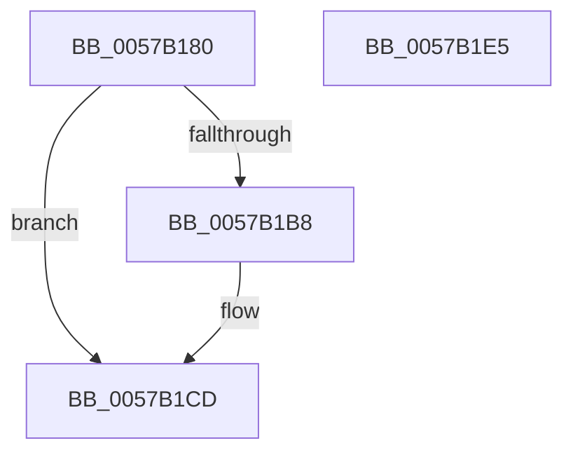

# CcGetFileObjectFromSectionPtrsRef

- RVA: `0x0057B180`–`0x0057B1E6` (길이 `102` bytes)
- VA: `0x000000014057B180`
- 실행 섹션: `.text`
- PDB 이름 있음: `예`; PDB Function 태그: `아니요`
- unwind 정보 RVA: `0x00065960`
- 디코드: `28`개 명령, `102/102` bytes 표시
- 미해석 바이트: `0` (있으면 어셈블리에 `.byte`로 보존)

> 이 문서는 커널 이미지의 기계어와 PDB 기호를 분석해 생성했습니다. 4번과 5번은 함수 원형과 자료형을 바이너리 사용 방식에서 추정한 C 해석이며 원본 소스 복구 결과는 아닙니다.

## 1. Dependencies

- 직접 호출 지점: **3**; 고유 호출 대상: **3**
- 직접 호출자로 확인된 함수: **0**
- RIP 상대 이미지 참조: **1**

### Outgoing calls
- `0x0057B1AA` → [KeAcquireInStackQueuedSpinLock](../27/KeAcquireInStackQueuedSpinLock_function_002757A0.md) (function, `0x002757A0`)
- `0x0057B1C8` → [ObfReferenceObjectWithTag](../21/ObfReferenceObjectWithTag_function_00210710.md) (function, `0x00210710`)
- `0x0057B1D2` → [KeReleaseInStackQueuedSpinLock](../34/KeReleaseInStackQueuedSpinLock_function_00342CE0.md) (function, `0x00342CE0`)

### Direct callers
- 이 함수 시작 RVA로 연결되는 직접 call은 확인되지 않았습니다. 간접 호출은 완전히 역산할 수 없습니다.

### Static image references
- `0x0057B195` → RVA `0x00E11CC0` (`.data`; read)

## 2. Other-region calls and transfers

- 다른 실행 섹션으로 향하는 call: **0**
- 별도 외부 분기/꼬리 이동을 확인하지 못했습니다.

## 3. Assembly (complete function range)

```asm
0057B180  48 89 5C 24 08                  mov qword ptr [rsp + 8], rbx
0057B185  57                              push rdi
0057B186  48 83 EC 40                     sub rsp, 0x40
0057B18A  48 8B D9                        mov rbx, rcx
0057B18D  48 8D 54 24 20                  lea rdx, [rsp + 0x20]
0057B192  0F 57 C0                        xorps xmm0, xmm0
0057B195  48 8D 0D 24 6B 89 00            lea rcx, [rip + 0x896b24]
0057B19C  33 C0                           xor eax, eax
0057B19E  33 FF                           xor edi, edi
0057B1A0  0F 11 44 24 20                  movups xmmword ptr [rsp + 0x20], xmm0
0057B1A5  48 89 44 24 30                  mov qword ptr [rsp + 0x30], rax
0057B1AA  E8 F1 A5 CF FF                  call 0x1402757a0
0057B1AF  48 8B 43 08                     mov rax, qword ptr [rbx + 8]
0057B1B3  48 85 C0                        test rax, rax
0057B1B6  74 15                           je 0x14057b1cd
0057B1B8  48 8B 78 60                     mov rdi, qword ptr [rax + 0x60]
0057B1BC  BA 44 66 6C 74                  mov edx, 0x746c6644
0057B1C1  48 83 E7 F0                     and rdi, 0xfffffffffffffff0
0057B1C5  48 8B CF                        mov rcx, rdi
0057B1C8  E8 43 55 C9 FF                  call 0x140210710
0057B1CD  48 8D 4C 24 20                  lea rcx, [rsp + 0x20]
0057B1D2  E8 09 7B DC FF                  call 0x140342ce0
0057B1D7  48 8B 5C 24 50                  mov rbx, qword ptr [rsp + 0x50]
0057B1DC  48 8B C7                        mov rax, rdi
0057B1DF  48 83 C4 40                     add rsp, 0x40
0057B1E3  5F                              pop rdi
0057B1E4  C3                              ret
0057B1E5  CC                              int3
```

## 4. C-style interpretation (structured pseudocode)

```c
__int64 __fastcall CcGetFileObjectFromSectionPtrsRef(__int64 a1)
{
    __int64 result;
    __int64 v_rdi;
    __int64 v_rsp;
    unsigned __int64 v_stack_m18;
    unsigned __int64 v_stack_m28;
    unsigned __int64 v_stack_p8;

    v_stack_p8 = v_rbx;
    v_rsp = (v_rsp) - (64);
    result = 0;
    v_rdi = 0;
    v_stack_m28 = v_xmm0;
    v_stack_m18 = 0;
    result = KeAcquireInStackQueuedSpinLock(v_rip + 9005860, v_stack_m28, a3, a4);
    result = *(unsigned __int64 *)(a1 + 8);
    if (*(unsigned __int64 *)(a1 + 8) != 0) {
        v_rdi = *(unsigned __int64 *)(*(unsigned __int64 *)(a1 + 8) + 96);
        a2 = 0x746C6644ULL;
        v_rdi = (v_rdi) & (-16);
        a1 = v_rdi;
        result = ObfReferenceObjectWithTag(a1, a2, a3, a4);
    }
    result = KeReleaseInStackQueuedSpinLock(v_stack_m28, a2, a3, a4);
    v_rsp = (v_rsp) + (64);
    return v_rdi;
}
```

## 5. (Beta) C Style

```c
int64_t CcGetFileObjectFromSectionPtrsRef(void *Arg1)
{
    uint8_t *arg1 = (uint8_t *)Arg1;

    int64_t result;
    int64_t local_rdi;
    int64_t local_rsp;
    uint64_t v_stack_m18;
    uint64_t v_stack_m28;
    uint64_t v_stack_p8;

    v_stack_p8 = local_rbx;
    local_rsp = (local_rsp) - (64);
    result = 0;
    local_rdi = 0;
    v_stack_m28 = v_xmm0;
    v_stack_m18 = 0;
    result = KeAcquireInStackQueuedSpinLock(v_rip + 9005860, v_stack_m28, a3, a4);
    result = *(uint64_t *)(arg1 + 0x8);
    if (*(uint64_t *)(arg1 + 0x8) != 0) {
        local_rdi = *(uint64_t *)(*(uint64_t *)(arg1 + 0x8) + 0x60);
        a2 = 0x746C6644ULL;
        local_rdi = (local_rdi) & (-16);
        Arg1 = local_rdi;
        result = ObfReferenceObjectWithTag(Arg1, a2, a3, a4);
    }
    result = KeReleaseInStackQueuedSpinLock(v_stack_m28, a2, a3, a4);
    local_rsp = (local_rsp) + (64);
    return local_rdi;
}
```

### 관측된 메모리 오프셋

구조체 형식이 확인되지 않은 접근은 인자 기준의 오프셋으로만 기록했습니다.

| 기준 인자 | 오프셋 표현 | 폭 (bit) | 접근 |
|---|---:|---:|---|
| `Arg1` | `+ 0x8` | `64` | `R` |

## 6. Execution-region graph

[열기: 2D/3D 그래프와 함수 탐색 컨트롤 패널](../../../control-panel.html?section=text&rva=0x0057B180&view=graph)

- 2D 그래프는 위에서 아래로 흐르고, 3D 그래프는 빈 공간을 드래그해 회전합니다. Shift+드래그는 이동, 휠은 확대·축소, 함수 노드 선택은 대상 보고서 이동입니다.

### Static fallback


