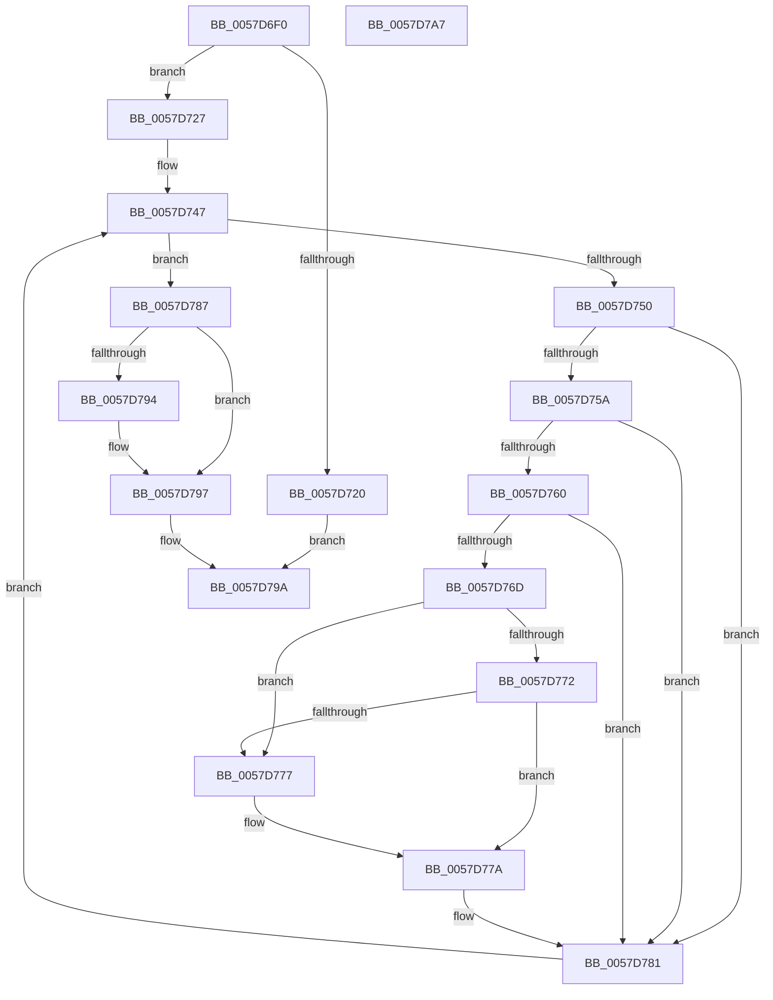

# CcGetLsnForFileObject

- RVA: `0x0057D6F0`–`0x0057D7A8` (길이 `184` bytes)
- VA: `0x000000014057D6F0`
- 실행 섹션: `.text`
- PDB 이름 있음: `예`; PDB Function 태그: `아니요`
- unwind 정보 RVA: `0x000BEE74`
- 디코드: `57`개 명령, `184/184` bytes 표시
- 미해석 바이트: `0` (있으면 어셈블리에 `.byte`로 보존)

> 이 문서는 커널 이미지의 기계어와 PDB 기호를 분석해 생성했습니다. 4번과 5번은 함수 원형과 자료형을 바이너리 사용 방식에서 추정한 C 해석이며 원본 소스 복구 결과는 아닙니다.

## 1. Dependencies

- 직접 호출 지점: **2**; 고유 호출 대상: **2**
- 직접 호출자로 확인된 함수: **0**
- RIP 상대 이미지 참조: **0**

### Outgoing calls
- `0x0057D731` → [ExAcquireFastMutex](../20/ExAcquireFastMutex_function_0020E5A0.md) (function, `0x0020E5A0`)
- `0x0057D78A` → [ExReleaseFastMutex](../25/ExReleaseFastMutex_function_002519C0.md) (function, `0x002519C0`)

### Direct callers
- 이 함수 시작 RVA로 연결되는 직접 call은 확인되지 않았습니다. 간접 호출은 완전히 역산할 수 없습니다.

### Static image references
- 디코드된 RIP-relative 메모리 참조가 없습니다.

## 2. Other-region calls and transfers

- 다른 실행 섹션으로 향하는 call: **0**
- 별도 외부 분기/꼬리 이동을 확인하지 못했습니다.

## 3. Assembly (complete function range)

```asm
0057D6F0  48 89 5C 24 10                  mov qword ptr [rsp + 0x10], rbx
0057D6F5  55                              push rbp
0057D6F6  56                              push rsi
0057D6F7  57                              push rdi
0057D6F8  48 83 EC 20                     sub rsp, 0x20
0057D6FC  48 8B 41 28                     mov rax, qword ptr [rcx + 0x28]
0057D700  48 8B F2                        mov rsi, rdx
0057D703  83 64 24 40 00                  and dword ptr [rsp + 0x40], 0
0057D708  83 64 24 44 00                  and dword ptr [rsp + 0x44], 0
0057D70D  83 64 24 50 00                  and dword ptr [rsp + 0x50], 0
0057D712  48 8B 58 08                     mov rbx, qword ptr [rax + 8]
0057D716  83 64 24 54 00                  and dword ptr [rsp + 0x54], 0
0057D71B  48 85 DB                        test rbx, rbx
0057D71E  75 07                           jne 0x14057d727
0057D720  48 8B 44 24 40                  mov rax, qword ptr [rsp + 0x40]
0057D725  EB 73                           jmp 0x14057d79a
0057D727  48 8D AB 20 01 00 00            lea rbp, [rbx + 0x120]
0057D72E  48 8B CD                        mov rcx, rbp
0057D731  E8 6A 0E C9 FF                  call 0x14020e5a0
0057D736  48 8B 7C 24 40                  mov rdi, qword ptr [rsp + 0x40]
0057D73B  4C 8D 43 10                     lea r8, [rbx + 0x10]
0057D73F  49 8B 00                        mov rax, qword ptr [r8]
0057D742  48 8B 5C 24 50                  mov rbx, qword ptr [rsp + 0x50]
0057D747  48 8D 50 F0                     lea rdx, [rax - 0x10]
0057D74B  49 3B C0                        cmp rax, r8
0057D74E  74 37                           je 0x14057d787
0057D750  B8 FD 02 00 00                  mov eax, 0x2fd
0057D755  66 39 02                        cmp word ptr [rdx], ax
0057D758  75 27                           jne 0x14057d781
0057D75A  80 7A 02 00                     cmp byte ptr [rdx + 2], 0
0057D75E  74 21                           je 0x14057d781
0057D760  48 8B 42 28                     mov rax, qword ptr [rdx + 0x28]
0057D764  48 8B 4A 30                     mov rcx, qword ptr [rdx + 0x30]
0057D768  48 85 C0                        test rax, rax
0057D76B  74 14                           je 0x14057d781
0057D76D  48 85 FF                        test rdi, rdi
0057D770  74 05                           je 0x14057d777
0057D772  48 3B C7                        cmp rax, rdi
0057D775  7D 03                           jge 0x14057d77a
0057D777  48 8B F8                        mov rdi, rax
0057D77A  48 3B CB                        cmp rcx, rbx
0057D77D  48 0F 4F D9                     cmovg rbx, rcx
0057D781  48 8B 42 10                     mov rax, qword ptr [rdx + 0x10]
0057D785  EB C0                           jmp 0x14057d747
0057D787  48 8B CD                        mov rcx, rbp
0057D78A  E8 31 42 CD FF                  call 0x1402519c0
0057D78F  48 85 F6                        test rsi, rsi
0057D792  74 03                           je 0x14057d797
0057D794  48 89 3E                        mov qword ptr [rsi], rdi
0057D797  48 8B C3                        mov rax, rbx
0057D79A  48 8B 5C 24 48                  mov rbx, qword ptr [rsp + 0x48]
0057D79F  48 83 C4 20                     add rsp, 0x20
0057D7A3  5F                              pop rdi
0057D7A4  5E                              pop rsi
0057D7A5  5D                              pop rbp
0057D7A6  C3                              ret
0057D7A7  CC                              int3
```

## 4. C-style interpretation (structured pseudocode)

```c
__int64 __fastcall CcGetLsnForFileObject(__int64 a1, __int64 a2)
{
    __int64 result;
    __int64 v_rbx;
    __int64 v_rdi;
    __int64 v_rsp;
    unsigned __int64 v_stack_p10;
    unsigned int v_stack_p18;
    unsigned int v_stack_p1C;
    unsigned int v_stack_p8;
    unsigned int v_stack_pC;

    v_stack_p10 = v_rbx;
    v_rsp = (v_rsp) - (32);
    if (*(unsigned __int64 *)(*(unsigned __int64 *)(a1 + 40) + 8) != 0) goto loc_0057D727;
    goto loc_0057D79A;
loc_0057D727:
    result = ExAcquireFastMutex(*(unsigned __int64 *)(*(unsigned __int64 *)(a1 + 40) + 8) + 288, a2, a3, a4);
loc_0057D747:
    if ((*(unsigned __int64 *)(*(unsigned __int64 *)(*(unsigned __int64 *)(a1 + 40) + 8) + 16)) == (*(unsigned __int64 *)(*(unsigned __int64 *)(a1 + 40) + 8) + 16)) goto loc_0057D787;
    if ((*(unsigned __int16 *)(*(unsigned __int64 *)(*(unsigned __int64 *)(*(unsigned __int64 *)(a1 + 40) + 8) + 16) - 16)) != 765) goto loc_0057D781;
    if ((*(unsigned __int8 *)(*(unsigned __int64 *)(*(unsigned __int64 *)(*(unsigned __int64 *)(a1 + 40) + 8) + 16) - 16 + 2)) == 0) goto loc_0057D781;
    if (*(unsigned __int64 *)(*(unsigned __int64 *)(*(unsigned __int64 *)(*(unsigned __int64 *)(a1 + 40) + 8) + 16) - 16 + 40) == 0) goto loc_0057D781;
    if (v_stack_p8 == 0) goto loc_0057D777;
    v_rdi = v_stack_p8;
    if ((*(unsigned __int64 *)(*(unsigned __int64 *)(*(unsigned __int64 *)(*(unsigned __int64 *)(a1 + 40) + 8) + 16) - 16 + 40)) < v_stack_p8) {
        v_rdi = *(unsigned __int64 *)(*(unsigned __int64 *)(*(unsigned __int64 *)(*(unsigned __int64 *)(a1 + 40) + 8) + 16) - 16 + 40);
    }
    v_rbx = v_stack_p18;
    if ((*(unsigned __int64 *)(*(unsigned __int64 *)(*(unsigned __int64 *)(*(unsigned __int64 *)(a1 + 40) + 8) + 16) - 16 + 48)) > v_stack_p18) { v_rbx = *(unsigned __int64 *)(*(unsigned __int64 *)(*(unsigned __int64 *)(*(unsigned __int64 *)(a1 + 40) + 8) + 16) - 16 + 48); }
loc_0057D781:
    goto loc_0057D747;
loc_0057D787:
    result = ExReleaseFastMutex(*(unsigned __int64 *)(*(unsigned __int64 *)(a1 + 40) + 8) + 288, *(unsigned __int64 *)(*(unsigned __int64 *)(*(unsigned __int64 *)(a1 + 40) + 8) + 16) - 16, *(unsigned __int64 *)(*(unsigned __int64 *)(a1 + 40) + 8) + 16, a4);
    if (a2 != 0) {
        *(unsigned __int64 *)(a2) = v_rdi;
    }
loc_0057D79A:
    v_rsp = (v_rsp) + (32);
    return v_rbx;
}
```

## 5. (Beta) C Style

```c
int64_t CcGetLsnForFileObject(void *Arg1, int64_t Arg2)
{
    uint8_t *arg1 = (uint8_t *)Arg1;

    int64_t result;
    int64_t local_rbx;
    int64_t local_rdi;
    int64_t local_rsp;
    uint64_t v_stack_p10;
    uint32_t v_stack_p18;
    uint32_t v_stack_p1C;
    uint32_t v_stack_p8;
    uint32_t v_stack_pC;

    v_stack_p10 = local_rbx;
    local_rsp = (local_rsp) - (32);
    if (*(uint64_t *)(*(uint64_t *)(arg1 + 0x28) + 0x8) != 0) goto loc_0057D727;
    goto loc_0057D79A;
loc_0057D727:
    result = ExAcquireFastMutex(*(uint64_t *)(*(uint64_t *)(arg1 + 0x28) + 0x8) + 288, Arg2, a3, a4);
loc_0057D747:
    if ((*(uint64_t *)(*(uint64_t *)(*(uint64_t *)(arg1 + 0x28) + 0x8) + 0x10)) == (*(uint64_t *)(*(uint64_t *)(arg1 + 0x28) + 0x8) + 16)) goto loc_0057D787;
    if ((*(uint16_t *)(*(uint64_t *)(*(uint64_t *)(*(uint64_t *)(arg1 + 0x28) + 0x8) + 0x10) - 0x10)) != 765) goto loc_0057D781;
    if ((*(uint8_t *)(*(uint64_t *)(*(uint64_t *)(*(uint64_t *)(arg1 + 0x28) + 0x8) + 0x10) - 0x10 + 0x2)) == 0) goto loc_0057D781;
    if (*(uint64_t *)(*(uint64_t *)(*(uint64_t *)(*(uint64_t *)(arg1 + 0x28) + 0x8) + 0x10) - 0x10 + 0x28) == 0) goto loc_0057D781;
    if (v_stack_p8 == 0) goto loc_0057D777;
    local_rdi = v_stack_p8;
    if ((*(uint64_t *)(*(uint64_t *)(*(uint64_t *)(*(uint64_t *)(arg1 + 0x28) + 0x8) + 0x10) - 0x10 + 0x28)) < v_stack_p8) {
        local_rdi = *(uint64_t *)(*(uint64_t *)(*(uint64_t *)(*(uint64_t *)(arg1 + 0x28) + 0x8) + 0x10) - 0x10 + 0x28);
    }
    local_rbx = v_stack_p18;
    if ((*(uint64_t *)(*(uint64_t *)(*(uint64_t *)(*(uint64_t *)(arg1 + 0x28) + 0x8) + 0x10) - 0x10 + 0x30)) > v_stack_p18) { local_rbx = *(uint64_t *)(*(uint64_t *)(*(uint64_t *)(*(uint64_t *)(arg1 + 0x28) + 0x8) + 0x10) - 0x10 + 0x30); }
loc_0057D781:
    goto loc_0057D747;
loc_0057D787:
    result = ExReleaseFastMutex(*(uint64_t *)(*(uint64_t *)(arg1 + 0x28) + 0x8) + 288, *(uint64_t *)(*(uint64_t *)(*(uint64_t *)(arg1 + 0x28) + 0x8) + 0x10) - 16, *(uint64_t *)(*(uint64_t *)(arg1 + 0x28) + 0x8) + 16, a4);
    if (Arg2 != 0) {
        *(uint64_t *)(Arg2) = local_rdi;
    }
loc_0057D79A:
    local_rsp = (local_rsp) + (32);
    return local_rbx;
}
```

### 관측된 메모리 오프셋

구조체 형식이 확인되지 않은 접근은 인자 기준의 오프셋으로만 기록했습니다.

| 기준 인자 | 오프셋 표현 | 폭 (bit) | 접근 |
|---|---:|---:|---|
| `Arg1` | `+ 0x28` | `64` | `R` |

## 6. Execution-region graph

[열기: 2D/3D 그래프와 함수 탐색 컨트롤 패널](../../../control-panel.html?section=text&rva=0x0057D6F0&view=graph)

- 2D 그래프는 위에서 아래로 흐르고, 3D 그래프는 빈 공간을 드래그해 회전합니다. Shift+드래그는 이동, 휠은 확대·축소, 함수 노드 선택은 대상 보고서 이동입니다.

### Static fallback


