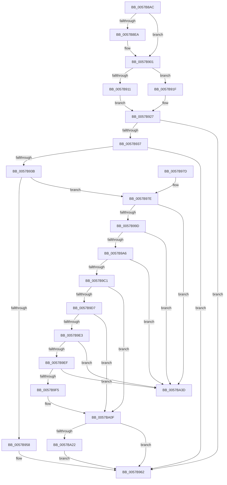

# CcIncrementWriteBehindPriority

- RVA: `0x0057B8AC`–`0x0057BA44` (길이 `408` bytes)
- VA: `0x000000014057B8AC`
- 실행 섹션: `.text`
- PDB 이름 있음: `예`; PDB Function 태그: `아니요`
- unwind 정보 RVA: `0x000C5798`
- 디코드: `104`개 명령, `408/408` bytes 표시
- 미해석 바이트: `0` (있으면 어셈블리에 `.byte`로 보존)

> 이 문서는 커널 이미지의 기계어와 PDB 기호를 분석해 생성했습니다. 4번과 5번은 함수 원형과 자료형을 바이너리 사용 방식에서 추정한 C 해석이며 원본 소스 복구 결과는 아닙니다.

## 1. Dependencies

- 직접 호출 지점: **5**; 고유 호출 대상: **4**
- 직접 호출자로 확인된 함수: **2**
- RIP 상대 이미지 참조: **2**

### Outgoing calls
- `0x0057B947` → [KeAcquireInStackQueuedSpinLockAtDpcLevel](../27/KeAcquireInStackQueuedSpinLockAtDpcLevel_function_00275740.md) (function, `0x00275740`)
- `0x0057B95D` → [KeReleaseInStackQueuedSpinLockFromDpcLevel](../21/KeReleaseInStackQueuedSpinLockFromDpcLevel_function_002171B0.md) (function, `0x002171B0`)
- `0x0057BA0A` → [CcReferencePartitionAndPrivateVolumeCacheMap](../38/CcReferencePartitionAndPrivateVolumeCacheMap_function_0038B9E0.md) (function, `0x0038B9E0`)
- `0x0057BA14` → [KeReleaseInStackQueuedSpinLockFromDpcLevel](../21/KeReleaseInStackQueuedSpinLockFromDpcLevel_function_002171B0.md) (function, `0x002171B0`)
- `0x0057BA33` → [ExQueueWorkItemToPartition](../35/ExQueueWorkItemToPartition_function_00356E2C.md) (function, `0x00356E2C`)

### Direct callers
- [CcLazyWriteScanVolume](../38/CcLazyWriteScanVolume_function_00388DC0.md) at `0x0038941C`
- [CcLazyWriteScan](../3C/CcLazyWriteScan_function_003C9394.md) at `0x003C98E2`

### Static image references
- `0x0057B903` → RVA `0x00E0A874` (`.data`; read)
- `0x0057B909` → RVA `0x00E65B88` (`.data`; read)

## 2. Other-region calls and transfers

- 다른 실행 섹션으로 향하는 call: **0**
- 별도 외부 분기/꼬리 이동을 확인하지 못했습니다.

## 3. Assembly (complete function range)

```asm
0057B8AC  4C 8B DC                        mov r11, rsp
0057B8AF  49 89 5B 08                     mov qword ptr [r11 + 8], rbx
0057B8B3  49 89 6B 10                     mov qword ptr [r11 + 0x10], rbp
0057B8B7  49 89 73 18                     mov qword ptr [r11 + 0x18], rsi
0057B8BB  49 89 7B 20                     mov qword ptr [r11 + 0x20], rdi
0057B8BF  41 56                           push r14
0057B8C1  48 83 EC 40                     sub rsp, 0x40
0057B8C5  48 8B A9 18 02 00 00            mov rbp, qword ptr [rcx + 0x218]
0057B8CC  33 C0                           xor eax, eax
0057B8CE  0F 57 C0                        xorps xmm0, xmm0
0057B8D1  33 DB                           xor ebx, ebx
0057B8D3  0F 11 44 24 20                  movups xmmword ptr [rsp + 0x20], xmm0
0057B8D8  49 89 43 E8                     mov qword ptr [r11 - 0x18], rax
0057B8DC  48 8B F1                        mov rsi, rcx
0057B8DF  8B 81 30 02 00 00               mov eax, dword ptr [rcx + 0x230]
0057B8E5  83 F8 FF                        cmp eax, -1
0057B8E8  75 17                           jne 0x14057b901
0057B8EA  65 48 8B 04 25 20 00 00 00      mov rax, qword ptr gs:[0x20]
0057B8F3  48 8B 88 C0 00 00 00            mov rcx, qword ptr [rax + 0xc0]
0057B8FA  0F B7 81 8A 00 00 00            movzx eax, word ptr [rcx + 0x8a]
0057B901  33 D2                           xor edx, edx
0057B903  F7 35 6B EF 88 00               div dword ptr [rip + 0x88ef6b]
0057B909  38 1D 79 A2 8E 00               cmp byte ptr [rip + 0x8ea279], bl
0057B90F  74 0E                           je 0x14057b91f
0057B911  48 8B 86 58 02 00 00            mov rax, qword ptr [rsi + 0x258]
0057B918  48 8B 7C D0 40                  mov rdi, qword ptr [rax + rdx*8 + 0x40]
0057B91D  EB 08                           jmp 0x14057b927
0057B91F  48 8B BC D5 80 00 00 00         mov rdi, qword ptr [rbp + rdx*8 + 0x80]
0057B927  48 8B 86 F8 01 00 00            mov rax, qword ptr [rsi + 0x1f8]
0057B92E  4C 8B 77 10                     mov r14, qword ptr [rdi + 0x10]
0057B932  48 85 C0                        test rax, rax
0057B935  74 2B                           je 0x14057b962
0057B937  A8 01                           test al, 1
0057B939  75 27                           jne 0x14057b962
0057B93B  48 8D 8D 40 03 00 00            lea rcx, [rbp + 0x340]
0057B942  48 8D 54 24 20                  lea rdx, [rsp + 0x20]
0057B947  E8 F4 9D CF FF                  call 0x140275740
0057B94C  48 8B 8E F8 01 00 00            mov rcx, qword ptr [rsi + 0x1f8]
0057B953  48 85 C9                        test rcx, rcx
0057B956  75 26                           jne 0x14057b97e
0057B958  48 8D 4C 24 20                  lea rcx, [rsp + 0x20]
0057B95D  E8 4E B8 C9 FF                  call 0x1402171b0
0057B962  48 8B 5C 24 50                  mov rbx, qword ptr [rsp + 0x50]
0057B967  48 8B 6C 24 58                  mov rbp, qword ptr [rsp + 0x58]
0057B96C  48 8B 74 24 60                  mov rsi, qword ptr [rsp + 0x60]
0057B971  48 8B 7C 24 68                  mov rdi, qword ptr [rsp + 0x68]
0057B976  48 83 C4 40                     add rsp, 0x40
0057B97A  41 5E                           pop r14
0057B97C  C3                              ret
0057B97D  CC                              int3
0057B97E  48 8B C1                        mov rax, rcx
0057B981  48 83 C8 01                     or rax, 1
0057B985  48 89 86 F8 01 00 00            mov qword ptr [rsi + 0x1f8], rax
0057B98C  48 8B 11                        mov rdx, qword ptr [rcx]
0057B98F  48 8B 41 08                     mov rax, qword ptr [rcx + 8]
0057B993  48 39 4A 08                     cmp qword ptr [rdx + 8], rcx
0057B997  0F 85 A0 00 00 00               jne 0x14057ba3d
0057B99D  48 39 08                        cmp qword ptr [rax], rcx
0057B9A0  0F 85 97 00 00 00               jne 0x14057ba3d
0057B9A6  48 89 10                        mov qword ptr [rax], rdx
0057B9A9  48 89 42 08                     mov qword ptr [rdx + 8], rax
0057B9AD  48 8D 47 48                     lea rax, [rdi + 0x48]
0057B9B1  48 21 59 08                     and qword ptr [rcx + 8], rbx
0057B9B5  48 21 19                        and qword ptr [rcx], rbx
0057B9B8  48 8B 50 08                     mov rdx, qword ptr [rax + 8]
0057B9BC  48 39 02                        cmp qword ptr [rdx], rax
0057B9BF  75 7C                           jne 0x14057ba3d
0057B9C1  48 89 01                        mov qword ptr [rcx], rax
0057B9C4  48 89 51 08                     mov qword ptr [rcx + 8], rdx
0057B9C8  48 89 0A                        mov qword ptr [rdx], rcx
0057B9CB  48 89 48 08                     mov qword ptr [rax + 8], rcx
0057B9CF  38 9F C4 00 00 00               cmp byte ptr [rdi + 0xc4], bl
0057B9D5  75 38                           jne 0x14057ba0f
0057B9D7  48 8D 47 38                     lea rax, [rdi + 0x38]
0057B9DB  48 8B 08                        mov rcx, qword ptr [rax]
0057B9DE  48 3B C8                        cmp rcx, rax
0057B9E1  74 2C                           je 0x14057ba0f
0057B9E3  48 8B D9                        mov rbx, rcx
0057B9E6  48 8B 09                        mov rcx, qword ptr [rcx]
0057B9E9  48 39 43 08                     cmp qword ptr [rbx + 8], rax
0057B9ED  75 4E                           jne 0x14057ba3d
0057B9EF  48 39 59 08                     cmp qword ptr [rcx + 8], rbx
0057B9F3  75 48                           jne 0x14057ba3d
0057B9F5  48 89 08                        mov qword ptr [rax], rcx
0057B9F8  49 8B D6                        mov rdx, r14
0057B9FB  48 89 41 08                     mov qword ptr [rcx + 8], rax
0057B9FF  48 8B CD                        mov rcx, rbp
0057BA02  8B 47 30                        mov eax, dword ptr [rdi + 0x30]
0057BA05  FF C0                           inc eax
0057BA07  89 47 30                        mov dword ptr [rdi + 0x30], eax
0057BA0A  E8 D1 FF E0 FF                  call 0x14038b9e0
0057BA0F  48 8D 4C 24 20                  lea rcx, [rsp + 0x20]
0057BA14  E8 97 B7 C9 FF                  call 0x1402171b0
0057BA19  48 85 DB                        test rbx, rbx
0057BA1C  0F 84 40 FF FF FF               je 0x14057b962
0057BA22  48 83 23 00                     and qword ptr [rbx], 0
0057BA26  33 D2                           xor edx, edx
0057BA28  4C 8B 4D 08                     mov r9, qword ptr [rbp + 8]
0057BA2C  48 8B CB                        mov rcx, rbx
0057BA2F  44 8B 47 18                     mov r8d, dword ptr [rdi + 0x18]
0057BA33  E8 F4 B3 DD FF                  call 0x140356e2c
0057BA38  E9 25 FF FF FF                  jmp 0x14057b962
0057BA3D  B9 03 00 00 00                  mov ecx, 3
0057BA42  CD 29                           int 0x29
```

## 4. C-style interpretation (structured pseudocode)

```c
__int64 __fastcall CcIncrementWriteBehindPriority(__int64 a1, int a2)
{
    __int64 result;
    __int64 v_rbx;
    __int64 v_rsp;
    unsigned __int64 v_stack_m28;
    unsigned __int64 v_stack_p10;
    unsigned __int64 v_stack_p18;
    unsigned __int64 v_stack_p20;
    unsigned __int64 v_stack_p8;

    *(unsigned __int64 *)(v_rsp + 8) = v_rbx;
    *(unsigned __int64 *)(v_rsp + 16) = v_rbp;
    *(unsigned __int64 *)(v_rsp + 24) = v_rsi;
    *(unsigned __int64 *)(v_rsp + 32) = v_rdi;
    v_rsp = (v_rsp) - (64);
    result = 0;
    v_rbx = 0;
    v_stack_m28 = v_xmm0;
    *(unsigned __int64 *)(v_rsp - 24) = 0;
    result = (unsigned int)(*(unsigned int *)(a1 + 560));
    if (((unsigned int)((unsigned int)(*(unsigned int *)(a1 + 560)))) == -1) {
        result = *(unsigned __int64 *)(gs_base + (0 + 32));
        a1 = *(unsigned __int64 *)(result + 192);
        result = *(unsigned __int16 *)(a1 + 138);
    }
    a2 = 0;
    if ((*(unsigned __int8 *)(v_rip + 9347705)) == 0) goto loc_0057B91F;
    goto loc_0057B927;
loc_0057B91F:
loc_0057B927:
    if (*(unsigned __int64 *)(a1 + 504) == 0) goto loc_0057B962;
    if ((((unsigned __int8)(*(unsigned __int64 *)(a1 + 504))) & (1)) != 0) goto loc_0057B962;
    result = KeAcquireInStackQueuedSpinLockAtDpcLevel(*(unsigned __int64 *)(a1 + 536) + 832, v_stack_m28, a3, a4);
    if (*(unsigned __int64 *)(a1 + 504) != 0) goto loc_0057B97E;
    result = KeReleaseInStackQueuedSpinLockFromDpcLevel(v_stack_m28, v_stack_m28, a3, a4);
loc_0057B962:
    v_rsp = (v_rsp) + (64);
    return result;
loc_0057B97E:
    result = (v_stack_m28) | (1);
    *(unsigned __int64 *)(v_stack_p18 + 504) = result;
    if ((*(unsigned __int64 *)(*(unsigned __int64 *)(v_stack_m28) + 8)) != v_stack_m28) goto loc_0057BA3D;
    if ((*(unsigned __int64 *)(*(unsigned __int64 *)(v_stack_m28 + 8))) != v_stack_m28) goto loc_0057BA3D;
    *(unsigned __int64 *)(*(unsigned __int64 *)(v_stack_m28 + 8)) = *(unsigned __int64 *)(v_stack_m28);
    *(unsigned __int64 *)(*(unsigned __int64 *)(v_stack_m28) + 8) = *(unsigned __int64 *)(v_stack_m28 + 8);
    if ((*(unsigned __int64 *)(*(unsigned __int64 *)(v_stack_p20 + 72 + 8))) != (v_stack_p20 + 72)) goto loc_0057BA3D;
    *(unsigned __int64 *)(v_stack_m28) = v_stack_p20 + 72;
    *(unsigned __int64 *)(v_stack_m28 + 8) = *(unsigned __int64 *)(v_stack_p20 + 72 + 8);
    *(unsigned __int64 *)(*(unsigned __int64 *)(v_stack_p20 + 72 + 8)) = v_stack_m28;
    *(unsigned __int64 *)(v_stack_p20 + 72 + 8) = v_stack_m28;
    if ((*(unsigned __int8 *)(v_stack_p20 + 196)) != ((unsigned __int8)(v_stack_p8))) goto loc_0057BA0F;
    if ((*(unsigned __int64 *)(v_stack_p20 + 56)) == (v_stack_p20 + 56)) goto loc_0057BA0F;
    if ((*(unsigned __int64 *)(*(unsigned __int64 *)(v_stack_p20 + 56) + 8)) != (v_stack_p20 + 56)) goto loc_0057BA3D;
    if ((*(unsigned __int64 *)(*(unsigned __int64 *)(*(unsigned __int64 *)(v_stack_p20 + 56)) + 8)) != (*(unsigned __int64 *)(v_stack_p20 + 56))) goto loc_0057BA3D;
    *(unsigned __int64 *)(v_stack_p20 + 56) = *(unsigned __int64 *)(*(unsigned __int64 *)(v_stack_p20 + 56));
    *(unsigned __int64 *)(*(unsigned __int64 *)(*(unsigned __int64 *)(v_stack_p20 + 56)) + 8) = v_stack_p20 + 56;
    result = (unsigned int)(((unsigned int)(*(unsigned int *)(v_stack_p20 + 48))) + 1);
    *(unsigned int *)(v_stack_p20 + 48) = (unsigned int)(result);
    result = CcReferencePartitionAndPrivateVolumeCacheMap(v_stack_p10, *(unsigned __int64 *)(*(unsigned __int64 *)(*(unsigned __int64 *)(a1 + 536) + a2 * 8 + 128) + 16), a3, a4);
loc_0057BA0F:
    result = KeReleaseInStackQueuedSpinLockFromDpcLevel(v_stack_p20, *(unsigned __int64 *)(*(unsigned __int64 *)(*(unsigned __int64 *)(a1 + 536) + a2 * 8 + 128) + 16), a3, a4);
    if (*(unsigned __int64 *)(v_stack_p20 + 56) == 0) goto loc_0057B962;
    a2 = 0;
    result = ExQueueWorkItemToPartition(*(unsigned __int64 *)(v_stack_p20 + 56), a2, (unsigned int)(*(unsigned int *)(v_stack_p20 + 24)), *(unsigned __int64 *)(v_stack_p10 + 8));
    goto loc_0057B962;
loc_0057BA3D:
    return result;
}
```

## 5. (Beta) C Style

```c
int64_t CcIncrementWriteBehindPriority(void *Arg1, int32_t Arg2)
{
    uint8_t *arg1 = (uint8_t *)Arg1;

    int64_t result;
    int64_t local_rbx;
    int64_t local_rsp;
    uint64_t v_stack_m28;
    uint64_t v_stack_p10;
    uint64_t v_stack_p18;
    uint64_t v_stack_p20;
    uint64_t v_stack_p8;

    *(uint64_t *)(local_rsp + 0x8) = local_rbx;
    *(uint64_t *)(local_rsp + 0x10) = local_rbp;
    *(uint64_t *)(local_rsp + 0x18) = local_rsi;
    *(uint64_t *)(local_rsp + 0x20) = local_rdi;
    local_rsp = (local_rsp) - (64);
    result = 0;
    local_rbx = 0;
    v_stack_m28 = v_xmm0;
    *(uint64_t *)(local_rsp - 0x18) = 0;
    result = (uint32_t)(*(uint32_t *)(arg1 + 0x230));
    if (((uint32_t)((uint32_t)(*(uint32_t *)(arg1 + 0x230)))) == -1) {
        result = *(uint64_t *)(gs_base + (0 + 0x20));
        Arg1 = *(uint64_t *)(result + 0xC0);
        result = *(uint16_t *)(arg1 + 0x8A);
    }
    Arg2 = 0;
    if ((*(uint8_t *)(v_rip + 0x8EA279)) == 0) goto loc_0057B91F;
    goto loc_0057B927;
loc_0057B91F:
loc_0057B927:
    if (*(uint64_t *)(arg1 + 0x1F8) == 0) goto loc_0057B962;
    if ((((uint8_t)(*(uint64_t *)(arg1 + 0x1F8))) & (1)) != 0) goto loc_0057B962;
    result = KeAcquireInStackQueuedSpinLockAtDpcLevel(*(uint64_t *)(arg1 + 0x218) + 832, v_stack_m28, a3, a4);
    if (*(uint64_t *)(arg1 + 0x1F8) != 0) goto loc_0057B97E;
    result = KeReleaseInStackQueuedSpinLockFromDpcLevel(v_stack_m28, v_stack_m28, a3, a4);
loc_0057B962:
    local_rsp = (local_rsp) + (64);
    return result;
loc_0057B97E:
    result = (v_stack_m28) | (1);
    *(uint64_t *)(v_stack_p18 + 0x1F8) = result;
    if ((*(uint64_t *)(*(uint64_t *)(v_stack_m28) + 0x8)) != v_stack_m28) goto loc_0057BA3D;
    if ((*(uint64_t *)(*(uint64_t *)(v_stack_m28 + 0x8))) != v_stack_m28) goto loc_0057BA3D;
    *(uint64_t *)(*(uint64_t *)(v_stack_m28 + 0x8)) = *(uint64_t *)(v_stack_m28);
    *(uint64_t *)(*(uint64_t *)(v_stack_m28) + 0x8) = *(uint64_t *)(v_stack_m28 + 0x8);
    if ((*(uint64_t *)(*(uint64_t *)(v_stack_p20 + 0x48 + 0x8))) != (v_stack_p20 + 72)) goto loc_0057BA3D;
    *(uint64_t *)(v_stack_m28) = v_stack_p20 + 72;
    *(uint64_t *)(v_stack_m28 + 0x8) = *(uint64_t *)(v_stack_p20 + 0x48 + 0x8);
    *(uint64_t *)(*(uint64_t *)(v_stack_p20 + 0x48 + 0x8)) = v_stack_m28;
    *(uint64_t *)(v_stack_p20 + 0x48 + 0x8) = v_stack_m28;
    if ((*(uint8_t *)(v_stack_p20 + 0xC4)) != ((uint8_t)(v_stack_p8))) goto loc_0057BA0F;
    if ((*(uint64_t *)(v_stack_p20 + 0x38)) == (v_stack_p20 + 56)) goto loc_0057BA0F;
    if ((*(uint64_t *)(*(uint64_t *)(v_stack_p20 + 0x38) + 0x8)) != (v_stack_p20 + 56)) goto loc_0057BA3D;
    if ((*(uint64_t *)(*(uint64_t *)(*(uint64_t *)(v_stack_p20 + 0x38)) + 0x8)) != (*(uint64_t *)(v_stack_p20 + 0x38))) goto loc_0057BA3D;
    *(uint64_t *)(v_stack_p20 + 0x38) = *(uint64_t *)(*(uint64_t *)(v_stack_p20 + 0x38));
    *(uint64_t *)(*(uint64_t *)(*(uint64_t *)(v_stack_p20 + 0x38)) + 0x8) = v_stack_p20 + 56;
    result = (uint32_t)(((uint32_t)(*(uint32_t *)(v_stack_p20 + 0x30))) + 1);
    *(uint32_t *)(v_stack_p20 + 0x30) = (uint32_t)(result);
    result = CcReferencePartitionAndPrivateVolumeCacheMap(v_stack_p10, *(uint64_t *)(*(uint64_t *)(*(uint64_t *)(arg1 + 0x218) + Arg2 * 8 + 0x80) + 0x10), a3, a4);
loc_0057BA0F:
    result = KeReleaseInStackQueuedSpinLockFromDpcLevel(v_stack_p20, *(uint64_t *)(*(uint64_t *)(*(uint64_t *)(arg1 + 0x218) + Arg2 * 8 + 0x80) + 0x10), a3, a4);
    if (*(uint64_t *)(v_stack_p20 + 0x38) == 0) goto loc_0057B962;
    Arg2 = 0;
    result = ExQueueWorkItemToPartition(*(uint64_t *)(v_stack_p20 + 0x38), Arg2, (uint32_t)(*(uint32_t *)(v_stack_p20 + 0x18)), *(uint64_t *)(v_stack_p10 + 0x8));
    goto loc_0057B962;
loc_0057BA3D:
    return result;
}
```

### 관측된 메모리 오프셋

구조체 형식이 확인되지 않은 접근은 인자 기준의 오프셋으로만 기록했습니다.

| 기준 인자 | 오프셋 표현 | 폭 (bit) | 접근 |
|---|---:|---:|---|
| `Arg1` | `+ 0x1F8` | `64` | `R` |
| `Arg1` | `+ 0x1F8` | `64` | `W` |
| `Arg1` | `+ 0x218` | `64` | `R` |
| `Arg1` | `+ 0x230` | `32` | `R` |
| `Arg1` | `+ 0x258` | `64` | `R` |

## 6. Execution-region graph

[열기: 2D/3D 그래프와 함수 탐색 컨트롤 패널](../../../control-panel.html?section=text&rva=0x0057B8AC&view=graph)

- 2D 그래프는 위에서 아래로 흐르고, 3D 그래프는 빈 공간을 드래그해 회전합니다. Shift+드래그는 이동, 휠은 확대·축소, 함수 노드 선택은 대상 보고서 이동입니다.

### Static fallback


