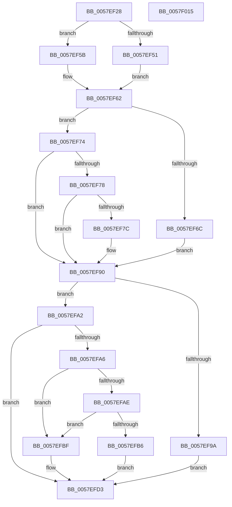

# CcInitPerVolumeParameters

- RVA: `0x0057EF28`–`0x0057F016` (길이 `238` bytes)
- VA: `0x000000014057EF28`
- 실행 섹션: `.text`
- PDB 이름 있음: `예`; PDB Function 태그: `아니요`
- unwind 정보 RVA: `0x0005CAAC`
- 디코드: `60`개 명령, `238/238` bytes 표시
- 미해석 바이트: `0` (있으면 어셈블리에 `.byte`로 보존)

> 이 문서는 커널 이미지의 기계어와 PDB 기호를 분석해 생성했습니다. 4번과 5번은 함수 원형과 자료형을 바이너리 사용 방식에서 추정한 C 해석이며 원본 소스 복구 결과는 아닙니다.

## 1. Dependencies

- 직접 호출 지점: **2**; 고유 호출 대상: **1**
- 직접 호출자로 확인된 함수: **1**
- RIP 상대 이미지 참조: **15**

### Outgoing calls
- `0x0057EF8B` → [DbgPrintEx](../35/DbgPrintEx_function_00359290.md) (function, `0x00359290`)
- `0x0057EFCE` → [DbgPrintEx](../35/DbgPrintEx_function_00359290.md) (function, `0x00359290`)

### Direct callers
- [CcInitializeCacheManager](../../init/BE/CcInitializeCacheManager_function_00BEE2E8.md) at `0x00BEE3B5`

### Static image references
- `0x0057EF32` → RVA `0x00E0A890` (`.data`; read)
- `0x0057EF3F` → RVA `0x00E65B88` (`.data`; write)
- `0x0057EF46` → RVA `0x00E65B96` (`.data`; write)
- `0x0057EF62` → RVA `0x00E0A888` (`.data`; read)
- `0x0057EF81` → RVA `0x006C8FB0` (` ?? ::FNODOBFM::`string'`; read)
- `0x0057EF90` → RVA `0x00E0A88C` (`.data`; read)
- `0x0057EF9A` → RVA `0x00E65B95` (`.data`; write)
- `0x0057EFA6` → RVA `0x00E65B88` (`.data`; read)
- `0x0057EFAE` → RVA `0x00E65B96` (`.data`; read)
- `0x0057EFC4` → RVA `0x006C8ED0` (` ?? ::FNODOBFM::`string'`; read)
- `0x0057EFD3` → RVA `0x00EFAAA8` (`.data`; read)
- `0x0057EFE7` → RVA `0x00F8F4D8` (`.data`; write)
- `0x0057EFF2` → RVA `0x00F8F4E4` (`.data`; write)
- `0x0057EFFF` → RVA `0x00F8F4E0` (`.data`; write)
- `0x0057F009` → RVA `0x00F8F4E8` (`.data`; write)

## 2. Other-region calls and transfers

- 다른 실행 섹션으로 향하는 call: **0**
- 별도 외부 분기/꼬리 이동을 확인하지 못했습니다.

## 3. Assembly (complete function range)

```asm
0057EF28  48 89 5C 24 08                  mov qword ptr [rsp + 8], rbx
0057EF2D  57                              push rdi
0057EF2E  48 83 EC 20                     sub rsp, 0x20
0057EF32  8B 0D 58 B9 88 00               mov ecx, dword ptr [rip + 0x88b958]
0057EF38  BF 01 00 00 00                  mov edi, 1
0057EF3D  33 DB                           xor ebx, ebx
0057EF3F  40 88 3D 42 6C 8E 00            mov byte ptr [rip + 0x8e6c42], dil
0057EF46  40 88 3D 49 6C 8E 00            mov byte ptr [rip + 0x8e6c49], dil
0057EF4D  85 C9                           test ecx, ecx
0057EF4F  75 0A                           jne 0x14057ef5b
0057EF51  88 1D 31 6C 8E 00               mov byte ptr [rip + 0x8e6c31], bl
0057EF57  8A C3                           mov al, bl
0057EF59  EB 07                           jmp 0x14057ef62
0057EF5B  3B CF                           cmp ecx, edi
0057EF5D  8B C7                           mov eax, edi
0057EF5F  0F 44 C7                        cmove eax, edi
0057EF62  8B 0D 20 B9 88 00               mov ecx, dword ptr [rip + 0x88b920]
0057EF68  85 C9                           test ecx, ecx
0057EF6A  75 08                           jne 0x14057ef74
0057EF6C  88 1D 24 6C 8E 00               mov byte ptr [rip + 0x8e6c24], bl
0057EF72  EB 1C                           jmp 0x14057ef90
0057EF74  3B CF                           cmp ecx, edi
0057EF76  75 18                           jne 0x14057ef90
0057EF78  84 C0                           test al, al
0057EF7A  75 14                           jne 0x14057ef90
0057EF7C  BA 02 00 00 00                  mov edx, 2
0057EF81  4C 8D 05 28 A0 14 00            lea r8, [rip + 0x14a028]
0057EF88  8D 4A 7D                        lea ecx, [rdx + 0x7d]
0057EF8B  E8 00 A3 DD FF                  call 0x140359290
0057EF90  8B 05 F6 B8 88 00               mov eax, dword ptr [rip + 0x88b8f6]
0057EF96  85 C0                           test eax, eax
0057EF98  75 08                           jne 0x14057efa2
0057EF9A  88 1D F5 6B 8E 00               mov byte ptr [rip + 0x8e6bf5], bl
0057EFA0  EB 31                           jmp 0x14057efd3
0057EFA2  3B C7                           cmp eax, edi
0057EFA4  75 2D                           jne 0x14057efd3
0057EFA6  38 1D DC 6B 8E 00               cmp byte ptr [rip + 0x8e6bdc], bl
0057EFAC  74 11                           je 0x14057efbf
0057EFAE  38 1D E2 6B 8E 00               cmp byte ptr [rip + 0x8e6be2], bl
0057EFB4  74 09                           je 0x14057efbf
0057EFB6  40 88 3D D8 6B 8E 00            mov byte ptr [rip + 0x8e6bd8], dil
0057EFBD  EB 14                           jmp 0x14057efd3
0057EFBF  BA 02 00 00 00                  mov edx, 2
0057EFC4  4C 8D 05 05 9F 14 00            lea r8, [rip + 0x149f05]
0057EFCB  8D 4A 7D                        lea ecx, [rdx + 0x7d]
0057EFCE  E8 BD A2 DD FF                  call 0x140359290
0057EFD3  8B 05 CF BA 97 00               mov eax, dword ptr [rip + 0x97bacf]
0057EFD9  B9 32 00 00 00                  mov ecx, 0x32
0057EFDE  48 8B 5C 24 30                  mov rbx, qword ptr [rsp + 0x30]
0057EFE3  FF C8                           dec eax
0057EFE5  3B C1                           cmp eax, ecx
0057EFE7  48 C7 05 E6 04 A1 00 00 BA 3C DC  mov qword ptr [rip + 0xa104e6], 0xffffffffdc3cba00
0057EFF2  C7 05 E8 04 A1 00 10 00 00 00   mov dword ptr [rip + 0xa104e8], 0x10
0057EFFC  0F 47 C1                        cmova eax, ecx
0057EFFF  C7 05 D7 04 A1 00 08 00 00 00   mov dword ptr [rip + 0xa104d7], 8
0057F009  89 05 D9 04 A1 00               mov dword ptr [rip + 0xa104d9], eax
0057F00F  48 83 C4 20                     add rsp, 0x20
0057F013  5F                              pop rdi
0057F014  C3                              ret
0057F015  CC                              int3
```

## 4. C-style interpretation (structured pseudocode)

```c
__int64 __fastcall CcInitPerVolumeParameters(void)
{
    __int64 result;
    __int64 v_rbx;
    __int64 v_rsp;
    unsigned __int64 v_stack_p8;

    v_stack_p8 = v_rbx;
    v_rsp = (v_rsp) - (32);
    v_rbx = 0;
    *(unsigned __int8 *)(v_rip + 9333826) = 1;
    *(unsigned __int8 *)(v_rip + 9333833) = 1;
    if ((unsigned int)((unsigned int)(*(unsigned int *)(v_rip + 8960344))) != 0) goto loc_0057EF5B;
    *(unsigned __int8 *)(v_rip + 9333809) = 0;
    goto loc_0057EF62;
loc_0057EF5B:
    result = 1;
    if (((unsigned int)((unsigned int)(*(unsigned int *)(v_rip + 8960344)))) == 1) { result = 1; }
loc_0057EF62:
    if ((unsigned int)((unsigned int)(*(unsigned int *)(v_rip + 8960288))) != 0) goto loc_0057EF74;
    *(unsigned __int8 *)(v_rip + 9333796) = 0;
    goto loc_0057EF90;
loc_0057EF74:
    if (((unsigned int)((unsigned int)(*(unsigned int *)(v_rip + 8960288)))) != 1) goto loc_0057EF90;
    if ((unsigned __int8)(result) == 0) {
        a2 = 2;
        a3 = v_rip + 1351720;
        a1 = a2 + 125;
        result = DbgPrintEx(a1, a2, a3, a4);
    }
    if ((unsigned int)((unsigned int)(*(unsigned int *)(v_rip + 8960246))) != 0) goto loc_0057EFA2;
    *(unsigned __int8 *)(v_rip + 9333749) = 0;
    goto loc_0057EFD3;
loc_0057EFA2:
    if (((unsigned int)((unsigned int)(*(unsigned int *)(v_rip + 8960246)))) != 1) goto loc_0057EFD3;
    if ((*(unsigned __int8 *)(v_rip + 9333724)) == 0) goto loc_0057EFBF;
    if ((*(unsigned __int8 *)(v_rip + 9333730)) == 0) goto loc_0057EFBF;
    *(unsigned __int8 *)(v_rip + 9333720) = 1;
    goto loc_0057EFD3;
loc_0057EFBF:
    result = DbgPrintEx(2 + 125, 2, v_rip + 1351429, a4);
loc_0057EFD3:
    result = (unsigned int)(((unsigned int)(*(unsigned int *)(v_rip + 9943759))) - 1);
    *(unsigned __int64 *)(v_rip + 10552550) = 0xFFFFFFFFDC3CBA00ULL;
    *(unsigned int *)(v_rip + 10552552) = 16;
    if (((unsigned int)(result)) > 50) { result = 50; }
    *(unsigned int *)(v_rip + 10552535) = 8;
    *(unsigned int *)(v_rip + 10552537) = (unsigned int)(result);
    v_rsp = (v_rsp) + (32);
    return result;
}
```

## 5. (Beta) C Style

```c
void CcInitPerVolumeParameters(void)
{
    int64_t result;
    int64_t local_rbx;
    int64_t local_rsp;
    uint64_t v_stack_p8;

    v_stack_p8 = local_rbx;
    local_rsp = (local_rsp) - (32);
    local_rbx = 0;
    *(uint8_t *)(v_rip + 0x8E6C42) = 1;
    *(uint8_t *)(v_rip + 0x8E6C49) = 1;
    if ((uint32_t)((uint32_t)(*(uint32_t *)(v_rip + 0x88B958))) != 0) goto loc_0057EF5B;
    *(uint8_t *)(v_rip + 0x8E6C31) = 0;
    goto loc_0057EF62;
loc_0057EF5B:
    result = 1;
    if (((uint32_t)((uint32_t)(*(uint32_t *)(v_rip + 0x88B958)))) == 1) { result = 1; }
loc_0057EF62:
    if ((uint32_t)((uint32_t)(*(uint32_t *)(v_rip + 0x88B920))) != 0) goto loc_0057EF74;
    *(uint8_t *)(v_rip + 0x8E6C24) = 0;
    goto loc_0057EF90;
loc_0057EF74:
    if (((uint32_t)((uint32_t)(*(uint32_t *)(v_rip + 0x88B920)))) != 1) goto loc_0057EF90;
    if ((uint8_t)(result) == 0) {
        a2 = 2;
        a3 = v_rip + 1351720;
        a1 = a2 + 125;
        result = DbgPrintEx(a1, a2, a3, a4);
    }
    if ((uint32_t)((uint32_t)(*(uint32_t *)(v_rip + 0x88B8F6))) != 0) goto loc_0057EFA2;
    *(uint8_t *)(v_rip + 0x8E6BF5) = 0;
    goto loc_0057EFD3;
loc_0057EFA2:
    if (((uint32_t)((uint32_t)(*(uint32_t *)(v_rip + 0x88B8F6)))) != 1) goto loc_0057EFD3;
    if ((*(uint8_t *)(v_rip + 0x8E6BDC)) == 0) goto loc_0057EFBF;
    if ((*(uint8_t *)(v_rip + 0x8E6BE2)) == 0) goto loc_0057EFBF;
    *(uint8_t *)(v_rip + 0x8E6BD8) = 1;
    goto loc_0057EFD3;
loc_0057EFBF:
    result = DbgPrintEx(2 + 125, 2, v_rip + 1351429, a4);
loc_0057EFD3:
    result = (uint32_t)(((uint32_t)(*(uint32_t *)(v_rip + 0x97BACF))) - 1);
    *(uint64_t *)(v_rip + 0xA104E6) = 0xFFFFFFFFDC3CBA00ULL;
    *(uint32_t *)(v_rip + 0xA104E8) = 16;
    if (((uint32_t)(result)) > 50) { result = 50; }
    *(uint32_t *)(v_rip + 0xA104D7) = 8;
    *(uint32_t *)(v_rip + 0xA104D9) = (uint32_t)(result);
    local_rsp = (local_rsp) + (32);
    return result;
}
```

## 6. Execution-region graph

[열기: 2D/3D 그래프와 함수 탐색 컨트롤 패널](../../../control-panel.html?section=text&rva=0x0057EF28&view=graph)

- 2D 그래프는 위에서 아래로 흐르고, 3D 그래프는 빈 공간을 드래그해 회전합니다. Shift+드래그는 이동, 휠은 확대·축소, 함수 노드 선택은 대상 보고서 이동입니다.

### Static fallback


