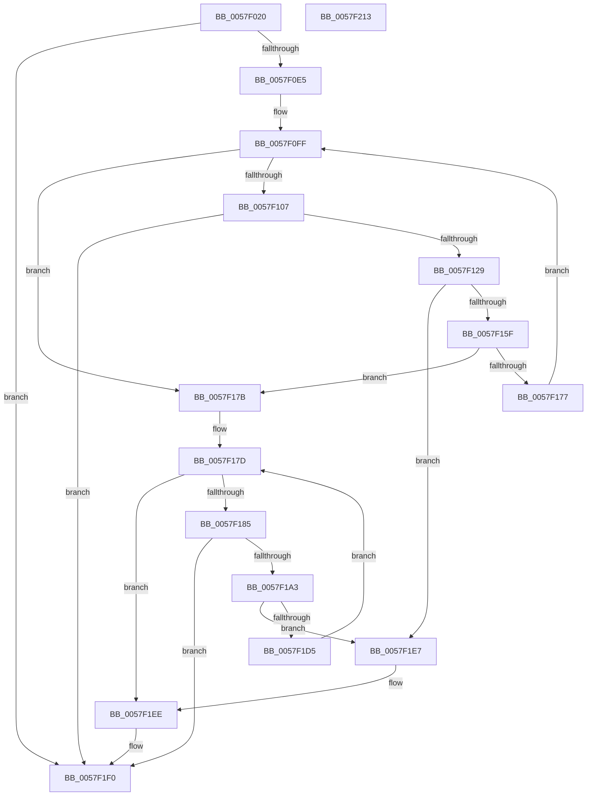

# CcInitializeAsyncLazywriteForNodeHelper

- RVA: `0x0057F020`–`0x0057F214` (길이 `500` bytes)
- VA: `0x000000014057F020`
- 실행 섹션: `.text`
- PDB 이름 있음: `예`; PDB Function 태그: `아니요`
- unwind 정보 RVA: `0x00075C18`
- 디코드: `123`개 명령, `500/500` bytes 표시
- 미해석 바이트: `0` (있으면 어셈블리에 `.byte`로 보존)

> 이 문서는 커널 이미지의 기계어와 PDB 기호를 분석해 생성했습니다. 4번과 5번은 함수 원형과 자료형을 바이너리 사용 방식에서 추정한 C 해석이며 원본 소스 복구 결과는 아닙니다.

## 1. Dependencies

- 직접 호출 지점: **4**; 고유 호출 대상: **2**
- 직접 호출자로 확인된 함수: **0**
- RIP 상대 이미지 참조: **3**

### Outgoing calls
- `0x0057F0D0` → [ExAllocatePoolWithTagFromNode](../35/ExAllocatePoolWithTagFromNode_function_0035A944.md) (function, `0x0035A944`)
- `0x0057F0F8` → [memset](../6C/memset_function_006C6C40.md) (function, `0x006C6C40`)
- `0x0057F11B` → [ExAllocatePoolWithTagFromNode](../35/ExAllocatePoolWithTagFromNode_function_0035A944.md) (function, `0x0035A944`)
- `0x0057F199` → [ExAllocatePoolWithTagFromNode](../35/ExAllocatePoolWithTagFromNode_function_0035A944.md) (function, `0x0035A944`)

### Direct callers
- 이 함수 시작 RVA로 연결되는 직접 call은 확인되지 않았습니다. 간접 호출은 완전히 역산할 수 없습니다.

### Static image references
- `0x0057F060` → RVA `0x00F8F4E8` (`.data`; read)
- `0x0057F131` → RVA `0x004B2130` (`CcAsyncLazywriteWorkerThread`; read)
- `0x0057F1AB` → RVA `0x0057F770` (`CcCompleteAsyncLazywriteWorkerThread`; read)

## 2. Other-region calls and transfers

- 다른 실행 섹션으로 향하는 call: **0**
- 별도 외부 분기/꼬리 이동을 확인하지 못했습니다.

## 3. Assembly (complete function range)

```asm
0057F020  48 89 5C 24 08                  mov qword ptr [rsp + 8], rbx
0057F025  48 89 6C 24 10                  mov qword ptr [rsp + 0x10], rbp
0057F02A  48 89 74 24 18                  mov qword ptr [rsp + 0x18], rsi
0057F02F  57                              push rdi
0057F030  41 54                           push r12
0057F032  41 55                           push r13
0057F034  41 56                           push r14
0057F036  41 57                           push r15
0057F038  48 83 EC 20                     sub rsp, 0x20
0057F03C  49 8D 80 38 01 00 00            lea rax, [r8 + 0x138]
0057F043  33 DB                           xor ebx, ebx
0057F045  4D 8D B0 20 01 00 00            lea r14, [r8 + 0x120]
0057F04C  4D 8B E9                        mov r13, r9
0057F04F  4D 89 76 08                     mov qword ptr [r14 + 8], r14
0057F053  4D 8D B8 68 01 00 00            lea r15, [r8 + 0x168]
0057F05A  4D 89 36                        mov qword ptr [r14], r14
0057F05D  48 8B EA                        mov rbp, rdx
0057F060  8B 15 82 04 A1 00               mov edx, dword ptr [rip + 0xa10482]
0057F066  49 8B F8                        mov rdi, r8
0057F069  4D 89 7F 08                     mov qword ptr [r15 + 8], r15
0057F06D  4C 8B E1                        mov r12, rcx
0057F070  4D 89 3F                        mov qword ptr [r15], r15
0057F073  48 89 40 08                     mov qword ptr [rax + 8], rax
0057F077  48 89 00                        mov qword ptr [rax], rax
0057F07A  49 8D 80 80 01 00 00            lea rax, [r8 + 0x180]
0057F081  48 89 40 08                     mov qword ptr [rax + 8], rax
0057F085  48 89 00                        mov qword ptr [rax], rax
0057F088  49 8D 80 50 01 00 00            lea rax, [r8 + 0x150]
0057F08F  66 41 C7 80 48 01 00 00 01 00   mov word ptr [r8 + 0x148], 1
0057F099  41 C6 80 4A 01 00 00 06         mov byte ptr [r8 + 0x14a], 6
0057F0A1  41 89 98 4C 01 00 00            mov dword ptr [r8 + 0x14c], ebx
0057F0A8  48 89 40 08                     mov qword ptr [rax + 8], rax
0057F0AC  48 89 00                        mov qword ptr [rax], rax
0057F0AF  45 8B 48 18                     mov r9d, dword ptr [r8 + 0x18]
0057F0B3  41 89 98 30 01 00 00            mov dword ptr [r8 + 0x130], ebx
0057F0BA  41 0F BA E9 1F                  bts r9d, 0x1f
0057F0BF  41 89 98 78 01 00 00            mov dword ptr [r8 + 0x178], ebx
0057F0C6  41 B8 43 63 57 71               mov r8d, 0x71576343
0057F0CC  48 C1 E2 02                     shl rdx, 2
0057F0D0  E8 6F B8 DD FF                  call 0x14035a944
0057F0D5  48 89 87 60 01 00 00            mov qword ptr [rdi + 0x160], rax
0057F0DC  48 85 C0                        test rax, rax
0057F0DF  0F 84 0B 01 00 00               je 0x14057f1f0
0057F0E5  44 8B 05 FC 03 A1 00            mov r8d, dword ptr [rip + 0xa103fc]
0057F0EC  BA FF 00 00 00                  mov edx, 0xff
0057F0F1  49 C1 E0 02                     shl r8, 2
0057F0F5  48 8B C8                        mov rcx, rax
0057F0F8  E8 43 7B 14 00                  call 0x1406c6c40
0057F0FD  8B F3                           mov esi, ebx
0057F0FF  3B 35 E3 03 A1 00               cmp esi, dword ptr [rip + 0xa103e3]
0057F105  73 74                           jae 0x14057f17b
0057F107  44 8B 4F 18                     mov r9d, dword ptr [rdi + 0x18]
0057F10B  BA 50 00 00 00                  mov edx, 0x50
0057F110  41 0F BA E9 1F                  bts r9d, 0x1f
0057F115  41 B8 43 63 57 71               mov r8d, 0x71576343
0057F11B  E8 24 B8 DD FF                  call 0x14035a944
0057F120  48 85 C0                        test rax, rax
0057F123  0F 84 C7 00 00 00               je 0x14057f1f0
0057F129  48 C7 40 20 07 00 00 00         mov qword ptr [rax + 0x20], 7
0057F131  48 8D 0D F8 2F F3 FF            lea rcx, [rip - 0xcd008]
0057F138  4C 89 60 38                     mov qword ptr [rax + 0x38], r12
0057F13C  48 89 68 40                     mov qword ptr [rax + 0x40], rbp
0057F140  48 89 78 48                     mov qword ptr [rax + 0x48], rdi
0057F144  89 70 28                        mov dword ptr [rax + 0x28], esi
0057F147  48 89 48 10                     mov qword ptr [rax + 0x10], rcx
0057F14B  48 89 40 18                     mov qword ptr [rax + 0x18], rax
0057F14F  48 89 18                        mov qword ptr [rax], rbx
0057F152  49 8B 4E 08                     mov rcx, qword ptr [r14 + 8]
0057F156  4C 39 31                        cmp qword ptr [rcx], r14
0057F159  0F 85 88 00 00 00               jne 0x14057f1e7
0057F15F  4C 89 30                        mov qword ptr [rax], r14
0057F162  48 89 48 08                     mov qword ptr [rax + 8], rcx
0057F166  48 89 01                        mov qword ptr [rcx], rax
0057F169  49 89 46 08                     mov qword ptr [r14 + 8], rax
0057F16D  8B 85 50 06 00 00               mov eax, dword ptr [rbp + 0x650]
0057F173  A8 02                           test al, 2
0057F175  75 04                           jne 0x14057f17b
0057F177  FF C6                           inc esi
0057F179  EB 84                           jmp 0x14057f0ff
0057F17B  8B F3                           mov esi, ebx
0057F17D  3B B5 4C 06 00 00               cmp esi, dword ptr [rbp + 0x64c]
0057F183  73 69                           jae 0x14057f1ee
0057F185  44 8B 4F 18                     mov r9d, dword ptr [rdi + 0x18]
0057F189  BA 50 00 00 00                  mov edx, 0x50
0057F18E  41 0F BA E9 1F                  bts r9d, 0x1f
0057F193  41 B8 43 63 57 71               mov r8d, 0x71576343
0057F199  E8 A6 B7 DD FF                  call 0x14035a944
0057F19E  48 85 C0                        test rax, rax
0057F1A1  74 4D                           je 0x14057f1f0
0057F1A3  48 C7 40 20 08 00 00 00         mov qword ptr [rax + 0x20], 8
0057F1AB  48 8D 0D BE 05 00 00            lea rcx, [rip + 0x5be]
0057F1B2  4C 89 60 38                     mov qword ptr [rax + 0x38], r12
0057F1B6  48 89 68 40                     mov qword ptr [rax + 0x40], rbp
0057F1BA  48 89 78 48                     mov qword ptr [rax + 0x48], rdi
0057F1BE  89 70 28                        mov dword ptr [rax + 0x28], esi
0057F1C1  48 89 48 10                     mov qword ptr [rax + 0x10], rcx
0057F1C5  48 89 40 18                     mov qword ptr [rax + 0x18], rax
0057F1C9  48 89 18                        mov qword ptr [rax], rbx
0057F1CC  49 8B 4F 08                     mov rcx, qword ptr [r15 + 8]
0057F1D0  4C 39 39                        cmp qword ptr [rcx], r15
0057F1D3  75 12                           jne 0x14057f1e7
0057F1D5  4C 89 38                        mov qword ptr [rax], r15
0057F1D8  FF C6                           inc esi
0057F1DA  48 89 48 08                     mov qword ptr [rax + 8], rcx
0057F1DE  48 89 01                        mov qword ptr [rcx], rax
0057F1E1  49 89 47 08                     mov qword ptr [r15 + 8], rax
0057F1E5  EB 96                           jmp 0x14057f17d
0057F1E7  B9 03 00 00 00                  mov ecx, 3
0057F1EC  CD 29                           int 0x29
0057F1EE  B3 01                           mov bl, 1
0057F1F0  48 8B 6C 24 58                  mov rbp, qword ptr [rsp + 0x58]
0057F1F5  8A C3                           mov al, bl
0057F1F7  48 8B 74 24 60                  mov rsi, qword ptr [rsp + 0x60]
0057F1FC  41 88 5D 00                     mov byte ptr [r13], bl
0057F200  48 8B 5C 24 50                  mov rbx, qword ptr [rsp + 0x50]
0057F205  48 83 C4 20                     add rsp, 0x20
0057F209  41 5F                           pop r15
0057F20B  41 5E                           pop r14
0057F20D  41 5D                           pop r13
0057F20F  41 5C                           pop r12
0057F211  5F                              pop rdi
0057F212  C3                              ret
0057F213  CC                              int3
```

## 4. C-style interpretation (structured pseudocode)

```c
__int64 __fastcall CcInitializeAsyncLazywriteForNodeHelper(__int64 a1, __int64 a2, __int64 a3, __int64 a4)
{
    __int64 result;
    __int64 v_rbx;
    __int64 v_rsi;
    __int64 v_rsp;
    unsigned __int64 v_stack_p10;
    unsigned __int64 v_stack_p18;
    unsigned __int64 v_stack_p8;

    v_stack_p8 = v_rbx;
    v_stack_p10 = v_rbp;
    v_stack_p18 = v_rsi;
    v_rsp = (v_rsp) - (32);
    v_rbx = 0;
    *(unsigned __int64 *)(a3 + 288 + 8) = a3 + 288;
    *(unsigned __int64 *)(a3 + 288) = a3 + 288;
    *(unsigned __int64 *)(a3 + 360 + 8) = a3 + 360;
    *(unsigned __int64 *)(a3 + 360) = a3 + 360;
    *(unsigned __int64 *)(a3 + 312 + 8) = a3 + 312;
    *(unsigned __int64 *)(a3 + 312) = a3 + 312;
    *(unsigned __int64 *)(a3 + 384 + 8) = a3 + 384;
    *(unsigned __int64 *)(a3 + 384) = a3 + 384;
    *(unsigned __int16 *)(a3 + 328) = 1;
    *(unsigned __int8 *)(a3 + 330) = 6;
    *(unsigned int *)(a3 + 332) = 0;
    *(unsigned __int64 *)(a3 + 336 + 8) = a3 + 336;
    *(unsigned __int64 *)(a3 + 336) = a3 + 336;
    *(unsigned int *)(a3 + 304) = 0;
    *(unsigned int *)(a3 + 376) = 0;
    a2 = ((unsigned int)(*(unsigned int *)(v_rip + 10552450))) << (2);
    result = ExAllocatePoolWithTagFromNode(a1, a2, (unsigned int)(0x71576343ULL), (unsigned int)(*(unsigned int *)(a3 + 24)));
    *(unsigned __int64 *)(a3 + 352) = result;
    if (result == 0) goto loc_0057F1F0;
    a3 = ((unsigned int)(*(unsigned int *)(v_rip + 10552316))) << (2);
    result = memset(result, 255, a3, (unsigned int)(*(unsigned int *)(a3 + 24)));
loc_0057F0FF:
    if (0 >= (*(unsigned int *)(v_rip + 10552291))) goto loc_0057F17B;
    result = ExAllocatePoolWithTagFromNode(result, 80, (unsigned int)(0x71576343ULL), (unsigned int)(*(unsigned int *)(a3 + 24)));
    if (result == 0) goto loc_0057F1F0;
    *(unsigned __int64 *)(result + 32) = 7;
    *(unsigned __int64 *)(result + 56) = a1;
    *(unsigned __int64 *)(result + 64) = a2;
    *(unsigned __int64 *)(result + 72) = a3;
    *(unsigned int *)(result + 40) = 0;
    *(unsigned __int64 *)(result + 16) = v_rip - 839688;
    *(unsigned __int64 *)(result + 24) = result;
    *(unsigned __int64 *)(result) = 0;
    if ((*(unsigned __int64 *)(*(unsigned __int64 *)(a3 + 288 + 8))) != (a3 + 288)) goto loc_0057F1E7;
    *(unsigned __int64 *)(result) = a3 + 288;
    *(unsigned __int64 *)(result + 8) = *(unsigned __int64 *)(a3 + 288 + 8);
    *(unsigned __int64 *)(*(unsigned __int64 *)(a3 + 288 + 8)) = result;
    *(unsigned __int64 *)(a3 + 288 + 8) = result;
    if ((((unsigned __int8)((unsigned int)(*(unsigned int *)(a2 + 1616)))) & (2)) != 0) goto loc_0057F17B;
    v_rsi = (unsigned int)((0) + 1);
    goto loc_0057F0FF;
loc_0057F17B:
loc_0057F17D:
    if (0 >= (*(unsigned int *)(a2 + 1612))) goto loc_0057F1EE;
    result = ExAllocatePoolWithTagFromNode(*(unsigned __int64 *)(a3 + 288 + 8), 80, (unsigned int)(0x71576343ULL), (unsigned int)(*(unsigned int *)(a3 + 24)));
    if (result == 0) goto loc_0057F1F0;
    *(unsigned __int64 *)(result + 32) = 8;
    *(unsigned __int64 *)(result + 56) = a1;
    *(unsigned __int64 *)(result + 64) = a2;
    *(unsigned __int64 *)(result + 72) = a3;
    *(unsigned int *)(result + 40) = 0;
    *(unsigned __int64 *)(result + 16) = v_rip + 1470;
    *(unsigned __int64 *)(result + 24) = result;
    *(unsigned __int64 *)(result) = 0;
    if ((*(unsigned __int64 *)(*(unsigned __int64 *)(a3 + 360 + 8))) != (a3 + 360)) goto loc_0057F1E7;
    *(unsigned __int64 *)(result) = a3 + 360;
    v_rsi = (unsigned int)((0) + 1);
    *(unsigned __int64 *)(result + 8) = *(unsigned __int64 *)(a3 + 360 + 8);
    *(unsigned __int64 *)(*(unsigned __int64 *)(a3 + 360 + 8)) = result;
    *(unsigned __int64 *)(a3 + 360 + 8) = result;
    goto loc_0057F17D;
loc_0057F1E7:
loc_0057F1EE:
loc_0057F1F0:
    *(unsigned __int8 *)(a4) = 1;
    v_rsp = (v_rsp) + (32);
    return 1;
}
```

## 5. (Beta) C Style

```c
int64_t CcInitializeAsyncLazywriteForNodeHelper(int64_t Arg1, void *Arg2, void *Arg3, void *Arg4)
{
    uint8_t *arg2 = (uint8_t *)Arg2;
    uint8_t *arg3 = (uint8_t *)Arg3;
    uint8_t *arg4 = (uint8_t *)Arg4;

    int64_t result;
    int64_t local_rbx;
    int64_t local_rsi;
    int64_t local_rsp;
    uint64_t v_stack_p10;
    uint64_t v_stack_p18;
    uint64_t v_stack_p8;

    v_stack_p8 = local_rbx;
    v_stack_p10 = local_rbp;
    v_stack_p18 = local_rsi;
    local_rsp = (local_rsp) - (32);
    local_rbx = 0;
    *(void **)(arg3 + 0x120 + 0x8) = Arg3 + 288;
    *(void **)(arg3 + 0x120) = Arg3 + 288;
    *(void **)(arg3 + 0x168 + 0x8) = Arg3 + 360;
    *(void **)(arg3 + 0x168) = Arg3 + 360;
    *(void **)(arg3 + 0x138 + 0x8) = Arg3 + 312;
    *(void **)(arg3 + 0x138) = Arg3 + 312;
    *(void **)(arg3 + 0x180 + 0x8) = Arg3 + 384;
    *(void **)(arg3 + 0x180) = Arg3 + 384;
    *(uint16_t *)(arg3 + 0x148) = 1;
    *(uint8_t *)(arg3 + 0x14A) = 6;
    *(uint32_t *)(arg3 + 0x14C) = 0;
    *(void **)(arg3 + 0x150 + 0x8) = Arg3 + 336;
    *(void **)(arg3 + 0x150) = Arg3 + 336;
    *(uint32_t *)(arg3 + 0x130) = 0;
    *(uint32_t *)(arg3 + 0x178) = 0;
    Arg2 = ((uint32_t)(*(uint32_t *)(v_rip + 0xA10482))) << (2);
    result = ExAllocatePoolWithTagFromNode(Arg1, Arg2, (uint32_t)(0x71576343ULL), (uint32_t)(*(uint32_t *)(arg3 + 0x18)));
    *(uint64_t *)(arg3 + 0x160) = result;
    if (result == 0) goto loc_0057F1F0;
    Arg3 = ((uint32_t)(*(uint32_t *)(v_rip + 0xA103FC))) << (2);
    result = memset(result, 255, Arg3, (uint32_t)(*(uint32_t *)(arg3 + 0x18)));
loc_0057F0FF:
    if (0 >= (*(uint32_t *)(v_rip + 0xA103E3))) goto loc_0057F17B;
    result = ExAllocatePoolWithTagFromNode(result, 80, (uint32_t)(0x71576343ULL), (uint32_t)(*(uint32_t *)(arg3 + 0x18)));
    if (result == 0) goto loc_0057F1F0;
    *(uint64_t *)(result + 0x20) = 7;
    *(uint64_t *)(result + 0x38) = Arg1;
    *(void **)(result + 0x40) = Arg2;
    *(void **)(result + 0x48) = Arg3;
    *(uint32_t *)(result + 0x28) = 0;
    *(uint64_t *)(result + 0x10) = v_rip - 839688;
    *(uint64_t *)(result + 0x18) = result;
    *(uint64_t *)(result) = 0;
    if ((*(uint64_t *)(*(uint64_t *)(arg3 + 0x120 + 0x8))) != (Arg3 + 288)) goto loc_0057F1E7;
    *(void **)(result) = Arg3 + 288;
    *(uint64_t *)(result + 0x8) = *(uint64_t *)(arg3 + 0x120 + 0x8);
    *(uint64_t *)(*(uint64_t *)(arg3 + 0x120 + 0x8)) = result;
    *(uint64_t *)(arg3 + 0x120 + 0x8) = result;
    if ((((uint8_t)((uint32_t)(*(uint32_t *)(arg2 + 0x650)))) & (2)) != 0) goto loc_0057F17B;
    local_rsi = (uint32_t)((0) + 1);
    goto loc_0057F0FF;
loc_0057F17B:
loc_0057F17D:
    if (0 >= (*(uint32_t *)(arg2 + 0x64C))) goto loc_0057F1EE;
    result = ExAllocatePoolWithTagFromNode(*(uint64_t *)(arg3 + 0x120 + 0x8), 80, (uint32_t)(0x71576343ULL), (uint32_t)(*(uint32_t *)(arg3 + 0x18)));
    if (result == 0) goto loc_0057F1F0;
    *(uint64_t *)(result + 0x20) = 8;
    *(uint64_t *)(result + 0x38) = Arg1;
    *(void **)(result + 0x40) = Arg2;
    *(void **)(result + 0x48) = Arg3;
    *(uint32_t *)(result + 0x28) = 0;
    *(uint64_t *)(result + 0x10) = v_rip + 1470;
    *(uint64_t *)(result + 0x18) = result;
    *(uint64_t *)(result) = 0;
    if ((*(uint64_t *)(*(uint64_t *)(arg3 + 0x168 + 0x8))) != (Arg3 + 360)) goto loc_0057F1E7;
    *(void **)(result) = Arg3 + 360;
    local_rsi = (uint32_t)((0) + 1);
    *(uint64_t *)(result + 0x8) = *(uint64_t *)(arg3 + 0x168 + 0x8);
    *(uint64_t *)(*(uint64_t *)(arg3 + 0x168 + 0x8)) = result;
    *(uint64_t *)(arg3 + 0x168 + 0x8) = result;
    goto loc_0057F17D;
loc_0057F1E7:
loc_0057F1EE:
loc_0057F1F0:
    *(uint8_t *)(arg4) = 1;
    local_rsp = (local_rsp) + (32);
    return 1;
}
```

### 관측된 메모리 오프셋

구조체 형식이 확인되지 않은 접근은 인자 기준의 오프셋으로만 기록했습니다.

| 기준 인자 | 오프셋 표현 | 폭 (bit) | 접근 |
|---|---:|---:|---|
| `Arg2` | `+ 0x64C` | `32` | `R` |
| `Arg2` | `+ 0x650` | `32` | `R` |
| `Arg3` | `+ 0x0` | `64` | `W` |
| `Arg3` | `+ 0x8` | `64` | `R` |
| `Arg3` | `+ 0x8` | `64` | `W` |
| `Arg3` | `+ 0x18` | `32` | `R` |
| `Arg3` | `+ 0x120` | `64` | `R` |
| `Arg3` | `+ 0x130` | `32` | `W` |
| `Arg3` | `+ 0x138` | `64` | `R` |
| `Arg3` | `+ 0x148` | `16` | `W` |
| `Arg3` | `+ 0x14A` | `8` | `W` |
| `Arg3` | `+ 0x14C` | `32` | `W` |
| `Arg3` | `+ 0x150` | `64` | `R` |
| `Arg3` | `+ 0x160` | `64` | `W` |
| `Arg3` | `+ 0x168` | `64` | `R` |
| `Arg3` | `+ 0x178` | `32` | `W` |
| `Arg3` | `+ 0x180` | `64` | `R` |
| `Arg4` | `+ 0x0` | `8` | `W` |

## 6. Execution-region graph

[열기: 2D/3D 그래프와 함수 탐색 컨트롤 패널](../../../control-panel.html?section=text&rva=0x0057F020&view=graph)

- 2D 그래프는 위에서 아래로 흐르고, 3D 그래프는 빈 공간을 드래그해 회전합니다. Shift+드래그는 이동, 휠은 확대·축소, 함수 노드 선택은 대상 보고서 이동입니다.

### Static fallback


