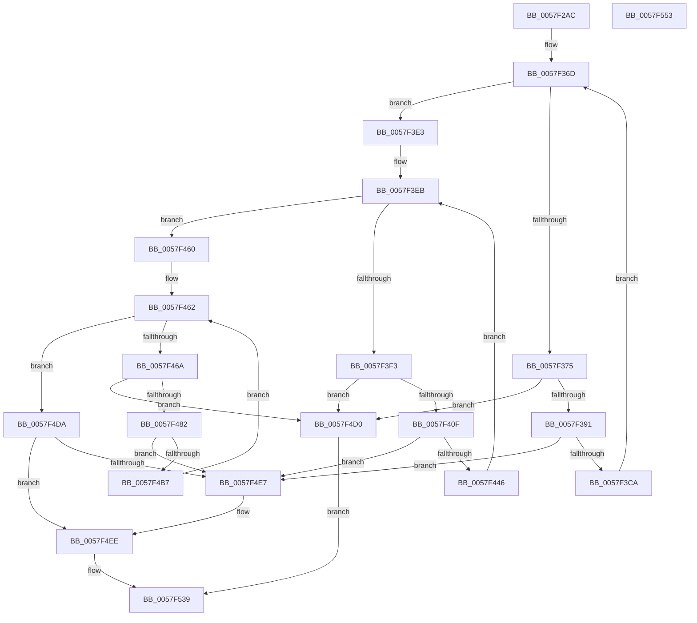

# CcInitializeNumaNode

- RVA: `0x0057F2AC`–`0x0057F554` (길이 `680` bytes)
- VA: `0x000000014057F2AC`
- 실행 섹션: `.text`
- PDB 이름 있음: `예`; PDB Function 태그: `아니요`
- unwind 정보 RVA: `0x000AFEC4`
- 디코드: `175`개 명령, `680/680` bytes 표시
- 미해석 바이트: `0` (있으면 어셈블리에 `.byte`로 보존)

> 이 문서는 커널 이미지의 기계어와 PDB 기호를 분석해 생성했습니다. 4번과 5번은 함수 원형과 자료형을 바이너리 사용 방식에서 추정한 C 해석이며 원본 소스 복구 결과는 아닙니다.

## 1. Dependencies

- 직접 호출 지점: **6**; 고유 호출 대상: **4**
- 직접 호출자로 확인된 함수: **1**
- RIP 상대 이미지 참조: **4**

### Outgoing calls
- `0x0057F2DD` → [memset](../6C/memset_function_006C6C40.md) (function, `0x006C6C40`)
- `0x0057F383` → [ExAllocatePoolWithTagFromNode](../35/ExAllocatePoolWithTagFromNode_function_0035A944.md) (function, `0x0035A944`)
- `0x0057F401` → [ExAllocatePoolWithTagFromNode](../35/ExAllocatePoolWithTagFromNode_function_0035A944.md) (function, `0x0035A944`)
- `0x0057F478` → [ExAllocatePoolWithTagFromNode](../35/ExAllocatePoolWithTagFromNode_function_0035A944.md) (function, `0x0035A944`)
- `0x0057F4D3` → [CcDeleteNumaNode](../3C/CcDeleteNumaNode_function_003CEF5C.md) (function, `0x003CEF5C`)
- `0x0057F534` → [DbgPrintEx](../35/DbgPrintEx_function_00359290.md) (function, `0x00359290`)

### Direct callers
- [CcInitializePartition](CcInitializePartition_function_0057E4D8.md) at `0x0057EA07`

### Static image references
- `0x0057F395` → RVA `0x0048F0F0` (`CcWorkerThread`; read)
- `0x0057F486` → RVA `0x003569D0` (`CcCachemapUninitWorkerThread`; read)
- `0x0057F4F6` → RVA `0x006C90E0` (` ?? ::FNODOBFM::`string'`; read)
- `0x0057F50C` → RVA `0x00E0A874` (`.data`; read)

## 2. Other-region calls and transfers

- 다른 실행 섹션으로 향하는 call: **0**
- 별도 외부 분기/꼬리 이동을 확인하지 못했습니다.

## 3. Assembly (complete function range)

```asm
0057F2AC  48 89 5C 24 08                  mov qword ptr [rsp + 8], rbx
0057F2B1  44 89 4C 24 20                  mov dword ptr [rsp + 0x20], r9d
0057F2B6  44 89 44 24 18                  mov dword ptr [rsp + 0x18], r8d
0057F2BB  55                              push rbp
0057F2BC  56                              push rsi
0057F2BD  57                              push rdi
0057F2BE  41 54                           push r12
0057F2C0  41 55                           push r13
0057F2C2  41 56                           push r14
0057F2C4  41 57                           push r15
0057F2C6  48 83 EC 40                     sub rsp, 0x40
0057F2CA  48 8B F2                        mov rsi, rdx
0057F2CD  48 8B F9                        mov rdi, rcx
0057F2D0  48 8B CE                        mov rcx, rsi
0057F2D3  33 D2                           xor edx, edx
0057F2D5  41 B8 90 01 00 00               mov r8d, 0x190
0057F2DB  33 DB                           xor ebx, ebx
0057F2DD  E8 5E 79 14 00                  call 0x1406c6c40
0057F2E2  8B 94 24 98 00 00 00            mov edx, dword ptr [rsp + 0x98]
0057F2E9  48 8D 46 48                     lea rax, [rsi + 0x48]
0057F2ED  89 56 18                        mov dword ptr [rsi + 0x18], edx
0057F2F0  4C 8D 7E 20                     lea r15, [rsi + 0x20]
0057F2F4  C7 06 F6 02 90 01               mov dword ptr [rsi], 0x19002f6
0057F2FA  4C 8D 76 38                     lea r14, [rsi + 0x38]
0057F2FE  C7 46 04 01 00 00 00            mov dword ptr [rsi + 4], 1
0057F305  4C 8D A6 88 00 00 00            lea r12, [rsi + 0x88]
0057F30C  48 89 7E 08                     mov qword ptr [rsi + 8], rdi
0057F310  4C 8D AE A0 00 00 00            lea r13, [rsi + 0xa0]
0057F317  4D 89 7F 08                     mov qword ptr [r15 + 8], r15
0057F31B  8B EB                           mov ebp, ebx
0057F31D  4D 89 3F                        mov qword ptr [r15], r15
0057F320  4D 89 76 08                     mov qword ptr [r14 + 8], r14
0057F324  4D 89 36                        mov qword ptr [r14], r14
0057F327  48 89 40 08                     mov qword ptr [rax + 8], rax
0057F32B  48 89 00                        mov qword ptr [rax], rax
0057F32E  48 8D 46 58                     lea rax, [rsi + 0x58]
0057F332  48 89 40 08                     mov qword ptr [rax + 8], rax
0057F336  48 89 00                        mov qword ptr [rax], rax
0057F339  48 8D 46 68                     lea rax, [rsi + 0x68]
0057F33D  48 89 40 08                     mov qword ptr [rax + 8], rax
0057F341  48 89 00                        mov qword ptr [rax], rax
0057F344  48 8D 46 78                     lea rax, [rsi + 0x78]
0057F348  4D 89 64 24 08                  mov qword ptr [r12 + 8], r12
0057F34D  4D 89 24 24                     mov qword ptr [r12], r12
0057F351  48 89 40 08                     mov qword ptr [rax + 8], rax
0057F355  48 89 00                        mov qword ptr [rax], rax
0057F358  8B C2                           mov eax, edx
0057F35A  0F BA E8 1F                     bts eax, 0x1f
0057F35E  4D 89 6D 08                     mov qword ptr [r13 + 8], r13
0057F362  89 84 24 90 00 00 00            mov dword ptr [rsp + 0x90], eax
0057F369  4D 89 6D 00                     mov qword ptr [r13], r13
0057F36D  3B AF 48 03 00 00               cmp ebp, dword ptr [rdi + 0x348]
0057F373  73 6E                           jae 0x14057f3e3
0057F375  44 8B C8                        mov r9d, eax
0057F378  BA 50 00 00 00                  mov edx, 0x50
0057F37D  41 B8 43 63 57 71               mov r8d, 0x71576343
0057F383  E8 BC B5 DD FF                  call 0x14035a944
0057F388  48 85 C0                        test rax, rax
0057F38B  0F 84 3F 01 00 00               je 0x14057f4d0
0057F391  83 48 24 FF                     or dword ptr [rax + 0x24], 0xffffffff
0057F395  48 8D 0D 54 FD F0 FF            lea rcx, [rip - 0xf02ac]
0057F39C  C7 40 20 01 00 00 00            mov dword ptr [rax + 0x20], 1
0057F3A3  48 89 78 38                     mov qword ptr [rax + 0x38], rdi
0057F3A7  48 89 58 40                     mov qword ptr [rax + 0x40], rbx
0057F3AB  48 89 70 48                     mov qword ptr [rax + 0x48], rsi
0057F3AF  89 68 28                        mov dword ptr [rax + 0x28], ebp
0057F3B2  48 89 48 10                     mov qword ptr [rax + 0x10], rcx
0057F3B6  48 89 40 18                     mov qword ptr [rax + 0x18], rax
0057F3BA  48 89 18                        mov qword ptr [rax], rbx
0057F3BD  49 8B 4E 08                     mov rcx, qword ptr [r14 + 8]
0057F3C1  4C 39 31                        cmp qword ptr [rcx], r14
0057F3C4  0F 85 1D 01 00 00               jne 0x14057f4e7
0057F3CA  4C 89 30                        mov qword ptr [rax], r14
0057F3CD  FF C5                           inc ebp
0057F3CF  48 89 48 08                     mov qword ptr [rax + 8], rcx
0057F3D3  48 89 01                        mov qword ptr [rcx], rax
0057F3D6  49 89 46 08                     mov qword ptr [r14 + 8], rax
0057F3DA  8B 84 24 90 00 00 00            mov eax, dword ptr [rsp + 0x90]
0057F3E1  EB 8A                           jmp 0x14057f36d
0057F3E3  8B EB                           mov ebp, ebx
0057F3E5  41 BE 02 00 00 00               mov r14d, 2
0057F3EB  3B AF 60 03 00 00               cmp ebp, dword ptr [rdi + 0x360]
0057F3F1  73 6D                           jae 0x14057f460
0057F3F3  44 8B C8                        mov r9d, eax
0057F3F6  BA 50 00 00 00                  mov edx, 0x50
0057F3FB  41 B8 43 63 57 71               mov r8d, 0x71576343
0057F401  E8 3E B5 DD FF                  call 0x14035a944
0057F406  48 85 C0                        test rax, rax
0057F409  0F 84 C1 00 00 00               je 0x14057f4d0
0057F40F  83 48 24 FF                     or dword ptr [rax + 0x24], 0xffffffff
0057F413  48 8D 0D D6 FC F0 FF            lea rcx, [rip - 0xf032a]
0057F41A  44 89 70 20                     mov dword ptr [rax + 0x20], r14d
0057F41E  48 89 78 38                     mov qword ptr [rax + 0x38], rdi
0057F422  48 89 58 40                     mov qword ptr [rax + 0x40], rbx
0057F426  48 89 70 48                     mov qword ptr [rax + 0x48], rsi
0057F42A  89 68 28                        mov dword ptr [rax + 0x28], ebp
0057F42D  48 89 48 10                     mov qword ptr [rax + 0x10], rcx
0057F431  48 89 40 18                     mov qword ptr [rax + 0x18], rax
0057F435  48 89 18                        mov qword ptr [rax], rbx
0057F438  49 8B 4C 24 08                  mov rcx, qword ptr [r12 + 8]
0057F43D  4C 39 21                        cmp qword ptr [rcx], r12
0057F440  0F 85 A1 00 00 00               jne 0x14057f4e7
0057F446  4C 89 20                        mov qword ptr [rax], r12
0057F449  FF C5                           inc ebp
0057F44B  48 89 48 08                     mov qword ptr [rax + 8], rcx
0057F44F  48 89 01                        mov qword ptr [rcx], rax
0057F452  49 89 44 24 08                  mov qword ptr [r12 + 8], rax
0057F457  8B 84 24 90 00 00 00            mov eax, dword ptr [rsp + 0x90]
0057F45E  EB 8B                           jmp 0x14057f3eb
0057F460  8B EB                           mov ebp, ebx
0057F462  3B AF 64 03 00 00               cmp ebp, dword ptr [rdi + 0x364]
0057F468  73 70                           jae 0x14057f4da
0057F46A  44 8B C8                        mov r9d, eax
0057F46D  BA 50 00 00 00                  mov edx, 0x50
0057F472  41 B8 43 63 57 71               mov r8d, 0x71576343
0057F478  E8 C7 B4 DD FF                  call 0x14035a944
0057F47D  48 85 C0                        test rax, rax
0057F480  74 4E                           je 0x14057f4d0
0057F482  83 48 24 FF                     or dword ptr [rax + 0x24], 0xffffffff
0057F486  48 8D 0D 43 75 DD FF            lea rcx, [rip - 0x228abd]
0057F48D  C7 40 20 05 00 00 00            mov dword ptr [rax + 0x20], 5
0057F494  48 89 78 38                     mov qword ptr [rax + 0x38], rdi
0057F498  48 89 58 40                     mov qword ptr [rax + 0x40], rbx
0057F49C  48 89 70 48                     mov qword ptr [rax + 0x48], rsi
0057F4A0  89 68 28                        mov dword ptr [rax + 0x28], ebp
0057F4A3  48 89 48 10                     mov qword ptr [rax + 0x10], rcx
0057F4A7  48 89 40 18                     mov qword ptr [rax + 0x18], rax
0057F4AB  48 89 18                        mov qword ptr [rax], rbx
0057F4AE  49 8B 4D 08                     mov rcx, qword ptr [r13 + 8]
0057F4B2  4C 39 29                        cmp qword ptr [rcx], r13
0057F4B5  75 30                           jne 0x14057f4e7
0057F4B7  4C 89 28                        mov qword ptr [rax], r13
0057F4BA  FF C5                           inc ebp
0057F4BC  48 89 48 08                     mov qword ptr [rax + 8], rcx
0057F4C0  48 89 01                        mov qword ptr [rcx], rax
0057F4C3  49 89 45 08                     mov qword ptr [r13 + 8], rax
0057F4C7  8B 84 24 90 00 00 00            mov eax, dword ptr [rsp + 0x90]
0057F4CE  EB 92                           jmp 0x14057f462
0057F4D0  48 8B CE                        mov rcx, rsi
0057F4D3  E8 84 FA E4 FF                  call 0x1403cef5c
0057F4D8  EB 5F                           jmp 0x14057f539
0057F4DA  48 8D 47 10                     lea rax, [rdi + 0x10]
0057F4DE  48 8B 48 08                     mov rcx, qword ptr [rax + 8]
0057F4E2  48 39 01                        cmp qword ptr [rcx], rax
0057F4E5  74 07                           je 0x14057f4ee
0057F4E7  B9 03 00 00 00                  mov ecx, 3
0057F4EC  CD 29                           int 0x29
0057F4EE  44 8B 8C 24 98 00 00 00         mov r9d, dword ptr [rsp + 0x98]
0057F4F6  4C 8D 05 E3 9B 14 00            lea r8, [rip + 0x149be3]
0057F4FD  49 89 4F 08                     mov qword ptr [r15 + 8], rcx
0057F501  41 8B D6                        mov edx, r14d
0057F504  49 89 07                        mov qword ptr [r15], rax
0057F507  B3 01                           mov bl, 1
0057F509  4C 89 39                        mov qword ptr [rcx], r15
0057F50C  8B 0D 62 B3 88 00               mov ecx, dword ptr [rip + 0x88b362]
0057F512  48 89 7C 24 30                  mov qword ptr [rsp + 0x30], rdi
0057F517  89 4C 24 28                     mov dword ptr [rsp + 0x28], ecx
0057F51B  B9 7F 00 00 00                  mov ecx, 0x7f
0057F520  4C 89 78 08                     mov qword ptr [rax + 8], r15
0057F524  4A 89 B4 CF 80 00 00 00         mov qword ptr [rdi + r9*8 + 0x80], rsi
0057F52C  44 89 4C 24 20                  mov dword ptr [rsp + 0x20], r9d
0057F531  4C 8B CE                        mov r9, rsi
0057F534  E8 57 9D DD FF                  call 0x140359290
0057F539  8A C3                           mov al, bl
0057F53B  48 8B 9C 24 80 00 00 00         mov rbx, qword ptr [rsp + 0x80]
0057F543  48 83 C4 40                     add rsp, 0x40
0057F547  41 5F                           pop r15
0057F549  41 5E                           pop r14
0057F54B  41 5D                           pop r13
0057F54D  41 5C                           pop r12
0057F54F  5F                              pop rdi
0057F550  5E                              pop rsi
0057F551  5D                              pop rbp
0057F552  C3                              ret
0057F553  CC                              int3
```

## 4. C-style interpretation (structured pseudocode)

```c
__int64 __fastcall CcInitializeNumaNode(__int64 a1, __int64 a2, int a3, int a4)
{
    __int64 result;
    __int64 v_rbp;
    __int64 v_rbx;
    __int64 v_rsp;
    unsigned __int64 v_stack_m48;
    unsigned int v_stack_m50;
    unsigned int v_stack_m58;
    unsigned int v_stack_p18;
    unsigned int v_stack_p20;
    unsigned __int64 v_stack_p8;

    v_stack_p8 = v_rbx;
    v_stack_p20 = a4;
    v_stack_p18 = a3;
    v_rsp = (v_rsp) - (64);
    a2 = 0;
    v_rbx = 0;
    result = memset(a2, a2, 400, a4);
    *(unsigned int *)(a2 + 24) = (unsigned int)((unsigned int)(v_stack_p20));
    *(unsigned int *)(a2) = 0x19002F6ULL;
    *(unsigned int *)(a2 + 4) = 1;
    *(unsigned __int64 *)(a2 + 8) = a1;
    *(unsigned __int64 *)(a2 + 32 + 8) = a2 + 32;
    *(unsigned __int64 *)(a2 + 32) = a2 + 32;
    *(unsigned __int64 *)(a2 + 56 + 8) = a2 + 56;
    *(unsigned __int64 *)(a2 + 56) = a2 + 56;
    *(unsigned __int64 *)(a2 + 72 + 8) = a2 + 72;
    *(unsigned __int64 *)(a2 + 72) = a2 + 72;
    *(unsigned __int64 *)(a2 + 88 + 8) = a2 + 88;
    *(unsigned __int64 *)(a2 + 88) = a2 + 88;
    *(unsigned __int64 *)(a2 + 104 + 8) = a2 + 104;
    *(unsigned __int64 *)(a2 + 104) = a2 + 104;
    *(unsigned __int64 *)(a2 + 136 + 8) = a2 + 136;
    *(unsigned __int64 *)(a2 + 136) = a2 + 136;
    *(unsigned __int64 *)(a2 + 120 + 8) = a2 + 120;
    *(unsigned __int64 *)(a2 + 120) = a2 + 120;
    *(unsigned __int64 *)(a2 + 160 + 8) = a2 + 160;
    v_stack_p18 = (unsigned int)((unsigned int)((unsigned int)((unsigned int)(v_stack_p20))));
    *(unsigned __int64 *)(a2 + 160) = a2 + 160;
loc_0057F36D:
    if (0 >= (*(unsigned int *)(a1 + 840))) goto loc_0057F3E3;
    result = ExAllocatePoolWithTagFromNode(a2, 80, (unsigned int)(0x71576343ULL), (unsigned int)((unsigned int)((unsigned int)((unsigned int)((unsigned int)(v_stack_p20))))));
    if (result == 0) goto loc_0057F4D0;
    *(unsigned int *)(result + 32) = 1;
    *(unsigned __int64 *)(result + 56) = a1;
    *(unsigned __int64 *)(result + 64) = 0;
    *(unsigned __int64 *)(result + 72) = 0;
    *(unsigned int *)(result + 40) = 0;
    *(unsigned __int64 *)(result + 16) = v_rip - 983724;
    *(unsigned __int64 *)(result + 24) = result;
    *(unsigned __int64 *)(result) = 0;
    if ((*(unsigned __int64 *)(*(unsigned __int64 *)(a2 + 56 + 8))) != (a2 + 56)) goto loc_0057F4E7;
    *(unsigned __int64 *)(result) = a2 + 56;
    v_rbp = (unsigned int)((0) + 1);
    *(unsigned __int64 *)(result + 8) = *(unsigned __int64 *)(a2 + 56 + 8);
    *(unsigned __int64 *)(*(unsigned __int64 *)(a2 + 56 + 8)) = result;
    *(unsigned __int64 *)(a2 + 56 + 8) = result;
    goto loc_0057F36D;
loc_0057F3E3:
loc_0057F3EB:
    if (0 >= (*(unsigned int *)(a1 + 864))) goto loc_0057F460;
    result = ExAllocatePoolWithTagFromNode(*(unsigned __int64 *)(a2 + 56 + 8), 80, (unsigned int)(0x71576343ULL), (unsigned int)((unsigned int)((unsigned int)(v_stack_p18))));
    if (result == 0) goto loc_0057F4D0;
    *(unsigned int *)(result + 32) = 2;
    *(unsigned __int64 *)(result + 56) = a1;
    *(unsigned __int64 *)(result + 64) = 0;
    *(unsigned __int64 *)(result + 72) = 0;
    *(unsigned int *)(result + 40) = 0;
    *(unsigned __int64 *)(result + 16) = v_rip - 983850;
    *(unsigned __int64 *)(result + 24) = result;
    *(unsigned __int64 *)(result) = 0;
    if ((*(unsigned __int64 *)(*(unsigned __int64 *)(a2 + 136 + 8))) != (a2 + 136)) goto loc_0057F4E7;
    *(unsigned __int64 *)(result) = a2 + 136;
    v_rbp = (unsigned int)((0) + 1);
    *(unsigned __int64 *)(result + 8) = *(unsigned __int64 *)(a2 + 136 + 8);
    *(unsigned __int64 *)(*(unsigned __int64 *)(a2 + 136 + 8)) = result;
    *(unsigned __int64 *)(a2 + 136 + 8) = result;
    goto loc_0057F3EB;
loc_0057F460:
loc_0057F462:
    if (0 >= (*(unsigned int *)(a1 + 868))) goto loc_0057F4DA;
    result = ExAllocatePoolWithTagFromNode(*(unsigned __int64 *)(a2 + 136 + 8), 80, (unsigned int)(0x71576343ULL), (unsigned int)((unsigned int)((unsigned int)(v_stack_p18))));
    if (result == 0) goto loc_0057F4D0;
    *(unsigned int *)(result + 32) = 5;
    *(unsigned __int64 *)(result + 56) = a1;
    *(unsigned __int64 *)(result + 64) = 0;
    *(unsigned __int64 *)(result + 72) = 0;
    *(unsigned int *)(result + 40) = 0;
    *(unsigned __int64 *)(result + 16) = v_rip - 2263741;
    *(unsigned __int64 *)(result + 24) = result;
    *(unsigned __int64 *)(result) = 0;
    if ((*(unsigned __int64 *)(*(unsigned __int64 *)(a2 + 160 + 8))) != (a2 + 160)) goto loc_0057F4E7;
    *(unsigned __int64 *)(result) = a2 + 160;
    v_rbp = (unsigned int)((0) + 1);
    *(unsigned __int64 *)(result + 8) = *(unsigned __int64 *)(a2 + 160 + 8);
    *(unsigned __int64 *)(*(unsigned __int64 *)(a2 + 160 + 8)) = result;
    *(unsigned __int64 *)(a2 + 160 + 8) = result;
    goto loc_0057F462;
loc_0057F4D0:
    result = CcDeleteNumaNode(0, 80, (unsigned int)(0x71576343ULL), (unsigned int)((unsigned int)((unsigned int)(v_stack_p18))));
    goto loc_0057F539;
loc_0057F4DA:
    if ((*(unsigned __int64 *)(*(unsigned __int64 *)(a1 + 16 + 8))) != (a1 + 16)) {
        a1 = 3;
    }
    *(unsigned __int64 *)(a2 + 32 + 8) = a1;
    *(unsigned __int64 *)(a2 + 32) = a1 + 16;
    *(unsigned __int64 *)(a1) = a2 + 32;
    v_stack_m48 = a1;
    v_stack_m50 = (unsigned int)((unsigned int)(*(unsigned int *)(v_rip + 8958818)));
    *(unsigned __int64 *)(a1 + 16 + 8) = a2 + 32;
    *(unsigned __int64 *)(a1 + (unsigned int)(v_stack_p20) * 8 + 128) = 0;
    v_stack_m58 = (unsigned int)((unsigned int)(v_stack_p20));
    result = DbgPrintEx(127, 2, v_rip + 1350627, 0);
loc_0057F539:
    v_rsp = (v_rsp) + (64);
    return 1;
}
```

## 5. (Beta) C Style

```c
int64_t CcInitializeNumaNode(void *Arg1, void *Arg2, int32_t Arg3, int32_t Arg4)
{
    uint8_t *arg1 = (uint8_t *)Arg1;
    uint8_t *arg2 = (uint8_t *)Arg2;

    int64_t result;
    int64_t local_rbp;
    int64_t local_rbx;
    int64_t local_rsp;
    uint64_t v_stack_m48;
    uint32_t v_stack_m50;
    uint32_t v_stack_m58;
    uint32_t v_stack_p18;
    uint32_t v_stack_p20;
    uint64_t v_stack_p8;

    v_stack_p8 = local_rbx;
    v_stack_p20 = Arg4;
    v_stack_p18 = Arg3;
    local_rsp = (local_rsp) - (64);
    Arg2 = 0;
    local_rbx = 0;
    result = memset(Arg2, Arg2, 400, Arg4);
    *(uint32_t *)(arg2 + 0x18) = (uint32_t)((uint32_t)(v_stack_p20));
    *(uint32_t *)(arg2) = 0x19002F6ULL;
    *(uint32_t *)(arg2 + 0x4) = 1;
    *(void **)(arg2 + 0x8) = Arg1;
    *(void **)(arg2 + 0x20 + 0x8) = Arg2 + 32;
    *(void **)(arg2 + 0x20) = Arg2 + 32;
    *(void **)(arg2 + 0x38 + 0x8) = Arg2 + 56;
    *(void **)(arg2 + 0x38) = Arg2 + 56;
    *(void **)(arg2 + 0x48 + 0x8) = Arg2 + 72;
    *(void **)(arg2 + 0x48) = Arg2 + 72;
    *(void **)(arg2 + 0x58 + 0x8) = Arg2 + 88;
    *(void **)(arg2 + 0x58) = Arg2 + 88;
    *(void **)(arg2 + 0x68 + 0x8) = Arg2 + 104;
    *(void **)(arg2 + 0x68) = Arg2 + 104;
    *(void **)(arg2 + 0x88 + 0x8) = Arg2 + 136;
    *(void **)(arg2 + 0x88) = Arg2 + 136;
    *(void **)(arg2 + 0x78 + 0x8) = Arg2 + 120;
    *(void **)(arg2 + 0x78) = Arg2 + 120;
    *(void **)(arg2 + 0xA0 + 0x8) = Arg2 + 160;
    v_stack_p18 = (uint32_t)((uint32_t)((uint32_t)((uint32_t)(v_stack_p20))));
    *(void **)(arg2 + 0xA0) = Arg2 + 160;
loc_0057F36D:
    if (0 >= (*(uint32_t *)(arg1 + 0x348))) goto loc_0057F3E3;
    result = ExAllocatePoolWithTagFromNode(Arg2, 80, (uint32_t)(0x71576343ULL), (uint32_t)((uint32_t)((uint32_t)((uint32_t)((uint32_t)(v_stack_p20))))));
    if (result == 0) goto loc_0057F4D0;
    *(uint32_t *)(result + 0x20) = 1;
    *(void **)(result + 0x38) = Arg1;
    *(uint64_t *)(result + 0x40) = 0;
    *(uint64_t *)(result + 0x48) = 0;
    *(uint32_t *)(result + 0x28) = 0;
    *(uint64_t *)(result + 0x10) = v_rip - 983724;
    *(uint64_t *)(result + 0x18) = result;
    *(uint64_t *)(result) = 0;
    if ((*(uint64_t *)(*(uint64_t *)(arg2 + 0x38 + 0x8))) != (Arg2 + 56)) goto loc_0057F4E7;
    *(void **)(result) = Arg2 + 56;
    local_rbp = (uint32_t)((0) + 1);
    *(uint64_t *)(result + 0x8) = *(uint64_t *)(arg2 + 0x38 + 0x8);
    *(uint64_t *)(*(uint64_t *)(arg2 + 0x38 + 0x8)) = result;
    *(uint64_t *)(arg2 + 0x38 + 0x8) = result;
    goto loc_0057F36D;
loc_0057F3E3:
loc_0057F3EB:
    if (0 >= (*(uint32_t *)(arg1 + 0x360))) goto loc_0057F460;
    result = ExAllocatePoolWithTagFromNode(*(uint64_t *)(arg2 + 0x38 + 0x8), 80, (uint32_t)(0x71576343ULL), (uint32_t)((uint32_t)((uint32_t)(v_stack_p18))));
    if (result == 0) goto loc_0057F4D0;
    *(uint32_t *)(result + 0x20) = 2;
    *(void **)(result + 0x38) = Arg1;
    *(uint64_t *)(result + 0x40) = 0;
    *(uint64_t *)(result + 0x48) = 0;
    *(uint32_t *)(result + 0x28) = 0;
    *(uint64_t *)(result + 0x10) = v_rip - 983850;
    *(uint64_t *)(result + 0x18) = result;
    *(uint64_t *)(result) = 0;
    if ((*(uint64_t *)(*(uint64_t *)(arg2 + 0x88 + 0x8))) != (Arg2 + 136)) goto loc_0057F4E7;
    *(void **)(result) = Arg2 + 136;
    local_rbp = (uint32_t)((0) + 1);
    *(uint64_t *)(result + 0x8) = *(uint64_t *)(arg2 + 0x88 + 0x8);
    *(uint64_t *)(*(uint64_t *)(arg2 + 0x88 + 0x8)) = result;
    *(uint64_t *)(arg2 + 0x88 + 0x8) = result;
    goto loc_0057F3EB;
loc_0057F460:
loc_0057F462:
    if (0 >= (*(uint32_t *)(arg1 + 0x364))) goto loc_0057F4DA;
    result = ExAllocatePoolWithTagFromNode(*(uint64_t *)(arg2 + 0x88 + 0x8), 80, (uint32_t)(0x71576343ULL), (uint32_t)((uint32_t)((uint32_t)(v_stack_p18))));
    if (result == 0) goto loc_0057F4D0;
    *(uint32_t *)(result + 0x20) = 5;
    *(void **)(result + 0x38) = Arg1;
    *(uint64_t *)(result + 0x40) = 0;
    *(uint64_t *)(result + 0x48) = 0;
    *(uint32_t *)(result + 0x28) = 0;
    *(uint64_t *)(result + 0x10) = v_rip - 2263741;
    *(uint64_t *)(result + 0x18) = result;
    *(uint64_t *)(result) = 0;
    if ((*(uint64_t *)(*(uint64_t *)(arg2 + 0xA0 + 0x8))) != (Arg2 + 160)) goto loc_0057F4E7;
    *(void **)(result) = Arg2 + 160;
    local_rbp = (uint32_t)((0) + 1);
    *(uint64_t *)(result + 0x8) = *(uint64_t *)(arg2 + 0xA0 + 0x8);
    *(uint64_t *)(*(uint64_t *)(arg2 + 0xA0 + 0x8)) = result;
    *(uint64_t *)(arg2 + 0xA0 + 0x8) = result;
    goto loc_0057F462;
loc_0057F4D0:
    result = CcDeleteNumaNode(0, 80, (uint32_t)(0x71576343ULL), (uint32_t)((uint32_t)((uint32_t)(v_stack_p18))));
    goto loc_0057F539;
loc_0057F4DA:
    if ((*(uint64_t *)(*(uint64_t *)(arg1 + 0x10 + 0x8))) != (Arg1 + 16)) {
        Arg1 = 3;
    }
    *(void **)(arg2 + 0x20 + 0x8) = Arg1;
    *(void **)(arg2 + 0x20) = Arg1 + 16;
    *(void **)(arg1) = Arg2 + 32;
    v_stack_m48 = Arg1;
    v_stack_m50 = (uint32_t)((uint32_t)(*(uint32_t *)(v_rip + 0x88B362)));
    *(void **)(arg1 + 0x10 + 0x8) = Arg2 + 32;
    *(uint64_t *)(arg1 + (uint32_t)(v_stack_p20) * 8 + 0x80) = 0;
    v_stack_m58 = (uint32_t)((uint32_t)(v_stack_p20));
    result = DbgPrintEx(127, 2, v_rip + 1350627, 0);
loc_0057F539:
    local_rsp = (local_rsp) + (64);
    return 1;
}
```

### 관측된 메모리 오프셋

구조체 형식이 확인되지 않은 접근은 인자 기준의 오프셋으로만 기록했습니다.

| 기준 인자 | 오프셋 표현 | 폭 (bit) | 접근 |
|---|---:|---:|---|
| `Arg1` | `+ 0x8` | `64` | `R` |
| `Arg1` | `+ 0x10` | `64` | `R` |
| `Arg1` | `+ 0x80 + r9*8` | `64` | `W` |
| `Arg1` | `+ 0x348` | `32` | `R` |
| `Arg1` | `+ 0x360` | `32` | `R` |
| `Arg1` | `+ 0x364` | `32` | `R` |
| `Arg2` | `+ 0x0` | `32` | `W` |
| `Arg2` | `+ 0x0` | `64` | `W` |
| `Arg2` | `+ 0x4` | `32` | `W` |
| `Arg2` | `+ 0x8` | `64` | `R` |
| `Arg2` | `+ 0x8` | `64` | `W` |
| `Arg2` | `+ 0x18` | `32` | `W` |
| `Arg2` | `+ 0x20` | `64` | `R` |
| `Arg2` | `+ 0x38` | `64` | `R` |
| `Arg2` | `+ 0x48` | `64` | `R` |
| `Arg2` | `+ 0x58` | `64` | `R` |
| `Arg2` | `+ 0x68` | `64` | `R` |
| `Arg2` | `+ 0x78` | `64` | `R` |
| `Arg2` | `+ 0x88` | `64` | `R` |
| `Arg2` | `+ 0xA0` | `64` | `R` |

## 6. Execution-region graph

[열기: 2D/3D 그래프와 함수 탐색 컨트롤 패널](../../../control-panel.html?section=text&rva=0x0057F2AC&view=graph)

- 2D 그래프는 위에서 아래로 흐르고, 3D 그래프는 빈 공간을 드래그해 회전합니다. Shift+드래그는 이동, 휠은 확대·축소, 함수 노드 선택은 대상 보고서 이동입니다.

### Static fallback


