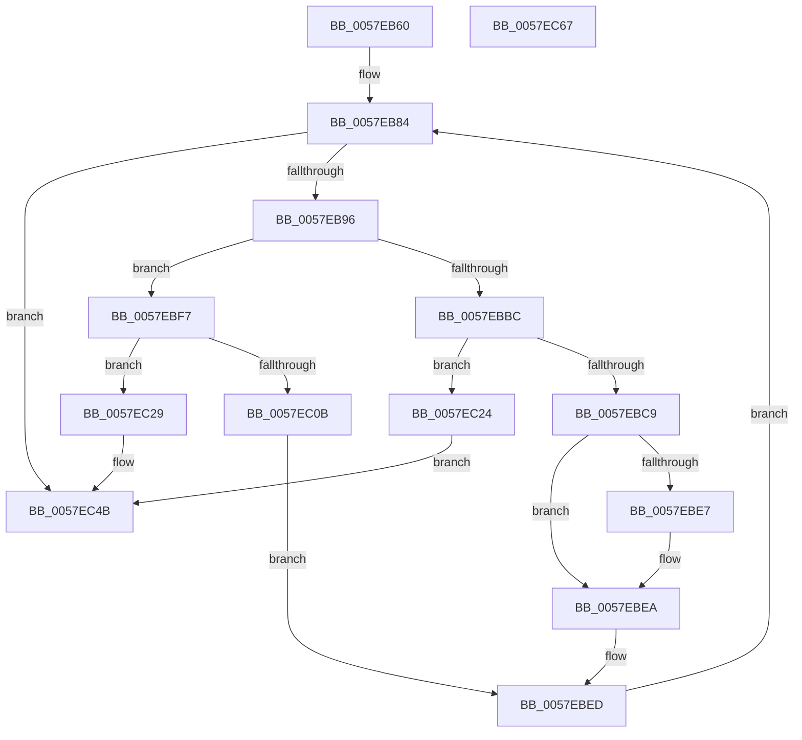

# CcInitializePartitionVacbs

- RVA: `0x0057EB60`–`0x0057EC68` (길이 `264` bytes)
- VA: `0x000000014057EB60`
- 실행 섹션: `.text`
- PDB 이름 있음: `예`; PDB Function 태그: `아니요`
- unwind 정보 RVA: `0x00060300`
- 디코드: `78`개 명령, `264/264` bytes 표시
- 미해석 바이트: `0` (있으면 어셈블리에 `.byte`로 보존)

> 이 문서는 커널 이미지의 기계어와 PDB 기호를 분석해 생성했습니다. 4번과 5번은 함수 원형과 자료형을 바이너리 사용 방식에서 추정한 C 해석이며 원본 소스 복구 결과는 아닙니다.

## 1. Dependencies

- 직접 호출 지점: **13**; 고유 호출 대상: **7**
- 직접 호출자로 확인된 함수: **1**
- RIP 상대 이미지 참조: **2**

### Outgoing calls
- `0x0057EB99` → [KeAcquireQueuedSpinLock](../27/KeAcquireQueuedSpinLock_function_00273D80.md) (function, `0x00273D80`)
- `0x0057EBA5` → [CcGetVacbFromFreeList](../27/CcGetVacbFromFreeList_function_00271630.md) (function, `0x00271630`)
- `0x0057EBB2` → [KeReleaseQueuedSpinLock](../27/KeReleaseQueuedSpinLock_function_00272540.md) (function, `0x00272540`)
- `0x0057EBBC` → [CcAllocateInitializeVacbArray](../4A/CcAllocateInitializeVacbArray_function_004AE2BC.md) (function, `0x004AE2BC`)
- `0x0057EBCC` → [KeAcquireQueuedSpinLock](../27/KeAcquireQueuedSpinLock_function_00273D80.md) (function, `0x00273D80`)
- `0x0057EBDA` → [CcInsertVacbArray](../49/CcInsertVacbArray_function_00495768.md) (function, `0x00495768`)
- `0x0057EBF0` → [KeReleaseQueuedSpinLock](../27/KeReleaseQueuedSpinLock_function_00272540.md) (function, `0x00272540`)
- `0x0057EBFB` → [MmReserveViewInSystemCache](../../page/7F/MmReserveViewInSystemCache_function_007FE368.md) (function, `0x007FE368`)
- `0x0057EC0B` → [KeAcquireQueuedSpinLock](../27/KeAcquireQueuedSpinLock_function_00273D80.md) (function, `0x00273D80`)
- `0x0057EC1B` → [CcSetVacbInFreeList](../26/CcSetVacbInFreeList_function_0026FBB0.md) (function, `0x0026FBB0`)
- `0x0057EC2C` → [KeAcquireQueuedSpinLock](../27/KeAcquireQueuedSpinLock_function_00273D80.md) (function, `0x00273D80`)
- `0x0057EC3C` → [CcSetVacbInFreeList](../26/CcSetVacbInFreeList_function_0026FBB0.md) (function, `0x0026FBB0`)
- `0x0057EC46` → [KeReleaseQueuedSpinLock](../27/KeReleaseQueuedSpinLock_function_00272540.md) (function, `0x00272540`)

### Direct callers
- [CcInitializePartition](CcInitializePartition_function_0057E4D8.md) at `0x0057EA21`

### Static image references
- `0x0057EB84` → RVA `0x00F8F498` (`.data`; read)
- `0x0057EBDF` → RVA `0x00F8F4B4` (`.data`; read)

## 2. Other-region calls and transfers

- 다른 실행 섹션으로 향하는 call: **1**
  - `0x0057EBFB` → [MmReserveViewInSystemCache](../../page/7F/MmReserveViewInSystemCache_function_007FE368.md) (`.text` → `PAGE`)
- 별도 외부 분기/꼬리 이동을 확인하지 못했습니다.

## 3. Assembly (complete function range)

```asm
0057EB60  48 89 5C 24 08                  mov qword ptr [rsp + 8], rbx
0057EB65  48 89 6C 24 10                  mov qword ptr [rsp + 0x10], rbp
0057EB6A  48 89 74 24 18                  mov qword ptr [rsp + 0x18], rsi
0057EB6F  57                              push rdi
0057EB70  41 56                           push r14
0057EB72  41 57                           push r15
0057EB74  48 83 EC 20                     sub rsp, 0x20
0057EB78  BF 01 00 00 00                  mov edi, 1
0057EB7D  48 8B F1                        mov rsi, rcx
0057EB80  44 8D 7F 03                     lea r15d, [rdi + 3]
0057EB84  8B 05 0E 09 A1 00               mov eax, dword ptr [rip + 0xa1090e]
0057EB8A  39 86 E0 04 00 00               cmp dword ptr [rsi + 0x4e0], eax
0057EB90  0F 83 B5 00 00 00               jae 0x14057ec4b
0057EB96  49 8B CF                        mov rcx, r15
0057EB99  E8 E2 51 CF FF                  call 0x140273d80
0057EB9E  33 D2                           xor edx, edx
0057EBA0  48 8B CE                        mov rcx, rsi
0057EBA3  8A D8                           mov bl, al
0057EBA5  E8 86 2A CF FF                  call 0x140271630
0057EBAA  8A D3                           mov dl, bl
0057EBAC  49 8B CF                        mov rcx, r15
0057EBAF  4C 8B F0                        mov r14, rax
0057EBB2  E8 89 39 CF FF                  call 0x140272540
0057EBB7  4D 85 F6                        test r14, r14
0057EBBA  75 3B                           jne 0x14057ebf7
0057EBBC  E8 FB F6 F2 FF                  call 0x1404ae2bc
0057EBC1  48 8B D8                        mov rbx, rax
0057EBC4  48 85 C0                        test rax, rax
0057EBC7  74 5B                           je 0x14057ec24
0057EBC9  49 8B CF                        mov rcx, r15
0057EBCC  E8 AF 51 CF FF                  call 0x140273d80
0057EBD1  48 8B D3                        mov rdx, rbx
0057EBD4  48 8B CE                        mov rcx, rsi
0057EBD7  40 8A E8                        mov bpl, al
0057EBDA  E8 89 6B F1 FF                  call 0x140495768
0057EBDF  39 3D CF 08 A1 00               cmp dword ptr [rip + 0xa108cf], edi
0057EBE5  75 03                           jne 0x14057ebea
0057EBE7  89 7B 04                        mov dword ptr [rbx + 4], edi
0057EBEA  40 8A D5                        mov dl, bpl
0057EBED  49 8B CF                        mov rcx, r15
0057EBF0  E8 4B 39 CF FF                  call 0x140272540
0057EBF5  EB 8D                           jmp 0x14057eb84
0057EBF7  48 8B 4E 08                     mov rcx, qword ptr [rsi + 8]
0057EBFB  E8 68 F7 27 00                  call 0x1407fe368
0057EC00  49 89 06                        mov qword ptr [r14], rax
0057EC03  49 8B CF                        mov rcx, r15
0057EC06  48 85 C0                        test rax, rax
0057EC09  74 1E                           je 0x14057ec29
0057EC0B  E8 70 51 CF FF                  call 0x140273d80
0057EC10  44 8A C7                        mov r8b, dil
0057EC13  49 8B D6                        mov rdx, r14
0057EC16  48 8B CE                        mov rcx, rsi
0057EC19  8A D8                           mov bl, al
0057EC1B  E8 90 0F CF FF                  call 0x14026fbb0
0057EC20  8A D3                           mov dl, bl
0057EC22  EB C9                           jmp 0x14057ebed
0057EC24  40 32 FF                        xor dil, dil
0057EC27  EB 22                           jmp 0x14057ec4b
0057EC29  40 32 FF                        xor dil, dil
0057EC2C  E8 4F 51 CF FF                  call 0x140273d80
0057EC31  45 33 C0                        xor r8d, r8d
0057EC34  49 8B D6                        mov rdx, r14
0057EC37  48 8B CE                        mov rcx, rsi
0057EC3A  8A D8                           mov bl, al
0057EC3C  E8 6F 0F CF FF                  call 0x14026fbb0
0057EC41  8A D3                           mov dl, bl
0057EC43  49 8B CF                        mov rcx, r15
0057EC46  E8 F5 38 CF FF                  call 0x140272540
0057EC4B  48 8B 5C 24 40                  mov rbx, qword ptr [rsp + 0x40]
0057EC50  40 8A C7                        mov al, dil
0057EC53  48 8B 6C 24 48                  mov rbp, qword ptr [rsp + 0x48]
0057EC58  48 8B 74 24 50                  mov rsi, qword ptr [rsp + 0x50]
0057EC5D  48 83 C4 20                     add rsp, 0x20
0057EC61  41 5F                           pop r15
0057EC63  41 5E                           pop r14
0057EC65  5F                              pop rdi
0057EC66  C3                              ret
0057EC67  CC                              int3
```

## 4. C-style interpretation (structured pseudocode)

```c
__int64 __fastcall CcInitializePartitionVacbs(__int64 a1, int a2)
{
    __int64 result;
    __int64 v_rdi;
    __int64 v_rsp;
    unsigned __int64 v_stack_p10;
    unsigned __int64 v_stack_p18;
    unsigned __int64 v_stack_p8;

    v_stack_p8 = v_rbx;
    v_stack_p10 = v_rbp;
    v_stack_p18 = v_rsi;
    v_rsp = (v_rsp) - (32);
loc_0057EB84:
    if ((*(unsigned int *)(a1 + 1248)) >= ((unsigned int)((unsigned int)(*(unsigned int *)(v_rip + 10553614))))) goto loc_0057EC4B;
    result = KeAcquireQueuedSpinLock(1 + 3, a2, a3, a4);
    a2 = 0;
    result = CcGetVacbFromFreeList(a1, a2, a3, a4);
    result = KeReleaseQueuedSpinLock(1 + 3, (unsigned __int8)((unsigned __int8)(result)), a3, a4);
    if (result != 0) goto loc_0057EBF7;
    result = CcAllocateInitializeVacbArray(1 + 3, (unsigned __int8)((unsigned __int8)(result)), a3, a4);
    if (result == 0) goto loc_0057EC24;
    result = KeAcquireQueuedSpinLock(1 + 3, (unsigned __int8)((unsigned __int8)(result)), a3, a4);
    result = CcInsertVacbArray(a1, result, a3, a4);
    if ((*(unsigned int *)(v_rip + 10553551)) == 1) {
        *(unsigned int *)(result + 4) = 1;
    }
loc_0057EBED:
    result = KeReleaseQueuedSpinLock(1 + 3, (unsigned __int8)((unsigned __int8)(result)), a3, a4);
    goto loc_0057EB84;
loc_0057EBF7:
    result = MmReserveViewInSystemCache(*(unsigned __int64 *)(a1 + 8), (unsigned __int8)((unsigned __int8)(result)), a3, a4);
    *(unsigned __int64 *)(result) = result;
    if (result == 0) goto loc_0057EC29;
    result = KeAcquireQueuedSpinLock(1 + 3, (unsigned __int8)((unsigned __int8)(result)), a3, a4);
    result = CcSetVacbInFreeList(a1, result, 1, a4);
    goto loc_0057EBED;
loc_0057EC24:
    v_rdi = 0;
    goto loc_0057EC4B;
loc_0057EC29:
    v_rdi = 0;
    result = KeAcquireQueuedSpinLock(a1, (unsigned __int8)((unsigned __int8)(result)), 1, a4);
    a3 = 0;
    result = CcSetVacbInFreeList(a1, result, a3, a4);
    result = KeReleaseQueuedSpinLock(1 + 3, (unsigned __int8)((unsigned __int8)(result)), a3, a4);
loc_0057EC4B:
    v_rsp = (v_rsp) + (32);
    return 0;
}
```

## 5. (Beta) C Style

```c
int64_t CcInitializePartitionVacbs(void *Arg1, int32_t Arg2)
{
    uint8_t *arg1 = (uint8_t *)Arg1;

    int64_t result;
    int64_t local_rdi;
    int64_t local_rsp;
    uint64_t v_stack_p10;
    uint64_t v_stack_p18;
    uint64_t v_stack_p8;

    v_stack_p8 = local_rbx;
    v_stack_p10 = local_rbp;
    v_stack_p18 = local_rsi;
    local_rsp = (local_rsp) - (32);
loc_0057EB84:
    if ((*(uint32_t *)(arg1 + 0x4E0)) >= ((uint32_t)((uint32_t)(*(uint32_t *)(v_rip + 0xA1090E))))) goto loc_0057EC4B;
    result = KeAcquireQueuedSpinLock(1 + 3, Arg2, a3, a4);
    Arg2 = 0;
    result = CcGetVacbFromFreeList(Arg1, Arg2, a3, a4);
    result = KeReleaseQueuedSpinLock(1 + 3, (uint8_t)((uint8_t)(result)), a3, a4);
    if (result != 0) goto loc_0057EBF7;
    result = CcAllocateInitializeVacbArray(1 + 3, (uint8_t)((uint8_t)(result)), a3, a4);
    if (result == 0) goto loc_0057EC24;
    result = KeAcquireQueuedSpinLock(1 + 3, (uint8_t)((uint8_t)(result)), a3, a4);
    result = CcInsertVacbArray(Arg1, result, a3, a4);
    if ((*(uint32_t *)(v_rip + 0xA108CF)) == 1) {
        *(uint32_t *)(result + 0x4) = 1;
    }
loc_0057EBED:
    result = KeReleaseQueuedSpinLock(1 + 3, (uint8_t)((uint8_t)(result)), a3, a4);
    goto loc_0057EB84;
loc_0057EBF7:
    result = MmReserveViewInSystemCache(*(uint64_t *)(arg1 + 0x8), (uint8_t)((uint8_t)(result)), a3, a4);
    *(uint64_t *)(result) = result;
    if (result == 0) goto loc_0057EC29;
    result = KeAcquireQueuedSpinLock(1 + 3, (uint8_t)((uint8_t)(result)), a3, a4);
    result = CcSetVacbInFreeList(Arg1, result, 1, a4);
    goto loc_0057EBED;
loc_0057EC24:
    local_rdi = 0;
    goto loc_0057EC4B;
loc_0057EC29:
    local_rdi = 0;
    result = KeAcquireQueuedSpinLock(Arg1, (uint8_t)((uint8_t)(result)), 1, a4);
    a3 = 0;
    result = CcSetVacbInFreeList(Arg1, result, a3, a4);
    result = KeReleaseQueuedSpinLock(1 + 3, (uint8_t)((uint8_t)(result)), a3, a4);
loc_0057EC4B:
    local_rsp = (local_rsp) + (32);
    return 0;
}
```

### 관측된 메모리 오프셋

구조체 형식이 확인되지 않은 접근은 인자 기준의 오프셋으로만 기록했습니다.

| 기준 인자 | 오프셋 표현 | 폭 (bit) | 접근 |
|---|---:|---:|---|
| `Arg1` | `+ 0x8` | `64` | `R` |
| `Arg1` | `+ 0x4E0` | `32` | `R` |

## 6. Execution-region graph

[열기: 2D/3D 그래프와 함수 탐색 컨트롤 패널](../../../control-panel.html?section=text&rva=0x0057EB60&view=graph)

- 2D 그래프는 위에서 아래로 흐르고, 3D 그래프는 빈 공간을 드래그해 회전합니다. Shift+드래그는 이동, 휠은 확대·축소, 함수 노드 선택은 대상 보고서 이동입니다.

### Static fallback


