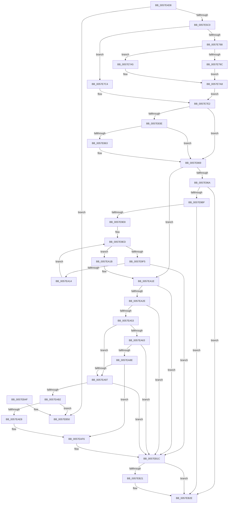

# CcInitializePartition

- RVA: `0x0057E4D8`–`0x0057EB57` (길이 `1,663` bytes)
- VA: `0x000000014057E4D8`
- 실행 섹션: `.text`
- PDB 이름 있음: `예`; PDB Function 태그: `아니요`
- unwind 정보 RVA: `0x000C58A8`
- 디코드: `349`개 명령, `1,663/1,663` bytes 표시
- 미해석 바이트: `0` (있으면 어셈블리에 `.byte`로 보존)

> 이 문서는 커널 이미지의 기계어와 PDB 기호를 분석해 생성했습니다. 4번과 5번은 함수 원형과 자료형을 바이너리 사용 방식에서 추정한 C 해석이며 원본 소스 복구 결과는 아닙니다.

## 1. Dependencies

- 직접 호출 지점: **12**; 고유 호출 대상: **10**
- 직접 호출자로 확인된 함수: **1**
- RIP 상대 이미지 참조: **14**

### Outgoing calls
- `0x0057E516` → [memset](../6C/memset_function_006C6C40.md) (function, `0x006C6C40`)
- `0x0057E735` → [memset](../6C/memset_function_006C6C40.md) (function, `0x006C6C40`)
- `0x0057E843` → [KeQueryActiveProcessorCountEx](../24/KeQueryActiveProcessorCountEx_function_00249EF0.md) (function, `0x00249EF0`)
- `0x0057E9B2` → [PsCreateSystemThread](../../page/9E/PsCreateSystemThread_function_009ED0D0.md) (function, `0x009ED0D0`)
- `0x0057E9D7` → [ExAllocatePoolWithTag](../../poolcode/B8/ExAllocatePoolWithTag_function_00B82010.md) (function, `0x00B82010`)
- `0x0057EA07` → [CcInitializeNumaNode](CcInitializeNumaNode_function_0057F2AC.md) (function, `0x0057F2AC`)
- `0x0057EA21` → [CcInitializePartitionVacbs](CcInitializePartitionVacbs_function_0057EB60.md) (function, `0x0057EB60`)
- `0x0057EA45` → [ExAllocatePoolWithTag](../../poolcode/B8/ExAllocatePoolWithTag_function_00B82010.md) (function, `0x00B82010`)
- `0x0057EA7F` → [CcForEachNumaNode](../3C/CcForEachNumaNode_function_003CF070.md) (function, `0x003CF070`)
- `0x0057EAA8` → [ExAllocatePoolWithTagFromNode](../35/ExAllocatePoolWithTagFromNode_function_0035A944.md) (function, `0x0035A944`)
- `0x0057EB17` → [DbgPrintEx](../35/DbgPrintEx_function_00359290.md) (function, `0x00359290`)
- `0x0057EB29` → [ExFreePoolWithTag](../../poolcode/B8/ExFreePoolWithTag_function_00B82870.md) (function, `0x00B82870`)

### Direct callers
- [CcCreatePartition](CcCreatePartition_function_0057DE10.md) at `0x0057DE6D`

### Static image references
- `0x0057E767` → RVA `0x00E30088` (`.data`; read)
- `0x0057E771` → RVA `0x00FC521C` (`ALMOSTRO`; read)
- `0x0057E78E` → RVA `0x00E65B90` (`.data`; read)
- `0x0057E7BA` → RVA `0x00EFAAA8` (`.data`; read)
- `0x0057E815` → RVA `0x00F8F524` (`.data`; read)
- `0x0057E835` → RVA `0x00E65B58` (`.data`; read)
- `0x0057E898` → RVA `0x00E65B88` (`.data`; read)
- `0x0057E8BA` → RVA `0x0057DCD0` (`CcProcessDelayedDeletePVCM`; read)
- `0x0057E921` → RVA `0x0057DC80` (`CcPVCMDelayedDeleteTimerDpc`; read)
- `0x0057E971` → RVA `0x0057BBD0` (`CcQueueLazyWriteScanThread`; read)
- `0x0057E9BF` → RVA `0x00E0A874` (`.data`; read)
- `0x0057EA78` → RVA `0x00498CD0` (`CcInitializeAsyncReadForNodeHelper`; read)
- `0x0057EAB6` → RVA `0x003CF320` (`CcReapPrivateVolumeCachemapWorkerThread`; read)
- `0x0057EB03` → RVA `0x006C8CC0` (` ?? ::FNODOBFM::`string'`; read)

## 2. Other-region calls and transfers

- 다른 실행 섹션으로 향하는 call: **4**
  - `0x0057E9B2` → [PsCreateSystemThread](../../page/9E/PsCreateSystemThread_function_009ED0D0.md) (`.text` → `PAGE`)
  - `0x0057E9D7` → [ExAllocatePoolWithTag](../../poolcode/B8/ExAllocatePoolWithTag_function_00B82010.md) (`.text` → `POOLCODE`)
  - `0x0057EA45` → [ExAllocatePoolWithTag](../../poolcode/B8/ExAllocatePoolWithTag_function_00B82010.md) (`.text` → `POOLCODE`)
  - `0x0057EB29` → [ExFreePoolWithTag](../../poolcode/B8/ExFreePoolWithTag_function_00B82870.md) (`.text` → `POOLCODE`)
- 별도 외부 분기/꼬리 이동을 확인하지 못했습니다.

## 3. Assembly (complete function range)

```asm
0057E4D8  48 89 5C 24 10                  mov qword ptr [rsp + 0x10], rbx
0057E4DD  48 89 74 24 18                  mov qword ptr [rsp + 0x18], rsi
0057E4E2  48 89 7C 24 20                  mov qword ptr [rsp + 0x20], rdi
0057E4E7  55                              push rbp
0057E4E8  41 54                           push r12
0057E4EA  41 55                           push r13
0057E4EC  41 56                           push r14
0057E4EE  41 57                           push r15
0057E4F0  48 8B EC                        mov rbp, rsp
0057E4F3  48 83 EC 70                     sub rsp, 0x70
0057E4F7  45 33 FF                        xor r15d, r15d
0057E4FA  4C 8B EA                        mov r13, rdx
0057E4FD  33 D2                           xor edx, edx
0057E4FF  44 89 7D D4                     mov dword ptr [rbp - 0x2c], r15d
0057E503  41 B8 40 06 00 00               mov r8d, 0x640
0057E509  44 89 7D EC                     mov dword ptr [rbp - 0x14], r15d
0057E50D  45 8A E7                        mov r12b, r15b
0057E510  45 8B F7                        mov r14d, r15d
0057E513  48 8B F9                        mov rdi, rcx
0057E516  E8 25 87 14 00                  call 0x1406c6c40
0057E51B  C7 07 F7 02 40 06               mov dword ptr [rdi], 0x64002f7
0057E521  48 8D 47 10                     lea rax, [rdi + 0x10]
0057E525  4C 89 6F 08                     mov qword ptr [rdi + 8], r13
0057E529  48 8D 77 60                     lea rsi, [rdi + 0x60]
0057E52D  45 8D 47 01                     lea r8d, [r15 + 1]
0057E531  41 B9 00 08 00 00               mov r9d, 0x800
0057E537  4C 89 87 10 05 00 00            mov qword ptr [rdi + 0x510], r8
0057E53E  48 8D 97 B8 02 00 00            lea rdx, [rdi + 0x2b8]
0057E545  48 89 40 08                     mov qword ptr [rax + 8], rax
0057E549  48 89 00                        mov qword ptr [rax], rax
0057E54C  48 8D 47 20                     lea rax, [rdi + 0x20]
0057E550  48 89 40 08                     mov qword ptr [rax + 8], rax
0057E554  48 89 00                        mov qword ptr [rax], rax
0057E557  48 8D 47 50                     lea rax, [rdi + 0x50]
0057E55B  48 89 40 08                     mov qword ptr [rax + 8], rax
0057E55F  48 89 00                        mov qword ptr [rax], rax
0057E562  48 8D 47 70                     lea rax, [rdi + 0x70]
0057E566  48 89 76 08                     mov qword ptr [rsi + 8], rsi
0057E56A  48 89 36                        mov qword ptr [rsi], rsi
0057E56D  48 89 40 08                     mov qword ptr [rax + 8], rax
0057E571  48 89 00                        mov qword ptr [rax], rax
0057E574  48 8D 87 90 02 00 00            lea rax, [rdi + 0x290]
0057E57B  48 89 40 08                     mov qword ptr [rax + 8], rax
0057E57F  48 89 00                        mov qword ptr [rax], rax
0057E582  48 8D 87 80 02 00 00            lea rax, [rdi + 0x280]
0057E589  48 89 40 08                     mov qword ptr [rax + 8], rax
0057E58D  48 89 00                        mov qword ptr [rax], rax
0057E590  48 8D 87 D0 02 00 00            lea rax, [rdi + 0x2d0]
0057E597  48 89 40 08                     mov qword ptr [rax + 8], rax
0057E59B  48 89 00                        mov qword ptr [rax], rax
0057E59E  48 8D 87 A0 02 00 00            lea rax, [rdi + 0x2a0]
0057E5A5  48 89 40 08                     mov qword ptr [rax + 8], rax
0057E5A9  48 89 00                        mov qword ptr [rax], rax
0057E5AC  44 89 8F B0 02 00 00            mov dword ptr [rdi + 0x2b0], r9d
0057E5B3  48 8B 48 08                     mov rcx, qword ptr [rax + 8]
0057E5B7  48 39 01                        cmp qword ptr [rcx], rax
0057E5BA  0F 85 90 05 00 00               jne 0x14057eb50
0057E5C0  48 89 02                        mov qword ptr [rdx], rax
0057E5C3  48 8D 9F D8 03 00 00            lea rbx, [rdi + 0x3d8]
0057E5CA  48 89 4A 08                     mov qword ptr [rdx + 8], rcx
0057E5CE  0F 57 C0                        xorps xmm0, xmm0
0057E5D1  48 89 11                        mov qword ptr [rcx], rdx
0057E5D4  48 8B CB                        mov rcx, rbx
0057E5D7  48 89 50 08                     mov qword ptr [rax + 8], rdx
0057E5DB  48 8D 87 50 03 00 00            lea rax, [rdi + 0x350]
0057E5E2  44 89 8F C8 02 00 00            mov dword ptr [rdi + 0x2c8], r9d
0057E5E9  33 D2                           xor edx, edx
0057E5EB  4C 89 BF 00 03 00 00            mov qword ptr [rdi + 0x300], r15
0057E5F2  4C 89 BF 40 03 00 00            mov qword ptr [rdi + 0x340], r15
0057E5F9  48 89 40 08                     mov qword ptr [rax + 8], rax
0057E5FD  48 89 00                        mov qword ptr [rax], rax
0057E600  48 8D 87 78 03 00 00            lea rax, [rdi + 0x378]
0057E607  66 44 89 87 70 03 00 00         mov word ptr [rdi + 0x370], r8w
0057E60F  C6 87 72 03 00 00 06            mov byte ptr [rdi + 0x372], 6
0057E616  44 89 BF 74 03 00 00            mov dword ptr [rdi + 0x374], r15d
0057E61D  48 89 40 08                     mov qword ptr [rax + 8], rax
0057E621  48 89 00                        mov qword ptr [rax], rax
0057E624  48 8D 87 90 03 00 00            lea rax, [rdi + 0x390]
0057E62B  66 44 89 87 88 03 00 00         mov word ptr [rdi + 0x388], r8w
0057E633  C6 87 8A 03 00 00 06            mov byte ptr [rdi + 0x38a], 6
0057E63A  44 89 BF 8C 03 00 00            mov dword ptr [rdi + 0x38c], r15d
0057E641  48 89 40 08                     mov qword ptr [rax + 8], rax
0057E645  48 89 00                        mov qword ptr [rax], rax
0057E648  48 8D 87 A8 03 00 00            lea rax, [rdi + 0x3a8]
0057E64F  66 44 89 87 A0 03 00 00         mov word ptr [rdi + 0x3a0], r8w
0057E657  C6 87 A2 03 00 00 06            mov byte ptr [rdi + 0x3a2], 6
0057E65E  44 89 BF A4 03 00 00            mov dword ptr [rdi + 0x3a4], r15d
0057E665  48 89 40 08                     mov qword ptr [rax + 8], rax
0057E669  48 89 00                        mov qword ptr [rax], rax
0057E66C  48 8D 87 C0 03 00 00            lea rax, [rdi + 0x3c0]
0057E673  66 44 89 87 B8 03 00 00         mov word ptr [rdi + 0x3b8], r8w
0057E67B  C6 87 BA 03 00 00 06            mov byte ptr [rdi + 0x3ba], 6
0057E682  44 89 BF BC 03 00 00            mov dword ptr [rdi + 0x3bc], r15d
0057E689  48 89 40 08                     mov qword ptr [rax + 8], rax
0057E68D  48 89 00                        mov qword ptr [rax], rax
0057E690  48 8D 87 20 05 00 00            lea rax, [rdi + 0x520]
0057E697  66 44 89 BF 18 05 00 00         mov word ptr [rdi + 0x518], r15w
0057E69F  C6 87 1A 05 00 00 06            mov byte ptr [rdi + 0x51a], 6
0057E6A6  44 89 BF 1C 05 00 00            mov dword ptr [rdi + 0x51c], r15d
0057E6AD  48 89 40 08                     mov qword ptr [rax + 8], rax
0057E6B1  48 89 00                        mov qword ptr [rax], rax
0057E6B4  48 8D 87 38 05 00 00            lea rax, [rdi + 0x538]
0057E6BB  66 44 89 BF 30 05 00 00         mov word ptr [rdi + 0x530], r15w
0057E6C3  C6 87 32 05 00 00 06            mov byte ptr [rdi + 0x532], 6
0057E6CA  44 89 BF 34 05 00 00            mov dword ptr [rdi + 0x534], r15d
0057E6D1  48 89 40 08                     mov qword ptr [rax + 8], rax
0057E6D5  48 89 00                        mov qword ptr [rax], rax
0057E6D8  48 8D 47 40                     lea rax, [rdi + 0x40]
0057E6DC  66 44 89 7F 38                  mov word ptr [rdi + 0x38], r15w
0057E6E1  C6 47 3A 06                     mov byte ptr [rdi + 0x3a], 6
0057E6E5  44 89 7F 3C                     mov dword ptr [rdi + 0x3c], r15d
0057E6E9  48 89 40 08                     mov qword ptr [rax + 8], rax
0057E6ED  48 89 00                        mov qword ptr [rax], rax
0057E6F0  33 C0                           xor eax, eax
0057E6F2  0F 11 87 20 04 00 00            movups xmmword ptr [rdi + 0x420], xmm0
0057E6F9  48 89 87 30 04 00 00            mov qword ptr [rdi + 0x430], rax
0057E700  0F 11 87 38 04 00 00            movups xmmword ptr [rdi + 0x438], xmm0
0057E707  0F 11 87 48 04 00 00            movups xmmword ptr [rdi + 0x448], xmm0
0057E70E  0F 11 87 58 04 00 00            movups xmmword ptr [rdi + 0x458], xmm0
0057E715  48 89 87 68 04 00 00            mov qword ptr [rdi + 0x468], rax
0057E71C  0F 11 87 50 05 00 00            movups xmmword ptr [rdi + 0x550], xmm0
0057E723  44 89 87 50 05 00 00            mov dword ptr [rdi + 0x550], r8d
0057E72A  45 8D 47 48                     lea r8d, [r15 + 0x48]
0057E72E  48 89 BF 58 05 00 00            mov qword ptr [rdi + 0x558], rdi
0057E735  E8 06 85 14 00                  call 0x1406c6c40
0057E73A  C6 03 09                        mov byte ptr [rbx], 9
0057E73D  48 8D 43 08                     lea rax, [rbx + 8]
0057E741  44 89 7B 04                     mov dword ptr [rbx + 4], r15d
0057E745  48 89 40 08                     mov qword ptr [rax + 8], rax
0057E749  48 89 00                        mov qword ptr [rax], rax
0057E74C  4C 89 7B 18                     mov qword ptr [rbx + 0x18], r15
0057E750  44 89 7B 3C                     mov dword ptr [rbx + 0x3c], r15d
0057E754  66 44 89 7B 38                  mov word ptr [rbx + 0x38], r15w
0057E759  48 8B 47 08                     mov rax, qword ptr [rdi + 8]
0057E75D  C6 87 18 04 00 00 01            mov byte ptr [rdi + 0x418], 1
0057E764  48 8B 08                        mov rcx, qword ptr [rax]
0057E767  48 8B 05 1A 19 8B 00            mov rax, qword ptr [rip + 0x8b191a]
0057E76E  0F B7 09                        movzx ecx, word ptr [rcx]
0057E771  44 38 3D A4 6A A4 00            cmp byte ptr [rip + 0xa46aa4], r15b
0057E778  48 8B 0C C8                     mov rcx, qword ptr [rax + rcx*8]
0057E77C  48 8B 91 50 48 00 00            mov rdx, qword ptr [rcx + 0x4850]
0057E783  48 8B C2                        mov rax, rdx
0057E786  74 3C                           je 0x14057e7c4
0057E788  48 D1 E8                        shr rax, 1
0057E78B  4C 8B CF                        mov r9, rdi
0057E78E  83 3D FB 73 8E 00 02            cmp dword ptr [rip + 0x8e73fb], 2
0057E795  B9 40 04 00 00                  mov ecx, 0x440
0057E79A  72 09                           jb 0x14057e7a5
0057E79C  4C 8B C2                        mov r8, rdx
0057E79F  49 C1 E8 03                     shr r8, 3
0057E7A3  EB 03                           jmp 0x14057e7a8
0057E7A5  4C 8B C0                        mov r8, rax
0057E7A8  49 89 04 09                     mov qword ptr [r9 + rcx], rax
0057E7AC  4C 89 87 48 04 00 00            mov qword ptr [rdi + 0x448], r8
0057E7B3  48 89 87 38 04 00 00            mov qword ptr [rdi + 0x438], rax
0057E7BA  8B 05 E8 C2 97 00               mov eax, dword ptr [rip + 0x97c2e8]
0057E7C0  FF C8                           dec eax
0057E7C2  EB 1E                           jmp 0x14057e7e2
0057E7C4  48 C1 E8 03                     shr rax, 3
0057E7C8  48 89 87 38 04 00 00            mov qword ptr [rdi + 0x438], rax
0057E7CF  48 89 87 48 04 00 00            mov qword ptr [rdi + 0x448], rax
0057E7D6  48 89 87 40 04 00 00            mov qword ptr [rdi + 0x440], rax
0057E7DD  B8 01 00 00 00                  mov eax, 1
0057E7E2  89 87 60 03 00 00               mov dword ptr [rdi + 0x360], eax
0057E7E8  48 8D 04 92                     lea rax, [rdx + rdx*4]
0057E7EC  48 03 C0                        add rax, rax
0057E7EF  C7 87 68 04 00 00 0A 00 00 00   mov dword ptr [rdi + 0x468], 0xa
0057E7F9  48 89 87 58 04 00 00            mov qword ptr [rdi + 0x458], rax
0057E800  8B 05 A2 C2 97 00               mov eax, dword ptr [rip + 0x97c2a2]
0057E806  FF C8                           dec eax
0057E808  4C 89 BF 60 04 00 00            mov qword ptr [rdi + 0x460], r15
0057E80F  89 87 48 03 00 00               mov dword ptr [rdi + 0x348], eax
0057E815  8B 05 09 0D A1 00               mov eax, dword ptr [rip + 0xa10d09]
0057E81B  89 87 64 03 00 00               mov dword ptr [rdi + 0x364], eax
0057E821  48 8B 87 38 04 00 00            mov rax, qword ptr [rdi + 0x438]
0057E828  48 8B D8                        mov rbx, rax
0057E82B  48 D1 E8                        shr rax, 1
0057E82E  48 C1 EB 02                     shr rbx, 2
0057E832  48 03 D8                        add rbx, rax
0057E835  44 39 3D 1C 73 8E 00            cmp dword ptr [rip + 0x8e731c], r15d
0057E83C  74 2B                           je 0x14057e869
0057E83E  B9 FF FF 00 00                  mov ecx, 0xffff
0057E843  E8 A8 B6 CC FF                  call 0x140249ef0
0057E848  8B C8                           mov ecx, eax
0057E84A  B8 1F 85 EB 51                  mov eax, 0x51eb851f
0057E84F  0F AF 0D 02 73 8E 00            imul ecx, dword ptr [rip + 0x8e7302]
0057E856  F7 E1                           mul ecx
0057E858  C1 EA 05                        shr edx, 5
0057E85B  39 97 48 03 00 00               cmp dword ptr [rdi + 0x348], edx
0057E861  73 06                           jae 0x14057e869
0057E863  89 97 48 03 00 00               mov dword ptr [rdi + 0x348], edx
0057E869  44 88 BF 0E 05 00 00            mov byte ptr [rdi + 0x50e], r15b
0057E870  48 8D 87 90 04 00 00            lea rax, [rdi + 0x490]
0057E877  44 89 BF 08 03 00 00            mov dword ptr [rdi + 0x308], r15d
0057E87E  B9 FF FF FF FF                  mov ecx, 0xffffffff
0057E883  44 88 BF 0C 03 00 00            mov byte ptr [rdi + 0x30c], r15b
0057E88A  48 3B D9                        cmp rbx, rcx
0057E88D  4C 89 BF C0 04 00 00            mov qword ptr [rdi + 0x4c0], r15
0057E894  48 0F 47 D9                     cmova rbx, rcx
0057E898  44 38 3D E9 72 8E 00            cmp byte ptr [rip + 0x8e72e9], r15b
0057E89F  89 9F 50 04 00 00               mov dword ptr [rdi + 0x450], ebx
0057E8A5  48 89 40 08                     mov qword ptr [rax + 8], rax
0057E8A9  48 89 00                        mov qword ptr [rax], rax
0057E8AC  48 8D 87 D0 04 00 00            lea rax, [rdi + 0x4d0]
0057E8B3  48 89 40 08                     mov qword ptr [rax + 8], rax
0057E8B7  48 89 00                        mov qword ptr [rax], rax
0057E8BA  48 8D 05 0F F4 FF FF            lea rax, [rip - 0xbf1]
0057E8C1  4C 89 BF E8 04 00 00            mov qword ptr [rdi + 0x4e8], r15
0057E8C8  4C 89 BF F0 04 00 00            mov qword ptr [rdi + 0x4f0], r15
0057E8CF  C7 87 F8 04 00 00 20 00 00 00   mov dword ptr [rdi + 0x4f8], 0x20
0057E8D9  C7 87 FC 04 00 00 05 00 00 00   mov dword ptr [rdi + 0x4fc], 5
0057E8E3  89 8F 08 05 00 00               mov dword ptr [rdi + 0x508], ecx
0057E8E9  4C 89 BF 00 05 00 00            mov qword ptr [rdi + 0x500], r15
0057E8F0  48 89 87 F8 05 00 00            mov qword ptr [rdi + 0x5f8], rax
0057E8F7  48 8D 87 68 05 00 00            lea rax, [rdi + 0x568]
0057E8FE  48 89 BF 00 06 00 00            mov qword ptr [rdi + 0x600], rdi
0057E905  4C 89 BF E8 05 00 00            mov qword ptr [rdi + 0x5e8], r15
0057E90C  4C 89 BF 60 05 00 00            mov qword ptr [rdi + 0x560], r15
0057E913  C6 87 60 05 00 00 08            mov byte ptr [rdi + 0x560], 8
0057E91A  48 89 40 08                     mov qword ptr [rax + 8], rax
0057E91E  48 89 00                        mov qword ptr [rax], rax
0057E921  48 8D 05 58 F3 FF FF            lea rax, [rip - 0xca8]
0057E928  4C 89 BF 78 05 00 00            mov qword ptr [rdi + 0x578], r15
0057E92F  44 89 BF 9C 05 00 00            mov dword ptr [rdi + 0x59c], r15d
0057E936  66 44 89 BF 98 05 00 00         mov word ptr [rdi + 0x598], r15w
0057E93E  48 89 87 B8 05 00 00            mov qword ptr [rdi + 0x5b8], rax
0057E945  C7 87 A0 05 00 00 13 01 00 00   mov dword ptr [rdi + 0x5a0], 0x113
0057E94F  48 89 BF C0 05 00 00            mov qword ptr [rdi + 0x5c0], rdi
0057E956  4C 89 BF D8 05 00 00            mov qword ptr [rdi + 0x5d8], r15
0057E95D  4C 89 BF B0 05 00 00            mov qword ptr [rdi + 0x5b0], r15
0057E964  0F 85 B4 00 00 00               jne 0x14057ea1e
0057E96A  4D 8B 8D 80 00 00 00            mov r9, qword ptr [r13 + 0x80]
0057E971  48 8D 05 58 D2 FF FF            lea rax, [rip - 0x2da8]
0057E978  0F 57 C0                        xorps xmm0, xmm0
0057E97B  48 89 7C 24 30                  mov qword ptr [rsp + 0x30], rdi
0057E980  48 89 44 24 28                  mov qword ptr [rsp + 0x28], rax
0057E985  48 8D 8F 48 05 00 00            lea rcx, [rdi + 0x548]
0057E98C  4C 8D 45 D0                     lea r8, [rbp - 0x30]
0057E990  4C 89 7C 24 20                  mov qword ptr [rsp + 0x20], r15
0057E995  BA FF FF 1F 00                  mov edx, 0x1fffff
0057E99A  C7 45 D0 30 00 00 00            mov dword ptr [rbp - 0x30], 0x30
0057E9A1  4C 89 7D D8                     mov qword ptr [rbp - 0x28], r15
0057E9A5  44 89 7D E8                     mov dword ptr [rbp - 0x18], r15d
0057E9A9  4C 89 7D E0                     mov qword ptr [rbp - 0x20], r15
0057E9AD  F3 0F 7F 45 F0                  movdqu xmmword ptr [rbp - 0x10], xmm0
0057E9B2  E8 19 E7 46 00                  call 0x1409ed0d0
0057E9B7  85 C0                           test eax, eax
0057E9B9  0F 88 6F 01 00 00               js 0x14057eb2e
0057E9BF  8B 05 AF BE 88 00               mov eax, dword ptr [rip + 0x88beaf]
0057E9C5  B9 00 06 00 00                  mov ecx, 0x600
0057E9CA  48 69 D0 90 01 00 00            imul rdx, rax, 0x190
0057E9D1  41 B8 43 63 4E 75               mov r8d, 0x754e6343
0057E9D7  E8 34 36 60 00                  call 0x140b82010
0057E9DC  4C 8B F8                        mov r15, rax
0057E9DF  48 85 C0                        test rax, rax
0057E9E2  0F 84 46 01 00 00               je 0x14057eb2e
0057E9E8  4C 8B F0                        mov r14, rax
0057E9EB  33 DB                           xor ebx, ebx
0057E9ED  3B 1D 81 BE 88 00               cmp ebx, dword ptr [rip + 0x88be81]
0057E9F3  73 26                           jae 0x14057ea1b
0057E9F5  8B C3                           mov eax, ebx
0057E9F7  44 8B CB                        mov r9d, ebx
0057E9FA  48 69 D0 90 01 00 00            imul rdx, rax, 0x190
0057EA01  48 8B CF                        mov rcx, rdi
0057EA04  49 03 D7                        add rdx, r15
0057EA07  E8 A0 08 00 00                  call 0x14057f2ac
0057EA0C  84 C0                           test al, al
0057EA0E  0F 84 08 01 00 00               je 0x14057eb1c
0057EA14  FF C3                           inc ebx
0057EA16  45 33 F6                        xor r14d, r14d
0057EA19  EB D2                           jmp 0x14057e9ed
0057EA1B  45 33 FF                        xor r15d, r15d
0057EA1E  48 8B CF                        mov rcx, rdi
0057EA21  E8 3A 01 00 00                  call 0x14057eb60
0057EA26  84 C0                           test al, al
0057EA28  0F 84 EE 00 00 00               je 0x14057eb1c
0057EA2E  8B 97 60 03 00 00               mov edx, dword ptr [rdi + 0x360]
0057EA34  B9 00 06 00 00                  mov ecx, 0x600
0057EA39  FF C2                           inc edx
0057EA3B  41 B8 43 63 54 70               mov r8d, 0x70546343
0057EA41  48 C1 E2 03                     shl rdx, 3
0057EA45  E8 C6 35 60 00                  call 0x140b82010
0057EA4A  48 85 C0                        test rax, rax
0057EA4D  0F 84 C9 00 00 00               je 0x14057eb1c
0057EA53  44 38 3D 2E 71 8E 00            cmp byte ptr [rip + 0x8e712e], r15b
0057EA5A  48 89 87 70 04 00 00            mov qword ptr [rdi + 0x470], rax
0057EA61  75 34                           jne 0x14057ea97
0057EA63  4C 8D 4D 30                     lea r9, [rbp + 0x30]
0057EA67  4C 89 BF C8 04 00 00            mov qword ptr [rdi + 0x4c8], r15
0057EA6E  45 33 C0                        xor r8d, r8d
0057EA71  C6 45 30 01                     mov byte ptr [rbp + 0x30], 1
0057EA75  48 8B D7                        mov rdx, rdi
0057EA78  48 8D 0D 51 A2 F1 FF            lea rcx, [rip - 0xe5daf]
0057EA7F  E8 EC 05 E5 FF                  call 0x1403cf070
0057EA84  44 38 7D 30                     cmp byte ptr [rbp + 0x30], r15b
0057EA88  0F 84 8E 00 00 00               je 0x14057eb1c
0057EA8E  44 38 3D F3 70 8E 00            cmp byte ptr [rip + 0x8e70f3], r15b
0057EA95  74 5F                           je 0x14057eaf6
0057EA97  BA 50 00 00 00                  mov edx, 0x50
0057EA9C  41 B9 00 00 00 80               mov r9d, 0x80000000
0057EAA2  41 B8 43 63 57 71               mov r8d, 0x71576343
0057EAA8  E8 97 BE DD FF                  call 0x14035a944
0057EAAD  48 85 C0                        test rax, rax
0057EAB0  74 6A                           je 0x14057eb1c
0057EAB2  83 48 24 FF                     or dword ptr [rax + 0x24], 0xffffffff
0057EAB6  48 8D 0D 63 08 E5 FF            lea rcx, [rip - 0x1af79d]
0057EABD  C7 40 20 09 00 00 00            mov dword ptr [rax + 0x20], 9
0057EAC4  48 89 78 38                     mov qword ptr [rax + 0x38], rdi
0057EAC8  4C 89 78 40                     mov qword ptr [rax + 0x40], r15
0057EACC  4C 89 78 48                     mov qword ptr [rax + 0x48], r15
0057EAD0  44 89 78 28                     mov dword ptr [rax + 0x28], r15d
0057EAD4  48 89 48 10                     mov qword ptr [rax + 0x10], rcx
0057EAD8  48 89 40 18                     mov qword ptr [rax + 0x18], rax
0057EADC  4C 89 38                        mov qword ptr [rax], r15
0057EADF  48 8B 4E 08                     mov rcx, qword ptr [rsi + 8]
0057EAE3  48 39 31                        cmp qword ptr [rcx], rsi
0057EAE6  75 68                           jne 0x14057eb50
0057EAE8  48 89 30                        mov qword ptr [rax], rsi
0057EAEB  48 89 48 08                     mov qword ptr [rax + 8], rcx
0057EAEF  48 89 01                        mov qword ptr [rcx], rax
0057EAF2  48 89 46 08                     mov qword ptr [rsi + 8], rax
0057EAF6  BA 02 00 00 00                  mov edx, 2
0057EAFB  4C 89 6C 24 20                  mov qword ptr [rsp + 0x20], r13
0057EB00  41 B4 01                        mov r12b, 1
0057EB03  4C 8D 05 B6 A1 14 00            lea r8, [rip + 0x14a1b6]
0057EB0A  4C 8B CF                        mov r9, rdi
0057EB0D  44 88 A7 54 05 00 00            mov byte ptr [rdi + 0x554], r12b
0057EB14  8D 4A 7D                        lea ecx, [rdx + 0x7d]
0057EB17  E8 74 A7 DD FF                  call 0x140359290
0057EB1C  4D 85 F6                        test r14, r14
0057EB1F  74 0D                           je 0x14057eb2e
0057EB21  BA 43 63 4E 75                  mov edx, 0x754e6343
0057EB26  49 8B CE                        mov rcx, r14
0057EB29  E8 42 3D 60 00                  call 0x140b82870
0057EB2E  4C 8D 5C 24 70                  lea r11, [rsp + 0x70]
0057EB33  41 8A C4                        mov al, r12b
0057EB36  49 8B 5B 38                     mov rbx, qword ptr [r11 + 0x38]
0057EB3A  49 8B 73 40                     mov rsi, qword ptr [r11 + 0x40]
0057EB3E  49 8B 7B 48                     mov rdi, qword ptr [r11 + 0x48]
0057EB42  49 8B E3                        mov rsp, r11
0057EB45  41 5F                           pop r15
0057EB47  41 5E                           pop r14
0057EB49  41 5D                           pop r13
0057EB4B  41 5C                           pop r12
0057EB4D  5D                              pop rbp
0057EB4E  C3                              ret
0057EB4F  CC                              int3
0057EB50  B9 03 00 00 00                  mov ecx, 3
0057EB55  CD 29                           int 0x29
```

## 4. C-style interpretation (structured pseudocode)

```c
__int64 __fastcall CcInitializePartition(__int64 a1, __int64 a2)
{
    __int64 result;
    __int64 v_r14;
    __int64 v_r15;
    __int64 v_rbx;
    __int64 v_rsp;
    unsigned __int64 v_stack_m28;
    unsigned __int64 v_stack_m38;
    unsigned int v_stack_m3C;
    unsigned int v_stack_m40;
    unsigned __int64 v_stack_m48;
    unsigned __int64 v_stack_m50;
    unsigned int v_stack_m54;
    unsigned __int64 v_stack_m58;
    unsigned __int64 v_stack_m68;
    unsigned __int64 v_stack_m70;
    unsigned __int64 v_stack_m78;
    unsigned __int64 v_stack_p10;
    unsigned __int64 v_stack_p18;
    unsigned __int64 v_stack_p20;
    unsigned __int64 v_stack_p8;

    v_stack_p10 = v_rbx;
    v_stack_p18 = v_rsi;
    v_stack_p20 = v_rdi;
    v_rsp = (v_rsp) - (112);
    v_r15 = 0;
    a2 = 0;
    v_stack_m54 = 0;
    v_stack_m3C = 0;
    result = memset(a1, a2, (unsigned int)(0x640ULL), a4);
    *(unsigned int *)(a1) = 0x64002F7ULL;
    *(unsigned __int64 *)(a1 + 8) = 0;
    *(unsigned __int64 *)(a1 + 1296) = v_r15 + 1;
    *(unsigned __int64 *)(a1 + 16 + 8) = a1 + 16;
    *(unsigned __int64 *)(a1 + 16) = a1 + 16;
    *(unsigned __int64 *)(a1 + 32 + 8) = a1 + 32;
    *(unsigned __int64 *)(a1 + 32) = a1 + 32;
    *(unsigned __int64 *)(a1 + 80 + 8) = a1 + 80;
    *(unsigned __int64 *)(a1 + 80) = a1 + 80;
    *(unsigned __int64 *)(a1 + 96 + 8) = a1 + 96;
    *(unsigned __int64 *)(a1 + 96) = a1 + 96;
    *(unsigned __int64 *)(a1 + 112 + 8) = a1 + 112;
    *(unsigned __int64 *)(a1 + 112) = a1 + 112;
    *(unsigned __int64 *)(a1 + 656 + 8) = a1 + 656;
    *(unsigned __int64 *)(a1 + 656) = a1 + 656;
    *(unsigned __int64 *)(a1 + 640 + 8) = a1 + 640;
    *(unsigned __int64 *)(a1 + 640) = a1 + 640;
    *(unsigned __int64 *)(a1 + 720 + 8) = a1 + 720;
    *(unsigned __int64 *)(a1 + 720) = a1 + 720;
    *(unsigned __int64 *)(a1 + 672 + 8) = a1 + 672;
    *(unsigned __int64 *)(a1 + 672) = a1 + 672;
    *(unsigned int *)(a1 + 688) = (unsigned int)((unsigned int)(0x800ULL));
    if ((*(unsigned __int64 *)(*(unsigned __int64 *)(a1 + 672 + 8))) != (a1 + 672)) goto loc_0057EB50;
    *(unsigned __int64 *)(a1 + 696) = a1 + 672;
    *(unsigned __int64 *)(a1 + 696 + 8) = *(unsigned __int64 *)(a1 + 672 + 8);
    *(unsigned __int64 *)(*(unsigned __int64 *)(a1 + 672 + 8)) = a1 + 696;
    *(unsigned __int64 *)(a1 + 672 + 8) = a1 + 696;
    *(unsigned int *)(a1 + 712) = (unsigned int)((unsigned int)(0x800ULL));
    a2 = 0;
    *(unsigned __int64 *)(a1 + 768) = 0;
    *(unsigned __int64 *)(a1 + 832) = 0;
    *(unsigned __int64 *)(a1 + 848 + 8) = a1 + 848;
    *(unsigned __int64 *)(a1 + 848) = a1 + 848;
    *(unsigned __int16 *)(a1 + 880) = (unsigned __int16)(v_r15 + 1);
    *(unsigned __int8 *)(a1 + 882) = 6;
    *(unsigned int *)(a1 + 884) = 0;
    *(unsigned __int64 *)(a1 + 888 + 8) = a1 + 888;
    *(unsigned __int64 *)(a1 + 888) = a1 + 888;
    *(unsigned __int16 *)(a1 + 904) = (unsigned __int16)(v_r15 + 1);
    *(unsigned __int8 *)(a1 + 906) = 6;
    *(unsigned int *)(a1 + 908) = 0;
    *(unsigned __int64 *)(a1 + 912 + 8) = a1 + 912;
    *(unsigned __int64 *)(a1 + 912) = a1 + 912;
    *(unsigned __int16 *)(a1 + 928) = (unsigned __int16)(v_r15 + 1);
    *(unsigned __int8 *)(a1 + 930) = 6;
    *(unsigned int *)(a1 + 932) = 0;
    *(unsigned __int64 *)(a1 + 936 + 8) = a1 + 936;
    *(unsigned __int64 *)(a1 + 936) = a1 + 936;
    *(unsigned __int16 *)(a1 + 952) = (unsigned __int16)(v_r15 + 1);
    *(unsigned __int8 *)(a1 + 954) = 6;
    *(unsigned int *)(a1 + 956) = 0;
    *(unsigned __int64 *)(a1 + 960 + 8) = a1 + 960;
    *(unsigned __int64 *)(a1 + 960) = a1 + 960;
    *(unsigned __int16 *)(a1 + 1304) = 0;
    *(unsigned __int8 *)(a1 + 1306) = 6;
    *(unsigned int *)(a1 + 1308) = 0;
    *(unsigned __int64 *)(a1 + 1312 + 8) = a1 + 1312;
    *(unsigned __int64 *)(a1 + 1312) = a1 + 1312;
    *(unsigned __int16 *)(a1 + 1328) = 0;
    *(unsigned __int8 *)(a1 + 1330) = 6;
    *(unsigned int *)(a1 + 1332) = 0;
    *(unsigned __int64 *)(a1 + 1336 + 8) = a1 + 1336;
    *(unsigned __int64 *)(a1 + 1336) = a1 + 1336;
    *(unsigned __int16 *)(a1 + 56) = 0;
    *(unsigned __int8 *)(a1 + 58) = 6;
    *(unsigned int *)(a1 + 60) = 0;
    *(unsigned __int64 *)(a1 + 64 + 8) = a1 + 64;
    *(unsigned __int64 *)(a1 + 64) = a1 + 64;
    result = 0;
    *(unsigned __int64 *)(a1 + 1056) = v_xmm0;
    *(unsigned __int64 *)(a1 + 1072) = 0;
    *(unsigned __int64 *)(a1 + 1080) = v_xmm0;
    *(unsigned __int64 *)(a1 + 1096) = v_xmm0;
    *(unsigned __int64 *)(a1 + 1112) = v_xmm0;
    *(unsigned __int64 *)(a1 + 1128) = 0;
    *(unsigned __int64 *)(a1 + 1360) = v_xmm0;
    *(unsigned int *)(a1 + 1360) = (unsigned int)(v_r15 + 1);
    *(unsigned __int64 *)(a1 + 1368) = a1;
    result = memset(a1 + 984, a2, v_r15 + 72, (unsigned int)(0x800ULL));
    *(unsigned __int8 *)(a1 + 984) = 9;
    *(unsigned int *)(a1 + 984 + 4) = 0;
    *(unsigned __int64 *)(a1 + 984 + 8 + 8) = a1 + 984 + 8;
    *(unsigned __int64 *)(a1 + 984 + 8) = a1 + 984 + 8;
    *(unsigned __int64 *)(a1 + 984 + 24) = 0;
    *(unsigned int *)(a1 + 984 + 60) = 0;
    *(unsigned __int16 *)(a1 + 984 + 56) = 0;
    *(unsigned __int8 *)(a1 + 1048) = 1;
    if ((*(unsigned __int8 *)(v_rip + 10775204)) == 0) goto loc_0057E7C4;
    result = (*(unsigned __int64 *)(*(unsigned __int64 *)(*(unsigned __int64 *)(v_rip + 9115930) + *(unsigned __int16 *)(*(unsigned __int64 *)(*(unsigned __int64 *)(a1 + 8))) * 8) + 18512)) >> (1);
    if ((*(unsigned int *)(v_rip + 9335803)) < 2) goto loc_0057E7A5;
    a3 = (*(unsigned __int64 *)(*(unsigned __int64 *)(*(unsigned __int64 *)(v_rip + 9115930) + *(unsigned __int16 *)(*(unsigned __int64 *)(*(unsigned __int64 *)(a1 + 8))) * 8) + 18512)) >> (3);
    goto loc_0057E7A8;
loc_0057E7A5:
loc_0057E7A8:
    *(unsigned __int64 *)(a1 + (unsigned int)(0x440ULL) * 1) = result;
    *(unsigned __int64 *)(a1 + 1096) = result;
    *(unsigned __int64 *)(a1 + 1080) = result;
    result = (unsigned int)(((unsigned int)(*(unsigned int *)(v_rip + 9945832))) - 1);
    goto loc_0057E7E2;
loc_0057E7C4:
    result = (result) >> (3);
    *(unsigned __int64 *)(a1 + 1080) = result;
    *(unsigned __int64 *)(a1 + 1096) = result;
    *(unsigned __int64 *)(a1 + 1088) = result;
loc_0057E7E2:
    *(unsigned int *)(a1 + 864) = 1;
    result = (*(unsigned __int64 *)(*(unsigned __int64 *)(*(unsigned __int64 *)(v_rip + 9115930) + *(unsigned __int16 *)(*(unsigned __int64 *)(*(unsigned __int64 *)(a1 + 8))) * 8) + 18512) + *(unsigned __int64 *)(*(unsigned __int64 *)(*(unsigned __int64 *)(v_rip + 9115930) + *(unsigned __int16 *)(*(unsigned __int64 *)(*(unsigned __int64 *)(a1 + 8))) * 8) + 18512) * 4) + (*(unsigned __int64 *)(*(unsigned __int64 *)(*(unsigned __int64 *)(v_rip + 9115930) + *(unsigned __int16 *)(*(unsigned __int64 *)(*(unsigned __int64 *)(a1 + 8))) * 8) + 18512) + *(unsigned __int64 *)(*(unsigned __int64 *)(*(unsigned __int64 *)(v_rip + 9115930) + *(unsigned __int16 *)(*(unsigned __int64 *)(*(unsigned __int64 *)(a1 + 8))) * 8) + 18512) * 4);
    *(unsigned int *)(a1 + 1128) = 10;
    *(unsigned __int64 *)(a1 + 1112) = result;
    result = (unsigned int)(((unsigned int)(*(unsigned int *)(v_rip + 9945762))) - 1);
    *(unsigned __int64 *)(a1 + 1120) = 0;
    *(unsigned int *)(a1 + 840) = (unsigned int)(result);
    *(unsigned int *)(a1 + 868) = (unsigned int)((unsigned int)(*(unsigned int *)(v_rip + 10554633)));
    result = (*(unsigned __int64 *)(a1 + 1080)) >> (1);
    v_rbx = (*(unsigned __int64 *)(a1 + 1080)) >> (2);
    v_rbx = (v_rbx) + (result);
    if ((*(unsigned int *)(v_rip + 9335580)) == 0) goto loc_0057E869;
    result = KeQueryActiveProcessorCountEx((unsigned int)(0xFFFFULL), *(unsigned __int64 *)(*(unsigned __int64 *)(*(unsigned __int64 *)(v_rip + 9115930) + *(unsigned __int16 *)(*(unsigned __int64 *)(*(unsigned __int64 *)(a1 + 8))) * 8) + 18512), result, a1);
    a1 = (unsigned int)(((unsigned int)((unsigned int)(result))) * (*(unsigned int *)(v_rip + 9335554)));
    a2 = (unsigned int)((*(unsigned __int64 *)(*(unsigned __int64 *)(*(unsigned __int64 *)(v_rip + 9115930) + *(unsigned __int16 *)(*(unsigned __int64 *)(*(unsigned __int64 *)(a1 + 8))) * 8) + 18512)) >> (5));
    if ((*(unsigned int *)(a1 + 840)) < ((unsigned int)(a2))) {
        *(unsigned int *)(a1 + 840) = (unsigned int)(a2);
    }
    *(unsigned __int8 *)(a1 + 1294) = 0;
    *(unsigned int *)(a1 + 776) = 0;
    *(unsigned __int8 *)(a1 + 780) = 0;
    *(unsigned __int64 *)(a1 + 1216) = 0;
    if (v_rbx > ((unsigned int)(0xFFFFFFFFULL))) { v_rbx = (unsigned int)(0xFFFFFFFFULL); }
    *(unsigned int *)(a1 + 1104) = (unsigned int)(v_rbx);
    *(unsigned __int64 *)(a1 + 1168 + 8) = a1 + 1168;
    *(unsigned __int64 *)(a1 + 1168) = a1 + 1168;
    *(unsigned __int64 *)(a1 + 1232 + 8) = a1 + 1232;
    *(unsigned __int64 *)(a1 + 1232) = a1 + 1232;
    *(unsigned __int64 *)(a1 + 1256) = 0;
    *(unsigned __int64 *)(a1 + 1264) = 0;
    *(unsigned int *)(a1 + 1272) = 32;
    *(unsigned int *)(a1 + 1276) = 5;
    *(unsigned int *)(a1 + 1288) = (unsigned int)((unsigned int)(0xFFFFFFFFULL));
    *(unsigned __int64 *)(a1 + 1280) = 0;
    *(unsigned __int64 *)(a1 + 1528) = v_rip - 3057;
    *(unsigned __int64 *)(a1 + 1536) = a1;
    *(unsigned __int64 *)(a1 + 1512) = 0;
    *(unsigned __int64 *)(a1 + 1376) = 0;
    *(unsigned __int8 *)(a1 + 1376) = 8;
    *(unsigned __int64 *)(a1 + 1384 + 8) = a1 + 1384;
    *(unsigned __int64 *)(a1 + 1384) = a1 + 1384;
    *(unsigned __int64 *)(a1 + 1400) = 0;
    *(unsigned int *)(a1 + 1436) = 0;
    *(unsigned __int16 *)(a1 + 1432) = 0;
    *(unsigned __int64 *)(a1 + 1464) = v_rip - 3240;
    *(unsigned int *)(a1 + 1440) = 275;
    *(unsigned __int64 *)(a1 + 1472) = a1;
    *(unsigned __int64 *)(a1 + 1496) = 0;
    *(unsigned __int64 *)(a1 + 1456) = 0;
    if ((*(unsigned __int8 *)(v_rip + 9335529)) != 0) goto loc_0057EA1E;
    v_stack_m68 = a1;
    v_stack_m70 = v_rip - 11688;
    v_stack_m78 = 0;
    v_stack_m58 = 48;
    v_stack_m50 = 0;
    v_stack_m40 = 0;
    v_stack_m48 = 0;
    v_stack_m38 = v_xmm0;
    result = PsCreateSystemThread(a1 + 1352, (unsigned int)(0x1FFFFFULL), v_stack_m58, *(unsigned __int64 *)(a2 + 128));
    if (sign_flag) goto loc_0057EB2E;
    a2 = ((unsigned int)(0x1FFFFFULL)) * ((unsigned int)(*(unsigned int *)(v_rip + 8961711)));
    result = ExAllocatePoolWithTag((unsigned int)(0x600ULL), a2, (unsigned int)(0x754E6343ULL), *(unsigned __int64 *)(a2 + 128));
    if (result == 0) goto loc_0057EB2E;
    v_rbx = 0;
loc_0057E9ED:
    if (0 >= (*(unsigned int *)(v_rip + 8961665))) goto loc_0057EA1B;
    a2 = (a2) * (0);
    a2 = (a2) + (result);
    result = CcInitializeNumaNode(a1, a2, (unsigned int)(0x754E6343ULL), 0);
    if ((unsigned __int8)(result) == 0) goto loc_0057EB1C;
    v_rbx = (unsigned int)((v_rbx) + 1);
    v_r14 = 0;
    goto loc_0057E9ED;
loc_0057EA1B:
    v_r15 = 0;
loc_0057EA1E:
    result = CcInitializePartitionVacbs(a1, a2, (unsigned int)(0x754E6343ULL), 0);
    if ((unsigned __int8)(result) == 0) goto loc_0057EB1C;
    a2 = (unsigned int)(((unsigned int)(*(unsigned int *)(a1 + 864))) + 1);
    a2 = (a2) << (3);
    result = ExAllocatePoolWithTag((unsigned int)(0x600ULL), a2, (unsigned int)(0x70546343ULL), 0);
    if (result == 0) goto loc_0057EB1C;
    *(unsigned __int64 *)(a1 + 1136) = result;
    if ((*(unsigned __int8 *)(v_rip + 9335086)) != 0) goto loc_0057EA97;
    *(unsigned __int64 *)(a1 + 1224) = 0;
    a3 = 0;
    v_stack_p8 = 1;
    result = CcForEachNumaNode(v_rip - 941487, a1, a3, v_stack_p8);
    if (v_stack_p8 == 0) goto loc_0057EB1C;
    if ((*(unsigned __int8 *)(v_rip + 9335027)) == 0) goto loc_0057EAF6;
loc_0057EA97:
    result = ExAllocatePoolWithTagFromNode(v_rip - 941487, 80, (unsigned int)(0x71576343ULL), (unsigned int)(0x80000000ULL));
    if (result == 0) goto loc_0057EB1C;
    *(unsigned int *)(result + 32) = 9;
    *(unsigned __int64 *)(result + 56) = a1;
    *(unsigned __int64 *)(result + 64) = 0;
    *(unsigned __int64 *)(result + 72) = 0;
    *(unsigned int *)(result + 40) = 0;
    *(unsigned __int64 *)(result + 16) = v_rip - 1767325;
    *(unsigned __int64 *)(result + 24) = result;
    *(unsigned __int64 *)(result) = 0;
    if ((*(unsigned __int64 *)(*(unsigned __int64 *)(a1 + 96 + 8))) != (a1 + 96)) goto loc_0057EB50;
    *(unsigned __int64 *)(result) = a1 + 96;
    *(unsigned __int64 *)(result + 8) = *(unsigned __int64 *)(a1 + 96 + 8);
    *(unsigned __int64 *)(*(unsigned __int64 *)(a1 + 96 + 8)) = result;
    *(unsigned __int64 *)(a1 + 96 + 8) = result;
loc_0057EAF6:
    v_stack_m78 = a2;
    *(unsigned __int8 *)(a1 + 1364) = 1;
    result = DbgPrintEx(2 + 125, 2, v_rip + 1352118, a1);
loc_0057EB1C:
    if (0 != 0) {
        a2 = 0x754E6343ULL;
        a1 = 0;
        result = ExFreePoolWithTag(a1, a2, v_rip + 1352118, a1);
    }
    return 1;
loc_0057EB50:
    return 1;
}
```

## 5. (Beta) C Style

```c
int64_t CcInitializePartition(void *Arg1, void *Arg2)
{
    uint8_t *arg1 = (uint8_t *)Arg1;
    uint8_t *arg2 = (uint8_t *)Arg2;

    int64_t result;
    int64_t local_r14;
    int64_t local_r15;
    int64_t local_rbx;
    int64_t local_rsp;
    uint64_t v_stack_m28;
    uint64_t v_stack_m38;
    uint32_t v_stack_m3C;
    uint32_t v_stack_m40;
    uint64_t v_stack_m48;
    uint64_t v_stack_m50;
    uint32_t v_stack_m54;
    uint64_t v_stack_m58;
    uint64_t v_stack_m68;
    uint64_t v_stack_m70;
    uint64_t v_stack_m78;
    uint64_t v_stack_p10;
    uint64_t v_stack_p18;
    uint64_t v_stack_p20;
    uint64_t v_stack_p8;

    v_stack_p10 = local_rbx;
    v_stack_p18 = local_rsi;
    v_stack_p20 = local_rdi;
    local_rsp = (local_rsp) - (112);
    local_r15 = 0;
    Arg2 = 0;
    v_stack_m54 = 0;
    v_stack_m3C = 0;
    result = memset(Arg1, Arg2, (uint32_t)(0x640ULL), a4);
    *(uint32_t *)(arg1) = 0x64002F7ULL;
    *(uint64_t *)(arg1 + 0x8) = 0;
    *(uint64_t *)(arg1 + 0x510) = local_r15 + 1;
    *(void **)(arg1 + 0x10 + 0x8) = Arg1 + 16;
    *(void **)(arg1 + 0x10) = Arg1 + 16;
    *(void **)(arg1 + 0x20 + 0x8) = Arg1 + 32;
    *(void **)(arg1 + 0x20) = Arg1 + 32;
    *(void **)(arg1 + 0x50 + 0x8) = Arg1 + 80;
    *(void **)(arg1 + 0x50) = Arg1 + 80;
    *(void **)(arg1 + 0x60 + 0x8) = Arg1 + 96;
    *(void **)(arg1 + 0x60) = Arg1 + 96;
    *(void **)(arg1 + 0x70 + 0x8) = Arg1 + 112;
    *(void **)(arg1 + 0x70) = Arg1 + 112;
    *(void **)(arg1 + 0x290 + 0x8) = Arg1 + 656;
    *(void **)(arg1 + 0x290) = Arg1 + 656;
    *(void **)(arg1 + 0x280 + 0x8) = Arg1 + 640;
    *(void **)(arg1 + 0x280) = Arg1 + 640;
    *(void **)(arg1 + 0x2D0 + 0x8) = Arg1 + 720;
    *(void **)(arg1 + 0x2D0) = Arg1 + 720;
    *(void **)(arg1 + 0x2A0 + 0x8) = Arg1 + 672;
    *(void **)(arg1 + 0x2A0) = Arg1 + 672;
    *(uint32_t *)(arg1 + 0x2B0) = (uint32_t)((uint32_t)(0x800ULL));
    if ((*(uint64_t *)(*(uint64_t *)(arg1 + 0x2A0 + 0x8))) != (Arg1 + 672)) goto loc_0057EB50;
    *(void **)(arg1 + 0x2B8) = Arg1 + 672;
    *(uint64_t *)(arg1 + 0x2B8 + 0x8) = *(uint64_t *)(arg1 + 0x2A0 + 0x8);
    *(void **)(*(uint64_t *)(arg1 + 0x2A0 + 0x8)) = Arg1 + 696;
    *(void **)(arg1 + 0x2A0 + 0x8) = Arg1 + 696;
    *(uint32_t *)(arg1 + 0x2C8) = (uint32_t)((uint32_t)(0x800ULL));
    Arg2 = 0;
    *(uint64_t *)(arg1 + 0x300) = 0;
    *(uint64_t *)(arg1 + 0x340) = 0;
    *(void **)(arg1 + 0x350 + 0x8) = Arg1 + 848;
    *(void **)(arg1 + 0x350) = Arg1 + 848;
    *(uint16_t *)(arg1 + 0x370) = (uint16_t)(local_r15 + 1);
    *(uint8_t *)(arg1 + 0x372) = 6;
    *(uint32_t *)(arg1 + 0x374) = 0;
    *(void **)(arg1 + 0x378 + 0x8) = Arg1 + 888;
    *(void **)(arg1 + 0x378) = Arg1 + 888;
    *(uint16_t *)(arg1 + 0x388) = (uint16_t)(local_r15 + 1);
    *(uint8_t *)(arg1 + 0x38A) = 6;
    *(uint32_t *)(arg1 + 0x38C) = 0;
    *(void **)(arg1 + 0x390 + 0x8) = Arg1 + 912;
    *(void **)(arg1 + 0x390) = Arg1 + 912;
    *(uint16_t *)(arg1 + 0x3A0) = (uint16_t)(local_r15 + 1);
    *(uint8_t *)(arg1 + 0x3A2) = 6;
    *(uint32_t *)(arg1 + 0x3A4) = 0;
    *(void **)(arg1 + 0x3A8 + 0x8) = Arg1 + 936;
    *(void **)(arg1 + 0x3A8) = Arg1 + 936;
    *(uint16_t *)(arg1 + 0x3B8) = (uint16_t)(local_r15 + 1);
    *(uint8_t *)(arg1 + 0x3BA) = 6;
    *(uint32_t *)(arg1 + 0x3BC) = 0;
    *(void **)(arg1 + 0x3C0 + 0x8) = Arg1 + 960;
    *(void **)(arg1 + 0x3C0) = Arg1 + 960;
    *(uint16_t *)(arg1 + 0x518) = 0;
    *(uint8_t *)(arg1 + 0x51A) = 6;
    *(uint32_t *)(arg1 + 0x51C) = 0;
    *(void **)(arg1 + 0x520 + 0x8) = Arg1 + 1312;
    *(void **)(arg1 + 0x520) = Arg1 + 1312;
    *(uint16_t *)(arg1 + 0x530) = 0;
    *(uint8_t *)(arg1 + 0x532) = 6;
    *(uint32_t *)(arg1 + 0x534) = 0;
    *(void **)(arg1 + 0x538 + 0x8) = Arg1 + 1336;
    *(void **)(arg1 + 0x538) = Arg1 + 1336;
    *(uint16_t *)(arg1 + 0x38) = 0;
    *(uint8_t *)(arg1 + 0x3A) = 6;
    *(uint32_t *)(arg1 + 0x3C) = 0;
    *(void **)(arg1 + 0x40 + 0x8) = Arg1 + 64;
    *(void **)(arg1 + 0x40) = Arg1 + 64;
    result = 0;
    *(uint64_t *)(arg1 + 0x420) = v_xmm0;
    *(uint64_t *)(arg1 + 0x430) = 0;
    *(uint64_t *)(arg1 + 0x438) = v_xmm0;
    *(uint64_t *)(arg1 + 0x448) = v_xmm0;
    *(uint64_t *)(arg1 + 0x458) = v_xmm0;
    *(uint64_t *)(arg1 + 0x468) = 0;
    *(uint64_t *)(arg1 + 0x550) = v_xmm0;
    *(uint32_t *)(arg1 + 0x550) = (uint32_t)(local_r15 + 1);
    *(void **)(arg1 + 0x558) = Arg1;
    result = memset(Arg1 + 984, Arg2, local_r15 + 72, (uint32_t)(0x800ULL));
    *(uint8_t *)(arg1 + 0x3D8) = 9;
    *(uint32_t *)(arg1 + 0x3D8 + 0x4) = 0;
    *(void **)(arg1 + 0x3D8 + 0x8 + 0x8) = Arg1 + 984 + 8;
    *(void **)(arg1 + 0x3D8 + 0x8) = Arg1 + 984 + 8;
    *(uint64_t *)(arg1 + 0x3D8 + 0x18) = 0;
    *(uint32_t *)(arg1 + 0x3D8 + 0x3C) = 0;
    *(uint16_t *)(arg1 + 0x3D8 + 0x38) = 0;
    *(uint8_t *)(arg1 + 0x418) = 1;
    if ((*(uint8_t *)(v_rip + 0xA46AA4)) == 0) goto loc_0057E7C4;
    result = (*(uint64_t *)(*(uint64_t *)(*(uint64_t *)(v_rip + 0x8B191A) + *(uint16_t *)(*(uint64_t *)(*(uint64_t *)(arg1 + 0x8))) * 8) + 0x4850)) >> (1);
    if ((*(uint32_t *)(v_rip + 0x8E73FB)) < 2) goto loc_0057E7A5;
    a3 = (*(uint64_t *)(*(uint64_t *)(*(uint64_t *)(v_rip + 0x8B191A) + *(uint16_t *)(*(uint64_t *)(*(uint64_t *)(arg1 + 0x8))) * 8) + 0x4850)) >> (3);
    goto loc_0057E7A8;
loc_0057E7A5:
loc_0057E7A8:
    *(uint64_t *)(arg1 + (uint32_t)(0x440ULL) * 1) = result;
    *(uint64_t *)(arg1 + 0x448) = result;
    *(uint64_t *)(arg1 + 0x438) = result;
    result = (uint32_t)(((uint32_t)(*(uint32_t *)(v_rip + 0x97C2E8))) - 1);
    goto loc_0057E7E2;
loc_0057E7C4:
    result = (result) >> (3);
    *(uint64_t *)(arg1 + 0x438) = result;
    *(uint64_t *)(arg1 + 0x448) = result;
    *(uint64_t *)(arg1 + 0x440) = result;
loc_0057E7E2:
    *(uint32_t *)(arg1 + 0x360) = 1;
    result = (*(uint64_t *)(*(uint64_t *)(*(uint64_t *)(v_rip + 0x8B191A) + *(uint16_t *)(*(uint64_t *)(*(uint64_t *)(arg1 + 0x8))) * 8) + 0x4850) + *(uint64_t *)(*(uint64_t *)(*(uint64_t *)(v_rip + 0x8B191A) + *(uint16_t *)(*(uint64_t *)(*(uint64_t *)(arg1 + 0x8))) * 8) + 0x4850) * 4) + (*(uint64_t *)(*(uint64_t *)(*(uint64_t *)(v_rip + 0x8B191A) + *(uint16_t *)(*(uint64_t *)(*(uint64_t *)(arg1 + 0x8))) * 8) + 0x4850) + *(uint64_t *)(*(uint64_t *)(*(uint64_t *)(v_rip + 0x8B191A) + *(uint16_t *)(*(uint64_t *)(*(uint64_t *)(arg1 + 0x8))) * 8) + 0x4850) * 4);
    *(uint32_t *)(arg1 + 0x468) = 10;
    *(uint64_t *)(arg1 + 0x458) = result;
    result = (uint32_t)(((uint32_t)(*(uint32_t *)(v_rip + 0x97C2A2))) - 1);
    *(uint64_t *)(arg1 + 0x460) = 0;
    *(uint32_t *)(arg1 + 0x348) = (uint32_t)(result);
    *(uint32_t *)(arg1 + 0x364) = (uint32_t)((uint32_t)(*(uint32_t *)(v_rip + 0xA10D09)));
    result = (*(uint64_t *)(arg1 + 0x438)) >> (1);
    local_rbx = (*(uint64_t *)(arg1 + 0x438)) >> (2);
    local_rbx = (local_rbx) + (result);
    if ((*(uint32_t *)(v_rip + 0x8E731C)) == 0) goto loc_0057E869;
    result = KeQueryActiveProcessorCountEx((uint32_t)(0xFFFFULL), *(uint64_t *)(*(uint64_t *)(*(uint64_t *)(v_rip + 0x8B191A) + *(uint16_t *)(*(uint64_t *)(*(uint64_t *)(arg1 + 0x8))) * 8) + 0x4850), result, Arg1);
    Arg1 = (uint32_t)(((uint32_t)((uint32_t)(result))) * (*(uint32_t *)(v_rip + 0x8E7302)));
    Arg2 = (uint32_t)((*(uint64_t *)(*(uint64_t *)(*(uint64_t *)(v_rip + 0x8B191A) + *(uint16_t *)(*(uint64_t *)(*(uint64_t *)(arg1 + 0x8))) * 8) + 0x4850)) >> (5));
    if ((*(uint32_t *)(arg1 + 0x348)) < ((uint32_t)(Arg2))) {
        *(uint32_t *)(arg1 + 0x348) = (uint32_t)(Arg2);
    }
    *(uint8_t *)(arg1 + 0x50E) = 0;
    *(uint32_t *)(arg1 + 0x308) = 0;
    *(uint8_t *)(arg1 + 0x30C) = 0;
    *(uint64_t *)(arg1 + 0x4C0) = 0;
    if (local_rbx > ((uint32_t)(0xFFFFFFFFULL))) { local_rbx = (uint32_t)(0xFFFFFFFFULL); }
    *(uint32_t *)(arg1 + 0x450) = (uint32_t)(local_rbx);
    *(void **)(arg1 + 0x490 + 0x8) = Arg1 + 1168;
    *(void **)(arg1 + 0x490) = Arg1 + 1168;
    *(void **)(arg1 + 0x4D0 + 0x8) = Arg1 + 1232;
    *(void **)(arg1 + 0x4D0) = Arg1 + 1232;
    *(uint64_t *)(arg1 + 0x4E8) = 0;
    *(uint64_t *)(arg1 + 0x4F0) = 0;
    *(uint32_t *)(arg1 + 0x4F8) = 32;
    *(uint32_t *)(arg1 + 0x4FC) = 5;
    *(uint32_t *)(arg1 + 0x508) = (uint32_t)((uint32_t)(0xFFFFFFFFULL));
    *(uint64_t *)(arg1 + 0x500) = 0;
    *(uint64_t *)(arg1 + 0x5F8) = v_rip - 3057;
    *(void **)(arg1 + 0x600) = Arg1;
    *(uint64_t *)(arg1 + 0x5E8) = 0;
    *(uint64_t *)(arg1 + 0x560) = 0;
    *(uint8_t *)(arg1 + 0x560) = 8;
    *(void **)(arg1 + 0x568 + 0x8) = Arg1 + 1384;
    *(void **)(arg1 + 0x568) = Arg1 + 1384;
    *(uint64_t *)(arg1 + 0x578) = 0;
    *(uint32_t *)(arg1 + 0x59C) = 0;
    *(uint16_t *)(arg1 + 0x598) = 0;
    *(uint64_t *)(arg1 + 0x5B8) = v_rip - 3240;
    *(uint32_t *)(arg1 + 0x5A0) = 275;
    *(void **)(arg1 + 0x5C0) = Arg1;
    *(uint64_t *)(arg1 + 0x5D8) = 0;
    *(uint64_t *)(arg1 + 0x5B0) = 0;
    if ((*(uint8_t *)(v_rip + 0x8E72E9)) != 0) goto loc_0057EA1E;
    v_stack_m68 = Arg1;
    v_stack_m70 = v_rip - 11688;
    v_stack_m78 = 0;
    v_stack_m58 = 48;
    v_stack_m50 = 0;
    v_stack_m40 = 0;
    v_stack_m48 = 0;
    v_stack_m38 = v_xmm0;
    result = PsCreateSystemThread(Arg1 + 1352, (uint32_t)(0x1FFFFFULL), v_stack_m58, *(uint64_t *)(arg2 + 0x80));
    if (sign_flag) goto loc_0057EB2E;
    Arg2 = ((uint32_t)(0x1FFFFFULL)) * ((uint32_t)(*(uint32_t *)(v_rip + 0x88BEAF)));
    result = ExAllocatePoolWithTag((uint32_t)(0x600ULL), Arg2, (uint32_t)(0x754E6343ULL), *(uint64_t *)(arg2 + 0x80));
    if (result == 0) goto loc_0057EB2E;
    local_rbx = 0;
loc_0057E9ED:
    if (0 >= (*(uint32_t *)(v_rip + 0x88BE81))) goto loc_0057EA1B;
    Arg2 = (Arg2) * (0);
    Arg2 = (Arg2) + (result);
    result = CcInitializeNumaNode(Arg1, Arg2, (uint32_t)(0x754E6343ULL), 0);
    if ((uint8_t)(result) == 0) goto loc_0057EB1C;
    local_rbx = (uint32_t)((local_rbx) + 1);
    local_r14 = 0;
    goto loc_0057E9ED;
loc_0057EA1B:
    local_r15 = 0;
loc_0057EA1E:
    result = CcInitializePartitionVacbs(Arg1, Arg2, (uint32_t)(0x754E6343ULL), 0);
    if ((uint8_t)(result) == 0) goto loc_0057EB1C;
    Arg2 = (uint32_t)(((uint32_t)(*(uint32_t *)(arg1 + 0x360))) + 1);
    Arg2 = (Arg2) << (3);
    result = ExAllocatePoolWithTag((uint32_t)(0x600ULL), Arg2, (uint32_t)(0x70546343ULL), 0);
    if (result == 0) goto loc_0057EB1C;
    *(uint64_t *)(arg1 + 0x470) = result;
    if ((*(uint8_t *)(v_rip + 0x8E712E)) != 0) goto loc_0057EA97;
    *(uint64_t *)(arg1 + 0x4C8) = 0;
    a3 = 0;
    v_stack_p8 = 1;
    result = CcForEachNumaNode(v_rip - 941487, Arg1, a3, v_stack_p8);
    if (v_stack_p8 == 0) goto loc_0057EB1C;
    if ((*(uint8_t *)(v_rip + 0x8E70F3)) == 0) goto loc_0057EAF6;
loc_0057EA97:
    result = ExAllocatePoolWithTagFromNode(v_rip - 941487, 80, (uint32_t)(0x71576343ULL), (uint32_t)(0x80000000ULL));
    if (result == 0) goto loc_0057EB1C;
    *(uint32_t *)(result + 0x20) = 9;
    *(void **)(result + 0x38) = Arg1;
    *(uint64_t *)(result + 0x40) = 0;
    *(uint64_t *)(result + 0x48) = 0;
    *(uint32_t *)(result + 0x28) = 0;
    *(uint64_t *)(result + 0x10) = v_rip - 1767325;
    *(uint64_t *)(result + 0x18) = result;
    *(uint64_t *)(result) = 0;
    if ((*(uint64_t *)(*(uint64_t *)(arg1 + 0x60 + 0x8))) != (Arg1 + 96)) goto loc_0057EB50;
    *(void **)(result) = Arg1 + 96;
    *(uint64_t *)(result + 0x8) = *(uint64_t *)(arg1 + 0x60 + 0x8);
    *(uint64_t *)(*(uint64_t *)(arg1 + 0x60 + 0x8)) = result;
    *(uint64_t *)(arg1 + 0x60 + 0x8) = result;
loc_0057EAF6:
    v_stack_m78 = Arg2;
    *(uint8_t *)(arg1 + 0x554) = 1;
    result = DbgPrintEx(2 + 125, 2, v_rip + 1352118, Arg1);
loc_0057EB1C:
    if (0 != 0) {
        Arg2 = 0x754E6343ULL;
        Arg1 = 0;
        result = ExFreePoolWithTag(Arg1, Arg2, v_rip + 1352118, Arg1);
    }
    return 1;
loc_0057EB50:
    return 1;
}
```

### 관측된 메모리 오프셋

구조체 형식이 확인되지 않은 접근은 인자 기준의 오프셋으로만 기록했습니다.

| 기준 인자 | 오프셋 표현 | 폭 (bit) | 접근 |
|---|---:|---:|---|
| `Arg1` | `+ 0x0` | `8` | `W` |
| `Arg1` | `+ 0x0` | `32` | `W` |
| `Arg1` | `+ 0x0` | `64` | `W` |
| `Arg1` | `+ 0x0 + rcx*1` | `64` | `W` |
| `Arg1` | `+ 0x4` | `32` | `W` |
| `Arg1` | `+ 0x8` | `64` | `R` |
| `Arg1` | `+ 0x8` | `64` | `W` |
| `Arg1` | `+ 0x10` | `64` | `R` |
| `Arg1` | `+ 0x18` | `64` | `W` |
| `Arg1` | `+ 0x20` | `64` | `R` |
| `Arg1` | `+ 0x38` | `16` | `W` |
| `Arg1` | `+ 0x3A` | `8` | `W` |
| `Arg1` | `+ 0x3C` | `32` | `W` |
| `Arg1` | `+ 0x40` | `64` | `R` |
| `Arg1` | `+ 0x50` | `64` | `R` |
| `Arg1` | `+ 0x60` | `64` | `R` |
| `Arg1` | `+ 0x70` | `64` | `R` |
| `Arg1` | `+ 0x280` | `64` | `R` |
| `Arg1` | `+ 0x290` | `64` | `R` |
| `Arg1` | `+ 0x2A0` | `64` | `R` |
| `Arg1` | `+ 0x2B0` | `32` | `W` |
| `Arg1` | `+ 0x2B8` | `64` | `R` |
| `Arg1` | `+ 0x2C8` | `32` | `W` |
| `Arg1` | `+ 0x2D0` | `64` | `R` |
| `Arg1` | `+ 0x300` | `64` | `W` |
| `Arg1` | `+ 0x308` | `32` | `W` |
| `Arg1` | `+ 0x30C` | `8` | `W` |
| `Arg1` | `+ 0x340` | `64` | `W` |
| `Arg1` | `+ 0x348` | `32` | `R` |
| `Arg1` | `+ 0x348` | `32` | `W` |
| `Arg1` | `+ 0x350` | `64` | `R` |
| `Arg1` | `+ 0x360` | `32` | `R` |

추가 오프셋 75개는 표에서 생략했습니다.

## 6. Execution-region graph

[열기: 2D/3D 그래프와 함수 탐색 컨트롤 패널](../../../control-panel.html?section=text&rva=0x0057E4D8&view=graph)

- 2D 그래프는 위에서 아래로 흐르고, 3D 그래프는 빈 공간을 드래그해 회전합니다. Shift+드래그는 이동, 휠은 확대·축소, 함수 노드 선택은 대상 보고서 이동입니다.

### Static fallback


