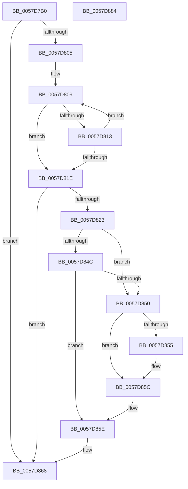

# CcIsThereDirtyDataEx

- RVA: `0x0057D7B0`–`0x0057D885` (길이 `213` bytes)
- VA: `0x000000014057D7B0`
- 실행 섹션: `.text`
- PDB 이름 있음: `예`; PDB Function 태그: `아니요`
- unwind 정보 RVA: `0x0007F83C`
- 디코드: `59`개 명령, `213/213` bytes 표시
- 미해석 바이트: `0` (있으면 어셈블리에 `.byte`로 보존)

> 이 문서는 커널 이미지의 기계어와 PDB 기호를 분석해 생성했습니다. 4번과 5번은 함수 원형과 자료형을 바이너리 사용 방식에서 추정한 C 해석이며 원본 소스 복구 결과는 아닙니다.

## 1. Dependencies

- 직접 호출 지점: **4**; 고유 호출 대상: **4**
- 직접 호출자로 확인된 함수: **0**
- RIP 상대 이미지 참조: **3**

### Outgoing calls
- `0x0057D7ED` → [KeAcquireInStackQueuedSpinLock](../27/KeAcquireInStackQueuedSpinLock_function_002757A0.md) (function, `0x002757A0`)
- `0x0057D83A` → [KeAcquireInStackQueuedSpinLockAtDpcLevel](../27/KeAcquireInStackQueuedSpinLockAtDpcLevel_function_00275740.md) (function, `0x00275740`)
- `0x0057D863` → [KeReleaseInStackQueuedSpinLockFromDpcLevel](../21/KeReleaseInStackQueuedSpinLockFromDpcLevel_function_002171B0.md) (function, `0x002171B0`)
- `0x0057D86D` → [KeReleaseInStackQueuedSpinLock](../34/KeReleaseInStackQueuedSpinLock_function_00342CE0.md) (function, `0x00342CE0`)

### Direct callers
- 이 함수 시작 RVA로 연결되는 직접 call은 확인되지 않았습니다. 간접 호출은 완전히 역산할 수 없습니다.

### Static image references
- `0x0057D7D7` → RVA `0x00E11CC0` (`.data`; read)
- `0x0057D7F2` → RVA `0x00F8F560` (`.data`; read)
- `0x0057D823` → RVA `0x00FC6EA0` (`ALMOSTRO`; read)

## 2. Other-region calls and transfers

- 다른 실행 섹션으로 향하는 call: **0**
- 별도 외부 분기/꼬리 이동을 확인하지 못했습니다.

## 3. Assembly (complete function range)

```asm
0057D7B0  4C 8B DC                        mov r11, rsp
0057D7B3  49 89 5B 08                     mov qword ptr [r11 + 8], rbx
0057D7B7  49 89 73 10                     mov qword ptr [r11 + 0x10], rsi
0057D7BB  57                              push rdi
0057D7BC  48 83 EC 50                     sub rsp, 0x50
0057D7C0  33 C0                           xor eax, eax
0057D7C2  0F 57 C0                        xorps xmm0, xmm0
0057D7C5  0F 57 C9                        xorps xmm1, xmm1
0057D7C8  48 8B F2                        mov rsi, rdx
0057D7CB  48 8B F9                        mov rdi, rcx
0057D7CE  49 8D 53 E0                     lea rdx, [r11 - 0x20]
0057D7D2  0F 11 44 24 38                  movups xmmword ptr [rsp + 0x38], xmm0
0057D7D7  48 8D 0D E2 44 89 00            lea rcx, [rip + 0x8944e2]
0057D7DE  49 89 43 F0                     mov qword ptr [r11 - 0x10], rax
0057D7E2  0F 11 4C 24 20                  movups xmmword ptr [rsp + 0x20], xmm1
0057D7E7  49 89 43 D8                     mov qword ptr [r11 - 0x28], rax
0057D7EB  33 DB                           xor ebx, ebx
0057D7ED  E8 AE 7F CF FF                  call 0x1402757a0
0057D7F2  48 8B 05 67 1D A1 00            mov rax, qword ptr [rip + 0xa11d67]
0057D7F9  48 8D 15 60 1D A1 00            lea rdx, [rip + 0xa11d60]
0057D800  48 3B C2                        cmp rax, rdx
0057D803  74 63                           je 0x14057d868
0057D805  48 8B 4F 08                     mov rcx, qword ptr [rdi + 8]
0057D809  48 8D 78 E8                     lea rdi, [rax - 0x18]
0057D80D  48 39 4F 10                     cmp qword ptr [rdi + 0x10], rcx
0057D811  74 0B                           je 0x14057d81e
0057D813  48 8B 00                        mov rax, qword ptr [rax]
0057D816  48 8B FB                        mov rdi, rbx
0057D819  48 3B C2                        cmp rax, rdx
0057D81C  75 EB                           jne 0x14057d809
0057D81E  48 85 FF                        test rdi, rdi
0057D821  74 45                           je 0x14057d868
0057D823  48 8B 05 76 96 A4 00            mov rax, qword ptr [rip + 0xa49676]
0057D82A  48 8D 54 24 20                  lea rdx, [rsp + 0x20]
0057D82F  48 8B 48 08                     mov rcx, qword ptr [rax + 8]
0057D833  48 81 C1 00 03 00 00            add rcx, 0x300
0057D83A  E8 01 7F CF FF                  call 0x140275740
0057D83F  48 8D 8F CC 00 00 00            lea rcx, [rdi + 0xcc]
0057D846  48 39 5F 28                     cmp qword ptr [rdi + 0x28], rbx
0057D84A  75 04                           jne 0x14057d850
0057D84C  39 19                           cmp dword ptr [rcx], ebx
0057D84E  74 0E                           je 0x14057d85e
0057D850  48 85 F6                        test rsi, rsi
0057D853  74 07                           je 0x14057d85c
0057D855  8B 47 28                        mov eax, dword ptr [rdi + 0x28]
0057D858  03 01                           add eax, dword ptr [rcx]
0057D85A  89 06                           mov dword ptr [rsi], eax
0057D85C  B3 01                           mov bl, 1
0057D85E  48 8D 4C 24 20                  lea rcx, [rsp + 0x20]
0057D863  E8 48 99 C9 FF                  call 0x1402171b0
0057D868  48 8D 4C 24 38                  lea rcx, [rsp + 0x38]
0057D86D  E8 6E 54 DC FF                  call 0x140342ce0
0057D872  48 8B 74 24 68                  mov rsi, qword ptr [rsp + 0x68]
0057D877  8A C3                           mov al, bl
0057D879  48 8B 5C 24 60                  mov rbx, qword ptr [rsp + 0x60]
0057D87E  48 83 C4 50                     add rsp, 0x50
0057D882  5F                              pop rdi
0057D883  C3                              ret
0057D884  CC                              int3
```

## 4. C-style interpretation (structured pseudocode)

```c
__int64 __fastcall CcIsThereDirtyDataEx(__int64 a1, __int64 a2)
{
    __int64 result;
    __int64 v_rbx;
    __int64 v_rsp;
    unsigned __int64 v_stack_m20;
    unsigned __int64 v_stack_m38;
    unsigned __int64 v_stack_p10;
    unsigned __int64 v_stack_p8;

    *(unsigned __int64 *)(v_rsp + 8) = v_rbx;
    *(unsigned __int64 *)(v_rsp + 16) = v_rsi;
    v_rsp = (v_rsp) - (80);
    result = 0;
    v_stack_m20 = v_xmm0;
    *(unsigned __int64 *)(v_rsp - 16) = 0;
    v_stack_m38 = v_xmm1;
    *(unsigned __int64 *)(v_rsp - 40) = 0;
    v_rbx = 0;
    result = KeAcquireInStackQueuedSpinLock(v_rip + 8996066, v_rsp - 32, a3, a4);
    if ((*(unsigned __int64 *)(v_rip + 10558823)) == (v_rip + 10558816)) goto loc_0057D868;
loc_0057D809:
    if ((*(unsigned __int64 *)(*(unsigned __int64 *)(v_rip + 10558823) - 24 + 16)) == (*(unsigned __int64 *)(a1 + 8))) goto loc_0057D81E;
    if ((*(unsigned __int64 *)(*(unsigned __int64 *)(v_rip + 10558823))) != (v_rip + 10558816)) goto loc_0057D809;
loc_0057D81E:
    if (0 == 0) goto loc_0057D868;
    a1 = (*(unsigned __int64 *)(*(unsigned __int64 *)(v_rip + 10786422) + 8)) + (768);
    result = KeAcquireInStackQueuedSpinLockAtDpcLevel(a1, v_stack_m38, a3, a4);
    if ((*(unsigned __int64 *)(0 + 40)) != 0) goto loc_0057D850;
    if ((*(unsigned int *)(0 + 204)) == 0) goto loc_0057D85E;
loc_0057D850:
    if (a2 != 0) {
        result = *(unsigned int *)(0 + 40);
        result = (unsigned int)((result) + (*(unsigned int *)(0 + 204)));
        *(unsigned int *)(a2) = (unsigned int)(result);
    }
loc_0057D85E:
    result = KeReleaseInStackQueuedSpinLockFromDpcLevel(v_stack_m38, v_stack_m38, a3, a4);
loc_0057D868:
    result = KeReleaseInStackQueuedSpinLock(v_stack_m20, v_stack_m38, a3, a4);
    v_rsp = (v_rsp) + (80);
    return 1;
}
```

## 5. (Beta) C Style

```c
int64_t CcIsThereDirtyDataEx(void *Arg1, int64_t Arg2)
{
    uint8_t *arg1 = (uint8_t *)Arg1;

    int64_t result;
    int64_t local_rbx;
    int64_t local_rsp;
    uint64_t v_stack_m20;
    uint64_t v_stack_m38;
    uint64_t v_stack_p10;
    uint64_t v_stack_p8;

    *(uint64_t *)(local_rsp + 0x8) = local_rbx;
    *(uint64_t *)(local_rsp + 0x10) = local_rsi;
    local_rsp = (local_rsp) - (80);
    result = 0;
    v_stack_m20 = v_xmm0;
    *(uint64_t *)(local_rsp - 0x10) = 0;
    v_stack_m38 = v_xmm1;
    *(uint64_t *)(local_rsp - 0x28) = 0;
    local_rbx = 0;
    result = KeAcquireInStackQueuedSpinLock(v_rip + 8996066, local_rsp - 32, a3, a4);
    if ((*(uint64_t *)(v_rip + 0xA11D67)) == (v_rip + 10558816)) goto loc_0057D868;
loc_0057D809:
    if ((*(uint64_t *)(*(uint64_t *)(v_rip + 0xA11D67) - 0x18 + 0x10)) == (*(uint64_t *)(arg1 + 0x8))) goto loc_0057D81E;
    if ((*(uint64_t *)(*(uint64_t *)(v_rip + 0xA11D67))) != (v_rip + 10558816)) goto loc_0057D809;
loc_0057D81E:
    if (0 == 0) goto loc_0057D868;
    Arg1 = (*(uint64_t *)(*(uint64_t *)(v_rip + 0xA49676) + 0x8)) + (768);
    result = KeAcquireInStackQueuedSpinLockAtDpcLevel(Arg1, v_stack_m38, a3, a4);
    if ((*(uint64_t *)(0 + 0x28)) != 0) goto loc_0057D850;
    if ((*(uint32_t *)(0 + 0xCC)) == 0) goto loc_0057D85E;
loc_0057D850:
    if (Arg2 != 0) {
        result = *(uint32_t *)(0 + 0x28);
        result = (uint32_t)((result) + (*(uint32_t *)(0 + 0xCC)));
        *(uint32_t *)(Arg2) = (uint32_t)(result);
    }
loc_0057D85E:
    result = KeReleaseInStackQueuedSpinLockFromDpcLevel(v_stack_m38, v_stack_m38, a3, a4);
loc_0057D868:
    result = KeReleaseInStackQueuedSpinLock(v_stack_m20, v_stack_m38, a3, a4);
    local_rsp = (local_rsp) + (80);
    return 1;
}
```

### 관측된 메모리 오프셋

구조체 형식이 확인되지 않은 접근은 인자 기준의 오프셋으로만 기록했습니다.

| 기준 인자 | 오프셋 표현 | 폭 (bit) | 접근 |
|---|---:|---:|---|
| `Arg1` | `+ 0x8` | `64` | `R` |

## 6. Execution-region graph

[열기: 2D/3D 그래프와 함수 탐색 컨트롤 패널](../../../control-panel.html?section=text&rva=0x0057D7B0&view=graph)

- 2D 그래프는 위에서 아래로 흐르고, 3D 그래프는 빈 공간을 드래그해 회전합니다. Shift+드래그는 이동, 휠은 확대·축소, 함수 노드 선택은 대상 보고서 이동입니다.

### Static fallback


