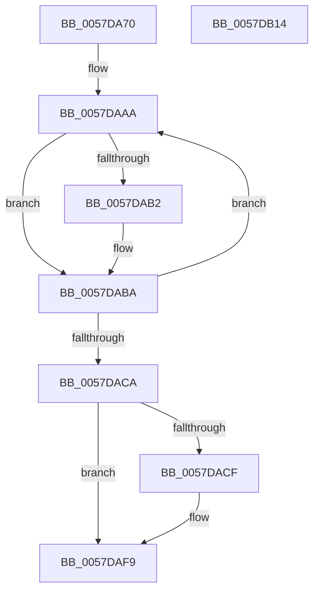

# CcMdlWriteAbort

- RVA: `0x0057DA70`–`0x0057DB15` (길이 `165` bytes)
- VA: `0x000000014057DA70`
- 실행 섹션: `.text`
- PDB 이름 있음: `예`; PDB Function 태그: `아니요`
- unwind 정보 RVA: `0x00060130`
- 디코드: `44`개 명령, `165/165` bytes 표시
- 미해석 바이트: `0` (있으면 어셈블리에 `.byte`로 보존)

> 이 문서는 커널 이미지의 기계어와 PDB 기호를 분석해 생성했습니다. 4번과 5번은 함수 원형과 자료형을 바이너리 사용 방식에서 추정한 C 해석이며 원본 소스 복구 결과는 아닙니다.

## 1. Dependencies

- 직접 호출 지점: **5**; 고유 호출 대상: **5**
- 직접 호출자로 확인된 함수: **0**
- RIP 상대 이미지 참조: **0**

### Outgoing calls
- `0x0057DAB5` → [MmUnlockPages](../29/MmUnlockPages_function_0029EEE0.md) (function, `0x0029EEE0`)
- `0x0057DABD` → [IoFreeMdl](../29/IoFreeMdl_function_0029EA80.md) (function, `0x0029EA80`)
- `0x0057DAE2` → [KeAcquireInStackQueuedSpinLock](../27/KeAcquireInStackQueuedSpinLock_function_002757A0.md) (function, `0x002757A0`)
- `0x0057DAEA` → [CcDecrementOpenCount](../38/CcDecrementOpenCount_function_0038B75C.md) (function, `0x0038B75C`)
- `0x0057DAF4` → [KeReleaseInStackQueuedSpinLock](../34/KeReleaseInStackQueuedSpinLock_function_00342CE0.md) (function, `0x00342CE0`)

### Direct callers
- 이 함수 시작 RVA로 연결되는 직접 call은 확인되지 않았습니다. 간접 호출은 완전히 역산할 수 없습니다.

### Static image references
- 디코드된 RIP-relative 메모리 참조가 없습니다.

## 2. Other-region calls and transfers

- 다른 실행 섹션으로 향하는 call: **0**
- 별도 외부 분기/꼬리 이동을 확인하지 못했습니다.

## 3. Assembly (complete function range)

```asm
0057DA70  4C 8B DC                        mov r11, rsp
0057DA73  49 89 5B 08                     mov qword ptr [r11 + 8], rbx
0057DA77  49 89 6B 10                     mov qword ptr [r11 + 0x10], rbp
0057DA7B  49 89 73 18                     mov qword ptr [r11 + 0x18], rsi
0057DA7F  49 89 7B 20                     mov qword ptr [r11 + 0x20], rdi
0057DA83  41 56                           push r14
0057DA85  48 83 EC 40                     sub rsp, 0x40
0057DA89  0F B7 7A 0A                     movzx edi, word ptr [rdx + 0xa]
0057DA8D  33 C0                           xor eax, eax
0057DA8F  0F 57 C0                        xorps xmm0, xmm0
0057DA92  48 8B DA                        mov rbx, rdx
0057DA95  0F 11 44 24 20                  movups xmmword ptr [rsp + 0x20], xmm0
0057DA9A  49 89 43 E8                     mov qword ptr [r11 - 0x18], rax
0057DA9E  66 83 E7 02                     and di, 2
0057DAA2  48 8B 41 28                     mov rax, qword ptr [rcx + 0x28]
0057DAA6  48 8B 68 08                     mov rbp, qword ptr [rax + 8]
0057DAAA  48 8B 33                        mov rsi, qword ptr [rbx]
0057DAAD  66 85 FF                        test di, di
0057DAB0  74 08                           je 0x14057daba
0057DAB2  48 8B CB                        mov rcx, rbx
0057DAB5  E8 26 14 D2 FF                  call 0x14029eee0
0057DABA  48 8B CB                        mov rcx, rbx
0057DABD  E8 BE 0F D2 FF                  call 0x14029ea80
0057DAC2  48 8B DE                        mov rbx, rsi
0057DAC5  48 85 F6                        test rsi, rsi
0057DAC8  75 E0                           jne 0x14057daaa
0057DACA  66 85 FF                        test di, di
0057DACD  74 2A                           je 0x14057daf9
0057DACF  48 8B 8D 18 02 00 00            mov rcx, qword ptr [rbp + 0x218]
0057DAD6  48 8D 54 24 20                  lea rdx, [rsp + 0x20]
0057DADB  48 81 C1 00 03 00 00            add rcx, 0x300
0057DAE2  E8 B9 7C CF FF                  call 0x1402757a0
0057DAE7  48 8B CD                        mov rcx, rbp
0057DAEA  E8 6D DC E0 FF                  call 0x14038b75c
0057DAEF  48 8D 4C 24 20                  lea rcx, [rsp + 0x20]
0057DAF4  E8 E7 51 DC FF                  call 0x140342ce0
0057DAF9  48 8B 5C 24 50                  mov rbx, qword ptr [rsp + 0x50]
0057DAFE  48 8B 6C 24 58                  mov rbp, qword ptr [rsp + 0x58]
0057DB03  48 8B 74 24 60                  mov rsi, qword ptr [rsp + 0x60]
0057DB08  48 8B 7C 24 68                  mov rdi, qword ptr [rsp + 0x68]
0057DB0D  48 83 C4 40                     add rsp, 0x40
0057DB11  41 5E                           pop r14
0057DB13  C3                              ret
0057DB14  CC                              int3
```

## 4. C-style interpretation (structured pseudocode)

```c
__int64 __fastcall CcMdlWriteAbort(__int64 a1, __int64 a2)
{
    __int64 result;
    __int64 v_rdi;
    __int64 v_rsp;
    unsigned __int64 v_stack_m28;
    unsigned __int64 v_stack_p10;
    unsigned __int64 v_stack_p18;
    unsigned __int64 v_stack_p20;
    unsigned __int64 v_stack_p8;

    *(unsigned __int64 *)(v_rsp + 8) = v_rbx;
    *(unsigned __int64 *)(v_rsp + 16) = v_rbp;
    *(unsigned __int64 *)(v_rsp + 24) = v_rsi;
    *(unsigned __int64 *)(v_rsp + 32) = v_rdi;
    v_rsp = (v_rsp) - (64);
    result = 0;
    v_stack_m28 = v_xmm0;
    *(unsigned __int64 *)(v_rsp - 24) = 0;
    v_rdi = (unsigned __int16)((*(unsigned __int16 *)(a2 + 10)) & (2));
loc_0057DAAA:
    result = *(unsigned __int64 *)(a1 + 40);
    if ((unsigned __int16)(v_rdi) != 0) {
        a1 = a2;
        result = MmUnlockPages(a1, a2, a3, a4);
    }
    result = IoFreeMdl(a2, a2, a3, a4);
    if (*(unsigned __int64 *)(a2) != 0) goto loc_0057DAAA;
    if ((unsigned __int16)(v_rdi) != 0) {
        a1 = *(unsigned __int64 *)(*(unsigned __int64 *)(*(unsigned __int64 *)(a1 + 40) + 8) + 536);
        a2 = v_stack_m28;
        a1 = (a1) + (768);
        result = KeAcquireInStackQueuedSpinLock(a1, a2, a3, a4);
        a1 = *(unsigned __int64 *)(*(unsigned __int64 *)(a1 + 40) + 8);
        result = CcDecrementOpenCount(a1, a2, a3, a4);
        a1 = v_stack_m28;
        result = KeReleaseInStackQueuedSpinLock(a1, a2, a3, a4);
    }
    v_rsp = (v_rsp) + (64);
    return result;
}
```

## 5. (Beta) C Style

```c
int64_t CcMdlWriteAbort(void *Arg1, void *Arg2)
{
    uint8_t *arg1 = (uint8_t *)Arg1;
    uint8_t *arg2 = (uint8_t *)Arg2;

    int64_t result;
    int64_t local_rdi;
    int64_t local_rsp;
    uint64_t v_stack_m28;
    uint64_t v_stack_p10;
    uint64_t v_stack_p18;
    uint64_t v_stack_p20;
    uint64_t v_stack_p8;

    *(uint64_t *)(local_rsp + 0x8) = local_rbx;
    *(uint64_t *)(local_rsp + 0x10) = local_rbp;
    *(uint64_t *)(local_rsp + 0x18) = local_rsi;
    *(uint64_t *)(local_rsp + 0x20) = local_rdi;
    local_rsp = (local_rsp) - (64);
    result = 0;
    v_stack_m28 = v_xmm0;
    *(uint64_t *)(local_rsp - 0x18) = 0;
    local_rdi = (uint16_t)((*(uint16_t *)(arg2 + 0xA)) & (2));
loc_0057DAAA:
    result = *(uint64_t *)(arg1 + 0x28);
    if ((uint16_t)(local_rdi) != 0) {
        Arg1 = Arg2;
        result = MmUnlockPages(Arg1, Arg2, a3, a4);
    }
    result = IoFreeMdl(Arg2, Arg2, a3, a4);
    if (*(uint64_t *)(arg2) != 0) goto loc_0057DAAA;
    if ((uint16_t)(local_rdi) != 0) {
        Arg1 = *(uint64_t *)(*(uint64_t *)(*(uint64_t *)(arg1 + 0x28) + 0x8) + 0x218);
        Arg2 = v_stack_m28;
        Arg1 = (Arg1) + (768);
        result = KeAcquireInStackQueuedSpinLock(Arg1, Arg2, a3, a4);
        Arg1 = *(uint64_t *)(*(uint64_t *)(arg1 + 0x28) + 0x8);
        result = CcDecrementOpenCount(Arg1, Arg2, a3, a4);
        Arg1 = v_stack_m28;
        result = KeReleaseInStackQueuedSpinLock(Arg1, Arg2, a3, a4);
    }
    local_rsp = (local_rsp) + (64);
    return result;
}
```

### 관측된 메모리 오프셋

구조체 형식이 확인되지 않은 접근은 인자 기준의 오프셋으로만 기록했습니다.

| 기준 인자 | 오프셋 표현 | 폭 (bit) | 접근 |
|---|---:|---:|---|
| `Arg1` | `+ 0x28` | `64` | `R` |
| `Arg2` | `+ 0xA` | `16` | `R` |

## 6. Execution-region graph

[열기: 2D/3D 그래프와 함수 탐색 컨트롤 패널](../../../control-panel.html?section=text&rva=0x0057DA70&view=graph)

- 2D 그래프는 위에서 아래로 흐르고, 3D 그래프는 빈 공간을 드래그해 회전합니다. Shift+드래그는 이동, 휠은 확대·축소, 함수 노드 선택은 대상 보고서 이동입니다.

### Static fallback


