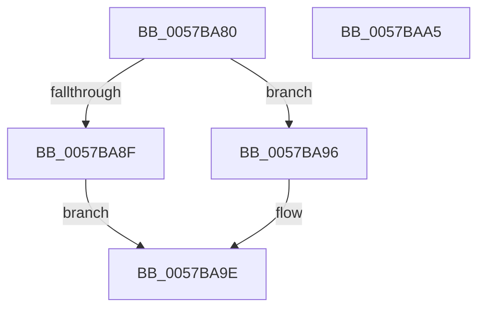

# CcNotifyWriteBehindHelper

- RVA: `0x0057BA80`–`0x0057BAA6` (길이 `38` bytes)
- VA: `0x000000014057BA80`
- 실행 섹션: `.text`
- PDB 이름 있음: `예`; PDB Function 태그: `아니요`
- unwind 정보 RVA: `0x0005C788`
- 디코드: `13`개 명령, `38/38` bytes 표시
- 미해석 바이트: `0` (있으면 어셈블리에 `.byte`로 보존)

> 이 문서는 커널 이미지의 기계어와 PDB 기호를 분석해 생성했습니다. 4번과 5번은 함수 원형과 자료형을 바이너리 사용 방식에서 추정한 C 해석이며 원본 소스 복구 결과는 아닙니다.

## 1. Dependencies

- 직접 호출 지점: **2**; 고유 호출 대상: **2**
- 직접 호출자로 확인된 함수: **0**
- RIP 상대 이미지 참조: **0**

### Outgoing calls
- `0x0057BA8F` → [CcNotifyWriteBehindInternal](../3C/CcNotifyWriteBehindInternal_function_003CC224.md) (function, `0x003CC224`)
- `0x0057BA99` → [CcNotifyWriteBehindVolume](../3C/CcNotifyWriteBehindVolume_function_003CC134.md) (function, `0x003CC134`)

### Direct callers
- 이 함수 시작 RVA로 연결되는 직접 call은 확인되지 않았습니다. 간접 호출은 완전히 역산할 수 없습니다.

### Static image references
- 디코드된 RIP-relative 메모리 참조가 없습니다.

## 2. Other-region calls and transfers

- 다른 실행 섹션으로 향하는 call: **0**
- 별도 외부 분기/꼬리 이동을 확인하지 못했습니다.

## 3. Assembly (complete function range)

```asm
0057BA80  48 83 EC 28                     sub rsp, 0x28
0057BA84  48 8B C2                        mov rax, rdx
0057BA87  48 85 D2                        test rdx, rdx
0057BA8A  41 8B D0                        mov edx, r8d
0057BA8D  75 07                           jne 0x14057ba96
0057BA8F  E8 90 07 E5 FF                  call 0x1403cc224
0057BA94  EB 08                           jmp 0x14057ba9e
0057BA96  48 8B C8                        mov rcx, rax
0057BA99  E8 96 06 E5 FF                  call 0x1403cc134
0057BA9E  B0 01                           mov al, 1
0057BAA0  48 83 C4 28                     add rsp, 0x28
0057BAA4  C3                              ret
0057BAA5  CC                              int3
```

## 4. C-style interpretation (structured pseudocode)

```c
__int64 __fastcall CcNotifyWriteBehindHelper(__int64 a1, __int64 a2, int a3)
{
    __int64 result;
    __int64 v_rsp;

    v_rsp = (v_rsp) - (40);
    if (a2 != 0) goto loc_0057BA96;
    result = CcNotifyWriteBehindInternal(a1, (unsigned int)(a3), a3, a4);
    goto loc_0057BA9E;
loc_0057BA96:
    result = CcNotifyWriteBehindVolume(result, (unsigned int)(a3), a3, a4);
loc_0057BA9E:
    v_rsp = (v_rsp) + (40);
    return 1;
}
```

## 5. (Beta) C Style

```c
int64_t CcNotifyWriteBehindHelper(int64_t Arg1, int64_t Arg2, int32_t Arg3)
{
    int64_t result;
    int64_t local_rsp;

    local_rsp = (local_rsp) - (40);
    if (Arg2 != 0) goto loc_0057BA96;
    result = CcNotifyWriteBehindInternal(Arg1, (uint32_t)(Arg3), Arg3, a4);
    goto loc_0057BA9E;
loc_0057BA96:
    result = CcNotifyWriteBehindVolume(result, (uint32_t)(Arg3), Arg3, a4);
loc_0057BA9E:
    local_rsp = (local_rsp) + (40);
    return 1;
}
```

## 6. Execution-region graph

[열기: 2D/3D 그래프와 함수 탐색 컨트롤 패널](../../../control-panel.html?section=text&rva=0x0057BA80&view=graph)

- 2D 그래프는 위에서 아래로 흐르고, 3D 그래프는 빈 공간을 드래그해 회전합니다. Shift+드래그는 이동, 휠은 확대·축소, 함수 노드 선택은 대상 보고서 이동입니다.

### Static fallback


