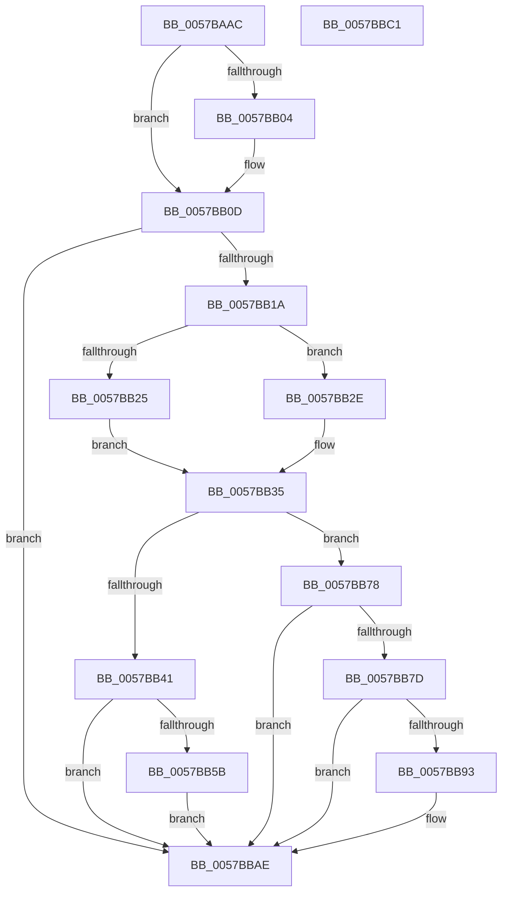

# CcOkToAddWriteBehindThread

- RVA: `0x0057BAAC`–`0x0057BBC2` (길이 `278` bytes)
- VA: `0x000000014057BAAC`
- 실행 섹션: `.text`
- PDB 이름 있음: `예`; PDB Function 태그: `아니요`
- unwind 정보 RVA: `0x00069588`
- 디코드: `70`개 명령, `278/278` bytes 표시
- 미해석 바이트: `0` (있으면 어셈블리에 `.byte`로 보존)

> 이 문서는 커널 이미지의 기계어와 PDB 기호를 분석해 생성했습니다. 4번과 5번은 함수 원형과 자료형을 바이너리 사용 방식에서 추정한 C 해석이며 원본 소스 복구 결과는 아닙니다.

## 1. Dependencies

- 직접 호출 지점: **0**; 고유 호출 대상: **0**
- 직접 호출자로 확인된 함수: **1**
- RIP 상대 이미지 참조: **0**

### Outgoing calls
- 직접 디코드된 call 명령이 없습니다.

### Direct callers
- [sub_006F6D7E](../6F/Unknown_function_006F6D7E.md) at `0x006F6DF3`

### Static image references
- 디코드된 RIP-relative 메모리 참조가 없습니다.

## 2. Other-region calls and transfers

- 다른 실행 섹션으로 향하는 call: **0**
- 별도 외부 분기/꼬리 이동을 확인하지 못했습니다.

## 3. Assembly (complete function range)

```asm
0057BAAC  48 89 5C 24 08                  mov qword ptr [rsp + 8], rbx
0057BAB1  48 89 74 24 10                  mov qword ptr [rsp + 0x10], rsi
0057BAB6  48 89 7C 24 18                  mov qword ptr [rsp + 0x18], rdi
0057BABB  44 8B 81 D0 03 00 00            mov r8d, dword ptr [rcx + 0x3d0]
0057BAC2  33 F6                           xor esi, esi
0057BAC4  4C 8B 89 70 04 00 00            mov r9, qword ptr [rcx + 0x470]
0057BACB  4C 8B DA                        mov r11, rdx
0057BACE  48 8B F9                        mov rdi, rcx
0057BAD1  8B D6                           mov edx, esi
0057BAD3  45 8B 93 98 00 00 00            mov r10d, dword ptr [r11 + 0x98]
0057BADA  43 8B 04 D1                     mov eax, dword ptr [r9 + r10*8]
0057BADE  8B D8                           mov ebx, eax
0057BAE0  41 2B D8                        sub ebx, r8d
0057BAE3  47 89 04 D1                     mov dword ptr [r9 + r10*8], r8d
0057BAE7  45 8B 93 98 00 00 00            mov r10d, dword ptr [r11 + 0x98]
0057BAEE  41 3B C0                        cmp eax, r8d
0057BAF1  4C 8B 89 70 04 00 00            mov r9, qword ptr [rcx + 0x470]
0057BAF8  44 8D 46 01                     lea r8d, [rsi + 1]
0057BAFC  0F 42 DE                        cmovb ebx, esi
0057BAFF  45 85 D2                        test r10d, r10d
0057BB02  74 09                           je 0x14057bb0d
0057BB04  41 8D 4A FF                     lea ecx, [r10 - 1]
0057BB08  41 8B 54 C9 04                  mov edx, dword ptr [r9 + rcx*8 + 4]
0057BB0D  43 89 5C D1 04                  mov dword ptr [r9 + r10*8 + 4], ebx
0057BB12  85 DB                           test ebx, ebx
0057BB14  0F 84 94 00 00 00               je 0x14057bbae
0057BB1A  41 8B 83 C8 00 00 00            mov eax, dword ptr [r11 + 0xc8]
0057BB21  3B DA                           cmp ebx, edx
0057BB23  72 09                           jb 0x14057bb2e
0057BB25  85 C0                           test eax, eax
0057BB27  0F 48 C6                        cmovs eax, esi
0057BB2A  FF C0                           inc eax
0057BB2C  EB 07                           jmp 0x14057bb35
0057BB2E  85 C0                           test eax, eax
0057BB30  0F 4F C6                        cmovg eax, esi
0057BB33  FF C8                           dec eax
0057BB35  41 89 83 C8 00 00 00            mov dword ptr [r11 + 0xc8], eax
0057BB3C  83 F8 03                        cmp eax, 3
0057BB3F  75 37                           jne 0x14057bb78
0057BB41  44 8D 40 FF                     lea r8d, [rax - 1]
0057BB45  41 89 B3 C8 00 00 00            mov dword ptr [r11 + 0xc8], esi
0057BB4C  41 8B 83 98 00 00 00            mov eax, dword ptr [r11 + 0x98]
0057BB53  3B 87 60 03 00 00               cmp eax, dword ptr [rdi + 0x360]
0057BB59  73 53                           jae 0x14057bbae
0057BB5B  8D 48 01                        lea ecx, [rax + 1]
0057BB5E  8B 87 D0 03 00 00               mov eax, dword ptr [rdi + 0x3d0]
0057BB64  41 89 04 C9                     mov dword ptr [r9 + rcx*8], eax
0057BB68  41 8B 83 98 00 00 00            mov eax, dword ptr [r11 + 0x98]
0057BB6F  FF C0                           inc eax
0057BB71  41 89 74 C1 04                  mov dword ptr [r9 + rax*8 + 4], esi
0057BB76  EB 36                           jmp 0x14057bbae
0057BB78  83 F8 FD                        cmp eax, -3
0057BB7B  75 31                           jne 0x14057bbae
0057BB7D  41 8B 8B 98 00 00 00            mov ecx, dword ptr [r11 + 0x98]
0057BB84  44 8D 40 06                     lea r8d, [rax + 6]
0057BB88  41 89 B3 C8 00 00 00            mov dword ptr [r11 + 0xc8], esi
0057BB8F  85 C9                           test ecx, ecx
0057BB91  74 1B                           je 0x14057bbae
0057BB93  8D 51 FF                        lea edx, [rcx - 1]
0057BB96  8B 8F D0 03 00 00               mov ecx, dword ptr [rdi + 0x3d0]
0057BB9C  41 89 0C D1                     mov dword ptr [r9 + rdx*8], ecx
0057BBA0  41 8B 8B 98 00 00 00            mov ecx, dword ptr [r11 + 0x98]
0057BBA7  FF C9                           dec ecx
0057BBA9  41 89 74 C9 04                  mov dword ptr [r9 + rcx*8 + 4], esi
0057BBAE  48 8B 5C 24 08                  mov rbx, qword ptr [rsp + 8]
0057BBB3  41 8B C0                        mov eax, r8d
0057BBB6  48 8B 74 24 10                  mov rsi, qword ptr [rsp + 0x10]
0057BBBB  48 8B 7C 24 18                  mov rdi, qword ptr [rsp + 0x18]
0057BBC0  C3                              ret
0057BBC1  CC                              int3
```

## 4. C-style interpretation (structured pseudocode)

```c
__int64 __fastcall CcOkToAddWriteBehindThread(__int64 a1, __int64 a2)
{
    __int64 result;
    __int64 v_rbx;
    __int64 v_rsi;
    unsigned __int64 v_stack_p10;
    unsigned __int64 v_stack_p18;
    unsigned __int64 v_stack_p8;

    v_stack_p8 = v_rbx;
    v_stack_p10 = v_rsi;
    v_stack_p18 = v_rdi;
    v_rsi = 0;
    v_rbx = (unsigned int)(((unsigned int)((unsigned int)((unsigned int)(*(unsigned int *)(*(unsigned __int64 *)(a1 + 1136) + (unsigned int)(*(unsigned int *)(a2 + 152)) * 8))))) - ((unsigned int)((unsigned int)(*(unsigned int *)(a1 + 976)))));
    *(unsigned int *)(*(unsigned __int64 *)(a1 + 1136) + (unsigned int)(*(unsigned int *)(a2 + 152)) * 8) = (unsigned int)((unsigned int)(*(unsigned int *)(a1 + 976)));
    if (((unsigned int)((unsigned int)(*(unsigned int *)(*(unsigned __int64 *)(a1 + 1136) + (unsigned int)(*(unsigned int *)(a2 + 152)) * 8)))) < ((unsigned int)((unsigned int)(*(unsigned int *)(a1 + 976))))) { v_rbx = 0; }
    if ((unsigned int)((unsigned int)(*(unsigned int *)(a2 + 152))) != 0) {
        a1 = (unsigned int)(*(unsigned int *)(a2 + 152)) - 1;
        a2 = *(unsigned int *)(*(unsigned __int64 *)(a1 + 1136) + a1 * 8 + 4);
    }
    *(unsigned int *)(*(unsigned __int64 *)(a1 + 1136) + (unsigned int)(*(unsigned int *)(a2 + 152)) * 8 + 4) = (unsigned int)(v_rbx);
    if ((unsigned int)(v_rbx) == 0) goto loc_0057BBAE;
    if (((unsigned int)(v_rbx)) < ((unsigned int)(a2))) goto loc_0057BB2E;
    result = (unsigned int)(*(unsigned int *)(a2 + 200));
    if (sign_flag) { result = 0; }
    result = (unsigned int)((result) + 1);
    goto loc_0057BB35;
loc_0057BB2E:
    if (condition_is_greater) { result = 0; }
    result = (unsigned int)((result) - 1);
loc_0057BB35:
    *(unsigned int *)(a2 + 200) = (unsigned int)(result);
    if (((unsigned int)(result)) != 3) goto loc_0057BB78;
    *(unsigned int *)(a2 + 200) = 0;
    if (((unsigned int)((unsigned int)(*(unsigned int *)(a2 + 152)))) >= (*(unsigned int *)(a1 + 864))) goto loc_0057BBAE;
    *(unsigned int *)(*(unsigned __int64 *)(a1 + 1136) + (unsigned int)(*(unsigned int *)(a2 + 152)) + 1 * 8) = (unsigned int)((unsigned int)(*(unsigned int *)(a1 + 976)));
    result = (unsigned int)(((unsigned int)(*(unsigned int *)(a2 + 152))) + 1);
    *(unsigned int *)(*(unsigned __int64 *)(a1 + 1136) + result * 8 + 4) = 0;
    goto loc_0057BBAE;
loc_0057BB78:
    if (((unsigned int)(result)) != -3) goto loc_0057BBAE;
    *(unsigned int *)(a2 + 200) = 0;
    if ((unsigned int)((unsigned int)(*(unsigned int *)(a2 + 152))) != 0) {
        a2 = (unsigned int)(*(unsigned int *)(a2 + 152)) - 1;
        a1 = *(unsigned int *)(a1 + 976);
        *(unsigned int *)(*(unsigned __int64 *)(a1 + 1136) + a2 * 8) = (unsigned int)(a1);
        a1 = *(unsigned int *)(a2 + 152);
        a1 = (unsigned int)((a1) - 1);
        *(unsigned int *)(*(unsigned __int64 *)(a1 + 1136) + a1 * 8 + 4) = 0;
    }
    return (unsigned int)((unsigned int)(result + 6));
}
```

## 5. (Beta) C Style

```c
int64_t CcOkToAddWriteBehindThread(void *Arg1, void *Arg2)
{
    uint8_t *arg1 = (uint8_t *)Arg1;
    uint8_t *arg2 = (uint8_t *)Arg2;

    int64_t result;
    int64_t local_rbx;
    int64_t local_rsi;
    uint64_t v_stack_p10;
    uint64_t v_stack_p18;
    uint64_t v_stack_p8;

    v_stack_p8 = local_rbx;
    v_stack_p10 = local_rsi;
    v_stack_p18 = local_rdi;
    local_rsi = 0;
    local_rbx = (uint32_t)(((uint32_t)((uint32_t)((uint32_t)(*(uint32_t *)(*(uint64_t *)(arg1 + 0x470) + (uint32_t)(*(uint32_t *)(arg2 + 0x98)) * 8))))) - ((uint32_t)((uint32_t)(*(uint32_t *)(arg1 + 0x3D0)))));
    *(uint32_t *)(*(uint64_t *)(arg1 + 0x470) + (uint32_t)(*(uint32_t *)(arg2 + 0x98)) * 8) = (uint32_t)((uint32_t)(*(uint32_t *)(arg1 + 0x3D0)));
    if (((uint32_t)((uint32_t)(*(uint32_t *)(*(uint64_t *)(arg1 + 0x470) + (uint32_t)(*(uint32_t *)(arg2 + 0x98)) * 8)))) < ((uint32_t)((uint32_t)(*(uint32_t *)(arg1 + 0x3D0))))) { local_rbx = 0; }
    if ((uint32_t)((uint32_t)(*(uint32_t *)(arg2 + 0x98))) != 0) {
        Arg1 = (uint32_t)(*(uint32_t *)(arg2 + 0x98)) - 1;
        Arg2 = *(uint32_t *)(*(uint64_t *)(arg1 + 0x470) + arg1 * 8 + 0x4);
    }
    *(uint32_t *)(*(uint64_t *)(arg1 + 0x470) + (uint32_t)(*(uint32_t *)(arg2 + 0x98)) * 8 + 0x4) = (uint32_t)(local_rbx);
    if ((uint32_t)(local_rbx) == 0) goto loc_0057BBAE;
    if (((uint32_t)(local_rbx)) < ((uint32_t)(Arg2))) goto loc_0057BB2E;
    result = (uint32_t)(*(uint32_t *)(arg2 + 0xC8));
    if (sign_flag) { result = 0; }
    result = (uint32_t)((result) + 1);
    goto loc_0057BB35;
loc_0057BB2E:
    if (condition_is_greater) { result = 0; }
    result = (uint32_t)((result) - 1);
loc_0057BB35:
    *(uint32_t *)(arg2 + 0xC8) = (uint32_t)(result);
    if (((uint32_t)(result)) != 3) goto loc_0057BB78;
    *(uint32_t *)(arg2 + 0xC8) = 0;
    if (((uint32_t)((uint32_t)(*(uint32_t *)(arg2 + 0x98)))) >= (*(uint32_t *)(arg1 + 0x360))) goto loc_0057BBAE;
    *(uint32_t *)(*(uint64_t *)(arg1 + 0x470) + (uint32_t)(*(uint32_t *)(arg2 + 0x98)) + 0x1 * 8) = (uint32_t)((uint32_t)(*(uint32_t *)(arg1 + 0x3D0)));
    result = (uint32_t)(((uint32_t)(*(uint32_t *)(arg2 + 0x98))) + 1);
    *(uint32_t *)(*(uint64_t *)(arg1 + 0x470) + result * 8 + 0x4) = 0;
    goto loc_0057BBAE;
loc_0057BB78:
    if (((uint32_t)(result)) != -3) goto loc_0057BBAE;
    *(uint32_t *)(arg2 + 0xC8) = 0;
    if ((uint32_t)((uint32_t)(*(uint32_t *)(arg2 + 0x98))) != 0) {
        Arg2 = (uint32_t)(*(uint32_t *)(arg2 + 0x98)) - 1;
        Arg1 = *(uint32_t *)(arg1 + 0x3D0);
        *(uint32_t *)(*(uint64_t *)(arg1 + 0x470) + arg2 * 8) = (uint32_t)(Arg1);
        Arg1 = *(uint32_t *)(arg2 + 0x98);
        Arg1 = (uint32_t)((Arg1) - 1);
        *(uint32_t *)(*(uint64_t *)(arg1 + 0x470) + arg1 * 8 + 0x4) = 0;
    }
    return (uint32_t)((uint32_t)(result + 6));
}
```

### 관측된 메모리 오프셋

구조체 형식이 확인되지 않은 접근은 인자 기준의 오프셋으로만 기록했습니다.

| 기준 인자 | 오프셋 표현 | 폭 (bit) | 접근 |
|---|---:|---:|---|
| `Arg1` | `+ 0x360` | `32` | `R` |
| `Arg1` | `+ 0x3D0` | `32` | `R` |
| `Arg1` | `+ 0x470` | `64` | `R` |
| `Arg2` | `+ 0x98` | `32` | `R` |
| `Arg2` | `+ 0xC8` | `32` | `R` |
| `Arg2` | `+ 0xC8` | `32` | `W` |

## 6. Execution-region graph

[열기: 2D/3D 그래프와 함수 탐색 컨트롤 패널](../../../control-panel.html?section=text&rva=0x0057BAAC&view=graph)

- 2D 그래프는 위에서 아래로 흐르고, 3D 그래프는 빈 공간을 드래그해 회전합니다. Shift+드래그는 이동, 휠은 확대·축소, 함수 노드 선택은 대상 보고서 이동입니다.

### Static fallback


