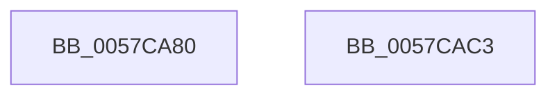

# CcOpenRegistryPath

- RVA: `0x0057CA80`–`0x0057CAC4` (길이 `68` bytes)
- VA: `0x000000014057CA80`
- 실행 섹션: `.text`
- PDB 이름 있음: `예`; PDB Function 태그: `아니요`
- unwind 정보 RVA: `0x0005CC98`
- 디코드: `17`개 명령, `68/68` bytes 표시
- 미해석 바이트: `0` (있으면 어셈블리에 `.byte`로 보존)

> 이 문서는 커널 이미지의 기계어와 PDB 기호를 분석해 생성했습니다. 4번과 5번은 함수 원형과 자료형을 바이너리 사용 방식에서 추정한 C 해석이며 원본 소스 복구 결과는 아닙니다.

## 1. Dependencies

- 직접 호출 지점: **1**; 고유 호출 대상: **1**
- 직접 호출자로 확인된 함수: **2**
- RIP 상대 이미지 참조: **0**

### Outgoing calls
- `0x0057CAB9` → [ZwOpenKey](../6A/ZwOpenKey_function_006AD310.md) (function, `0x006AD310`)

### Direct callers
- [CcRegistryChangeCallback](CcRegistryChangeCallback_function_0057CC20.md) at `0x0057CCCF`
- [CcSetupWatchForRegistryChanges](CcSetupWatchForRegistryChanges_function_0057CE10.md) at `0x0057CEA0`

### Static image references
- 디코드된 RIP-relative 메모리 참조가 없습니다.

## 2. Other-region calls and transfers

- 다른 실행 섹션으로 향하는 call: **0**
- 별도 외부 분기/꼬리 이동을 확인하지 못했습니다.

## 3. Assembly (complete function range)

```asm
0057CA80  4C 8B DC                        mov r11, rsp
0057CA83  48 83 EC 58                     sub rsp, 0x58
0057CA87  48 8B C2                        mov rax, rdx
0057CA8A  49 89 4B D8                     mov qword ptr [r11 - 0x28], rcx
0057CA8E  33 D2                           xor edx, edx
0057CA90  49 C7 43 C8 30 00 00 00         mov qword ptr [r11 - 0x38], 0x30
0057CA98  49 89 53 D0                     mov qword ptr [r11 - 0x30], rdx
0057CA9C  4D 8D 43 C8                     lea r8, [r11 - 0x38]
0057CAA0  0F 57 C0                        xorps xmm0, xmm0
0057CAA3  49 C7 43 E0 40 02 00 00         mov qword ptr [r11 - 0x20], 0x240
0057CAAB  BA 10 00 00 00                  mov edx, 0x10
0057CAB0  48 8B C8                        mov rcx, rax
0057CAB3  F3 0F 7F 44 24 40               movdqu xmmword ptr [rsp + 0x40], xmm0
0057CAB9  E8 52 08 13 00                  call 0x1406ad310
0057CABE  48 83 C4 58                     add rsp, 0x58
0057CAC2  C3                              ret
0057CAC3  CC                              int3
```

## 4. C-style interpretation (structured pseudocode)

```c
__int64 __fastcall CcOpenRegistryPath(__int64 a1, __int64 a2)
{
    __int64 result;
    __int64 v_rsp;
    unsigned __int64 v_stack_m18;

    v_rsp = (v_rsp) - (88);
    *(unsigned __int64 *)(v_rsp - 40) = a1;
    a2 = 0;
    *(unsigned __int64 *)(v_rsp - 56) = 48;
    *(unsigned __int64 *)(v_rsp - 48) = 0;
    *(unsigned __int64 *)(v_rsp - 32) = 576;
    v_stack_m18 = v_xmm0;
    result = ZwOpenKey(0, 16, v_rsp - 56, a4);
    v_rsp = (v_rsp) + (88);
    return result;
}
```

## 5. (Beta) C Style

```c
int64_t CcOpenRegistryPath(int64_t Arg1, int64_t Arg2)
{
    int64_t result;
    int64_t local_rsp;
    uint64_t v_stack_m18;

    local_rsp = (local_rsp) - (88);
    *(uint64_t *)(local_rsp - 0x28) = Arg1;
    Arg2 = 0;
    *(uint64_t *)(local_rsp - 0x38) = 48;
    *(uint64_t *)(local_rsp - 0x30) = 0;
    *(uint64_t *)(local_rsp - 0x20) = 576;
    v_stack_m18 = v_xmm0;
    result = ZwOpenKey(0, 16, local_rsp - 56, a4);
    local_rsp = (local_rsp) + (88);
    return result;
}
```

## 6. Execution-region graph

[열기: 2D/3D 그래프와 함수 탐색 컨트롤 패널](../../../control-panel.html?section=text&rva=0x0057CA80&view=graph)

- 2D 그래프는 위에서 아래로 흐르고, 3D 그래프는 빈 공간을 드래그해 회전합니다. Shift+드래그는 이동, 휠은 확대·축소, 함수 노드 선택은 대상 보고서 이동입니다.

### Static fallback


