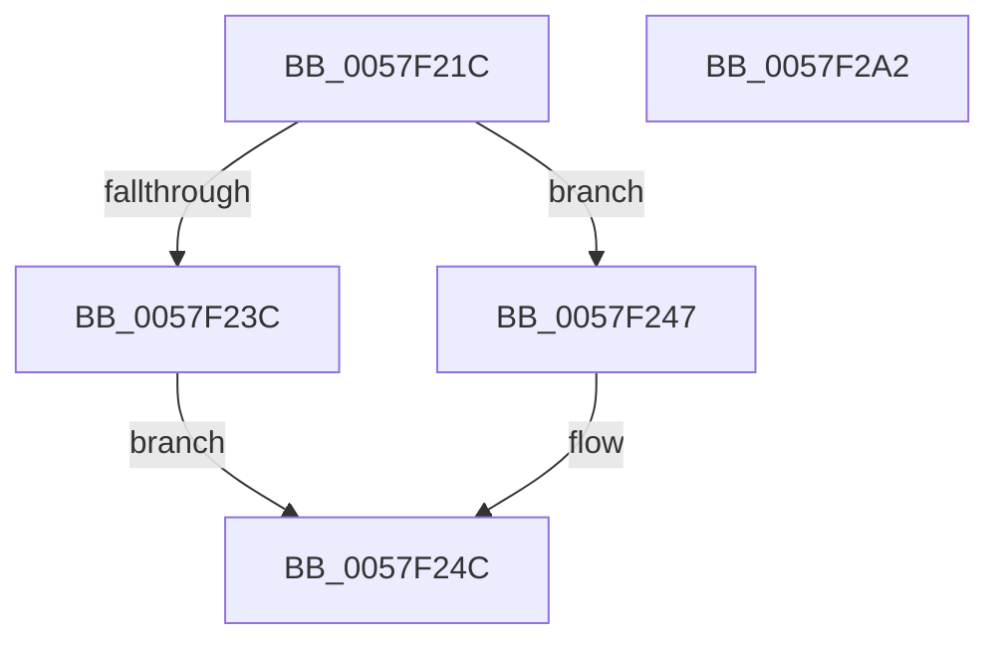

# CcPerfLogCanWriteFail

- RVA: `0x0057F21C`–`0x0057F2A3` (길이 `135` bytes)
- VA: `0x000000014057F21C`
- 실행 섹션: `.text`
- PDB 이름 있음: `예`; PDB Function 태그: `아니요`
- unwind 정보 RVA: `0x000A02F8`
- 디코드: `30`개 명령, `135/135` bytes 표시
- 미해석 바이트: `0` (있으면 어셈블리에 `.byte`로 보존)

> 이 문서는 커널 이미지의 기계어와 PDB 기호를 분석해 생성했습니다. 4번과 5번은 함수 원형과 자료형을 바이너리 사용 방식에서 추정한 C 해석이며 원본 소스 복구 결과는 아닙니다.

## 1. Dependencies

- 직접 호출 지점: **2**; 고유 호출 대상: **2**
- 직접 호출자로 확인된 함수: **1**
- RIP 상대 이미지 참조: **1**

### Outgoing calls
- `0x0057F28B` → [EtwTraceKernelEvent](../23/EtwTraceKernelEvent_function_00235350.md) (function, `0x00235350`)
- `0x0057F298` → [_security_check_cookie](../6A/_security_check_cookie_function_006AC640.md) (function, `0x006AC640`)

### Direct callers
- [CcCanIWrite](../38/CcCanIWrite_function_00388250.md) at `0x0038874A`

### Static image references
- `0x0057F220` → RVA `0x00E0A740` (`.data`; read)

## 2. Other-region calls and transfers

- 다른 실행 섹션으로 향하는 call: **0**
- 별도 외부 분기/꼬리 이동을 확인하지 못했습니다.

## 3. Assembly (complete function range)

```asm
0057F21C  48 83 EC 78                     sub rsp, 0x78
0057F220  48 8B 05 19 B5 88 00            mov rax, qword ptr [rip + 0x88b519]
0057F227  48 33 C4                        xor rax, rsp
0057F22A  48 89 44 24 60                  mov qword ptr [rsp + 0x60], rax
0057F22F  45 33 D2                        xor r10d, r10d
0057F232  44 89 54 24 5C                  mov dword ptr [rsp + 0x5c], r10d
0057F237  48 85 C9                        test rcx, rcx
0057F23A  74 0B                           je 0x14057f247
0057F23C  48 8B 41 18                     mov rax, qword ptr [rcx + 0x18]
0057F240  48 89 44 24 40                  mov qword ptr [rsp + 0x40], rax
0057F245  EB 05                           jmp 0x14057f24c
0057F247  4C 89 54 24 40                  mov qword ptr [rsp + 0x40], r10
0057F24C  89 54 24 58                     mov dword ptr [rsp + 0x58], edx
0057F250  48 8D 44 24 40                  lea rax, [rsp + 0x40]
0057F255  4C 89 44 24 48                  mov qword ptr [rsp + 0x48], r8
0057F25A  48 8D 4C 24 30                  lea rcx, [rsp + 0x30]
0057F25F  4C 89 4C 24 50                  mov qword ptr [rsp + 0x50], r9
0057F264  BA 01 00 00 00                  mov edx, 1
0057F269  41 B9 06 16 00 00               mov r9d, 0x1606
0057F26F  48 89 44 24 30                  mov qword ptr [rsp + 0x30], rax
0057F274  41 B8 00 00 02 80               mov r8d, 0x80020000
0057F27A  48 C7 44 24 38 20 00 00 00      mov qword ptr [rsp + 0x38], 0x20
0057F283  C7 44 24 20 02 19 50 00         mov dword ptr [rsp + 0x20], 0x501902
0057F28B  E8 C0 60 CB FF                  call 0x140235350
0057F290  48 8B 4C 24 60                  mov rcx, qword ptr [rsp + 0x60]
0057F295  48 33 CC                        xor rcx, rsp
0057F298  E8 A3 D3 12 00                  call 0x1406ac640
0057F29D  48 83 C4 78                     add rsp, 0x78
0057F2A1  C3                              ret
0057F2A2  CC                              int3
```

## 4. C-style interpretation (structured pseudocode)

```c
__int64 __fastcall CcPerfLogCanWriteFail(__int64 a1, int a2, __int64 a3, __int64 a4)
{
    __int64 result;
    __int64 v_r10;
    __int64 v_rsp;
    unsigned __int64 v_stack_m18;
    unsigned int v_stack_m1C;
    unsigned int v_stack_m20;
    unsigned __int64 v_stack_m28;
    unsigned __int64 v_stack_m30;
    unsigned __int64 v_stack_m38;
    unsigned __int64 v_stack_m40;
    unsigned __int64 v_stack_m48;
    unsigned int v_stack_m58;

    v_rsp = (v_rsp) - (120);
    result = (*(unsigned __int64 *)(v_rip + 8959257)) ^ (v_rsp);
    v_stack_m18 = result;
    v_r10 = 0;
    v_stack_m1C = 0;
    if (a1 == 0) goto loc_0057F247;
    v_stack_m38 = *(unsigned __int64 *)(a1 + 24);
    goto loc_0057F24C;
loc_0057F247:
    v_stack_m38 = 0;
loc_0057F24C:
    v_stack_m20 = a2;
    v_stack_m30 = a3;
    v_stack_m28 = a4;
    v_stack_m48 = v_stack_m38;
    v_stack_m40 = 32;
    v_stack_m58 = 0x501902ULL;
    result = EtwTraceKernelEvent(v_stack_m48, 1, (unsigned int)(0x80020000ULL), (unsigned int)(0x1606ULL));
    a1 = (v_stack_m18) ^ (v_rsp);
    result = _security_check_cookie(a1, 1, (unsigned int)(0x80020000ULL), (unsigned int)(0x1606ULL));
    v_rsp = (v_rsp) + (120);
    return result;
}
```

## 5. (Beta) C Style

```c
int64_t CcPerfLogCanWriteFail(int64_t Arg1, int32_t Arg2, int64_t Arg3, int64_t Arg4)
{
    int64_t result;
    int64_t local_r10;
    int64_t local_rsp;
    uint64_t v_stack_m18;
    uint32_t v_stack_m1C;
    uint32_t v_stack_m20;
    uint64_t v_stack_m28;
    uint64_t v_stack_m30;
    uint64_t v_stack_m38;
    uint64_t v_stack_m40;
    uint64_t v_stack_m48;
    uint32_t v_stack_m58;

    local_rsp = (local_rsp) - (120);
    result = (*(uint64_t *)(v_rip + 0x88B519)) ^ (local_rsp);
    v_stack_m18 = result;
    local_r10 = 0;
    v_stack_m1C = 0;
    if (Arg1 == 0) goto loc_0057F247;
    v_stack_m38 = *(uint64_t *)(Arg1 + 0x18);
    goto loc_0057F24C;
loc_0057F247:
    v_stack_m38 = 0;
loc_0057F24C:
    v_stack_m20 = Arg2;
    v_stack_m30 = Arg3;
    v_stack_m28 = Arg4;
    v_stack_m48 = v_stack_m38;
    v_stack_m40 = 32;
    v_stack_m58 = 0x501902ULL;
    result = EtwTraceKernelEvent(v_stack_m48, 1, (uint32_t)(0x80020000ULL), (uint32_t)(0x1606ULL));
    Arg1 = (v_stack_m18) ^ (local_rsp);
    result = _security_check_cookie(Arg1, 1, (uint32_t)(0x80020000ULL), (uint32_t)(0x1606ULL));
    local_rsp = (local_rsp) + (120);
    return result;
}
```

## 6. Execution-region graph

[열기: 2D/3D 그래프와 함수 탐색 컨트롤 패널](../../../control-panel.html?section=text&rva=0x0057F21C&view=graph)

- 2D 그래프는 위에서 아래로 흐르고, 3D 그래프는 빈 공간을 드래그해 회전합니다. Shift+드래그는 이동, 휠은 확대·축소, 함수 노드 선택은 대상 보고서 이동입니다.

### Static fallback


