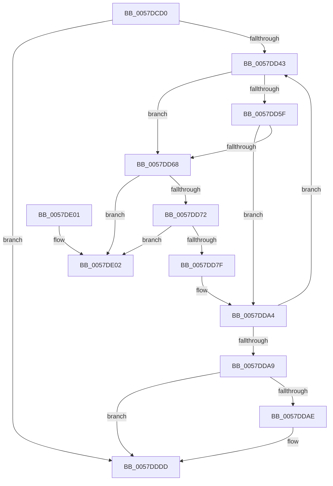

# CcProcessDelayedDeletePVCM

- RVA: `0x0057DCD0`–`0x0057DE09` (길이 `313` bytes)
- VA: `0x000000014057DCD0`
- 실행 섹션: `.text`
- PDB 이름 있음: `예`; PDB Function 태그: `아니요`
- unwind 정보 RVA: `0x000C588C`
- 디코드: `78`개 명령, `313/313` bytes 표시
- 미해석 바이트: `0` (있으면 어셈블리에 `.byte`로 보존)

> 이 문서는 커널 이미지의 기계어와 PDB 기호를 분석해 생성했습니다. 4번과 5번은 함수 원형과 자료형을 바이너리 사용 방식에서 추정한 C 해석이며 원본 소스 복구 결과는 아닙니다.

## 1. Dependencies

- 직접 호출 지점: **5**; 고유 호출 대상: **5**
- 직접 호출자로 확인된 함수: **0**
- RIP 상대 이미지 참조: **3**

### Outgoing calls
- `0x0057DD27` → [KeAcquireInStackQueuedSpinLock](../27/KeAcquireInStackQueuedSpinLock_function_002757A0.md) (function, `0x002757A0`)
- `0x0057DD92` → [KeSetEvent](../33/KeSetEvent_function_0033F310.md) (function, `0x0033F310`)
- `0x0057DD9F` → [CcPostPVCMForDeleteToPartition](../4C/CcPostPVCMForDeleteToPartition_function_004C2DBC.md) (function, `0x004C2DBC`)
- `0x0057DDD1` → [KeSetCoalescableTimer](../22/KeSetCoalescableTimer_function_0022FFD0.md) (function, `0x0022FFD0`)
- `0x0057DDE2` → [KeReleaseInStackQueuedSpinLock](../34/KeReleaseInStackQueuedSpinLock_function_00342CE0.md) (function, `0x00342CE0`)

### Direct callers
- 이 함수 시작 RVA로 연결되는 직접 call은 확인되지 않았습니다. 간접 호출은 완전히 역산할 수 없습니다.

### Static image references
- `0x0057DD0D` → RVA `0x00026300` (`.rdata`; read)
- `0x0057DD14` → RVA `0x00FC6AA0` (`ALMOSTRO`; read)
- `0x0057DDAE` → RVA `0x000262F8` (`.rdata`; read)

## 2. Other-region calls and transfers

- 다른 실행 섹션으로 향하는 call: **0**
- 별도 외부 분기/꼬리 이동을 확인하지 못했습니다.

## 3. Assembly (complete function range)

```asm
0057DCD0  4C 8B DC                        mov r11, rsp
0057DCD3  49 89 5B 08                     mov qword ptr [r11 + 8], rbx
0057DCD7  49 89 6B 10                     mov qword ptr [r11 + 0x10], rbp
0057DCDB  49 89 73 18                     mov qword ptr [r11 + 0x18], rsi
0057DCDF  57                              push rdi
0057DCE0  41 56                           push r14
0057DCE2  41 57                           push r15
0057DCE4  48 83 EC 50                     sub rsp, 0x50
0057DCE8  33 C0                           xor eax, eax
0057DCEA  0F 57 C0                        xorps xmm0, xmm0
0057DCED  0F 11 44 24 30                  movups xmmword ptr [rsp + 0x30], xmm0
0057DCF2  49 89 43 D8                     mov qword ptr [r11 - 0x28], rax
0057DCF6  48 BB 20 03 00 00 80 F7 FF FF   movabs rbx, 0xfffff78000000320
0057DD00  48 8B E9                        mov rbp, rcx
0057DD03  48 81 C1 00 03 00 00            add rcx, 0x300
0057DD0A  48 8B 1B                        mov rbx, qword ptr [rbx]
0057DD0D  48 8B 05 EC 85 AA FF            mov rax, qword ptr [rip - 0x557a14]
0057DD14  44 8B 05 85 8D A4 00            mov r8d, dword ptr [rip + 0xa48d85]
0057DD1B  48 99                           cqo
0057DD1D  49 F7 F8                        idiv r8
0057DD20  49 8D 53 C8                     lea rdx, [r11 - 0x38]
0057DD24  48 8B F8                        mov rdi, rax
0057DD27  E8 74 7A CF FF                  call 0x1402757a0
0057DD2C  4C 8D 75 70                     lea r14, [rbp + 0x70]
0057DD30  C6 85 E0 05 00 00 00            mov byte ptr [rbp + 0x5e0], 0
0057DD37  49 8B 36                        mov rsi, qword ptr [r14]
0057DD3A  49 3B F6                        cmp rsi, r14
0057DD3D  0F 84 9A 00 00 00               je 0x14057dddd
0057DD43  4C 8D BE C0 FD FF FF            lea r15, [rsi - 0x240]
0057DD4A  48 8B D6                        mov rdx, rsi
0057DD4D  49 8B 8F 58 06 00 00            mov rcx, qword ptr [r15 + 0x658]
0057DD54  48 8B 36                        mov rsi, qword ptr [rsi]
0057DD57  48 03 CF                        add rcx, rdi
0057DD5A  48 3B D9                        cmp rbx, rcx
0057DD5D  7D 09                           jge 0x14057dd68
0057DD5F  80 BD 0E 05 00 00 00            cmp byte ptr [rbp + 0x50e], 0
0057DD66  74 3C                           je 0x14057dda4
0057DD68  48 39 56 08                     cmp qword ptr [rsi + 8], rdx
0057DD6C  0F 85 90 00 00 00               jne 0x14057de02
0057DD72  48 8B 42 08                     mov rax, qword ptr [rdx + 8]
0057DD76  48 39 10                        cmp qword ptr [rax], rdx
0057DD79  0F 85 83 00 00 00               jne 0x14057de02
0057DD7F  48 89 30                        mov qword ptr [rax], rsi
0057DD82  49 8D 8F 98 04 00 00            lea rcx, [r15 + 0x498]
0057DD89  45 33 C0                        xor r8d, r8d
0057DD8C  48 89 46 08                     mov qword ptr [rsi + 8], rax
0057DD90  33 D2                           xor edx, edx
0057DD92  E8 79 15 DC FF                  call 0x14033f310
0057DD97  45 33 C0                        xor r8d, r8d
0057DD9A  B2 01                           mov dl, 1
0057DD9C  49 8B CF                        mov rcx, r15
0057DD9F  E8 18 50 F4 FF                  call 0x1404c2dbc
0057DDA4  49 3B F6                        cmp rsi, r14
0057DDA7  75 9A                           jne 0x14057dd43
0057DDA9  4D 39 36                        cmp qword ptr [r14], r14
0057DDAC  74 2F                           je 0x14057dddd
0057DDAE  48 8B 15 43 85 AA FF            mov rdx, qword ptr [rip - 0x557abd]
0057DDB5  48 8D 85 A0 05 00 00            lea rax, [rbp + 0x5a0]
0057DDBC  48 8D 8D 60 05 00 00            lea rcx, [rbp + 0x560]
0057DDC3  48 89 44 24 20                  mov qword ptr [rsp + 0x20], rax
0057DDC8  41 B9 E8 03 00 00               mov r9d, 0x3e8
0057DDCE  45 33 C0                        xor r8d, r8d
0057DDD1  E8 FA 21 CB FF                  call 0x14022ffd0
0057DDD6  C6 85 E0 05 00 00 01            mov byte ptr [rbp + 0x5e0], 1
0057DDDD  48 8D 4C 24 30                  lea rcx, [rsp + 0x30]
0057DDE2  E8 F9 4E DC FF                  call 0x140342ce0
0057DDE7  4C 8D 5C 24 50                  lea r11, [rsp + 0x50]
0057DDEC  49 8B 5B 20                     mov rbx, qword ptr [r11 + 0x20]
0057DDF0  49 8B 6B 28                     mov rbp, qword ptr [r11 + 0x28]
0057DDF4  49 8B 73 30                     mov rsi, qword ptr [r11 + 0x30]
0057DDF8  49 8B E3                        mov rsp, r11
0057DDFB  41 5F                           pop r15
0057DDFD  41 5E                           pop r14
0057DDFF  5F                              pop rdi
0057DE00  C3                              ret
0057DE01  CC                              int3
0057DE02  B9 03 00 00 00                  mov ecx, 3
0057DE07  CD 29                           int 0x29
```

## 4. C-style interpretation (structured pseudocode)

```c
__int64 __fastcall CcProcessDelayedDeletePVCM(__int64 a1)
{
    __int64 result;
    __int64 v_rsp;
    unsigned __int64 v_stack_m18;
    unsigned __int64 v_stack_m38;
    unsigned __int64 v_stack_m48;

    *(unsigned __int64 *)(v_rsp + 8) = v_rbx;
    *(unsigned __int64 *)(v_rsp + 16) = v_rbp;
    *(unsigned __int64 *)(v_rsp + 24) = v_rsi;
    v_rsp = (v_rsp) - (80);
    result = 0;
    v_stack_m38 = v_xmm0;
    *(unsigned __int64 *)(v_rsp - 40) = 0;
    a1 = (a1) + (768);
    result = KeAcquireInStackQueuedSpinLock(a1, v_rsp - 56, (unsigned int)(*(unsigned int *)(v_rip + 10784133)), a4);
    *(unsigned __int8 *)(a1 + 1504) = 0;
    if ((*(unsigned __int64 *)(a1 + 112)) == (a1 + 112)) goto loc_0057DDDD;
loc_0057DD43:
    a1 = (*(unsigned __int64 *)(*(unsigned __int64 *)(a1 + 112) - 576 + 1624)) + (*(unsigned __int64 *)(v_rip - 5601812));
    if ((*(unsigned __int64 *)(v_rbx)) >= a1) goto loc_0057DD68;
    if ((*(unsigned __int8 *)(a1 + 1294)) == 0) goto loc_0057DDA4;
loc_0057DD68:
    if ((*(unsigned __int64 *)(*(unsigned __int64 *)(*(unsigned __int64 *)(a1 + 112)) + 8)) != (*(unsigned __int64 *)(a1 + 112))) goto loc_0057DE02;
    if ((*(unsigned __int64 *)(*(unsigned __int64 *)(*(unsigned __int64 *)(a1 + 112) + 8))) != (*(unsigned __int64 *)(a1 + 112))) goto loc_0057DE02;
    *(unsigned __int64 *)(*(unsigned __int64 *)(*(unsigned __int64 *)(a1 + 112) + 8)) = *(unsigned __int64 *)(*(unsigned __int64 *)(a1 + 112));
    a3 = 0;
    *(unsigned __int64 *)(*(unsigned __int64 *)(*(unsigned __int64 *)(a1 + 112)) + 8) = *(unsigned __int64 *)(*(unsigned __int64 *)(a1 + 112) + 8);
    a2 = 0;
    result = KeSetEvent(*(unsigned __int64 *)(a1 + 112) - 576 + 1176, a2, a3, a4);
    a3 = 0;
    result = CcPostPVCMForDeleteToPartition(*(unsigned __int64 *)(a1 + 112) - 576, 1, a3, a4);
loc_0057DDA4:
    if ((*(unsigned __int64 *)(*(unsigned __int64 *)(a1 + 112))) != (a1 + 112)) goto loc_0057DD43;
    if ((*(unsigned __int64 *)(a1 + 112)) != (a1 + 112)) {
        a2 = *(unsigned __int64 *)(v_rip - 5601981);
        result = a1 + 1440;
        a1 = a1 + 1376;
        v_stack_m48 = result;
        a4 = 1000;
        a3 = 0;
        result = KeSetCoalescableTimer(a1, a2, a3, a4);
        *(unsigned __int8 *)(a1 + 1504) = 1;
    }
    result = KeReleaseInStackQueuedSpinLock(v_stack_m38, a2, a3, a4);
    return result;
loc_0057DE02:
    return result;
}
```

## 5. (Beta) C Style

```c
int64_t CcProcessDelayedDeletePVCM(void *Arg1)
{
    uint8_t *arg1 = (uint8_t *)Arg1;

    int64_t result;
    int64_t local_rsp;
    uint64_t v_stack_m18;
    uint64_t v_stack_m38;
    uint64_t v_stack_m48;

    *(uint64_t *)(local_rsp + 0x8) = local_rbx;
    *(uint64_t *)(local_rsp + 0x10) = local_rbp;
    *(uint64_t *)(local_rsp + 0x18) = local_rsi;
    local_rsp = (local_rsp) - (80);
    result = 0;
    v_stack_m38 = v_xmm0;
    *(uint64_t *)(local_rsp - 0x28) = 0;
    Arg1 = (Arg1) + (768);
    result = KeAcquireInStackQueuedSpinLock(Arg1, local_rsp - 56, (uint32_t)(*(uint32_t *)(v_rip + 0xA48D85)), a4);
    *(uint8_t *)(arg1 + 0x5E0) = 0;
    if ((*(uint64_t *)(arg1 + 0x70)) == (Arg1 + 112)) goto loc_0057DDDD;
loc_0057DD43:
    Arg1 = (*(uint64_t *)(*(uint64_t *)(arg1 + 0x70) - 0x240 + 0x658)) + (*(uint64_t *)(v_rip - 0x557A14));
    if ((*(uint64_t *)(local_rbx)) >= Arg1) goto loc_0057DD68;
    if ((*(uint8_t *)(arg1 + 0x50E)) == 0) goto loc_0057DDA4;
loc_0057DD68:
    if ((*(uint64_t *)(*(uint64_t *)(*(uint64_t *)(arg1 + 0x70)) + 0x8)) != (*(uint64_t *)(arg1 + 0x70))) goto loc_0057DE02;
    if ((*(uint64_t *)(*(uint64_t *)(*(uint64_t *)(arg1 + 0x70) + 0x8))) != (*(uint64_t *)(arg1 + 0x70))) goto loc_0057DE02;
    *(uint64_t *)(*(uint64_t *)(*(uint64_t *)(arg1 + 0x70) + 0x8)) = *(uint64_t *)(*(uint64_t *)(arg1 + 0x70));
    a3 = 0;
    *(uint64_t *)(*(uint64_t *)(*(uint64_t *)(arg1 + 0x70)) + 0x8) = *(uint64_t *)(*(uint64_t *)(arg1 + 0x70) + 0x8);
    a2 = 0;
    result = KeSetEvent(*(uint64_t *)(arg1 + 0x70) - 576 + 1176, a2, a3, a4);
    a3 = 0;
    result = CcPostPVCMForDeleteToPartition(*(uint64_t *)(arg1 + 0x70) - 576, 1, a3, a4);
loc_0057DDA4:
    if ((*(uint64_t *)(*(uint64_t *)(arg1 + 0x70))) != (Arg1 + 112)) goto loc_0057DD43;
    if ((*(uint64_t *)(arg1 + 0x70)) != (Arg1 + 112)) {
        a2 = *(uint64_t *)(v_rip - 0x557ABD);
        result = Arg1 + 1440;
        Arg1 = Arg1 + 1376;
        v_stack_m48 = result;
        a4 = 1000;
        a3 = 0;
        result = KeSetCoalescableTimer(Arg1, a2, a3, a4);
        *(uint8_t *)(arg1 + 0x5E0) = 1;
    }
    result = KeReleaseInStackQueuedSpinLock(v_stack_m38, a2, a3, a4);
    return result;
loc_0057DE02:
    return result;
}
```

### 관측된 메모리 오프셋

구조체 형식이 확인되지 않은 접근은 인자 기준의 오프셋으로만 기록했습니다.

| 기준 인자 | 오프셋 표현 | 폭 (bit) | 접근 |
|---|---:|---:|---|
| `Arg1` | `+ 0x0` | `64` | `R` |
| `Arg1` | `+ 0x70` | `64` | `R` |
| `Arg1` | `+ 0x50E` | `8` | `R` |
| `Arg1` | `+ 0x560` | `64` | `R` |
| `Arg1` | `+ 0x5A0` | `64` | `R` |
| `Arg1` | `+ 0x5E0` | `8` | `W` |

## 6. Execution-region graph

[열기: 2D/3D 그래프와 함수 탐색 컨트롤 패널](../../../control-panel.html?section=text&rva=0x0057DCD0&view=graph)

- 2D 그래프는 위에서 아래로 흐르고, 3D 그래프는 빈 공간을 드래그해 회전합니다. Shift+드래그는 이동, 휠은 확대·축소, 함수 노드 선택은 대상 보고서 이동입니다.

### Static fallback


