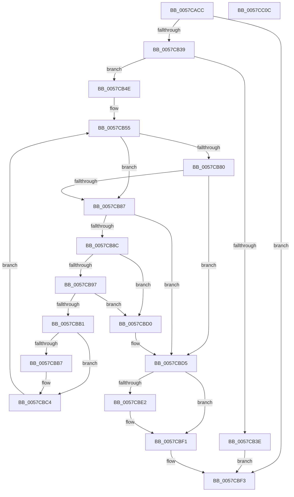

# CcQueryRegKeyValue

- RVA: `0x0057CACC`–`0x0057CC0D` (길이 `321` bytes)
- VA: `0x000000014057CACC`
- 실행 섹션: `.text`
- PDB 이름 있음: `예`; PDB Function 태그: `아니요`
- unwind 정보 RVA: `0x000C57D0`
- 디코드: `91`개 명령, `321/321` bytes 표시
- 미해석 바이트: `0` (있으면 어셈블리에 `.byte`로 보존)

> 이 문서는 커널 이미지의 기계어와 PDB 기호를 분석해 생성했습니다. 4번과 5번은 함수 원형과 자료형을 바이너리 사용 방식에서 추정한 C 해석이며 원본 소스 복구 결과는 아닙니다.

## 1. Dependencies

- 직접 호출 지점: **6**; 고유 호출 대상: **5**
- 직접 호출자로 확인된 함수: **1**
- RIP 상대 이미지 참조: **0**

### Outgoing calls
- `0x0057CB2C` → [ZwOpenKey](../6A/ZwOpenKey_function_006AD310.md) (function, `0x006AD310`)
- `0x0057CB42` → [ZwClose](../6A/ZwClose_function_006AD2B0.md) (function, `0x006AD2B0`)
- `0x0057CB72` → [ZwQueryValueKey](../6A/ZwQueryValueKey_function_006AD3B0.md) (function, `0x006AD3B0`)
- `0x0057CBA4` → [ExAllocatePoolWithTag](../../poolcode/B8/ExAllocatePoolWithTag_function_00B82010.md) (function, `0x00B82010`)
- `0x0057CBBF` → [ExFreePoolWithTag](../../poolcode/B8/ExFreePoolWithTag_function_00B82870.md) (function, `0x00B82870`)
- `0x0057CBD9` → [ZwClose](../6A/ZwClose_function_006AD2B0.md) (function, `0x006AD2B0`)

### Direct callers
- [CcUpdateDynamicRegistrySettings](CcUpdateDynamicRegistrySettings_function_0057CFC0.md) at `0x0057D0AC`
- [CcUpdateDynamicRegistrySettings](CcUpdateDynamicRegistrySettings_function_0057CFC0.md) at `0x0057D0F6`
- [CcUpdateDynamicRegistrySettings](CcUpdateDynamicRegistrySettings_function_0057CFC0.md) at `0x0057D13B`
- [CcUpdateDynamicRegistrySettings](CcUpdateDynamicRegistrySettings_function_0057CFC0.md) at `0x0057D17E`
- [CcUpdateDynamicRegistrySettings](CcUpdateDynamicRegistrySettings_function_0057CFC0.md) at `0x0057D1C3`
- [CcUpdateDynamicRegistrySettings](CcUpdateDynamicRegistrySettings_function_0057CFC0.md) at `0x0057D208`
- [CcUpdateDynamicRegistrySettings](CcUpdateDynamicRegistrySettings_function_0057CFC0.md) at `0x0057D24D`
- [CcUpdateDynamicRegistrySettings](CcUpdateDynamicRegistrySettings_function_0057CFC0.md) at `0x0057D292`
- [CcUpdateDynamicRegistrySettings](CcUpdateDynamicRegistrySettings_function_0057CFC0.md) at `0x0057D2D7`
- [CcUpdateDynamicRegistrySettings](CcUpdateDynamicRegistrySettings_function_0057CFC0.md) at `0x0057D31C`
- [CcUpdateDynamicRegistrySettings](CcUpdateDynamicRegistrySettings_function_0057CFC0.md) at `0x0057D361`
- [CcUpdateDynamicRegistrySettings](CcUpdateDynamicRegistrySettings_function_0057CFC0.md) at `0x0057D3A3`

### Static image references
- 디코드된 RIP-relative 메모리 참조가 없습니다.

## 2. Other-region calls and transfers

- 다른 실행 섹션으로 향하는 call: **2**
  - `0x0057CBA4` → [ExAllocatePoolWithTag](../../poolcode/B8/ExAllocatePoolWithTag_function_00B82010.md) (`.text` → `POOLCODE`)
  - `0x0057CBBF` → [ExFreePoolWithTag](../../poolcode/B8/ExFreePoolWithTag_function_00B82870.md) (`.text` → `POOLCODE`)
- 별도 외부 분기/꼬리 이동을 확인하지 못했습니다.

## 3. Assembly (complete function range)

```asm
0057CACC  48 89 5C 24 10                  mov qword ptr [rsp + 0x10], rbx
0057CAD1  48 89 74 24 18                  mov qword ptr [rsp + 0x18], rsi
0057CAD6  55                              push rbp
0057CAD7  57                              push rdi
0057CAD8  41 54                           push r12
0057CADA  41 56                           push r14
0057CADC  41 57                           push r15
0057CADE  48 8B EC                        mov rbp, rsp
0057CAE1  48 83 EC 70                     sub rsp, 0x70
0057CAE5  48 83 65 C0 00                  and qword ptr [rbp - 0x40], 0
0057CAEA  4D 8B F0                        mov r14, r8
0057CAED  83 65 30 00                     and dword ptr [rbp + 0x30], 0
0057CAF1  4C 8D 45 C8                     lea r8, [rbp - 0x38]
0057CAF5  83 65 E4 00                     and dword ptr [rbp - 0x1c], 0
0057CAF9  4C 8B E2                        mov r12, rdx
0057CAFC  48 83 65 D0 00                  and qword ptr [rbp - 0x30], 0
0057CB01  0F 57 C0                        xorps xmm0, xmm0
0057CB04  48 89 4D D8                     mov qword ptr [rbp - 0x28], rcx
0057CB08  BA 19 00 02 00                  mov edx, 0x20019
0057CB0D  48 C7 45 C8 30 00 00 00         mov qword ptr [rbp - 0x38], 0x30
0057CB15  48 8D 4D C0                     lea rcx, [rbp - 0x40]
0057CB19  83 65 CC 00                     and dword ptr [rbp - 0x34], 0
0057CB1D  49 8B F1                        mov rsi, r9
0057CB20  F3 0F 7F 45 E8                  movdqu xmmword ptr [rbp - 0x18], xmm0
0057CB25  C7 45 E0 40 02 00 00            mov dword ptr [rbp - 0x20], 0x240
0057CB2C  E8 DF 07 13 00                  call 0x1406ad310
0057CB31  85 C0                           test eax, eax
0057CB33  0F 88 BA 00 00 00               js 0x14057cbf3
0057CB39  4D 85 E4                        test r12, r12
0057CB3C  75 10                           jne 0x14057cb4e
0057CB3E  48 8B 4D C0                     mov rcx, qword ptr [rbp - 0x40]
0057CB42  E8 69 07 13 00                  call 0x1406ad2b0
0057CB47  33 C0                           xor eax, eax
0057CB49  E9 A5 00 00 00                  jmp 0x14057cbf3
0057CB4E  41 8B 3E                        mov edi, dword ptr [r14]
0057CB51  4C 8B 7D 50                     mov r15, qword ptr [rbp + 0x50]
0057CB55  4C 8B 0E                        mov r9, qword ptr [rsi]
0057CB58  48 8D 45 30                     lea rax, [rbp + 0x30]
0057CB5C  48 8B 4D C0                     mov rcx, qword ptr [rbp - 0x40]
0057CB60  41 B8 01 00 00 00               mov r8d, 1
0057CB66  48 89 44 24 28                  mov qword ptr [rsp + 0x28], rax
0057CB6B  49 8B D4                        mov rdx, r12
0057CB6E  89 7C 24 20                     mov dword ptr [rsp + 0x20], edi
0057CB72  E8 39 08 13 00                  call 0x1406ad3b0
0057CB77  8B D8                           mov ebx, eax
0057CB79  3D 23 00 00 C0                  cmp eax, 0xc0000023
0057CB7E  74 07                           je 0x14057cb87
0057CB80  3D 05 00 00 80                  cmp eax, 0x80000005
0057CB85  75 4E                           jne 0x14057cbd5
0057CB87  41 3B 3E                        cmp edi, dword ptr [r14]
0057CB8A  75 49                           jne 0x14057cbd5
0057CB8C  8B 7D 30                        mov edi, dword ptr [rbp + 0x30]
0057CB8F  81 FF 00 00 04 00               cmp edi, 0x40000
0057CB95  77 39                           ja 0x14057cbd0
0057CB97  8B D7                           mov edx, edi
0057CB99  B9 01 00 00 00                  mov ecx, 1
0057CB9E  41 B8 43 63 66 78               mov r8d, 0x78666343
0057CBA4  E8 67 54 60 00                  call 0x140b82010
0057CBA9  48 8B D8                        mov rbx, rax
0057CBAC  48 85 C0                        test rax, rax
0057CBAF  74 1F                           je 0x14057cbd0
0057CBB1  41 80 3F 00                     cmp byte ptr [r15], 0
0057CBB5  74 0D                           je 0x14057cbc4
0057CBB7  48 8B 0E                        mov rcx, qword ptr [rsi]
0057CBBA  BA 43 63 66 78                  mov edx, 0x78666343
0057CBBF  E8 AC 5C 60 00                  call 0x140b82870
0057CBC4  48 89 1E                        mov qword ptr [rsi], rbx
0057CBC7  41 89 3E                        mov dword ptr [r14], edi
0057CBCA  41 C6 07 01                     mov byte ptr [r15], 1
0057CBCE  EB 85                           jmp 0x14057cb55
0057CBD0  BB 9A 00 00 C0                  mov ebx, 0xc000009a
0057CBD5  48 8B 4D C0                     mov rcx, qword ptr [rbp - 0x40]
0057CBD9  E8 D2 06 13 00                  call 0x1406ad2b0
0057CBDE  85 DB                           test ebx, ebx
0057CBE0  78 0F                           js 0x14057cbf1
0057CBE2  48 8B 06                        mov rax, qword ptr [rsi]
0057CBE5  B9 34 00 00 C0                  mov ecx, 0xc0000034
0057CBEA  83 78 0C 00                     cmp dword ptr [rax + 0xc], 0
0057CBEE  0F 44 D9                        cmove ebx, ecx
0057CBF1  8B C3                           mov eax, ebx
0057CBF3  4C 8D 5C 24 70                  lea r11, [rsp + 0x70]
0057CBF8  49 8B 5B 38                     mov rbx, qword ptr [r11 + 0x38]
0057CBFC  49 8B 73 40                     mov rsi, qword ptr [r11 + 0x40]
0057CC00  49 8B E3                        mov rsp, r11
0057CC03  41 5F                           pop r15
0057CC05  41 5E                           pop r14
0057CC07  41 5C                           pop r12
0057CC09  5F                              pop rdi
0057CC0A  5D                              pop rbp
0057CC0B  C3                              ret
0057CC0C  CC                              int3
```

## 4. C-style interpretation (structured pseudocode)

```c
__int64 __fastcall CcQueryRegKeyValue(__int64 a1, __int64 a2, __int64 a3, __int64 a4, __int64 a5)
{
    __int64 result;
    __int64 v_rbx;
    __int64 v_rsp;
    unsigned __int64 v_stack_m28;
    unsigned __int64 v_stack_m40;
    unsigned int v_stack_m44;
    unsigned int v_stack_m48;
    unsigned __int64 v_stack_m50;
    unsigned __int64 v_stack_m58;
    unsigned int v_stack_m5C;
    unsigned __int64 v_stack_m60;
    unsigned __int64 v_stack_m68;
    unsigned __int64 v_stack_m70;
    unsigned int v_stack_m78;
    unsigned __int64 v_stack_p10;
    unsigned __int64 v_stack_p18;
    unsigned int v_stack_p8;

    v_stack_p10 = v_rbx;
    v_stack_p18 = v_rsi;
    v_rsp = (v_rsp) - (112);
    v_stack_m50 = a1;
    v_stack_m60 = 48;
    v_stack_m40 = v_xmm0;
    v_stack_m48 = 576;
    result = ZwOpenKey(v_stack_m68, (unsigned int)(0x20019ULL), v_stack_m60, a4);
    if (sign_flag) goto loc_0057CBF3;
    if (a2 != 0) goto loc_0057CB4E;
    result = ZwClose(v_stack_m68, (unsigned int)(0x20019ULL), v_stack_m60, a4);
    result = 0;
    goto loc_0057CBF3;
loc_0057CB4E:
loc_0057CB55:
    v_stack_m70 = v_stack_p8;
    v_stack_m78 = (unsigned int)((unsigned int)(*(unsigned int *)(a3)));
    result = ZwQueryValueKey(v_stack_m68, a2, 1, *(unsigned __int64 *)(a4));
    if (((unsigned int)(result)) == 0xC0000023ULL) goto loc_0057CB87;
    if (((unsigned int)(result)) != 0x80000005ULL) goto loc_0057CBD5;
loc_0057CB87:
    if (((unsigned int)((unsigned int)(*(unsigned int *)(a3)))) != (*(unsigned int *)(a3))) goto loc_0057CBD5;
    if (((unsigned int)((unsigned int)(v_stack_p8))) > 0x40000ULL) goto loc_0057CBD0;
    result = ExAllocatePoolWithTag(1, (unsigned int)((unsigned int)((unsigned int)(v_stack_p8))), (unsigned int)(0x78666343ULL), *(unsigned __int64 *)(a4));
    if (result == 0) goto loc_0057CBD0;
    if ((*(unsigned __int8 *)(a5)) != 0) {
        a1 = *(unsigned __int64 *)(a4);
        a2 = 0x78666343ULL;
        result = ExFreePoolWithTag(a1, a2, (unsigned int)(0x78666343ULL), *(unsigned __int64 *)(a4));
    }
    *(unsigned __int64 *)(a4) = result;
    *(unsigned int *)(a3) = (unsigned int)((unsigned int)(v_stack_p8));
    *(unsigned __int8 *)(a5) = 1;
    goto loc_0057CB55;
loc_0057CBD0:
loc_0057CBD5:
    result = ZwClose(v_stack_m68, a2, (unsigned int)(0x78666343ULL), *(unsigned __int64 *)(a4));
    v_rbx = (unsigned int)(0xC000009AULL);
    if (!(sign_flag)) {
        result = *(unsigned __int64 *)(a4);
        a1 = 0xC0000034ULL;
        v_rbx = (unsigned int)(0xC000009AULL);
        if ((*(unsigned int *)(result + 12)) == 0) { v_rbx = (unsigned int)(a1); }
    }
loc_0057CBF3:
    return (unsigned int)((unsigned int)(v_rbx));
}
```

## 5. (Beta) C Style

```c
int64_t CcQueryRegKeyValue(int64_t Arg1, int64_t Arg2, void *Arg3, void *Arg4, void *Arg5)
{
    uint8_t *arg3 = (uint8_t *)Arg3;
    uint8_t *arg4 = (uint8_t *)Arg4;
    uint8_t *arg5 = (uint8_t *)Arg5;

    int64_t result;
    int64_t local_rbx;
    int64_t local_rsp;
    uint64_t v_stack_m28;
    uint64_t v_stack_m40;
    uint32_t v_stack_m44;
    uint32_t v_stack_m48;
    uint64_t v_stack_m50;
    uint64_t v_stack_m58;
    uint32_t v_stack_m5C;
    uint64_t v_stack_m60;
    uint64_t v_stack_m68;
    uint64_t v_stack_m70;
    uint32_t v_stack_m78;
    uint64_t v_stack_p10;
    uint64_t v_stack_p18;
    uint32_t v_stack_p8;

    v_stack_p10 = local_rbx;
    v_stack_p18 = local_rsi;
    local_rsp = (local_rsp) - (112);
    v_stack_m50 = Arg1;
    v_stack_m60 = 48;
    v_stack_m40 = v_xmm0;
    v_stack_m48 = 576;
    result = ZwOpenKey(v_stack_m68, (uint32_t)(0x20019ULL), v_stack_m60, Arg4);
    if (sign_flag) goto loc_0057CBF3;
    if (Arg2 != 0) goto loc_0057CB4E;
    result = ZwClose(v_stack_m68, (uint32_t)(0x20019ULL), v_stack_m60, Arg4);
    result = 0;
    goto loc_0057CBF3;
loc_0057CB4E:
loc_0057CB55:
    v_stack_m70 = v_stack_p8;
    v_stack_m78 = (uint32_t)((uint32_t)(*(uint32_t *)(arg3)));
    result = ZwQueryValueKey(v_stack_m68, Arg2, 1, *(uint64_t *)(arg4));
    if (((uint32_t)(result)) == 0xC0000023ULL) goto loc_0057CB87;
    if (((uint32_t)(result)) != 0x80000005ULL) goto loc_0057CBD5;
loc_0057CB87:
    if (((uint32_t)((uint32_t)(*(uint32_t *)(arg3)))) != (*(uint32_t *)(arg3))) goto loc_0057CBD5;
    if (((uint32_t)((uint32_t)(v_stack_p8))) > 0x40000ULL) goto loc_0057CBD0;
    result = ExAllocatePoolWithTag(1, (uint32_t)((uint32_t)((uint32_t)(v_stack_p8))), (uint32_t)(0x78666343ULL), *(uint64_t *)(arg4));
    if (result == 0) goto loc_0057CBD0;
    if ((*(uint8_t *)(arg5)) != 0) {
        Arg1 = *(uint64_t *)(arg4);
        Arg2 = 0x78666343ULL;
        result = ExFreePoolWithTag(Arg1, Arg2, (uint32_t)(0x78666343ULL), *(uint64_t *)(arg4));
    }
    *(uint64_t *)(arg4) = result;
    *(uint32_t *)(arg3) = (uint32_t)((uint32_t)(v_stack_p8));
    *(uint8_t *)(arg5) = 1;
    goto loc_0057CB55;
loc_0057CBD0:
loc_0057CBD5:
    result = ZwClose(v_stack_m68, Arg2, (uint32_t)(0x78666343ULL), *(uint64_t *)(arg4));
    local_rbx = (uint32_t)(0xC000009AULL);
    if (!(sign_flag)) {
        result = *(uint64_t *)(arg4);
        Arg1 = 0xC0000034ULL;
        local_rbx = (uint32_t)(0xC000009AULL);
        if ((*(uint32_t *)(result + 0xC)) == 0) { local_rbx = (uint32_t)(Arg1); }
    }
loc_0057CBF3:
    return (uint32_t)((uint32_t)(local_rbx));
}
```

### 관측된 메모리 오프셋

구조체 형식이 확인되지 않은 접근은 인자 기준의 오프셋으로만 기록했습니다.

| 기준 인자 | 오프셋 표현 | 폭 (bit) | 접근 |
|---|---:|---:|---|
| `Arg3` | `+ 0x0` | `32` | `R` |
| `Arg3` | `+ 0x0` | `32` | `W` |
| `Arg4` | `+ 0x0` | `64` | `R` |
| `Arg4` | `+ 0x0` | `64` | `W` |
| `Arg5` | `+ 0x0` | `8` | `R` |
| `Arg5` | `+ 0x0` | `8` | `W` |

## 6. Execution-region graph

[열기: 2D/3D 그래프와 함수 탐색 컨트롤 패널](../../../control-panel.html?section=text&rva=0x0057CACC&view=graph)

- 2D 그래프는 위에서 아래로 흐르고, 3D 그래프는 빈 공간을 드래그해 회전합니다. Shift+드래그는 이동, 휠은 확대·축소, 함수 노드 선택은 대상 보고서 이동입니다.

### Static fallback


