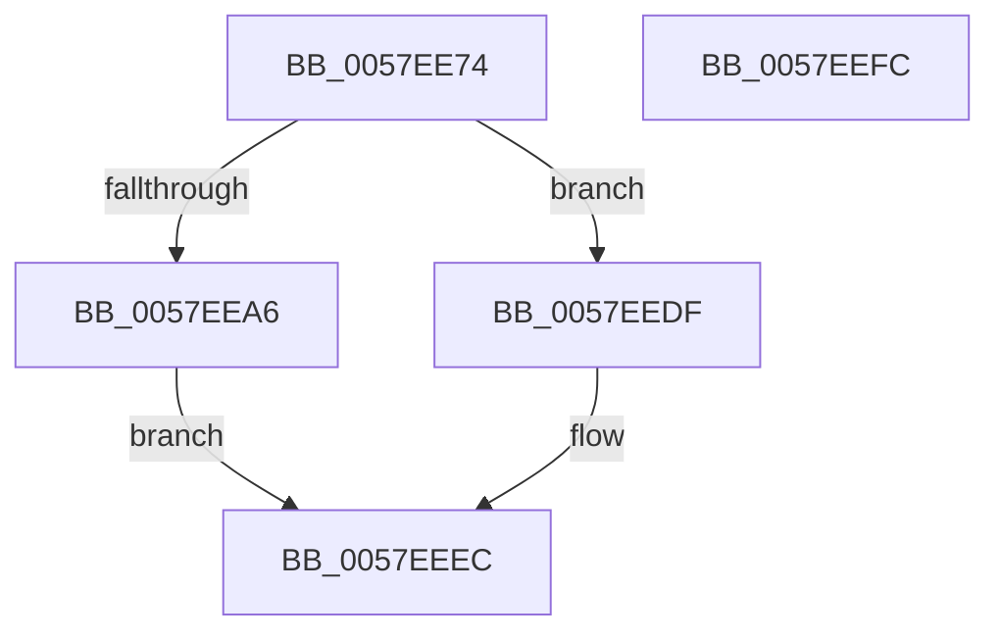

# CcQueueAsyncGetDeviceGuid

- RVA: `0x0057EE74`–`0x0057EEFD` (길이 `137` bytes)
- VA: `0x000000014057EE74`
- 실행 섹션: `.text`
- PDB 이름 있음: `예`; PDB Function 태그: `아니요`
- unwind 정보 RVA: `0x00060BC4`
- 디코드: `36`개 명령, `137/137` bytes 표시
- 미해석 바이트: `0` (있으면 어셈블리에 `.byte`로 보존)

> 이 문서는 커널 이미지의 기계어와 PDB 기호를 분석해 생성했습니다. 4번과 5번은 함수 원형과 자료형을 바이너리 사용 방식에서 추정한 C 해석이며 원본 소스 복구 결과는 아닙니다.

## 1. Dependencies

- 직접 호출 지점: **4**; 고유 호출 대상: **4**
- 직접 호출자로 확인된 함수: **1**
- RIP 상대 이미지 참조: **1**

### Outgoing calls
- `0x0057EE99` → [ExAllocatePoolWithTag](../../poolcode/B8/ExAllocatePoolWithTag_function_00B82010.md) (function, `0x00B82010`)
- `0x0057EEAE` → [ObfReferenceObjectWithTag](../21/ObfReferenceObjectWithTag_function_00210710.md) (function, `0x00210710`)
- `0x0057EED6` → [ExQueueWorkItem](../2F/ExQueueWorkItem_function_002F9520.md) (function, `0x002F9520`)
- `0x0057EEE2` → [CcDecrementVolumeUseCountWithDelete](../38/CcDecrementVolumeUseCountWithDelete_function_0038B888.md) (function, `0x0038B888`)

### Direct callers
- [sub_006E5110](../6E/Unknown_function_006E5110.md) at `0x006E5284`

### Static image references
- `0x0057EEBE` → RVA `0x0057ED70` (`CcGetDeviceGuidAsync`; read)

## 2. Other-region calls and transfers

- 다른 실행 섹션으로 향하는 call: **1**
  - `0x0057EE99` → [ExAllocatePoolWithTag](../../poolcode/B8/ExAllocatePoolWithTag_function_00B82010.md) (`.text` → `POOLCODE`)
- 별도 외부 분기/꼬리 이동을 확인하지 못했습니다.

## 3. Assembly (complete function range)

```asm
0057EE74  48 89 5C 24 08                  mov qword ptr [rsp + 8], rbx
0057EE79  48 89 74 24 10                  mov qword ptr [rsp + 0x10], rsi
0057EE7E  57                              push rdi
0057EE7F  48 83 EC 20                     sub rsp, 0x20
0057EE83  48 8B F2                        mov rsi, rdx
0057EE86  48 8B F9                        mov rdi, rcx
0057EE89  BA 30 00 00 00                  mov edx, 0x30
0057EE8E  B9 00 06 00 00                  mov ecx, 0x600
0057EE93  41 B8 43 63 54 65               mov r8d, 0x65546343
0057EE99  E8 72 31 60 00                  call 0x140b82010
0057EE9E  48 8B D8                        mov rbx, rax
0057EEA1  48 85 C0                        test rax, rax
0057EEA4  74 39                           je 0x14057eedf
0057EEA6  BA 44 66 6C 74                  mov edx, 0x746c6644
0057EEAB  48 8B CE                        mov rcx, rsi
0057EEAE  E8 5D 18 C9 FF                  call 0x140210710
0057EEB3  48 8D 4B 10                     lea rcx, [rbx + 0x10]
0057EEB7  48 89 73 08                     mov qword ptr [rbx + 8], rsi
0057EEBB  48 89 3B                        mov qword ptr [rbx], rdi
0057EEBE  48 8D 05 AB FE FF FF            lea rax, [rip - 0x155]
0057EEC5  48 83 21 00                     and qword ptr [rcx], 0
0057EEC9  BA 03 00 00 00                  mov edx, 3
0057EECE  48 89 41 10                     mov qword ptr [rcx + 0x10], rax
0057EED2  48 89 59 18                     mov qword ptr [rcx + 0x18], rbx
0057EED6  E8 45 A6 D7 FF                  call 0x1402f9520
0057EEDB  33 C0                           xor eax, eax
0057EEDD  EB 0D                           jmp 0x14057eeec
0057EEDF  48 8B CF                        mov rcx, rdi
0057EEE2  E8 A1 C9 E0 FF                  call 0x14038b888
0057EEE7  B8 9A 00 00 C0                  mov eax, 0xc000009a
0057EEEC  48 8B 5C 24 30                  mov rbx, qword ptr [rsp + 0x30]
0057EEF1  48 8B 74 24 38                  mov rsi, qword ptr [rsp + 0x38]
0057EEF6  48 83 C4 20                     add rsp, 0x20
0057EEFA  5F                              pop rdi
0057EEFB  C3                              ret
0057EEFC  CC                              int3
```

## 4. C-style interpretation (structured pseudocode)

```c
__int64 __fastcall CcQueueAsyncGetDeviceGuid(__int64 a1, __int64 a2)
{
    __int64 result;
    __int64 v_rsp;
    unsigned __int64 v_stack_p10;
    unsigned __int64 v_stack_p8;

    v_stack_p8 = v_rbx;
    v_stack_p10 = v_rsi;
    v_rsp = (v_rsp) - (32);
    result = ExAllocatePoolWithTag((unsigned int)(0x600ULL), 48, (unsigned int)(0x65546343ULL), a4);
    if (result == 0) goto loc_0057EEDF;
    result = ObfReferenceObjectWithTag(a2, (unsigned int)(0x746C6644ULL), (unsigned int)(0x65546343ULL), a4);
    *(unsigned __int64 *)(result + 8) = a2;
    *(unsigned __int64 *)(result) = a1;
    *(unsigned __int64 *)(result + 16 + 16) = v_rip - 341;
    *(unsigned __int64 *)(result + 16 + 24) = result;
    result = ExQueueWorkItem(result + 16, 3, (unsigned int)(0x65546343ULL), a4);
    result = 0;
    goto loc_0057EEEC;
loc_0057EEDF:
    result = CcDecrementVolumeUseCountWithDelete(a1, 3, (unsigned int)(0x65546343ULL), a4);
loc_0057EEEC:
    v_rsp = (v_rsp) + (32);
    return (unsigned int)(0xC000009AULL);
}
```

## 5. (Beta) C Style

```c
int64_t CcQueueAsyncGetDeviceGuid(int64_t Arg1, int64_t Arg2)
{
    int64_t result;
    int64_t local_rsp;
    uint64_t v_stack_p10;
    uint64_t v_stack_p8;

    v_stack_p8 = local_rbx;
    v_stack_p10 = local_rsi;
    local_rsp = (local_rsp) - (32);
    result = ExAllocatePoolWithTag((uint32_t)(0x600ULL), 48, (uint32_t)(0x65546343ULL), a4);
    if (result == 0) goto loc_0057EEDF;
    result = ObfReferenceObjectWithTag(Arg2, (uint32_t)(0x746C6644ULL), (uint32_t)(0x65546343ULL), a4);
    *(uint64_t *)(result + 0x8) = Arg2;
    *(uint64_t *)(result) = Arg1;
    *(uint64_t *)(result + 0x10 + 0x10) = v_rip - 341;
    *(uint64_t *)(result + 0x10 + 0x18) = result;
    result = ExQueueWorkItem(result + 16, 3, (uint32_t)(0x65546343ULL), a4);
    result = 0;
    goto loc_0057EEEC;
loc_0057EEDF:
    result = CcDecrementVolumeUseCountWithDelete(Arg1, 3, (uint32_t)(0x65546343ULL), a4);
loc_0057EEEC:
    local_rsp = (local_rsp) + (32);
    return (uint32_t)(0xC000009AULL);
}
```

## 6. Execution-region graph

[열기: 2D/3D 그래프와 함수 탐색 컨트롤 패널](../../../control-panel.html?section=text&rva=0x0057EE74&view=graph)

- 2D 그래프는 위에서 아래로 흐르고, 3D 그래프는 빈 공간을 드래그해 회전합니다. Shift+드래그는 이동, 휠은 확대·축소, 함수 노드 선택은 대상 보고서 이동입니다.

### Static fallback


