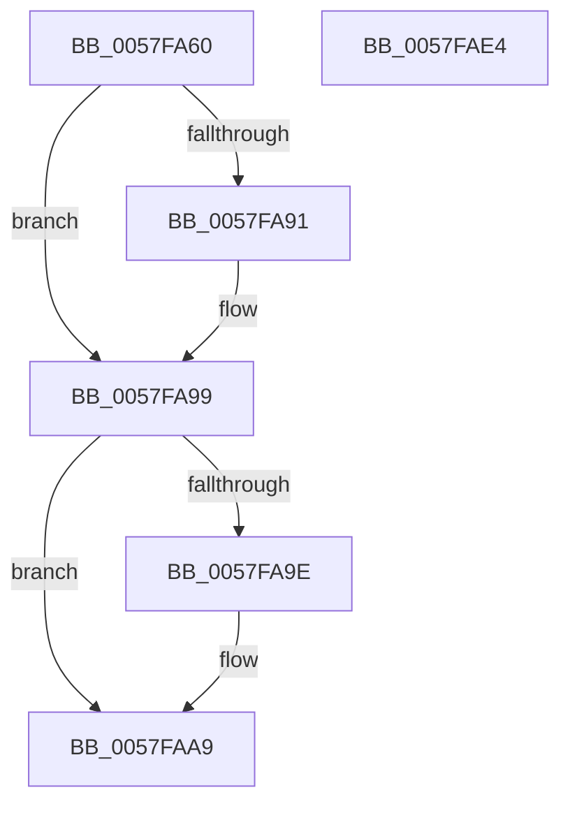

# CcQueueAsyncLazywriteCompletion

- RVA: `0x0057FA60`–`0x0057FAE5` (길이 `133` bytes)
- VA: `0x000000014057FA60`
- 실행 섹션: `.text`
- PDB 이름 있음: `예`; PDB Function 태그: `아니요`
- unwind 정보 RVA: `0x0005E6B4`
- 디코드: `35`개 명령, `133/133` bytes 표시
- 미해석 바이트: `0` (있으면 어셈블리에 `.byte`로 보존)

> 이 문서는 커널 이미지의 기계어와 PDB 기호를 분석해 생성했습니다. 4번과 5번은 함수 원형과 자료형을 바이너리 사용 방식에서 추정한 C 해석이며 원본 소스 복구 결과는 아닙니다.

## 1. Dependencies

- 직접 호출 지점: **3**; 고유 호출 대상: **3**
- 직접 호출자로 확인된 함수: **1**
- RIP 상대 이미지 참조: **0**

### Outgoing calls
- `0x0057FA94` → [CcFlushCachePostProcess](../35/CcFlushCachePostProcess_function_0035A570.md) (function, `0x0035A570`)
- `0x0057FAA1` → [CcWriteBehindReleaseFile](../4A/CcWriteBehindReleaseFile_function_004A4080.md) (function, `0x004A4080`)
- `0x0057FAC1` → [CcPostWorkQueueAsyncLazywrite](../4B/CcPostWorkQueueAsyncLazywrite_function_004BA17C.md) (function, `0x004BA17C`)

### Direct callers
- [CcAsyncLazywriteWorkerMulti](../4D/CcAsyncLazywriteWorkerMulti_function_004D1574.md) at `0x004D193E`
- [CcAsyncLazywriteWorkerMulti](../4D/CcAsyncLazywriteWorkerMulti_function_004D1574.md) at `0x004D1A02`

### Static image references
- 디코드된 RIP-relative 메모리 참조가 없습니다.

## 2. Other-region calls and transfers

- 다른 실행 섹션으로 향하는 call: **0**
- 별도 외부 분기/꼬리 이동을 확인하지 못했습니다.

## 3. Assembly (complete function range)

```asm
0057FA60  48 8B C4                        mov rax, rsp
0057FA63  48 89 58 08                     mov qword ptr [rax + 8], rbx
0057FA67  48 89 68 10                     mov qword ptr [rax + 0x10], rbp
0057FA6B  48 89 70 18                     mov qword ptr [rax + 0x18], rsi
0057FA6F  48 89 78 20                     mov qword ptr [rax + 0x20], rdi
0057FA73  41 56                           push r14
0057FA75  48 83 EC 20                     sub rsp, 0x20
0057FA79  48 8B 69 10                     mov rbp, qword ptr [rcx + 0x10]
0057FA7D  40 32 FF                        xor dil, dil
0057FA80  4C 8B B1 98 00 00 00            mov r14, qword ptr [rcx + 0x98]
0057FA87  41 8A F0                        mov sil, r8b
0057FA8A  48 8B D9                        mov rbx, rcx
0057FA8D  84 D2                           test dl, dl
0057FA8F  74 08                           je 0x14057fa99
0057FA91  48 8B CD                        mov rcx, rbp
0057FA94  E8 D7 AA DD FF                  call 0x14035a570
0057FA99  40 84 F6                        test sil, sil
0057FA9C  74 0B                           je 0x14057faa9
0057FA9E  48 8B CD                        mov rcx, rbp
0057FAA1  E8 DA 45 F2 FF                  call 0x1404a4080
0057FAA6  40 8A F8                        mov dil, al
0057FAA9  49 8D 96 80 01 00 00            lea rdx, [r14 + 0x180]
0057FAB0  C7 83 80 00 00 00 08 00 00 00   mov dword ptr [rbx + 0x80], 8
0057FABA  48 8B CB                        mov rcx, rbx
0057FABD  40 88 73 48                     mov byte ptr [rbx + 0x48], sil
0057FAC1  E8 B6 A6 F3 FF                  call 0x1404ba17c
0057FAC6  48 8B 5C 24 30                  mov rbx, qword ptr [rsp + 0x30]
0057FACB  40 8A C7                        mov al, dil
0057FACE  48 8B 7C 24 48                  mov rdi, qword ptr [rsp + 0x48]
0057FAD3  48 8B 6C 24 38                  mov rbp, qword ptr [rsp + 0x38]
0057FAD8  48 8B 74 24 40                  mov rsi, qword ptr [rsp + 0x40]
0057FADD  48 83 C4 20                     add rsp, 0x20
0057FAE1  41 5E                           pop r14
0057FAE3  C3                              ret
0057FAE4  CC                              int3
```

## 4. C-style interpretation (structured pseudocode)

```c
__int64 __fastcall CcQueueAsyncLazywriteCompletion(__int64 a1, unsigned __int8 a2, unsigned __int8 a3)
{
    __int64 result;
    __int64 v_rdi;
    __int64 v_rsp;
    unsigned __int64 v_stack_p10;
    unsigned __int64 v_stack_p18;
    unsigned __int64 v_stack_p20;
    unsigned __int64 v_stack_p8;

    *(unsigned __int64 *)(v_rsp + 8) = v_rbx;
    *(unsigned __int64 *)(v_rsp + 16) = v_rbp;
    *(unsigned __int64 *)(v_rsp + 24) = v_rsi;
    *(unsigned __int64 *)(v_rsp + 32) = v_rdi;
    v_rsp = (v_rsp) - (32);
    v_rdi = 0;
    result = v_rsp;
    if (a2 != 0) {
        a1 = *(unsigned __int64 *)(a1 + 16);
        result = CcFlushCachePostProcess(a1, a2, a3, a4);
    }
    if (a3 != 0) {
        a1 = *(unsigned __int64 *)(a1 + 16);
        result = CcWriteBehindReleaseFile(a1, a2, a3, a4);
        v_rdi = (unsigned __int8)(result);
    }
    *(unsigned int *)(a1 + 128) = 8;
    *(unsigned __int8 *)(a1 + 72) = a3;
    result = CcPostWorkQueueAsyncLazywrite(a1, *(unsigned __int64 *)(a1 + 152) + 384, a3, a4);
    v_rsp = (v_rsp) + (32);
    return (unsigned __int8)(v_rdi);
}
```

## 5. (Beta) C Style

```c
int64_t CcQueueAsyncLazywriteCompletion(void *Arg1, uint8_t Arg2, uint8_t Arg3)
{
    uint8_t *arg1 = (uint8_t *)Arg1;

    int64_t result;
    int64_t local_rdi;
    int64_t local_rsp;
    uint64_t v_stack_p10;
    uint64_t v_stack_p18;
    uint64_t v_stack_p20;
    uint64_t v_stack_p8;

    *(uint64_t *)(local_rsp + 0x8) = local_rbx;
    *(uint64_t *)(local_rsp + 0x10) = local_rbp;
    *(uint64_t *)(local_rsp + 0x18) = local_rsi;
    *(uint64_t *)(local_rsp + 0x20) = local_rdi;
    local_rsp = (local_rsp) - (32);
    local_rdi = 0;
    result = local_rsp;
    if (Arg2 != 0) {
        Arg1 = *(uint64_t *)(arg1 + 0x10);
        result = CcFlushCachePostProcess(Arg1, Arg2, Arg3, a4);
    }
    if (Arg3 != 0) {
        Arg1 = *(uint64_t *)(arg1 + 0x10);
        result = CcWriteBehindReleaseFile(Arg1, Arg2, Arg3, a4);
        local_rdi = (uint8_t)(result);
    }
    *(uint32_t *)(arg1 + 0x80) = 8;
    *(uint8_t *)(arg1 + 0x48) = Arg3;
    result = CcPostWorkQueueAsyncLazywrite(Arg1, *(uint64_t *)(arg1 + 0x98) + 384, Arg3, a4);
    local_rsp = (local_rsp) + (32);
    return (uint8_t)(local_rdi);
}
```

### 관측된 메모리 오프셋

구조체 형식이 확인되지 않은 접근은 인자 기준의 오프셋으로만 기록했습니다.

| 기준 인자 | 오프셋 표현 | 폭 (bit) | 접근 |
|---|---:|---:|---|
| `Arg1` | `+ 0x10` | `64` | `R` |
| `Arg1` | `+ 0x48` | `8` | `W` |
| `Arg1` | `+ 0x80` | `32` | `W` |
| `Arg1` | `+ 0x98` | `64` | `R` |

## 6. Execution-region graph

[열기: 2D/3D 그래프와 함수 탐색 컨트롤 패널](../../../control-panel.html?section=text&rva=0x0057FA60&view=graph)

- 2D 그래프는 위에서 아래로 흐르고, 3D 그래프는 빈 공간을 드래그해 회전합니다. Shift+드래그는 이동, 휠은 확대·축소, 함수 노드 선택은 대상 보고서 이동입니다.

### Static fallback


