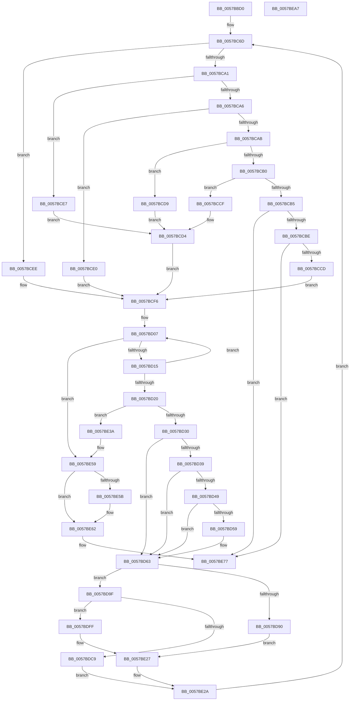

# CcQueueLazyWriteScanThread

- RVA: `0x0057BBD0`–`0x0057BEA8` (길이 `728` bytes)
- VA: `0x000000014057BBD0`
- 실행 섹션: `.text`
- PDB 이름 있음: `예`; PDB Function 태그: `아니요`
- unwind 정보 RVA: `0x000AC0FC`
- 디코드: `181`개 명령, `728/728` bytes 표시
- 미해석 바이트: `0` (있으면 어셈블리에 `.byte`로 보존)

> 이 문서는 커널 이미지의 기계어와 PDB 기호를 분석해 생성했습니다. 4번과 5번은 함수 원형과 자료형을 바이너리 사용 방식에서 추정한 C 해석이며 원본 소스 복구 결과는 아닙니다.

## 1. Dependencies

- 직접 호출 지점: **17**; 고유 호출 대상: **13**
- 직접 호출자로 확인된 함수: **0**
- RIP 상대 이미지 참조: **5**

### Outgoing calls
- `0x0057BC98` → [KeWaitForMultipleObjects](../20/KeWaitForMultipleObjects_function_0020D110.md) (function, `0x0020D110`)
- `0x0057BD5E` → [CcNotifyExternalCachesInternal](../3C/CcNotifyExternalCachesInternal_function_003C9E00.md) (function, `0x003C9E00`)
- `0x0057BD69` → [CcAdjustWriteBehindThreadPoolIfNeeded](../38/CcAdjustWriteBehindThreadPoolIfNeeded_function_00386D94.md) (function, `0x00386D94`)
- `0x0057BD7D` → [KeAcquireInStackQueuedSpinLock](../27/KeAcquireInStackQueuedSpinLock_function_002757A0.md) (function, `0x002757A0`)
- `0x0057BD87` → [CcIsLazyWriteScanQueuedInternal](../3C/CcIsLazyWriteScanQueuedInternal_function_003C9DB4.md) (function, `0x003C9DB4`)
- `0x0057BD95` → [KeReleaseInStackQueuedSpinLock](../34/KeReleaseInStackQueuedSpinLock_function_00342CE0.md) (function, `0x00342CE0`)
- `0x0057BDA4` → [CcSetLazyWriteScanQueuedInternal](../3C/CcSetLazyWriteScanQueuedInternal_function_003C9F60.md) (function, `0x003C9F60`)
- `0x0057BDAE` → [KeReleaseInStackQueuedSpinLock](../34/KeReleaseInStackQueuedSpinLock_function_00342CE0.md) (function, `0x00342CE0`)
- `0x0057BDC0` → [CcAllocateWorkQueueEntry](../35/CcAllocateWorkQueueEntry_function_0035710C.md) (function, `0x0035710C`)
- `0x0057BDD7` → [KeAcquireInStackQueuedSpinLock](../27/KeAcquireInStackQueuedSpinLock_function_002757A0.md) (function, `0x002757A0`)
- `0x0057BDEE` → [CcSetLazyWriteScanQueuedInternal](../3C/CcSetLazyWriteScanQueuedInternal_function_003C9F60.md) (function, `0x003C9F60`)
- `0x0057BDF8` → [KeReleaseInStackQueuedSpinLock](../34/KeReleaseInStackQueuedSpinLock_function_00342CE0.md) (function, `0x00342CE0`)
- `0x0057BE22` → [CcPostWorkQueue](../35/CcPostWorkQueue_function_00356808.md) (function, `0x00356808`)
- `0x0057BE30` → [CcDereferencePartition](../35/CcDereferencePartition_function_003572F0.md) (function, `0x003572F0`)
- `0x0057BE53` → [KeBugCheckEx](../4F/KeBugCheckEx_function_004FD660.md) (function, `0x004FD660`)
- `0x0057BE72` → [KeWaitForSingleObject](../20/KeWaitForSingleObject_function_0020E6B0.md) (function, `0x0020E6B0`)
- `0x0057BE81` → [_security_check_cookie](../6A/_security_check_cookie_function_006AC640.md) (function, `0x006AC640`)

### Direct callers
- 이 함수 시작 RVA로 연결되는 직접 call은 확인되지 않았습니다. 간접 호출은 완전히 역산할 수 없습니다.

### Static image references
- `0x0057BBF6` → RVA `0x00E0A740` (`.data`; read)
- `0x0057BD30` → RVA `0x00F8F500` (`.data`; read)
- `0x0057BD39` → RVA `0x00F8F5E0` (`.data`; read)
- `0x0057BD49` → RVA `0x00FC6EA0` (`ALMOSTRO`; read)
- `0x0057BDC9` → RVA `0x00F8F5F4` (`.data`; read/write)

## 2. Other-region calls and transfers

- 다른 실행 섹션으로 향하는 call: **0**
- 별도 외부 분기/꼬리 이동을 확인하지 못했습니다.

## 3. Assembly (complete function range)

```asm
0057BBD0  48 8B C4                        mov rax, rsp
0057BBD3  48 89 58 10                     mov qword ptr [rax + 0x10], rbx
0057BBD7  48 89 70 18                     mov qword ptr [rax + 0x18], rsi
0057BBDB  48 89 78 20                     mov qword ptr [rax + 0x20], rdi
0057BBDF  55                              push rbp
0057BBE0  41 54                           push r12
0057BBE2  41 55                           push r13
0057BBE4  41 56                           push r14
0057BBE6  41 57                           push r15
0057BBE8  48 8D A8 18 FF FF FF            lea rbp, [rax - 0xe8]
0057BBEF  48 81 EC C0 01 00 00            sub rsp, 0x1c0
0057BBF6  48 8B 05 43 EB 88 00            mov rax, qword ptr [rip + 0x88eb43]
0057BBFD  48 33 C4                        xor rax, rsp
0057BC00  48 89 85 B0 00 00 00            mov qword ptr [rbp + 0xb0], rax
0057BC07  45 33 FF                        xor r15d, r15d
0057BC0A  4C 8D A1 D8 03 00 00            lea r12, [rcx + 0x3d8]
0057BC11  33 C0                           xor eax, eax
0057BC13  4C 89 7C 24 40                  mov qword ptr [rsp + 0x40], r15
0057BC18  48 89 44 24 58                  mov qword ptr [rsp + 0x58], rax
0057BC1D  4C 8D A9 30 05 00 00            lea r13, [rcx + 0x530]
0057BC24  48 8D 81 70 03 00 00            lea rax, [rcx + 0x370]
0057BC2B  4C 89 64 24 70                  mov qword ptr [rsp + 0x70], r12
0057BC30  48 89 44 24 60                  mov qword ptr [rsp + 0x60], rax
0057BC35  0F 57 C0                        xorps xmm0, xmm0
0057BC38  48 8D 81 88 03 00 00            lea rax, [rcx + 0x388]
0057BC3F  4C 89 6D 88                     mov qword ptr [rbp - 0x78], r13
0057BC43  48 89 44 24 68                  mov qword ptr [rsp + 0x68], rax
0057BC48  48 8B F9                        mov rdi, rcx
0057BC4B  48 8D 81 A0 03 00 00            lea rax, [rcx + 0x3a0]
0057BC52  45 8B F7                        mov r14d, r15d
0057BC55  48 89 44 24 78                  mov qword ptr [rsp + 0x78], rax
0057BC5A  41 8A F7                        mov sil, r15b
0057BC5D  48 8D 81 B8 03 00 00            lea rax, [rcx + 0x3b8]
0057BC64  48 89 45 80                     mov qword ptr [rbp - 0x80], rax
0057BC68  0F 11 44 24 48                  movups xmmword ptr [rsp + 0x48], xmm0
0057BC6D  41 B9 08 00 00 00               mov r9d, 8
0057BC73  48 8D 45 90                     lea rax, [rbp - 0x70]
0057BC77  48 89 44 24 38                  mov qword ptr [rsp + 0x38], rax
0057BC7C  48 8D 54 24 60                  lea rdx, [rsp + 0x60]
0057BC81  4C 89 7C 24 30                  mov qword ptr [rsp + 0x30], r15
0057BC86  44 88 7C 24 28                  mov byte ptr [rsp + 0x28], r15b
0057BC8B  45 8D 41 F9                     lea r8d, [r9 - 7]
0057BC8F  44 88 7C 24 20                  mov byte ptr [rsp + 0x20], r15b
0057BC94  41 8D 49 FE                     lea ecx, [r9 - 2]
0057BC98  E8 73 14 C9 FF                  call 0x14020d110
0057BC9D  85 C0                           test eax, eax
0057BC9F  74 4D                           je 0x14057bcee
0057BCA1  83 E8 01                        sub eax, 1
0057BCA4  74 41                           je 0x14057bce7
0057BCA6  83 E8 01                        sub eax, 1
0057BCA9  74 35                           je 0x14057bce0
0057BCAB  83 E8 01                        sub eax, 1
0057BCAE  74 29                           je 0x14057bcd9
0057BCB0  83 E8 01                        sub eax, 1
0057BCB3  74 1A                           je 0x14057bccf
0057BCB5  83 F8 01                        cmp eax, 1
0057BCB8  0F 84 B9 01 00 00               je 0x14057be77
0057BCBE  41 8B DE                        mov ebx, r14d
0057BCC1  41 8A F7                        mov sil, r15b
0057BCC4  45 85 F6                        test r14d, r14d
0057BCC7  0F 84 AA 01 00 00               je 0x14057be77
0057BCCD  EB 27                           jmp 0x14057bcf6
0057BCCF  BB 10 00 00 00                  mov ebx, 0x10
0057BCD4  40 B6 01                        mov sil, 1
0057BCD7  EB 1D                           jmp 0x14057bcf6
0057BCD9  BB 08 00 00 00                  mov ebx, 8
0057BCDE  EB F4                           jmp 0x14057bcd4
0057BCE0  BB 04 00 00 00                  mov ebx, 4
0057BCE5  EB 0F                           jmp 0x14057bcf6
0057BCE7  BB 02 00 00 00                  mov ebx, 2
0057BCEC  EB E6                           jmp 0x14057bcd4
0057BCEE  BB 01 00 00 00                  mov ebx, 1
0057BCF3  40 8A F3                        mov sil, bl
0057BCF6  44 8B F3                        mov r14d, ebx
0057BCF9  0F 0D 8F 10 05 00 00            prefetchw byte ptr [rdi + 0x510]
0057BD00  48 8B 87 10 05 00 00            mov rax, qword ptr [rdi + 0x510]
0057BD07  48 8D 48 01                     lea rcx, [rax + 1]
0057BD0B  48 83 F9 01                     cmp rcx, 1
0057BD0F  0F 86 44 01 00 00               jbe 0x14057be59
0057BD15  F0 48 0F B1 8F 10 05 00 00      lock cmpxchg qword ptr [rdi + 0x510], rcx
0057BD1E  75 E7                           jne 0x14057bd07
0057BD20  4C 8B BF 80 00 00 00            mov r15, qword ptr [rdi + 0x80]
0057BD27  4D 85 FF                        test r15, r15
0057BD2A  0F 84 0A 01 00 00               je 0x14057be3a
0057BD30  83 3D C9 37 A1 00 00            cmp dword ptr [rip + 0xa137c9], 0
0057BD37  76 2A                           jbe 0x14057bd63
0057BD39  48 8D 05 A0 38 A1 00            lea rax, [rip + 0xa138a0]
0057BD40  48 39 05 99 38 A1 00            cmp qword ptr [rip + 0xa13899], rax
0057BD47  74 1A                           je 0x14057bd63
0057BD49  48 8B 05 50 B1 A4 00            mov rax, qword ptr [rip + 0xa4b150]
0057BD50  48 8B 50 08                     mov rdx, qword ptr [rax + 8]
0057BD54  48 3B FA                        cmp rdi, rdx
0057BD57  75 0A                           jne 0x14057bd63
0057BD59  45 33 C0                        xor r8d, r8d
0057BD5C  8B CB                           mov ecx, ebx
0057BD5E  E8 9D E0 E4 FF                  call 0x1403c9e00
0057BD63  40 8A D6                        mov dl, sil
0057BD66  48 8B CF                        mov rcx, rdi
0057BD69  E8 26 B0 E0 FF                  call 0x140386d94
0057BD6E  48 8D B7 00 03 00 00            lea rsi, [rdi + 0x300]
0057BD75  48 8B CE                        mov rcx, rsi
0057BD78  48 8D 54 24 48                  lea rdx, [rsp + 0x48]
0057BD7D  E8 1E 9A CF FF                  call 0x1402757a0
0057BD82  8B D3                           mov edx, ebx
0057BD84  49 8B CC                        mov rcx, r12
0057BD87  E8 28 E0 E4 FF                  call 0x1403c9db4
0057BD8C  84 C0                           test al, al
0057BD8E  74 0F                           je 0x14057bd9f
0057BD90  48 8D 4C 24 48                  lea rcx, [rsp + 0x48]
0057BD95  E8 46 6F DC FF                  call 0x140342ce0
0057BD9A  E9 88 00 00 00                  jmp 0x14057be27
0057BD9F  41 B0 01                        mov r8b, 1
0057BDA2  8B D3                           mov edx, ebx
0057BDA4  E8 B7 E1 E4 FF                  call 0x1403c9f60
0057BDA9  48 8D 4C 24 48                  lea rcx, [rsp + 0x48]
0057BDAE  E8 2D 6F DC FF                  call 0x140342ce0
0057BDB3  4C 8D 4C 24 40                  lea r9, [rsp + 0x40]
0057BDB8  4D 8B C7                        mov r8, r15
0057BDBB  33 D2                           xor edx, edx
0057BDBD  48 8B CF                        mov rcx, rdi
0057BDC0  E8 47 B3 DD FF                  call 0x14035710c
0057BDC5  85 C0                           test eax, eax
0057BDC7  79 36                           jns 0x14057bdff
0057BDC9  FF 05 25 38 A1 00               inc dword ptr [rip + 0xa13825]
0057BDCF  48 8D 54 24 48                  lea rdx, [rsp + 0x48]
0057BDD4  48 8B CE                        mov rcx, rsi
0057BDD7  E8 C4 99 CF FF                  call 0x1402757a0
0057BDDC  45 33 FF                        xor r15d, r15d
0057BDDF  45 33 C0                        xor r8d, r8d
0057BDE2  8B D3                           mov edx, ebx
0057BDE4  44 88 BF 19 04 00 00            mov byte ptr [rdi + 0x419], r15b
0057BDEB  49 8B CC                        mov rcx, r12
0057BDEE  E8 6D E1 E4 FF                  call 0x1403c9f60
0057BDF3  48 8D 4C 24 48                  lea rcx, [rsp + 0x48]
0057BDF8  E8 E3 6E DC FF                  call 0x140342ce0
0057BDFD  EB 2B                           jmp 0x14057be2a
0057BDFF  48 8B 4C 24 40                  mov rcx, qword ptr [rsp + 0x40]
0057BE04  BA 48 00 00 00                  mov edx, 0x48
0057BE09  83 FB 08                        cmp ebx, 8
0057BE0C  8D 42 20                        lea eax, [rdx + 0x20]
0057BE0F  C7 81 80 00 00 00 03 00 00 00   mov dword ptr [rcx + 0x80], 3
0057BE19  0F 45 D0                        cmovne edx, eax
0057BE1C  89 59 10                        mov dword ptr [rcx + 0x10], ebx
0057BE1F  49 03 D7                        add rdx, r15
0057BE22  E8 E1 A9 DD FF                  call 0x140356808
0057BE27  45 33 FF                        xor r15d, r15d
0057BE2A  48 8B CF                        mov rcx, rdi
0057BE2D  41 8A F7                        mov sil, r15b
0057BE30  E8 BB B4 DD FF                  call 0x1403572f0
0057BE35  E9 33 FE FF FF                  jmp 0x14057bc6d
0057BE3A  48 83 64 24 20 00               and qword ptr [rsp + 0x20], 0
0057BE40  45 33 C9                        xor r9d, r9d
0057BE43  BA B4 07 00 00                  mov edx, 0x7b4
0057BE48  49 C7 C0 20 04 00 C0            mov r8, 0xffffffffc0000420
0057BE4F  41 8D 49 34                     lea ecx, [r9 + 0x34]
0057BE53  E8 08 18 F8 FF                  call 0x1404fd660
0057BE58  CC                              int3
0057BE59  74 07                           je 0x14057be62
0057BE5B  B9 0E 00 00 00                  mov ecx, 0xe
0057BE60  CD 29                           int 0x29
0057BE62  45 33 C9                        xor r9d, r9d
0057BE65  4C 89 7C 24 20                  mov qword ptr [rsp + 0x20], r15
0057BE6A  45 33 C0                        xor r8d, r8d
0057BE6D  33 D2                           xor edx, edx
0057BE6F  49 8B CD                        mov rcx, r13
0057BE72  E8 39 28 C9 FF                  call 0x14020e6b0
0057BE77  48 8B 8D B0 00 00 00            mov rcx, qword ptr [rbp + 0xb0]
0057BE7E  48 33 CC                        xor rcx, rsp
0057BE81  E8 BA 07 13 00                  call 0x1406ac640
0057BE86  4C 8D 9C 24 C0 01 00 00         lea r11, [rsp + 0x1c0]
0057BE8E  49 8B 5B 38                     mov rbx, qword ptr [r11 + 0x38]
0057BE92  49 8B 73 40                     mov rsi, qword ptr [r11 + 0x40]
0057BE96  49 8B 7B 48                     mov rdi, qword ptr [r11 + 0x48]
0057BE9A  49 8B E3                        mov rsp, r11
0057BE9D  41 5F                           pop r15
0057BE9F  41 5E                           pop r14
0057BEA1  41 5D                           pop r13
0057BEA3  41 5C                           pop r12
0057BEA5  5D                              pop rbp
0057BEA6  C3                              ret
0057BEA7  CC                              int3
```

## 4. C-style interpretation (structured pseudocode)

```c
__int64 __fastcall CcQueueLazyWriteScanThread(__int64 a1)
{
    __int64 result;
    __int64 v_r15;
    __int64 v_rsp;
    unsigned __int64 v_stack_m170;
    unsigned __int64 v_stack_m178;
    unsigned __int64 v_stack_m180;
    unsigned __int64 v_stack_m188;
    unsigned __int64 v_stack_m190;
    unsigned __int64 v_stack_m1A0;
    unsigned __int64 v_stack_m1A8;
    unsigned __int64 v_stack_m1B0;
    unsigned __int64 v_stack_m1B8;
    unsigned __int8 v_stack_m1C0;
    unsigned __int8 v_stack_m1C8;
    unsigned __int64 v_stack_m28;

    *(unsigned __int64 *)(v_rsp + 16) = v_rbx;
    *(unsigned __int64 *)(v_rsp + 24) = v_rsi;
    *(unsigned __int64 *)(v_rsp + 32) = v_rdi;
    v_rsp = (v_rsp) - (448);
    result = (*(unsigned __int64 *)(v_rip + 8973123)) ^ (v_rsp);
    *(unsigned __int64 *)(v_rsp - 232 + 176) = result;
    v_r15 = 0;
    result = 0;
    v_stack_m1A8 = 0;
    v_stack_m190 = 0;
    v_stack_m178 = a1 + 984;
    v_stack_m188 = a1 + 880;
    *(unsigned __int64 *)(v_rsp - 232 - 120) = a1 + 1328;
    v_stack_m180 = a1 + 904;
    v_stack_m170 = a1 + 928;
    *(unsigned __int64 *)(v_rsp - 232 - 128) = a1 + 952;
    v_stack_m1A0 = v_xmm0;
loc_0057BC6D:
    v_stack_m1B0 = v_rsp - 232 - 112;
    v_stack_m1B8 = 0;
    v_stack_m1C0 = 0;
    v_stack_m1C8 = 0;
    result = KeWaitForMultipleObjects(8 - 2, v_stack_m188, 8 - 7, 8);
    if ((unsigned int)(result) == 0) goto loc_0057BCEE;
    result = (unsigned int)((result) - (1));
    if (condition_is_equal) goto loc_0057BCE7;
    result = (unsigned int)((result) - (1));
    if (condition_is_equal) goto loc_0057BCE0;
    result = (unsigned int)((result) - (1));
    if (condition_is_equal) goto loc_0057BCD9;
    result = (unsigned int)((result) - (1));
    if (condition_is_equal) goto loc_0057BCCF;
    if (((unsigned int)(result)) == 1) goto loc_0057BE77;
    if (0 == 0) goto loc_0057BE77;
    goto loc_0057BCF6;
loc_0057BCCF:
loc_0057BCD4:
    goto loc_0057BCF6;
loc_0057BCD9:
    goto loc_0057BCD4;
loc_0057BCE0:
    goto loc_0057BCF6;
loc_0057BCE7:
    goto loc_0057BCD4;
loc_0057BCEE:
loc_0057BCF6:
loc_0057BD07:
    if ((*(unsigned __int64 *)(a1 + 1296) + 1) <= 1) goto loc_0057BE59;
    if ((*(unsigned __int64 *)(a1 + 1296) + 1) != 1) goto loc_0057BD07;
    if (*(unsigned __int64 *)(a1 + 128) == 0) goto loc_0057BE3A;
    if ((*(unsigned int *)(v_rip + 10565577)) <= 0) goto loc_0057BD63;
    if ((*(unsigned __int64 *)(v_rip + 10565785)) == (v_rip + 10565792)) goto loc_0057BD63;
    result = *(unsigned __int64 *)(v_rip + 10793296);
    if (a1 == (*(unsigned __int64 *)(*(unsigned __int64 *)(v_rip + 10793296) + 8))) {
        a3 = 0;
        a1 = 1;
        result = CcNotifyExternalCachesInternal(a1, *(unsigned __int64 *)(*(unsigned __int64 *)(v_rip + 10793296) + 8), a3, 8);
    }
    result = CcAdjustWriteBehindThreadPoolIfNeeded(a1, 1, a3, 8);
    result = KeAcquireInStackQueuedSpinLock(a1 + 768, v_stack_m1A0, a3, 8);
    result = CcIsLazyWriteScanQueuedInternal(a1 + 984, 1, a3, 8);
    if ((unsigned __int8)(result) == 0) goto loc_0057BD9F;
    result = KeReleaseInStackQueuedSpinLock(v_stack_m1A0, 1, a3, 8);
    goto loc_0057BE27;
loc_0057BD9F:
    result = CcSetLazyWriteScanQueuedInternal(v_stack_m1A0, 1, 1, 8);
    result = KeReleaseInStackQueuedSpinLock(v_stack_m1A0, 1, 1, 8);
    a2 = 0;
    result = CcAllocateWorkQueueEntry(a1, a2, *(unsigned __int64 *)(a1 + 128), v_stack_m1A8);
    if (!sign_flag) goto loc_0057BDFF;
    result = KeAcquireInStackQueuedSpinLock(a1 + 768, v_stack_m1A0, *(unsigned __int64 *)(a1 + 128), v_stack_m1A8);
    v_r15 = 0;
    a3 = 0;
    *(unsigned __int8 *)(a1 + 1049) = 0;
    result = CcSetLazyWriteScanQueuedInternal(a1 + 984, 1, a3, v_stack_m1A8);
    result = KeReleaseInStackQueuedSpinLock(v_stack_m1A0, 1, a3, v_stack_m1A8);
    goto loc_0057BE2A;
loc_0057BDFF:
    *(unsigned int *)(v_stack_m1A8 + 128) = 3;
    a2 = 72;
    if (1 != 8) { a2 = (unsigned int)(72 + 32); }
    *(unsigned int *)(v_stack_m1A8 + 16) = 1;
    a2 = (a2) + (0);
    result = CcPostWorkQueue(v_stack_m1A8, a2, a3, v_stack_m1A8);
loc_0057BE27:
    v_r15 = 0;
loc_0057BE2A:
    result = CcDereferencePartition(a1, a2, a3, v_stack_m1A8);
    goto loc_0057BC6D;
loc_0057BE3A:
    a4 = 0;
    result = KeBugCheckEx(a4 + 52, (unsigned int)(0x7B4ULL), 0xFFFFFFFFC0000420ULL, a4);
loc_0057BE59:
    if (!(condition_is_equal)) {
        a1 = 14;
    }
    a4 = 0;
    v_stack_m1C8 = 0;
    a3 = 0;
    a2 = 0;
    result = KeWaitForSingleObject(a1 + 1328, a2, a3, a4);
loc_0057BE77:
    a1 = (*(unsigned __int64 *)(v_rsp - 232 + 176)) ^ (v_rsp);
    result = _security_check_cookie(a1, a2, a3, a4);
    return result;
}
```

## 5. (Beta) C Style

```c
int64_t CcQueueLazyWriteScanThread(void *Arg1)
{
    uint8_t *arg1 = (uint8_t *)Arg1;

    int64_t result;
    int64_t local_r15;
    int64_t local_rsp;
    uint64_t v_stack_m170;
    uint64_t v_stack_m178;
    uint64_t v_stack_m180;
    uint64_t v_stack_m188;
    uint64_t v_stack_m190;
    uint64_t v_stack_m1A0;
    uint64_t v_stack_m1A8;
    uint64_t v_stack_m1B0;
    uint64_t v_stack_m1B8;
    uint8_t v_stack_m1C0;
    uint8_t v_stack_m1C8;
    uint64_t v_stack_m28;

    *(uint64_t *)(local_rsp + 0x10) = local_rbx;
    *(uint64_t *)(local_rsp + 0x18) = local_rsi;
    *(uint64_t *)(local_rsp + 0x20) = local_rdi;
    local_rsp = (local_rsp) - (448);
    result = (*(uint64_t *)(v_rip + 0x88EB43)) ^ (local_rsp);
    *(uint64_t *)(local_rsp - 0xE8 + 0xB0) = result;
    local_r15 = 0;
    result = 0;
    v_stack_m1A8 = 0;
    v_stack_m190 = 0;
    v_stack_m178 = Arg1 + 984;
    v_stack_m188 = Arg1 + 880;
    *(void **)(local_rsp - 0xE8 - 0x78) = Arg1 + 1328;
    v_stack_m180 = Arg1 + 904;
    v_stack_m170 = Arg1 + 928;
    *(void **)(local_rsp - 0xE8 - 0x80) = Arg1 + 952;
    v_stack_m1A0 = v_xmm0;
loc_0057BC6D:
    v_stack_m1B0 = local_rsp - 232 - 112;
    v_stack_m1B8 = 0;
    v_stack_m1C0 = 0;
    v_stack_m1C8 = 0;
    result = KeWaitForMultipleObjects(8 - 2, v_stack_m188, 8 - 7, 8);
    if ((uint32_t)(result) == 0) goto loc_0057BCEE;
    result = (uint32_t)((result) - (1));
    if (condition_is_equal) goto loc_0057BCE7;
    result = (uint32_t)((result) - (1));
    if (condition_is_equal) goto loc_0057BCE0;
    result = (uint32_t)((result) - (1));
    if (condition_is_equal) goto loc_0057BCD9;
    result = (uint32_t)((result) - (1));
    if (condition_is_equal) goto loc_0057BCCF;
    if (((uint32_t)(result)) == 1) goto loc_0057BE77;
    if (0 == 0) goto loc_0057BE77;
    goto loc_0057BCF6;
loc_0057BCCF:
loc_0057BCD4:
    goto loc_0057BCF6;
loc_0057BCD9:
    goto loc_0057BCD4;
loc_0057BCE0:
    goto loc_0057BCF6;
loc_0057BCE7:
    goto loc_0057BCD4;
loc_0057BCEE:
loc_0057BCF6:
loc_0057BD07:
    if ((*(uint64_t *)(arg1 + 0x510) + 1) <= 1) goto loc_0057BE59;
    if ((*(uint64_t *)(arg1 + 0x510) + 1) != 1) goto loc_0057BD07;
    if (*(uint64_t *)(arg1 + 0x80) == 0) goto loc_0057BE3A;
    if ((*(uint32_t *)(v_rip + 0xA137C9)) <= 0) goto loc_0057BD63;
    if ((*(uint64_t *)(v_rip + 0xA13899)) == (v_rip + 10565792)) goto loc_0057BD63;
    result = *(uint64_t *)(v_rip + 0xA4B150);
    if (Arg1 == (*(uint64_t *)(*(uint64_t *)(v_rip + 0xA4B150) + 0x8))) {
        a3 = 0;
        Arg1 = 1;
        result = CcNotifyExternalCachesInternal(Arg1, *(uint64_t *)(*(uint64_t *)(v_rip + 0xA4B150) + 0x8), a3, 8);
    }
    result = CcAdjustWriteBehindThreadPoolIfNeeded(Arg1, 1, a3, 8);
    result = KeAcquireInStackQueuedSpinLock(Arg1 + 768, v_stack_m1A0, a3, 8);
    result = CcIsLazyWriteScanQueuedInternal(Arg1 + 984, 1, a3, 8);
    if ((uint8_t)(result) == 0) goto loc_0057BD9F;
    result = KeReleaseInStackQueuedSpinLock(v_stack_m1A0, 1, a3, 8);
    goto loc_0057BE27;
loc_0057BD9F:
    result = CcSetLazyWriteScanQueuedInternal(v_stack_m1A0, 1, 1, 8);
    result = KeReleaseInStackQueuedSpinLock(v_stack_m1A0, 1, 1, 8);
    a2 = 0;
    result = CcAllocateWorkQueueEntry(Arg1, a2, *(uint64_t *)(arg1 + 0x80), v_stack_m1A8);
    if (!sign_flag) goto loc_0057BDFF;
    result = KeAcquireInStackQueuedSpinLock(Arg1 + 768, v_stack_m1A0, *(uint64_t *)(arg1 + 0x80), v_stack_m1A8);
    local_r15 = 0;
    a3 = 0;
    *(uint8_t *)(arg1 + 0x419) = 0;
    result = CcSetLazyWriteScanQueuedInternal(Arg1 + 984, 1, a3, v_stack_m1A8);
    result = KeReleaseInStackQueuedSpinLock(v_stack_m1A0, 1, a3, v_stack_m1A8);
    goto loc_0057BE2A;
loc_0057BDFF:
    *(uint32_t *)(v_stack_m1A8 + 0x80) = 3;
    a2 = 72;
    if (1 != 8) { a2 = (uint32_t)(72 + 32); }
    *(uint32_t *)(v_stack_m1A8 + 0x10) = 1;
    a2 = (a2) + (0);
    result = CcPostWorkQueue(v_stack_m1A8, a2, a3, v_stack_m1A8);
loc_0057BE27:
    local_r15 = 0;
loc_0057BE2A:
    result = CcDereferencePartition(Arg1, a2, a3, v_stack_m1A8);
    goto loc_0057BC6D;
loc_0057BE3A:
    a4 = 0;
    result = KeBugCheckEx(a4 + 52, (uint32_t)(0x7B4ULL), 0xFFFFFFFFC0000420ULL, a4);
loc_0057BE59:
    if (!(condition_is_equal)) {
        Arg1 = 14;
    }
    a4 = 0;
    v_stack_m1C8 = 0;
    a3 = 0;
    a2 = 0;
    result = KeWaitForSingleObject(Arg1 + 1328, a2, a3, a4);
loc_0057BE77:
    Arg1 = (*(uint64_t *)(local_rsp - 0xE8 + 0xB0)) ^ (local_rsp);
    result = _security_check_cookie(Arg1, a2, a3, a4);
    return result;
}
```

### 관측된 메모리 오프셋

구조체 형식이 확인되지 않은 접근은 인자 기준의 오프셋으로만 기록했습니다.

| 기준 인자 | 오프셋 표현 | 폭 (bit) | 접근 |
|---|---:|---:|---|
| `Arg1` | `+ 0x370` | `64` | `R` |
| `Arg1` | `+ 0x388` | `64` | `R` |
| `Arg1` | `+ 0x3A0` | `64` | `R` |
| `Arg1` | `+ 0x3B8` | `64` | `R` |
| `Arg1` | `+ 0x3D8` | `64` | `R` |
| `Arg1` | `+ 0x530` | `64` | `R` |

## 6. Execution-region graph

[열기: 2D/3D 그래프와 함수 탐색 컨트롤 패널](../../../control-panel.html?section=text&rva=0x0057BBD0&view=graph)

- 2D 그래프는 위에서 아래로 흐르고, 3D 그래프는 빈 공간을 드래그해 회전합니다. Shift+드래그는 이동, 휠은 확대·축소, 함수 노드 선택은 대상 보고서 이동입니다.

### Static fallback


