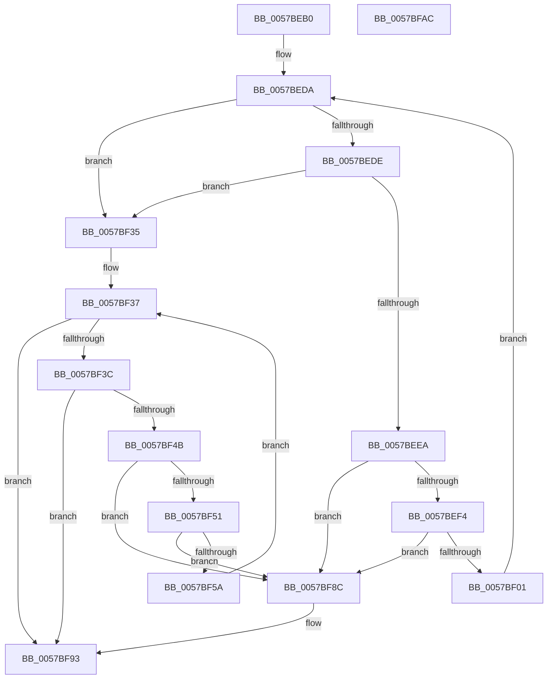

# CcReEngageWorkerThreads

- RVA: `0x0057BEB0`–`0x0057BFAD` (길이 `253` bytes)
- VA: `0x000000014057BEB0`
- 실행 섹션: `.text`
- PDB 이름 있음: `예`; PDB Function 태그: `아니요`
- unwind 정보 RVA: `0x00060300`
- 디코드: `77`개 명령, `253/253` bytes 표시
- 미해석 바이트: `0` (있으면 어셈블리에 `.byte`로 보존)

> 이 문서는 커널 이미지의 기계어와 PDB 기호를 분석해 생성했습니다. 4번과 5번은 함수 원형과 자료형을 바이너리 사용 방식에서 추정한 C 해석이며 원본 소스 복구 결과는 아닙니다.

## 1. Dependencies

- 직접 호출 지점: **4**; 고유 호출 대상: **2**
- 직접 호출자로 확인된 함수: **3**
- RIP 상대 이미지 참조: **0**

### Outgoing calls
- `0x0057BF16` → [CcReferencePartitionAndPrivateVolumeCacheMap](../38/CcReferencePartitionAndPrivateVolumeCacheMap_function_0038B9E0.md) (function, `0x0038B9E0`)
- `0x0057BF2C` → [ExQueueWorkItemToPartition](../35/ExQueueWorkItemToPartition_function_00356E2C.md) (function, `0x00356E2C`)
- `0x0057BF6D` → [CcReferencePartitionAndPrivateVolumeCacheMap](../38/CcReferencePartitionAndPrivateVolumeCacheMap_function_0038B9E0.md) (function, `0x0038B9E0`)
- `0x0057BF83` → [ExQueueWorkItemToPartition](../35/ExQueueWorkItemToPartition_function_00356E2C.md) (function, `0x00356E2C`)

### Direct callers
- [CcAsyncLazywriteWorker](../35/CcAsyncLazywriteWorker_function_00354C28.md) at `0x00354F7E`
- [CcWorkerThread](../48/CcWorkerThread_function_0048F0F0.md) at `0x0048F5CD`
- [CcAdjustWriteBehindThreadPool](CcAdjustWriteBehindThreadPool_function_0057B684.md) at `0x0057B6F1`

### Static image references
- 디코드된 RIP-relative 메모리 참조가 없습니다.

## 2. Other-region calls and transfers

- 다른 실행 섹션으로 향하는 call: **0**
- 별도 외부 분기/꼬리 이동을 확인하지 못했습니다.

## 3. Assembly (complete function range)

```asm
0057BEB0  48 89 5C 24 08                  mov qword ptr [rsp + 8], rbx
0057BEB5  48 89 6C 24 10                  mov qword ptr [rsp + 0x10], rbp
0057BEBA  48 89 74 24 18                  mov qword ptr [rsp + 0x18], rsi
0057BEBF  57                              push rdi
0057BEC0  41 56                           push r14
0057BEC2  41 57                           push r15
0057BEC4  48 83 EC 20                     sub rsp, 0x20
0057BEC8  4C 8B 7A 10                     mov r15, qword ptr [rdx + 0x10]
0057BECC  45 8B F1                        mov r14d, r9d
0057BECF  41 8B F0                        mov esi, r8d
0057BED2  48 8B DA                        mov rbx, rdx
0057BED5  48 8B E9                        mov rbp, rcx
0057BED8  33 FF                           xor edi, edi
0057BEDA  3B FE                           cmp edi, esi
0057BEDC  73 57                           jae 0x14057bf35
0057BEDE  48 8D 43 38                     lea rax, [rbx + 0x38]
0057BEE2  4C 8B 10                        mov r10, qword ptr [rax]
0057BEE5  4C 3B D0                        cmp r10, rax
0057BEE8  74 4B                           je 0x14057bf35
0057BEEA  49 39 42 08                     cmp qword ptr [r10 + 8], rax
0057BEEE  0F 85 98 00 00 00               jne 0x14057bf8c
0057BEF4  49 8B 0A                        mov rcx, qword ptr [r10]
0057BEF7  4C 39 51 08                     cmp qword ptr [rcx + 8], r10
0057BEFB  0F 85 8B 00 00 00               jne 0x14057bf8c
0057BF01  48 89 08                        mov qword ptr [rax], rcx
0057BF04  49 8B D7                        mov rdx, r15
0057BF07  48 89 41 08                     mov qword ptr [rcx + 8], rax
0057BF0B  48 8B CD                        mov rcx, rbp
0057BF0E  8B 43 30                        mov eax, dword ptr [rbx + 0x30]
0057BF11  FF C0                           inc eax
0057BF13  89 43 30                        mov dword ptr [rbx + 0x30], eax
0057BF16  E8 C5 FA E0 FF                  call 0x14038b9e0
0057BF1B  49 83 22 00                     and qword ptr [r10], 0
0057BF1F  49 8B CA                        mov rcx, r10
0057BF22  4C 8B 4D 08                     mov r9, qword ptr [rbp + 8]
0057BF26  33 D2                           xor edx, edx
0057BF28  44 8B 43 18                     mov r8d, dword ptr [rbx + 0x18]
0057BF2C  E8 FB AE DD FF                  call 0x140356e2c
0057BF31  FF C7                           inc edi
0057BF33  EB A5                           jmp 0x14057beda
0057BF35  33 FF                           xor edi, edi
0057BF37  41 3B FE                        cmp edi, r14d
0057BF3A  73 57                           jae 0x14057bf93
0057BF3C  48 8D 83 88 00 00 00            lea rax, [rbx + 0x88]
0057BF43  4C 8B 10                        mov r10, qword ptr [rax]
0057BF46  4C 3B D0                        cmp r10, rax
0057BF49  74 48                           je 0x14057bf93
0057BF4B  49 39 42 08                     cmp qword ptr [r10 + 8], rax
0057BF4F  75 3B                           jne 0x14057bf8c
0057BF51  49 8B 0A                        mov rcx, qword ptr [r10]
0057BF54  4C 39 51 08                     cmp qword ptr [rcx + 8], r10
0057BF58  75 32                           jne 0x14057bf8c
0057BF5A  48 89 08                        mov qword ptr [rax], rcx
0057BF5D  49 8B D7                        mov rdx, r15
0057BF60  48 89 41 08                     mov qword ptr [rcx + 8], rax
0057BF64  48 8B CD                        mov rcx, rbp
0057BF67  FF 83 98 00 00 00               inc dword ptr [rbx + 0x98]
0057BF6D  E8 6E FA E0 FF                  call 0x14038b9e0
0057BF72  49 83 22 00                     and qword ptr [r10], 0
0057BF76  49 8B CA                        mov rcx, r10
0057BF79  4C 8B 4D 08                     mov r9, qword ptr [rbp + 8]
0057BF7D  33 D2                           xor edx, edx
0057BF7F  44 8B 43 18                     mov r8d, dword ptr [rbx + 0x18]
0057BF83  E8 A4 AE DD FF                  call 0x140356e2c
0057BF88  FF C7                           inc edi
0057BF8A  EB AB                           jmp 0x14057bf37
0057BF8C  B9 03 00 00 00                  mov ecx, 3
0057BF91  CD 29                           int 0x29
0057BF93  48 8B 5C 24 40                  mov rbx, qword ptr [rsp + 0x40]
0057BF98  48 8B 6C 24 48                  mov rbp, qword ptr [rsp + 0x48]
0057BF9D  48 8B 74 24 50                  mov rsi, qword ptr [rsp + 0x50]
0057BFA2  48 83 C4 20                     add rsp, 0x20
0057BFA6  41 5F                           pop r15
0057BFA8  41 5E                           pop r14
0057BFAA  5F                              pop rdi
0057BFAB  C3                              ret
0057BFAC  CC                              int3
```

## 4. C-style interpretation (structured pseudocode)

```c
__int64 __fastcall CcReEngageWorkerThreads(__int64 a1, __int64 a2, int a3, int a4)
{
    __int64 result;
    __int64 v_rdi;
    __int64 v_rsp;
    unsigned __int64 v_stack_p10;
    unsigned __int64 v_stack_p18;
    unsigned __int64 v_stack_p8;

    v_stack_p8 = v_rbx;
    v_stack_p10 = v_rbp;
    v_stack_p18 = v_rsi;
    v_rsp = (v_rsp) - (32);
    v_rdi = 0;
loc_0057BEDA:
    if (0 >= ((unsigned int)((unsigned int)(a3)))) goto loc_0057BF35;
    if ((*(unsigned __int64 *)(a2 + 56)) == (a2 + 56)) goto loc_0057BF35;
    if ((*(unsigned __int64 *)(*(unsigned __int64 *)(a2 + 56) + 8)) != (a2 + 56)) goto loc_0057BF8C;
    if ((*(unsigned __int64 *)(*(unsigned __int64 *)(*(unsigned __int64 *)(a2 + 56)) + 8)) != (*(unsigned __int64 *)(a2 + 56))) goto loc_0057BF8C;
    *(unsigned __int64 *)(a2 + 56) = *(unsigned __int64 *)(*(unsigned __int64 *)(a2 + 56));
    *(unsigned __int64 *)(*(unsigned __int64 *)(*(unsigned __int64 *)(a2 + 56)) + 8) = a2 + 56;
    result = (unsigned int)(((unsigned int)(*(unsigned int *)(a2 + 48))) + 1);
    *(unsigned int *)(a2 + 48) = (unsigned int)(result);
    result = CcReferencePartitionAndPrivateVolumeCacheMap(a1, *(unsigned __int64 *)(a2 + 16), a3, a4);
    a2 = 0;
    result = ExQueueWorkItemToPartition(*(unsigned __int64 *)(a2 + 56), a2, (unsigned int)(*(unsigned int *)(a2 + 24)), *(unsigned __int64 *)(a1 + 8));
    v_rdi = (unsigned int)((v_rdi) + 1);
    goto loc_0057BEDA;
loc_0057BF35:
    v_rdi = 0;
loc_0057BF37:
    if (0 >= ((unsigned int)((unsigned int)(a4)))) goto loc_0057BF93;
    if ((*(unsigned __int64 *)(a2 + 136)) == (a2 + 136)) goto loc_0057BF93;
    if ((*(unsigned __int64 *)(*(unsigned __int64 *)(a2 + 136) + 8)) != (a2 + 136)) goto loc_0057BF8C;
    if ((*(unsigned __int64 *)(*(unsigned __int64 *)(*(unsigned __int64 *)(a2 + 136)) + 8)) != (*(unsigned __int64 *)(a2 + 136))) goto loc_0057BF8C;
    *(unsigned __int64 *)(a2 + 136) = *(unsigned __int64 *)(*(unsigned __int64 *)(a2 + 136));
    *(unsigned __int64 *)(*(unsigned __int64 *)(*(unsigned __int64 *)(a2 + 136)) + 8) = a2 + 136;
    result = CcReferencePartitionAndPrivateVolumeCacheMap(a1, *(unsigned __int64 *)(a2 + 16), (unsigned int)(*(unsigned int *)(a2 + 24)), *(unsigned __int64 *)(a1 + 8));
    a2 = 0;
    result = ExQueueWorkItemToPartition(*(unsigned __int64 *)(a2 + 136), a2, (unsigned int)(*(unsigned int *)(a2 + 24)), *(unsigned __int64 *)(a1 + 8));
    v_rdi = (unsigned int)((v_rdi) + 1);
    goto loc_0057BF37;
loc_0057BF8C:
loc_0057BF93:
    v_rsp = (v_rsp) + (32);
    return result;
}
```

## 5. (Beta) C Style

```c
int64_t CcReEngageWorkerThreads(void *Arg1, void *Arg2, int32_t Arg3, int32_t Arg4)
{
    uint8_t *arg1 = (uint8_t *)Arg1;
    uint8_t *arg2 = (uint8_t *)Arg2;

    int64_t result;
    int64_t local_rdi;
    int64_t local_rsp;
    uint64_t v_stack_p10;
    uint64_t v_stack_p18;
    uint64_t v_stack_p8;

    v_stack_p8 = local_rbx;
    v_stack_p10 = local_rbp;
    v_stack_p18 = local_rsi;
    local_rsp = (local_rsp) - (32);
    local_rdi = 0;
loc_0057BEDA:
    if (0 >= ((uint32_t)((uint32_t)(Arg3)))) goto loc_0057BF35;
    if ((*(uint64_t *)(arg2 + 0x38)) == (Arg2 + 56)) goto loc_0057BF35;
    if ((*(uint64_t *)(*(uint64_t *)(arg2 + 0x38) + 0x8)) != (Arg2 + 56)) goto loc_0057BF8C;
    if ((*(uint64_t *)(*(uint64_t *)(*(uint64_t *)(arg2 + 0x38)) + 0x8)) != (*(uint64_t *)(arg2 + 0x38))) goto loc_0057BF8C;
    *(uint64_t *)(arg2 + 0x38) = *(uint64_t *)(*(uint64_t *)(arg2 + 0x38));
    *(void **)(*(uint64_t *)(*(uint64_t *)(arg2 + 0x38)) + 0x8) = Arg2 + 56;
    result = (uint32_t)(((uint32_t)(*(uint32_t *)(arg2 + 0x30))) + 1);
    *(uint32_t *)(arg2 + 0x30) = (uint32_t)(result);
    result = CcReferencePartitionAndPrivateVolumeCacheMap(Arg1, *(uint64_t *)(arg2 + 0x10), Arg3, Arg4);
    Arg2 = 0;
    result = ExQueueWorkItemToPartition(*(uint64_t *)(arg2 + 0x38), Arg2, (uint32_t)(*(uint32_t *)(arg2 + 0x18)), *(uint64_t *)(arg1 + 0x8));
    local_rdi = (uint32_t)((local_rdi) + 1);
    goto loc_0057BEDA;
loc_0057BF35:
    local_rdi = 0;
loc_0057BF37:
    if (0 >= ((uint32_t)((uint32_t)(Arg4)))) goto loc_0057BF93;
    if ((*(uint64_t *)(arg2 + 0x88)) == (Arg2 + 136)) goto loc_0057BF93;
    if ((*(uint64_t *)(*(uint64_t *)(arg2 + 0x88) + 0x8)) != (Arg2 + 136)) goto loc_0057BF8C;
    if ((*(uint64_t *)(*(uint64_t *)(*(uint64_t *)(arg2 + 0x88)) + 0x8)) != (*(uint64_t *)(arg2 + 0x88))) goto loc_0057BF8C;
    *(uint64_t *)(arg2 + 0x88) = *(uint64_t *)(*(uint64_t *)(arg2 + 0x88));
    *(void **)(*(uint64_t *)(*(uint64_t *)(arg2 + 0x88)) + 0x8) = Arg2 + 136;
    result = CcReferencePartitionAndPrivateVolumeCacheMap(Arg1, *(uint64_t *)(arg2 + 0x10), (uint32_t)(*(uint32_t *)(arg2 + 0x18)), *(uint64_t *)(arg1 + 0x8));
    Arg2 = 0;
    result = ExQueueWorkItemToPartition(*(uint64_t *)(arg2 + 0x88), Arg2, (uint32_t)(*(uint32_t *)(arg2 + 0x18)), *(uint64_t *)(arg1 + 0x8));
    local_rdi = (uint32_t)((local_rdi) + 1);
    goto loc_0057BF37;
loc_0057BF8C:
loc_0057BF93:
    local_rsp = (local_rsp) + (32);
    return result;
}
```

### 관측된 메모리 오프셋

구조체 형식이 확인되지 않은 접근은 인자 기준의 오프셋으로만 기록했습니다.

| 기준 인자 | 오프셋 표현 | 폭 (bit) | 접근 |
|---|---:|---:|---|
| `Arg1` | `+ 0x8` | `64` | `R` |
| `Arg2` | `+ 0x0` | `64` | `R` |
| `Arg2` | `+ 0x0` | `64` | `W` |
| `Arg2` | `+ 0x10` | `64` | `R` |
| `Arg2` | `+ 0x18` | `32` | `R` |
| `Arg2` | `+ 0x30` | `32` | `R` |
| `Arg2` | `+ 0x30` | `32` | `W` |
| `Arg2` | `+ 0x38` | `64` | `R` |
| `Arg2` | `+ 0x88` | `64` | `R` |
| `Arg2` | `+ 0x98` | `32` | `R/W` |

## 6. Execution-region graph

[열기: 2D/3D 그래프와 함수 탐색 컨트롤 패널](../../../control-panel.html?section=text&rva=0x0057BEB0&view=graph)

- 2D 그래프는 위에서 아래로 흐르고, 3D 그래프는 빈 공간을 드래그해 회전합니다. Shift+드래그는 이동, 휠은 확대·축소, 함수 노드 선택은 대상 보고서 이동입니다.

### Static fallback


