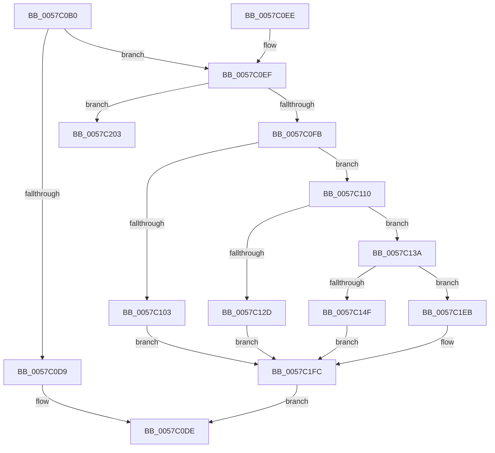

# CcRegisterExternalCacheEx

- RVA: `0x0057C0B0`–`0x0057C221` (길이 `369` bytes)
- VA: `0x000000014057C0B0`
- 실행 섹션: `.text`
- PDB 이름 있음: `예`; PDB Function 태그: `아니요`
- unwind 정보 RVA: `0x000C575C`
- 디코드: `92`개 명령, `369/369` bytes 표시
- 미해석 바이트: `0` (있으면 어셈블리에 `.byte`로 보존)

> 이 문서는 커널 이미지의 기계어와 PDB 기호를 분석해 생성했습니다. 4번과 5번은 함수 원형과 자료형을 바이너리 사용 방식에서 추정한 C 해석이며 원본 소스 복구 결과는 아닙니다.

## 1. Dependencies

- 직접 호출 지점: **7**; 고유 호출 대상: **7**
- 직접 호출자로 확인된 함수: **0**
- RIP 상대 이미지 참조: **3**

### Outgoing calls
- `0x0057C120` → [ExAllocatePoolWithTag](../../poolcode/B8/ExAllocatePoolWithTag_function_00B82010.md) (function, `0x00B82010`)
- `0x0057C140` → [CcAddExternalCacheToVolumeEx](CcAddExternalCacheToVolumeEx_function_0057B42C.md) (function, `0x0057B42C`)
- `0x0057C1C7` → [KeAcquireInStackQueuedSpinLock](../27/KeAcquireInStackQueuedSpinLock_function_002757A0.md) (function, `0x002757A0`)
- `0x0057C1DA` → [CcScheduleLazyWriteScan](../3C/CcScheduleLazyWriteScan_function_003CBD20.md) (function, `0x003CBD20`)
- `0x0057C1E4` → [KeReleaseInStackQueuedSpinLock](../34/KeReleaseInStackQueuedSpinLock_function_00342CE0.md) (function, `0x00342CE0`)
- `0x0057C1F7` → [ExFreePoolWithTag](../../poolcode/B8/ExFreePoolWithTag_function_00B82870.md) (function, `0x00B82870`)
- `0x0057C21B` → [KeBugCheckEx](../4F/KeBugCheckEx_function_004FD660.md) (function, `0x004FD660`)

### Direct callers
- 이 함수 시작 RVA로 연결되는 직접 call은 확인되지 않았습니다. 간접 호출은 완전히 역산할 수 없습니다.

### Static image references
- `0x0057C0EF` → RVA `0x00E65B50` (`.data`; read)
- `0x0057C0FB` → RVA `0x00E65B88` (`.data`; read)
- `0x0057C153` → RVA `0x00E30088` (`.data`; read)

## 2. Other-region calls and transfers

- 다른 실행 섹션으로 향하는 call: **2**
  - `0x0057C120` → [ExAllocatePoolWithTag](../../poolcode/B8/ExAllocatePoolWithTag_function_00B82010.md) (`.text` → `POOLCODE`)
  - `0x0057C1F7` → [ExFreePoolWithTag](../../poolcode/B8/ExFreePoolWithTag_function_00B82870.md) (`.text` → `POOLCODE`)
- 별도 외부 분기/꼬리 이동을 확인하지 못했습니다.

## 3. Assembly (complete function range)

```asm
0057C0B0  48 89 5C 24 08                  mov qword ptr [rsp + 8], rbx
0057C0B5  48 89 74 24 10                  mov qword ptr [rsp + 0x10], rsi
0057C0BA  57                              push rdi
0057C0BB  48 83 EC 50                     sub rsp, 0x50
0057C0BF  33 C0                           xor eax, eax
0057C0C1  0F 57 C0                        xorps xmm0, xmm0
0057C0C4  48 89 44 24 40                  mov qword ptr [rsp + 0x40], rax
0057C0C9  49 8B F0                        mov rsi, r8
0057C0CC  48 8B DA                        mov rbx, rdx
0057C0CF  0F 11 44 24 30                  movups xmmword ptr [rsp + 0x30], xmm0
0057C0D4  48 85 C9                        test rcx, rcx
0057C0D7  74 16                           je 0x14057c0ef
0057C0D9  B8 0D 00 00 C0                  mov eax, 0xc000000d
0057C0DE  48 8B 5C 24 60                  mov rbx, qword ptr [rsp + 0x60]
0057C0E3  48 8B 74 24 68                  mov rsi, qword ptr [rsp + 0x68]
0057C0E8  48 83 C4 50                     add rsp, 0x50
0057C0EC  5F                              pop rdi
0057C0ED  C3                              ret
0057C0EE  CC                              int3
0057C0EF  39 05 5B 9A 8E 00               cmp dword ptr [rip + 0x8e9a5b], eax
0057C0F5  0F 84 08 01 00 00               je 0x14057c203
0057C0FB  38 05 87 9A 8E 00               cmp byte ptr [rip + 0x8e9a87], al
0057C101  75 0D                           jne 0x14057c110
0057C103  49 21 00                        and qword ptr [r8], rax
0057C106  BB BB 00 00 C0                  mov ebx, 0xc00000bb
0057C10B  E9 EC 00 00 00                  jmp 0x14057c1fc
0057C110  BA 50 00 00 00                  mov edx, 0x50
0057C115  B9 00 06 00 00                  mov ecx, 0x600
0057C11A  41 B8 43 63 45 43               mov r8d, 0x43456343
0057C120  E8 EB 5E 60 00                  call 0x140b82010
0057C125  48 8B F8                        mov rdi, rax
0057C128  48 85 C0                        test rax, rax
0057C12B  75 0D                           jne 0x14057c13a
0057C12D  48 21 06                        and qword ptr [rsi], rax
0057C130  BB 9A 00 00 C0                  mov ebx, 0xc000009a
0057C135  E9 C2 00 00 00                  jmp 0x14057c1fc
0057C13A  48 8B CF                        mov rcx, rdi
0057C13D  48 89 18                        mov qword ptr [rax], rbx
0057C140  E8 E7 F2 FF FF                  call 0x14057b42c
0057C145  8B D8                           mov ebx, eax
0057C147  85 C0                           test eax, eax
0057C149  0F 88 9C 00 00 00               js 0x14057c1eb
0057C14F  48 8B 4F 40                     mov rcx, qword ptr [rdi + 0x40]
0057C153  48 8B 05 2E 3F 8B 00            mov rax, qword ptr [rip + 0x8b3f2e]
0057C15A  4C 8B 47 48                     mov r8, qword ptr [rdi + 0x48]
0057C15E  49 81 C0 F8 03 00 00            add r8, 0x3f8
0057C165  48 8B 51 08                     mov rdx, qword ptr [rcx + 8]
0057C169  48 8B 0A                        mov rcx, qword ptr [rdx]
0057C16C  0F B7 09                        movzx ecx, word ptr [rcx]
0057C16F  48 8B 0C C8                     mov rcx, qword ptr [rax + rcx*8]
0057C173  48 8B 81 50 48 00 00            mov rax, qword ptr [rcx + 0x4850]
0057C17A  49 83 60 28 00                  and qword ptr [r8 + 0x28], 0
0057C17F  48 8B C8                        mov rcx, rax
0057C182  48 C1 E9 02                     shr rcx, 2
0057C186  49 89 48 10                     mov qword ptr [r8 + 0x10], rcx
0057C18A  48 8D 04 80                     lea rax, [rax + rax*4]
0057C18E  49 89 48 08                     mov qword ptr [r8 + 8], rcx
0057C192  48 03 C0                        add rax, rax
0057C195  49 89 08                        mov qword ptr [r8], rcx
0057C198  49 89 40 20                     mov qword ptr [r8 + 0x20], rax
0057C19C  48 8B C1                        mov rax, rcx
0057C19F  48 C1 E8 02                     shr rax, 2
0057C1A3  48 D1 E9                        shr rcx, 1
0057C1A6  03 C1                           add eax, ecx
0057C1A8  41 C7 40 30 0A 00 00 00         mov dword ptr [r8 + 0x30], 0xa
0057C1B0  41 89 40 18                     mov dword ptr [r8 + 0x18], eax
0057C1B4  48 89 3E                        mov qword ptr [rsi], rdi
0057C1B7  48 8D 54 24 30                  lea rdx, [rsp + 0x30]
0057C1BC  48 8B 4F 40                     mov rcx, qword ptr [rdi + 0x40]
0057C1C0  48 81 C1 00 03 00 00            add rcx, 0x300
0057C1C7  E8 D4 95 CF FF                  call 0x1402757a0
0057C1CC  48 8B 57 48                     mov rdx, qword ptr [rdi + 0x48]
0057C1D0  45 33 C9                        xor r9d, r9d
0057C1D3  48 8B 4F 40                     mov rcx, qword ptr [rdi + 0x40]
0057C1D7  41 B0 01                        mov r8b, 1
0057C1DA  E8 41 FB E4 FF                  call 0x1403cbd20
0057C1DF  48 8D 4C 24 30                  lea rcx, [rsp + 0x30]
0057C1E4  E8 F7 6A DC FF                  call 0x140342ce0
0057C1E9  EB 11                           jmp 0x14057c1fc
0057C1EB  48 83 26 00                     and qword ptr [rsi], 0
0057C1EF  BA 43 63 45 43                  mov edx, 0x43456343
0057C1F4  48 8B CF                        mov rcx, rdi
0057C1F7  E8 74 66 60 00                  call 0x140b82870
0057C1FC  8B C3                           mov eax, ebx
0057C1FE  E9 DB FE FF FF                  jmp 0x14057c0de
0057C203  48 21 44 24 20                  and qword ptr [rsp + 0x20], rax
0057C208  45 33 C9                        xor r9d, r9d
0057C20B  BA CB 24 00 00                  mov edx, 0x24cb
0057C210  49 C7 C0 20 04 00 C0            mov r8, 0xffffffffc0000420
0057C217  41 8D 49 34                     lea ecx, [r9 + 0x34]
0057C21B  E8 40 14 F8 FF                  call 0x1404fd660
0057C220  CC                              int3
```

## 4. C-style interpretation (structured pseudocode)

```c
__int64 __fastcall CcRegisterExternalCacheEx(__int64 a1, __int64 a2, __int64 a3, int a4)
{
    __int64 result;
    __int64 v_rsp;
    unsigned __int64 v_stack_m18;
    unsigned __int64 v_stack_m28;
    unsigned __int64 v_stack_p10;
    unsigned __int64 v_stack_p20;
    unsigned __int64 v_stack_p30;
    unsigned __int64 v_stack_p8;

    v_stack_p8 = v_rbx;
    v_stack_p10 = v_rsi;
    v_rsp = (v_rsp) - (80);
    result = 0;
    v_stack_m18 = 0;
    v_stack_m28 = v_xmm0;
    if (a1 == 0) goto loc_0057C0EF;
loc_0057C0DE:
    v_rsp = (v_rsp) + (80);
    return (unsigned int)(0xC000000DULL);
loc_0057C0EF:
    if ((*(unsigned int *)(v_rip + 9345627)) == ((unsigned int)((unsigned int)(0xC000000DULL)))) goto loc_0057C203;
    if ((*(unsigned __int8 *)(v_rip + 9345671)) != ((unsigned __int8)((unsigned int)(0xC000000DULL)))) goto loc_0057C110;
    goto loc_0057C1FC;
loc_0057C110:
    result = ExAllocatePoolWithTag((unsigned int)(0x600ULL), 80, (unsigned int)(0x43456343ULL), a4);
    if (result != 0) goto loc_0057C13A;
    goto loc_0057C1FC;
loc_0057C13A:
    *(unsigned __int64 *)(result) = (unsigned int)(0xC000009AULL);
    result = CcAddExternalCacheToVolumeEx(result, 80, (unsigned int)(0x43456343ULL), a4);
    if (sign_flag) goto loc_0057C1EB;
    a3 = (*(unsigned __int64 *)(result + 72)) + (0x3F8ULL);
    a1 = (*(unsigned __int64 *)(*(unsigned __int64 *)(*(unsigned __int64 *)(v_rip + 9125678) + *(unsigned __int16 *)(*(unsigned __int64 *)(*(unsigned __int64 *)(*(unsigned __int64 *)(result + 64) + 8))) * 8) + 18512)) >> (2);
    *(unsigned __int64 *)(a3 + 16) = a1;
    *(unsigned __int64 *)(a3 + 8) = a1;
    result = (*(unsigned __int64 *)(*(unsigned __int64 *)(*(unsigned __int64 *)(v_rip + 9125678) + *(unsigned __int16 *)(*(unsigned __int64 *)(*(unsigned __int64 *)(*(unsigned __int64 *)(result + 64) + 8))) * 8) + 18512) + *(unsigned __int64 *)(*(unsigned __int64 *)(*(unsigned __int64 *)(v_rip + 9125678) + *(unsigned __int16 *)(*(unsigned __int64 *)(*(unsigned __int64 *)(*(unsigned __int64 *)(result + 64) + 8))) * 8) + 18512) * 4) + (*(unsigned __int64 *)(*(unsigned __int64 *)(*(unsigned __int64 *)(v_rip + 9125678) + *(unsigned __int16 *)(*(unsigned __int64 *)(*(unsigned __int64 *)(*(unsigned __int64 *)(result + 64) + 8))) * 8) + 18512) + *(unsigned __int64 *)(*(unsigned __int64 *)(*(unsigned __int64 *)(v_rip + 9125678) + *(unsigned __int16 *)(*(unsigned __int64 *)(*(unsigned __int64 *)(*(unsigned __int64 *)(result + 64) + 8))) * 8) + 18512) * 4);
    *(unsigned __int64 *)(a3) = a1;
    *(unsigned __int64 *)(a3 + 32) = result;
    result = (a1) >> (2);
    a1 = (a1) >> (1);
    result = (unsigned int)((result) + ((unsigned int)(a1)));
    *(unsigned int *)(a3 + 48) = 10;
    *(unsigned int *)(a3 + 24) = (unsigned int)(result);
    *(unsigned __int64 *)(v_stack_p10) = result;
    a1 = (*(unsigned __int64 *)(result + 64)) + (768);
    result = KeAcquireInStackQueuedSpinLock(a1, v_stack_p30, a3, a4);
    a4 = 0;
    result = CcScheduleLazyWriteScan(*(unsigned __int64 *)(result + 64), *(unsigned __int64 *)(result + 72), 1, a4);
    result = KeReleaseInStackQueuedSpinLock(v_stack_p30, *(unsigned __int64 *)(result + 72), 1, a4);
    goto loc_0057C1FC;
loc_0057C1EB:
    result = ExFreePoolWithTag(result, (unsigned int)(0x43456343ULL), 1, a4);
loc_0057C1FC:
    goto loc_0057C0DE;
loc_0057C203:
    a4 = 0;
    result = KeBugCheckEx(a4 + 52, (unsigned int)(0x24CBULL), 0xFFFFFFFFC0000420ULL, a4);
    return result;
}
```

## 5. (Beta) C Style

```c
int64_t CcRegisterExternalCacheEx(int64_t Arg1, int64_t Arg2, void *Arg3, int32_t Arg4)
{
    uint8_t *arg3 = (uint8_t *)Arg3;

    int64_t result;
    int64_t local_rsp;
    uint64_t v_stack_m18;
    uint64_t v_stack_m28;
    uint64_t v_stack_p10;
    uint64_t v_stack_p20;
    uint64_t v_stack_p30;
    uint64_t v_stack_p8;

    v_stack_p8 = local_rbx;
    v_stack_p10 = local_rsi;
    local_rsp = (local_rsp) - (80);
    result = 0;
    v_stack_m18 = 0;
    v_stack_m28 = v_xmm0;
    if (Arg1 == 0) goto loc_0057C0EF;
loc_0057C0DE:
    local_rsp = (local_rsp) + (80);
    return (uint32_t)(0xC000000DULL);
loc_0057C0EF:
    if ((*(uint32_t *)(v_rip + 0x8E9A5B)) == ((uint32_t)((uint32_t)(0xC000000DULL)))) goto loc_0057C203;
    if ((*(uint8_t *)(v_rip + 0x8E9A87)) != ((uint8_t)((uint32_t)(0xC000000DULL)))) goto loc_0057C110;
    goto loc_0057C1FC;
loc_0057C110:
    result = ExAllocatePoolWithTag((uint32_t)(0x600ULL), 80, (uint32_t)(0x43456343ULL), Arg4);
    if (result != 0) goto loc_0057C13A;
    goto loc_0057C1FC;
loc_0057C13A:
    *(uint64_t *)(result) = (uint32_t)(0xC000009AULL);
    result = CcAddExternalCacheToVolumeEx(result, 80, (uint32_t)(0x43456343ULL), Arg4);
    if (sign_flag) goto loc_0057C1EB;
    Arg3 = (*(uint64_t *)(result + 0x48)) + (0x3F8ULL);
    Arg1 = (*(uint64_t *)(*(uint64_t *)(*(uint64_t *)(v_rip + 0x8B3F2E) + *(uint16_t *)(*(uint64_t *)(*(uint64_t *)(*(uint64_t *)(result + 0x40) + 0x8))) * 8) + 0x4850)) >> (2);
    *(uint64_t *)(arg3 + 0x10) = Arg1;
    *(uint64_t *)(arg3 + 0x8) = Arg1;
    result = (*(uint64_t *)(*(uint64_t *)(*(uint64_t *)(v_rip + 0x8B3F2E) + *(uint16_t *)(*(uint64_t *)(*(uint64_t *)(*(uint64_t *)(result + 0x40) + 0x8))) * 8) + 0x4850) + *(uint64_t *)(*(uint64_t *)(*(uint64_t *)(v_rip + 0x8B3F2E) + *(uint16_t *)(*(uint64_t *)(*(uint64_t *)(*(uint64_t *)(result + 0x40) + 0x8))) * 8) + 0x4850) * 4) + (*(uint64_t *)(*(uint64_t *)(*(uint64_t *)(v_rip + 0x8B3F2E) + *(uint16_t *)(*(uint64_t *)(*(uint64_t *)(*(uint64_t *)(result + 0x40) + 0x8))) * 8) + 0x4850) + *(uint64_t *)(*(uint64_t *)(*(uint64_t *)(v_rip + 0x8B3F2E) + *(uint16_t *)(*(uint64_t *)(*(uint64_t *)(*(uint64_t *)(result + 0x40) + 0x8))) * 8) + 0x4850) * 4);
    *(uint64_t *)(arg3) = Arg1;
    *(uint64_t *)(arg3 + 0x20) = result;
    result = (Arg1) >> (2);
    Arg1 = (Arg1) >> (1);
    result = (uint32_t)((result) + ((uint32_t)(Arg1)));
    *(uint32_t *)(arg3 + 0x30) = 10;
    *(uint32_t *)(arg3 + 0x18) = (uint32_t)(result);
    *(uint64_t *)(v_stack_p10) = result;
    Arg1 = (*(uint64_t *)(result + 0x40)) + (768);
    result = KeAcquireInStackQueuedSpinLock(Arg1, v_stack_p30, Arg3, Arg4);
    Arg4 = 0;
    result = CcScheduleLazyWriteScan(*(uint64_t *)(result + 0x40), *(uint64_t *)(result + 0x48), 1, Arg4);
    result = KeReleaseInStackQueuedSpinLock(v_stack_p30, *(uint64_t *)(result + 0x48), 1, Arg4);
    goto loc_0057C1FC;
loc_0057C1EB:
    result = ExFreePoolWithTag(result, (uint32_t)(0x43456343ULL), 1, Arg4);
loc_0057C1FC:
    goto loc_0057C0DE;
loc_0057C203:
    Arg4 = 0;
    result = KeBugCheckEx(Arg4 + 52, (uint32_t)(0x24CBULL), 0xFFFFFFFFC0000420ULL, Arg4);
    return result;
}
```

### 관측된 메모리 오프셋

구조체 형식이 확인되지 않은 접근은 인자 기준의 오프셋으로만 기록했습니다.

| 기준 인자 | 오프셋 표현 | 폭 (bit) | 접근 |
|---|---:|---:|---|
| `Arg3` | `+ 0x0` | `64` | `R/W` |
| `Arg3` | `+ 0x0` | `64` | `W` |

## 6. Execution-region graph

[열기: 2D/3D 그래프와 함수 탐색 컨트롤 패널](../../../control-panel.html?section=text&rva=0x0057C0B0&view=graph)

- 2D 그래프는 위에서 아래로 흐르고, 3D 그래프는 빈 공간을 드래그해 회전합니다. Shift+드래그는 이동, 휠은 확대·축소, 함수 노드 선택은 대상 보고서 이동입니다.

### Static fallback


