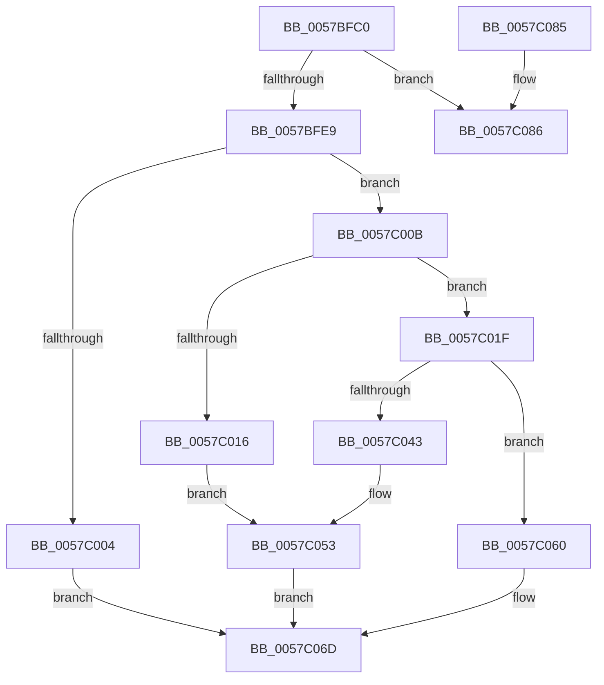

# CcRegisterExternalCache

- RVA: `0x0057BFC0`–`0x0057C0A4` (길이 `228` bytes)
- VA: `0x000000014057BFC0`
- 실행 섹션: `.text`
- PDB 이름 있음: `예`; PDB Function 태그: `아니요`
- unwind 정보 RVA: `0x000C5780`
- 디코드: `59`개 명령, `228/228` bytes 표시
- 미해석 바이트: `0` (있으면 어셈블리에 `.byte`로 보존)

> 이 문서는 커널 이미지의 기계어와 PDB 기호를 분석해 생성했습니다. 4번과 5번은 함수 원형과 자료형을 바이너리 사용 방식에서 추정한 C 해석이며 원본 소스 복구 결과는 아닙니다.

## 1. Dependencies

- 직접 호출 지점: **5**; 고유 호출 대상: **5**
- 직접 호출자로 확인된 함수: **0**
- RIP 상대 이미지 참조: **4**

### Outgoing calls
- `0x0057BFF7` → [ExAllocatePoolWithTag](../../poolcode/B8/ExAllocatePoolWithTag_function_00B82010.md) (function, `0x00B82010`)
- `0x0057C036` → [CcCreatePrivateVolumeCacheMap](../3C/CcCreatePrivateVolumeCacheMap_function_003CDB20.md) (function, `0x003CDB20`)
- `0x0057C056` → [CcAddExternalCacheInternal](CcAddExternalCacheInternal_function_0057B304.md) (function, `0x0057B304`)
- `0x0057C068` → [ExFreePoolWithTag](../../poolcode/B8/ExFreePoolWithTag_function_00B82870.md) (function, `0x00B82870`)
- `0x0057C09E` → [KeBugCheckEx](../4F/KeBugCheckEx_function_004FD660.md) (function, `0x004FD660`)

### Direct callers
- 이 함수 시작 RVA로 연결되는 직접 call은 확인되지 않았습니다. 간접 호출은 완전히 역산할 수 없습니다.

### Static image references
- `0x0057BFDA` → RVA `0x00E65B50` (`.data`; read)
- `0x0057C00B` → RVA `0x00E65B88` (`.data`; read)
- `0x0057C016` → RVA `0x00F8F5E0` (`.data`; read)
- `0x0057C01F` → RVA `0x00FC6EA0` (`ALMOSTRO`; read)

## 2. Other-region calls and transfers

- 다른 실행 섹션으로 향하는 call: **2**
  - `0x0057BFF7` → [ExAllocatePoolWithTag](../../poolcode/B8/ExAllocatePoolWithTag_function_00B82010.md) (`.text` → `POOLCODE`)
  - `0x0057C068` → [ExFreePoolWithTag](../../poolcode/B8/ExFreePoolWithTag_function_00B82870.md) (`.text` → `POOLCODE`)
- 별도 외부 분기/꼬리 이동을 확인하지 못했습니다.

## 3. Assembly (complete function range)

```asm
0057BFC0  48 89 5C 24 08                  mov qword ptr [rsp + 8], rbx
0057BFC5  48 89 74 24 10                  mov qword ptr [rsp + 0x10], rsi
0057BFCA  48 89 7C 24 20                  mov qword ptr [rsp + 0x20], rdi
0057BFCF  41 56                           push r14
0057BFD1  48 83 EC 30                     sub rsp, 0x30
0057BFD5  33 DB                           xor ebx, ebx
0057BFD7  4C 8B F2                        mov r14, rdx
0057BFDA  39 1D 70 9B 8E 00               cmp dword ptr [rip + 0x8e9b70], ebx
0057BFE0  48 8B F1                        mov rsi, rcx
0057BFE3  0F 84 9D 00 00 00               je 0x14057c086
0057BFE9  8D 53 40                        lea edx, [rbx + 0x40]
0057BFEC  B9 00 06 00 00                  mov ecx, 0x600
0057BFF1  41 B8 43 63 45 43               mov r8d, 0x43456343
0057BFF7  E8 14 60 60 00                  call 0x140b82010
0057BFFC  48 8B F8                        mov rdi, rax
0057BFFF  48 85 C0                        test rax, rax
0057C002  75 07                           jne 0x14057c00b
0057C004  BB 9A 00 00 C0                  mov ebx, 0xc000009a
0057C009  EB 62                           jmp 0x14057c06d
0057C00B  38 1D 77 9B 8E 00               cmp byte ptr [rip + 0x8e9b77], bl
0057C011  48 89 30                        mov qword ptr [rax], rsi
0057C014  75 09                           jne 0x14057c01f
0057C016  48 8D 15 C3 35 A1 00            lea rdx, [rip + 0xa135c3]
0057C01D  EB 34                           jmp 0x14057c053
0057C01F  48 8B 0D 7A AE A4 00            mov rcx, qword ptr [rip + 0xa4ae7a]
0057C026  4C 8D 44 24 50                  lea r8, [rsp + 0x50]
0057C02B  33 D2                           xor edx, edx
0057C02D  48 89 5C 24 50                  mov qword ptr [rsp + 0x50], rbx
0057C032  48 8B 49 08                     mov rcx, qword ptr [rcx + 8]
0057C036  E8 E5 1A E5 FF                  call 0x1403cdb20
0057C03B  8B C8                           mov ecx, eax
0057C03D  8B D8                           mov ebx, eax
0057C03F  85 C0                           test eax, eax
0057C041  78 1D                           js 0x14057c060
0057C043  48 8B 44 24 50                  mov rax, qword ptr [rsp + 0x50]
0057C048  48 89 47 38                     mov qword ptr [rdi + 0x38], rax
0057C04C  48 8D 90 E0 04 00 00            lea rdx, [rax + 0x4e0]
0057C053  48 8B CF                        mov rcx, rdi
0057C056  E8 A9 F2 FF FF                  call 0x14057b304
0057C05B  49 89 3E                        mov qword ptr [r14], rdi
0057C05E  EB 0D                           jmp 0x14057c06d
0057C060  BA 43 63 45 43                  mov edx, 0x43456343
0057C065  48 8B CF                        mov rcx, rdi
0057C068  E8 03 68 60 00                  call 0x140b82870
0057C06D  48 8B 74 24 48                  mov rsi, qword ptr [rsp + 0x48]
0057C072  8B C3                           mov eax, ebx
0057C074  48 8B 5C 24 40                  mov rbx, qword ptr [rsp + 0x40]
0057C079  48 8B 7C 24 58                  mov rdi, qword ptr [rsp + 0x58]
0057C07E  48 83 C4 30                     add rsp, 0x30
0057C082  41 5E                           pop r14
0057C084  C3                              ret
0057C085  CC                              int3
0057C086  45 33 C9                        xor r9d, r9d
0057C089  48 89 5C 24 20                  mov qword ptr [rsp + 0x20], rbx
0057C08E  BA 89 1E 00 00                  mov edx, 0x1e89
0057C093  49 C7 C0 20 04 00 C0            mov r8, 0xffffffffc0000420
0057C09A  41 8D 49 34                     lea ecx, [r9 + 0x34]
0057C09E  E8 BD 15 F8 FF                  call 0x1404fd660
0057C0A3  CC                              int3
```

## 4. C-style interpretation (structured pseudocode)

```c
__int64 __fastcall CcRegisterExternalCache(__int64 a1, __int64 a2, __int64 a3, int a4)
{
    __int64 result;
    __int64 v_rbx;
    __int64 v_rsp;
    unsigned __int64 v_stack_p10;
    unsigned __int64 v_stack_p18;
    unsigned __int64 v_stack_p20;
    unsigned __int64 v_stack_p8;

    v_stack_p8 = v_rbx;
    v_stack_p10 = v_rsi;
    v_stack_p20 = v_rdi;
    v_rsp = (v_rsp) - (48);
    v_rbx = 0;
    if ((*(unsigned int *)(v_rip + 9345904)) == 0) goto loc_0057C086;
    result = ExAllocatePoolWithTag((unsigned int)(0x600ULL), v_rbx + 64, (unsigned int)(0x43456343ULL), a4);
    if (result != 0) goto loc_0057C00B;
    goto loc_0057C06D;
loc_0057C00B:
    *(unsigned __int64 *)(result) = a1;
    if ((*(unsigned __int8 *)(v_rip + 9345911)) != ((unsigned __int8)((unsigned int)(0xC000009AULL)))) goto loc_0057C01F;
    goto loc_0057C053;
loc_0057C01F:
    a2 = 0;
    v_stack_p18 = (unsigned int)(0xC000009AULL);
    result = CcCreatePrivateVolumeCacheMap(*(unsigned __int64 *)(*(unsigned __int64 *)(v_rip + 10792570) + 8), a2, v_stack_p18, a4);
    if (sign_flag) goto loc_0057C060;
    *(unsigned __int64 *)(result + 56) = v_stack_p18;
loc_0057C053:
    result = CcAddExternalCacheInternal(result, v_stack_p18 + 1248, v_stack_p18, a4);
    *(unsigned __int64 *)(a2) = result;
    goto loc_0057C06D;
loc_0057C060:
    result = ExFreePoolWithTag(result, (unsigned int)(0x43456343ULL), v_stack_p18, a4);
loc_0057C06D:
    v_rsp = (v_rsp) + (48);
    return (unsigned int)((unsigned int)((unsigned int)((unsigned int)(result))));
loc_0057C086:
    a4 = 0;
    v_stack_p20 = v_stack_p8;
    result = KeBugCheckEx(a4 + 52, (unsigned int)(0x1E89ULL), 0xFFFFFFFFC0000420ULL, a4);
    return result;
}
```

## 5. (Beta) C Style

```c
int64_t CcRegisterExternalCache(int64_t Arg1, void *Arg2, int64_t Arg3, int32_t Arg4)
{
    uint8_t *arg2 = (uint8_t *)Arg2;

    int64_t result;
    int64_t local_rbx;
    int64_t local_rsp;
    uint64_t v_stack_p10;
    uint64_t v_stack_p18;
    uint64_t v_stack_p20;
    uint64_t v_stack_p8;

    v_stack_p8 = local_rbx;
    v_stack_p10 = local_rsi;
    v_stack_p20 = local_rdi;
    local_rsp = (local_rsp) - (48);
    local_rbx = 0;
    if ((*(uint32_t *)(v_rip + 0x8E9B70)) == 0) goto loc_0057C086;
    result = ExAllocatePoolWithTag((uint32_t)(0x600ULL), local_rbx + 64, (uint32_t)(0x43456343ULL), Arg4);
    if (result != 0) goto loc_0057C00B;
    goto loc_0057C06D;
loc_0057C00B:
    *(uint64_t *)(result) = Arg1;
    if ((*(uint8_t *)(v_rip + 0x8E9B77)) != ((uint8_t)((uint32_t)(0xC000009AULL)))) goto loc_0057C01F;
    goto loc_0057C053;
loc_0057C01F:
    Arg2 = 0;
    v_stack_p18 = (uint32_t)(0xC000009AULL);
    result = CcCreatePrivateVolumeCacheMap(*(uint64_t *)(*(uint64_t *)(v_rip + 0xA4AE7A) + 0x8), Arg2, v_stack_p18, Arg4);
    if (sign_flag) goto loc_0057C060;
    *(uint64_t *)(result + 0x38) = v_stack_p18;
loc_0057C053:
    result = CcAddExternalCacheInternal(result, v_stack_p18 + 1248, v_stack_p18, Arg4);
    *(uint64_t *)(arg2) = result;
    goto loc_0057C06D;
loc_0057C060:
    result = ExFreePoolWithTag(result, (uint32_t)(0x43456343ULL), v_stack_p18, Arg4);
loc_0057C06D:
    local_rsp = (local_rsp) + (48);
    return (uint32_t)((uint32_t)((uint32_t)((uint32_t)(result))));
loc_0057C086:
    Arg4 = 0;
    v_stack_p20 = v_stack_p8;
    result = KeBugCheckEx(Arg4 + 52, (uint32_t)(0x1E89ULL), 0xFFFFFFFFC0000420ULL, Arg4);
    return result;
}
```

### 관측된 메모리 오프셋

구조체 형식이 확인되지 않은 접근은 인자 기준의 오프셋으로만 기록했습니다.

| 기준 인자 | 오프셋 표현 | 폭 (bit) | 접근 |
|---|---:|---:|---|
| `Arg2` | `+ 0x0` | `64` | `W` |

## 6. Execution-region graph

[열기: 2D/3D 그래프와 함수 탐색 컨트롤 패널](../../../control-panel.html?section=text&rva=0x0057BFC0&view=graph)

- 2D 그래프는 위에서 아래로 흐르고, 3D 그래프는 빈 공간을 드래그해 회전합니다. Shift+드래그는 이동, 휠은 확대·축소, 함수 노드 선택은 대상 보고서 이동입니다.

### Static fallback


