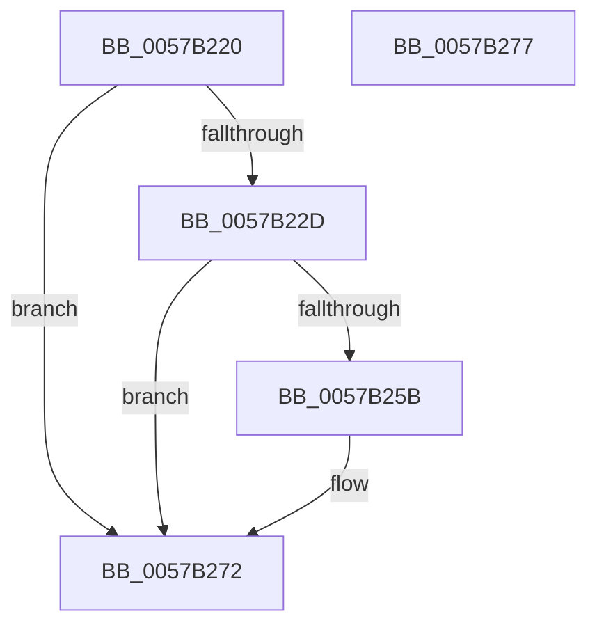

# CcRegisterForContainerRestore

- RVA: `0x0057B220`–`0x0057B278` (길이 `88` bytes)
- VA: `0x000000014057B220`
- 실행 섹션: `.text`
- PDB 이름 있음: `예`; PDB Function 태그: `아니요`
- unwind 정보 RVA: `0x0005D2F4`
- 디코드: `22`개 명령, `88/88` bytes 표시
- 미해석 바이트: `0` (있으면 어셈블리에 `.byte`로 보존)

> 이 문서는 커널 이미지의 기계어와 PDB 기호를 분석해 생성했습니다. 4번과 5번은 함수 원형과 자료형을 바이너리 사용 방식에서 추정한 C 해석이며 원본 소스 복구 결과는 아닙니다.

## 1. Dependencies

- 직접 호출 지점: **3**; 고유 호출 대상: **3**
- 직접 호출자로 확인된 함수: **0**
- RIP 상대 이미지 참조: **3**

### Outgoing calls
- `0x0057B224` → [CcCheckContainerWaitForRestore](CcCheckContainerWaitForRestore_function_0057AEE4.md) (function, `0x0057AEE4`)
- `0x0057B252` → [ExSubscribeWnfStateChange](../../page/9D/ExSubscribeWnfStateChange_function_009D4BC0.md) (function, `0x009D4BC0`)
- `0x0057B26D` → [DbgPrintEx](../35/DbgPrintEx_function_00359290.md) (function, `0x00359290`)

### Direct callers
- 이 함수 시작 RVA로 연결되는 직접 call은 확인되지 않았습니다. 간접 호출은 완전히 역산할 수 없습니다.

### Static image references
- `0x0057B233` → RVA `0x0057B000` (`CcContainerRestoreCallBack`; read)
- `0x0057B242` → RVA `0x000208C0` (`.rdata`; read)
- `0x0057B260` → RVA `0x006C7A30` (` ?? ::FNODOBFM::`string'`; read)

## 2. Other-region calls and transfers

- 다른 실행 섹션으로 향하는 call: **1**
  - `0x0057B252` → [ExSubscribeWnfStateChange](../../page/9D/ExSubscribeWnfStateChange_function_009D4BC0.md) (`.text` → `PAGE`)
- 별도 외부 분기/꼬리 이동을 확인하지 못했습니다.

## 3. Assembly (complete function range)

```asm
0057B220  48 83 EC 38                     sub rsp, 0x38
0057B224  E8 BB FC FF FF                  call 0x14057aee4
0057B229  85 C0                           test eax, eax
0057B22B  74 45                           je 0x14057b272
0057B22D  48 83 64 24 28 00               and qword ptr [rsp + 0x28], 0
0057B233  48 8D 05 C6 FD FF FF            lea rax, [rip - 0x23a]
0057B23A  45 33 C9                        xor r9d, r9d
0057B23D  48 89 44 24 20                  mov qword ptr [rsp + 0x20], rax
0057B242  48 8D 15 77 56 AA FF            lea rdx, [rip - 0x55a989]
0057B249  48 8D 4C 24 48                  lea rcx, [rsp + 0x48]
0057B24E  45 8D 41 01                     lea r8d, [r9 + 1]
0057B252  E8 69 99 45 00                  call 0x1409d4bc0
0057B257  85 C0                           test eax, eax
0057B259  79 17                           jns 0x14057b272
0057B25B  BA 01 00 00 00                  mov edx, 1
0057B260  4C 8D 05 C9 C7 14 00            lea r8, [rip + 0x14c7c9]
0057B267  44 8B C8                        mov r9d, eax
0057B26A  8D 4A 7E                        lea ecx, [rdx + 0x7e]
0057B26D  E8 1E E0 DD FF                  call 0x140359290
0057B272  48 83 C4 38                     add rsp, 0x38
0057B276  C3                              ret
0057B277  CC                              int3
```

## 4. C-style interpretation (structured pseudocode)

```c
__int64 __fastcall CcRegisterForContainerRestore(__int64 a1, __int64 a2, __int64 a3, int a4)
{
    __int64 result;
    __int64 v_rsp;
    unsigned __int64 v_stack_m10;
    unsigned __int64 v_stack_m18;
    unsigned __int64 v_stack_p10;

    v_rsp = (v_rsp) - (56);
    result = CcCheckContainerWaitForRestore(a1, a2, a3, a4);
    if ((unsigned int)(result) == 0) goto loc_0057B272;
    a4 = 0;
    v_stack_m18 = v_rip - 570;
    result = ExSubscribeWnfStateChange(v_stack_p10, v_rip - 5613961, a4 + 1, a4);
    if (sign_flag) {
        a2 = 1;
        a3 = v_rip + 1361865;
        a4 = (unsigned int)(result);
        a1 = a2 + 126;
        result = DbgPrintEx(a1, a2, a3, a4);
    }
    v_rsp = (v_rsp) + (56);
    return result;
}
```

## 5. (Beta) C Style

```c
int64_t CcRegisterForContainerRestore(int64_t Arg1, int64_t Arg2, int64_t Arg3, int32_t Arg4)
{
    int64_t result;
    int64_t local_rsp;
    uint64_t v_stack_m10;
    uint64_t v_stack_m18;
    uint64_t v_stack_p10;

    local_rsp = (local_rsp) - (56);
    result = CcCheckContainerWaitForRestore(Arg1, Arg2, Arg3, Arg4);
    if ((uint32_t)(result) == 0) goto loc_0057B272;
    Arg4 = 0;
    v_stack_m18 = v_rip - 570;
    result = ExSubscribeWnfStateChange(v_stack_p10, v_rip - 5613961, Arg4 + 1, Arg4);
    if (sign_flag) {
        Arg2 = 1;
        Arg3 = v_rip + 1361865;
        Arg4 = (uint32_t)(result);
        Arg1 = Arg2 + 126;
        result = DbgPrintEx(Arg1, Arg2, Arg3, Arg4);
    }
    local_rsp = (local_rsp) + (56);
    return result;
}
```

## 6. Execution-region graph

[열기: 2D/3D 그래프와 함수 탐색 컨트롤 패널](../../../control-panel.html?section=text&rva=0x0057B220&view=graph)

- 2D 그래프는 위에서 아래로 흐르고, 3D 그래프는 빈 공간을 드래그해 회전합니다. Shift+드래그는 이동, 휠은 확대·축소, 함수 노드 선택은 대상 보고서 이동입니다.

### Static fallback


