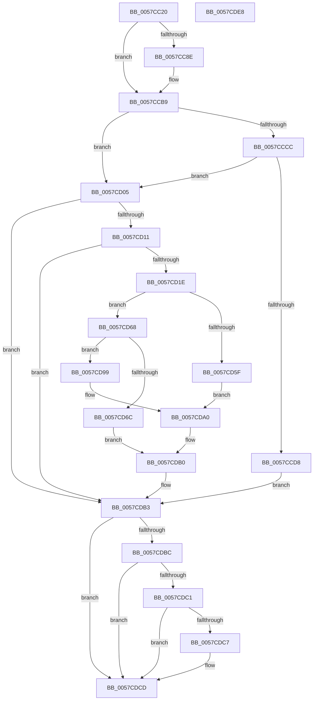

# CcRegistryChangeCallback

- RVA: `0x0057CC20`–`0x0057CDE9` (길이 `457` bytes)
- VA: `0x000000014057CC20`
- 실행 섹션: `.text`
- PDB 이름 있음: `예`; PDB Function 태그: `아니요`
- unwind 정보 RVA: `0x000C57EC`
- 디코드: `116`개 명령, `457/457` bytes 표시
- 미해석 바이트: `0` (있으면 어셈블리에 `.byte`로 보존)

> 이 문서는 커널 이미지의 기계어와 PDB 기호를 분석해 생성했습니다. 4번과 5번은 함수 원형과 자료형을 바이너리 사용 방식에서 추정한 C 해석이며 원본 소스 복구 결과는 아닙니다.

## 1. Dependencies

- 직접 호출 지점: **10**; 고유 호출 대상: **6**
- 직접 호출자로 확인된 함수: **0**
- RIP 상대 이미지 참조: **8**

### Outgoing calls
- `0x0057CC83` → [DbgPrintEx](../35/DbgPrintEx_function_00359290.md) (function, `0x00359290`)
- `0x0057CC95` → [guard_dispatch_icall](../6B/guard_dispatch_icall_function_006BAAD0.md) (function, `0x006BAAD0`)
- `0x0057CCB4` → [DbgPrintEx](../35/DbgPrintEx_function_00359290.md) (function, `0x00359290`)
- `0x0057CCCF` → [CcOpenRegistryPath](CcOpenRegistryPath_function_0057CA80.md) (function, `0x0057CA80`)
- `0x0057CCEC` → [DbgPrintEx](../35/DbgPrintEx_function_00359290.md) (function, `0x00359290`)
- `0x0057CCF9` → [ExFreePoolWithTag](../../poolcode/B8/ExFreePoolWithTag_function_00B82870.md) (function, `0x00B82870`)
- `0x0057CD4D` → [ZwNotifyChangeKey](../6A/ZwNotifyChangeKey_function_006AF550.md) (function, `0x006AF550`)
- `0x0057CD70` → [ZwClose](../6A/ZwClose_function_006AD2B0.md) (function, `0x006AD2B0`)
- `0x0057CD92` → [DbgPrintEx](../35/DbgPrintEx_function_00359290.md) (function, `0x00359290`)
- `0x0057CDAB` → [DbgPrintEx](../35/DbgPrintEx_function_00359290.md) (function, `0x00359290`)

### Direct callers
- 이 함수 시작 RVA로 연결되는 직접 call은 확인되지 않았습니다. 간접 호출은 완전히 역산할 수 없습니다.

### Static image references
- `0x0057CC51` → RVA `0x006C8070` (` ?? ::FNODOBFM::`string'`; read)
- `0x0057CCA1` → RVA `0x006C7F90` (` ?? ::FNODOBFM::`string'`; read)
- `0x0057CCE0` → RVA `0x006C7FD0` (` ?? ::FNODOBFM::`string'`; read)
- `0x0057CD5F` → RVA `0x006C8170` (` ?? ::FNODOBFM::`string'`; read)
- `0x0057CD7A` → RVA `0x006C81A0` (` ?? ::FNODOBFM::`string'`; read)
- `0x0057CD99` → RVA `0x006C80D0` (` ?? ::FNODOBFM::`string'`; read)
- `0x0057CDB3` → RVA `0x00E65B48` (`.data`; read)
- `0x0057CDC7` → RVA `0x00E65B48` (`.data`; write)

## 2. Other-region calls and transfers

- 다른 실행 섹션으로 향하는 call: **1**
  - `0x0057CCF9` → [ExFreePoolWithTag](../../poolcode/B8/ExFreePoolWithTag_function_00B82870.md) (`.text` → `POOLCODE`)
- 별도 외부 분기/꼬리 이동을 확인하지 못했습니다.

## 3. Assembly (complete function range)

```asm
0057CC20  48 8B C4                        mov rax, rsp
0057CC23  48 89 58 08                     mov qword ptr [rax + 8], rbx
0057CC27  48 89 68 10                     mov qword ptr [rax + 0x10], rbp
0057CC2B  48 89 70 18                     mov qword ptr [rax + 0x18], rsi
0057CC2F  48 89 78 20                     mov qword ptr [rax + 0x20], rdi
0057CC33  41 57                           push r15
0057CC35  48 83 EC 60                     sub rsp, 0x60
0057CC39  48 8D 71 38                     lea rsi, [rcx + 0x38]
0057CC3D  0F 57 C0                        xorps xmm0, xmm0
0057CC40  0F 11 40 E8                     movups xmmword ptr [rax - 0x18], xmm0
0057CC44  BA 02 00 00 00                  mov edx, 2
0057CC49  48 89 74 24 20                  mov qword ptr [rsp + 0x20], rsi
0057CC4E  48 8B F9                        mov rdi, rcx
0057CC51  4C 8D 05 18 B4 14 00            lea r8, [rip + 0x14b418]
0057CC58  48 BB 20 03 00 00 80 F7 FF FF   movabs rbx, 0xfffff78000000320
0057CC62  44 8D 7A 7D                     lea r15d, [rdx + 0x7d]
0057CC66  48 8B 1B                        mov rbx, qword ptr [rbx]
0057CC69  8A 41 48                        mov al, byte ptr [rcx + 0x48]
0057CC6C  48 8B EB                        mov rbp, rbx
0057CC6F  48 2B 69 30                     sub rbp, qword ptr [rcx + 0x30]
0057CC73  41 8B CF                        mov ecx, r15d
0057CC76  F6 D8                           neg al
0057CC78  45 1B C9                        sbb r9d, r9d
0057CC7B  41 83 E1 F2                     and r9d, 0xfffffff2
0057CC7F  41 83 C1 54                     add r9d, 0x54
0057CC83  E8 08 C6 DD FF                  call 0x140359290
0057CC88  80 7F 48 00                     cmp byte ptr [rdi + 0x48], 0
0057CC8C  75 2B                           jne 0x14057ccb9
0057CC8E  48 8B 47 28                     mov rax, qword ptr [rdi + 0x28]
0057CC92  48 8B CF                        mov rcx, rdi
0057CC95  E8 36 DE 13 00                  call 0x1406baad0
0057CC9A  4C 8B CE                        mov r9, rsi
0057CC9D  48 89 5F 30                     mov qword ptr [rdi + 0x30], rbx
0057CCA1  4C 8D 05 E8 B2 14 00            lea r8, [rip + 0x14b2e8]
0057CCA8  48 89 6C 24 20                  mov qword ptr [rsp + 0x20], rbp
0057CCAD  41 8D 57 83                     lea edx, [r15 - 0x7d]
0057CCB1  41 8B CF                        mov ecx, r15d
0057CCB4  E8 D7 C5 DD FF                  call 0x140359290
0057CCB9  48 8D 57 20                     lea rdx, [rdi + 0x20]
0057CCBD  C6 47 48 00                     mov byte ptr [rdi + 0x48], 0
0057CCC1  48 83 3A 00                     cmp qword ptr [rdx], 0
0057CCC5  BD 01 00 00 00                  mov ebp, 1
0057CCCA  75 39                           jne 0x14057cd05
0057CCCC  48 8B CE                        mov rcx, rsi
0057CCCF  E8 AC FD FF FF                  call 0x14057ca80
0057CCD4  85 C0                           test eax, eax
0057CCD6  79 2D                           jns 0x14057cd05
0057CCD8  44 8B C8                        mov r9d, eax
0057CCDB  48 89 74 24 20                  mov qword ptr [rsp + 0x20], rsi
0057CCE0  4C 8D 05 E9 B2 14 00            lea r8, [rip + 0x14b2e9]
0057CCE7  33 D2                           xor edx, edx
0057CCE9  41 8B CF                        mov ecx, r15d
0057CCEC  E8 9F C5 DD FF                  call 0x140359290
0057CCF1  BA 43 63 57 52                  mov edx, 0x52576343
0057CCF6  48 8B CF                        mov rcx, rdi
0057CCF9  E8 72 5B 60 00                  call 0x140b82870
0057CCFE  33 C0                           xor eax, eax
0057CD00  E9 AE 00 00 00                  jmp 0x14057cdb3
0057CD05  48 8B C7                        mov rax, rdi
0057CD08  48 85 FF                        test rdi, rdi
0057CD0B  0F 84 A2 00 00 00               je 0x14057cdb3
0057CD11  48 8B 4F 20                     mov rcx, qword ptr [rdi + 0x20]
0057CD15  48 85 C9                        test rcx, rcx
0057CD18  0F 84 95 00 00 00               je 0x14057cdb3
0057CD1E  40 88 6C 24 48                  mov byte ptr [rsp + 0x48], bpl
0057CD23  48 8D 44 24 50                  lea rax, [rsp + 0x50]
0057CD28  83 64 24 40 00                  and dword ptr [rsp + 0x40], 0
0057CD2D  4C 8B CD                        mov r9, rbp
0057CD30  48 83 64 24 38 00               and qword ptr [rsp + 0x38], 0
0057CD36  4C 8B C7                        mov r8, rdi
0057CD39  40 88 6C 24 30                  mov byte ptr [rsp + 0x30], bpl
0057CD3E  33 D2                           xor edx, edx
0057CD40  C7 44 24 28 05 00 00 00         mov dword ptr [rsp + 0x28], 5
0057CD48  48 89 44 24 20                  mov qword ptr [rsp + 0x20], rax
0057CD4D  E8 FE 27 13 00                  call 0x1406af550
0057CD52  48 8D 77 38                     lea rsi, [rdi + 0x38]
0057CD56  8B D8                           mov ebx, eax
0057CD58  3D 03 01 00 00                  cmp eax, 0x103
0057CD5D  75 09                           jne 0x14057cd68
0057CD5F  4C 8D 05 0A B4 14 00            lea r8, [rip + 0x14b40a]
0057CD66  EB 38                           jmp 0x14057cda0
0057CD68  85 DB                           test ebx, ebx
0057CD6A  79 2D                           jns 0x14057cd99
0057CD6C  48 8B 4F 20                     mov rcx, qword ptr [rdi + 0x20]
0057CD70  E8 3B 05 13 00                  call 0x1406ad2b0
0057CD75  48 83 67 20 00                  and qword ptr [rdi + 0x20], 0
0057CD7A  4C 8D 05 1F B4 14 00            lea r8, [rip + 0x14b41f]
0057CD81  44 8B CB                        mov r9d, ebx
0057CD84  40 88 6F 48                     mov byte ptr [rdi + 0x48], bpl
0057CD88  33 D2                           xor edx, edx
0057CD8A  48 89 74 24 20                  mov qword ptr [rsp + 0x20], rsi
0057CD8F  41 8B CF                        mov ecx, r15d
0057CD92  E8 F9 C4 DD FF                  call 0x140359290
0057CD97  EB 17                           jmp 0x14057cdb0
0057CD99  4C 8D 05 30 B3 14 00            lea r8, [rip + 0x14b330]
0057CDA0  4C 8B CE                        mov r9, rsi
0057CDA3  BA 02 00 00 00                  mov edx, 2
0057CDA8  41 8B CF                        mov ecx, r15d
0057CDAB  E8 E0 C4 DD FF                  call 0x140359290
0057CDB0  48 8B C7                        mov rax, rdi
0057CDB3  83 3D 8E 8D 8E 00 00            cmp dword ptr [rip + 0x8e8d8e], 0
0057CDBA  75 11                           jne 0x14057cdcd
0057CDBC  48 85 C0                        test rax, rax
0057CDBF  74 0C                           je 0x14057cdcd
0057CDC1  80 78 48 00                     cmp byte ptr [rax + 0x48], 0
0057CDC5  75 06                           jne 0x14057cdcd
0057CDC7  89 2D 7B 8D 8E 00               mov dword ptr [rip + 0x8e8d7b], ebp
0057CDCD  4C 8D 5C 24 60                  lea r11, [rsp + 0x60]
0057CDD2  49 8B 5B 10                     mov rbx, qword ptr [r11 + 0x10]
0057CDD6  49 8B 6B 18                     mov rbp, qword ptr [r11 + 0x18]
0057CDDA  49 8B 73 20                     mov rsi, qword ptr [r11 + 0x20]
0057CDDE  49 8B 7B 28                     mov rdi, qword ptr [r11 + 0x28]
0057CDE2  49 8B E3                        mov rsp, r11
0057CDE5  41 5F                           pop r15
0057CDE7  C3                              ret
0057CDE8  CC                              int3
```

## 4. C-style interpretation (structured pseudocode)

```c
__int64 __fastcall CcRegistryChangeCallback(__int64 a1, __int64 a2, __int64 a3, int a4)
{
    __int64 result;
    __int64 v_rbp;
    __int64 v_rsp;
    unsigned __int64 v_stack_m18;
    unsigned __int8 v_stack_m20;
    unsigned int v_stack_m28;
    unsigned __int64 v_stack_m30;
    unsigned __int8 v_stack_m38;
    unsigned int v_stack_m40;
    unsigned __int64 v_stack_m48;
    unsigned __int64 v_stack_m8;

    *(unsigned __int64 *)(v_rsp + 8) = v_rbx;
    *(unsigned __int64 *)(v_rsp + 16) = v_rbp;
    *(unsigned __int64 *)(v_rsp + 24) = v_rsi;
    *(unsigned __int64 *)(v_rsp + 32) = v_rdi;
    v_rsp = (v_rsp) - (96);
    *(unsigned __int64 *)(v_rsp - 24) = v_xmm0;
    v_stack_m48 = a1 + 56;
    v_rbp = (*(unsigned __int64 *)(v_rbx)) - (*(unsigned __int64 *)(a1 + 48));
    result = (unsigned __int8)(-(*(unsigned __int8 *)(a1 + 72)));
    a4 = (unsigned int)((a4) & (0xFFFFFFF2ULL));
    a4 = (unsigned int)((a4) + (84));
    result = DbgPrintEx((unsigned int)((unsigned int)(2 + 125)), 2, v_rip + 1356824, a4);
    if ((*(unsigned __int8 *)(a1 + 72)) == 0) {
        result = *(unsigned __int64 *)(a1 + 40);
        a1 = a1;
        result = guard_dispatch_icall(a1, 2, v_rip + 1356824, a4);
        a4 = a1 + 56;
        *(unsigned __int64 *)(a1 + 48) = *(unsigned __int64 *)(v_rbx);
        a3 = v_rip + 1356520;
        v_stack_m48 = v_rbp;
        a2 = 2 + 125 - 125;
        a1 = (unsigned int)(2 + 125);
        result = DbgPrintEx(a1, a2, a3, a4);
    }
    *(unsigned __int8 *)(a1 + 72) = 0;
    if ((*(unsigned __int64 *)(a1 + 32)) != 0) goto loc_0057CD05;
    result = CcOpenRegistryPath(a1 + 56, a1 + 32, a3, a4);
    if (!sign_flag) goto loc_0057CD05;
    v_stack_m48 = a1 + 56;
    a2 = 0;
    result = DbgPrintEx((unsigned int)((unsigned int)(2 + 125)), a2, v_rip + 1356521, (unsigned int)((unsigned int)(result)));
    result = ExFreePoolWithTag(a1, (unsigned int)(0x52576343ULL), v_rip + 1356521, (unsigned int)((unsigned int)(result)));
    result = 0;
    goto loc_0057CDB3;
loc_0057CD05:
    if (a1 == 0) goto loc_0057CDB3;
    if (*(unsigned __int64 *)(a1 + 32) == 0) goto loc_0057CDB3;
    v_stack_m20 = 1;
    v_stack_m38 = 1;
    a2 = 0;
    v_stack_m40 = 5;
    v_stack_m48 = v_stack_m18;
    result = ZwNotifyChangeKey(*(unsigned __int64 *)(a1 + 32), a2, a1, 1);
    if (((unsigned int)(result)) != 259) goto loc_0057CD68;
    goto loc_0057CDA0;
loc_0057CD68:
    if (!sign_flag) goto loc_0057CD99;
    result = ZwClose(*(unsigned __int64 *)(a1 + 32), a2, v_rip + 1356810, 1);
    *(unsigned __int8 *)(a1 + 72) = 1;
    a2 = 0;
    v_stack_m48 = a1 + 56;
    result = DbgPrintEx((unsigned int)((unsigned int)(2 + 125)), a2, v_rip + 1356831, (unsigned int)((unsigned int)((unsigned int)((unsigned int)(result)))));
    goto loc_0057CDB0;
loc_0057CD99:
loc_0057CDA0:
    result = DbgPrintEx((unsigned int)((unsigned int)(2 + 125)), 2, v_rip + 1356592, a1 + 56);
loc_0057CDB0:
loc_0057CDB3:
    if ((*(unsigned int *)(v_rip + 9342350)) != 0) goto loc_0057CDCD;
    if (a1 == 0) goto loc_0057CDCD;
    if ((*(unsigned __int8 *)(a1 + 72)) == 0) {
        *(unsigned int *)(v_rip + 9342331) = 1;
    }
    return a1;
}
```

## 5. (Beta) C Style

```c
void *CcRegistryChangeCallback(void *Arg1, int64_t Arg2, int64_t Arg3, int32_t Arg4)
{
    uint8_t *arg1 = (uint8_t *)Arg1;

    int64_t result;
    int64_t local_rbp;
    int64_t local_rsp;
    uint64_t v_stack_m18;
    uint8_t v_stack_m20;
    uint32_t v_stack_m28;
    uint64_t v_stack_m30;
    uint8_t v_stack_m38;
    uint32_t v_stack_m40;
    uint64_t v_stack_m48;
    uint64_t v_stack_m8;

    *(uint64_t *)(local_rsp + 0x8) = local_rbx;
    *(uint64_t *)(local_rsp + 0x10) = local_rbp;
    *(uint64_t *)(local_rsp + 0x18) = local_rsi;
    *(uint64_t *)(local_rsp + 0x20) = local_rdi;
    local_rsp = (local_rsp) - (96);
    *(uint64_t *)(local_rsp - 0x18) = v_xmm0;
    v_stack_m48 = Arg1 + 56;
    local_rbp = (*(uint64_t *)(local_rbx)) - (*(uint64_t *)(arg1 + 0x30));
    result = (uint8_t)(-(*(uint8_t *)(arg1 + 0x48)));
    Arg4 = (uint32_t)((Arg4) & (0xFFFFFFF2ULL));
    Arg4 = (uint32_t)((Arg4) + (84));
    result = DbgPrintEx((uint32_t)((uint32_t)(2 + 125)), 2, v_rip + 1356824, Arg4);
    if ((*(uint8_t *)(arg1 + 0x48)) == 0) {
        result = *(uint64_t *)(arg1 + 0x28);
        Arg1 = Arg1;
        result = guard_dispatch_icall(Arg1, 2, v_rip + 1356824, Arg4);
        Arg4 = Arg1 + 56;
        *(uint64_t *)(arg1 + 0x30) = *(uint64_t *)(local_rbx);
        Arg3 = v_rip + 1356520;
        v_stack_m48 = local_rbp;
        Arg2 = 2 + 125 - 125;
        Arg1 = (uint32_t)(2 + 125);
        result = DbgPrintEx(Arg1, Arg2, Arg3, Arg4);
    }
    *(uint8_t *)(arg1 + 0x48) = 0;
    if ((*(uint64_t *)(arg1 + 0x20)) != 0) goto loc_0057CD05;
    result = CcOpenRegistryPath(Arg1 + 56, Arg1 + 32, Arg3, Arg4);
    if (!sign_flag) goto loc_0057CD05;
    v_stack_m48 = Arg1 + 56;
    Arg2 = 0;
    result = DbgPrintEx((uint32_t)((uint32_t)(2 + 125)), Arg2, v_rip + 1356521, (uint32_t)((uint32_t)(result)));
    result = ExFreePoolWithTag(Arg1, (uint32_t)(0x52576343ULL), v_rip + 1356521, (uint32_t)((uint32_t)(result)));
    result = 0;
    goto loc_0057CDB3;
loc_0057CD05:
    if (Arg1 == NULL) goto loc_0057CDB3;
    if (*(uint64_t *)(arg1 + 0x20) == 0) goto loc_0057CDB3;
    v_stack_m20 = 1;
    v_stack_m38 = 1;
    Arg2 = 0;
    v_stack_m40 = 5;
    v_stack_m48 = v_stack_m18;
    result = ZwNotifyChangeKey(*(uint64_t *)(arg1 + 0x20), Arg2, Arg1, 1);
    if (((uint32_t)(result)) != 259) goto loc_0057CD68;
    goto loc_0057CDA0;
loc_0057CD68:
    if (!sign_flag) goto loc_0057CD99;
    result = ZwClose(*(uint64_t *)(arg1 + 0x20), Arg2, v_rip + 1356810, 1);
    *(uint8_t *)(arg1 + 0x48) = 1;
    Arg2 = 0;
    v_stack_m48 = Arg1 + 56;
    result = DbgPrintEx((uint32_t)((uint32_t)(2 + 125)), Arg2, v_rip + 1356831, (uint32_t)((uint32_t)((uint32_t)((uint32_t)(result)))));
    goto loc_0057CDB0;
loc_0057CD99:
loc_0057CDA0:
    result = DbgPrintEx((uint32_t)((uint32_t)(2 + 125)), 2, v_rip + 1356592, Arg1 + 56);
loc_0057CDB0:
loc_0057CDB3:
    if ((*(uint32_t *)(v_rip + 0x8E8D8E)) != 0) goto loc_0057CDCD;
    if (Arg1 == NULL) goto loc_0057CDCD;
    if ((*(uint8_t *)(arg1 + 0x48)) == 0) {
        *(uint32_t *)(v_rip + 0x8E8D7B) = 1;
    }
    return Arg1;
}
```

### 관측된 메모리 오프셋

구조체 형식이 확인되지 않은 접근은 인자 기준의 오프셋으로만 기록했습니다.

| 기준 인자 | 오프셋 표현 | 폭 (bit) | 접근 |
|---|---:|---:|---|
| `Arg1` | `+ 0x0` | `64` | `R` |
| `Arg1` | `+ 0x20` | `64` | `R` |
| `Arg1` | `+ 0x28` | `64` | `R` |
| `Arg1` | `+ 0x30` | `64` | `R` |
| `Arg1` | `+ 0x30` | `64` | `W` |
| `Arg1` | `+ 0x38` | `64` | `R` |
| `Arg1` | `+ 0x48` | `8` | `R` |
| `Arg1` | `+ 0x48` | `8` | `W` |

## 6. Execution-region graph

[열기: 2D/3D 그래프와 함수 탐색 컨트롤 패널](../../../control-panel.html?section=text&rva=0x0057CC20&view=graph)

- 2D 그래프는 위에서 아래로 흐르고, 3D 그래프는 빈 공간을 드래그해 회전합니다. Shift+드래그는 이동, 휠은 확대·축소, 함수 노드 선택은 대상 보고서 이동입니다.

### Static fallback


