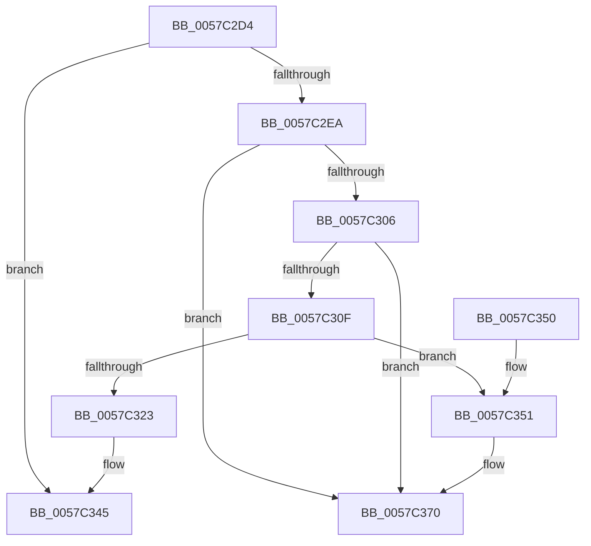

# CcRemoveExternalCacheEx

- RVA: `0x0057C2D4`–`0x0057C377` (길이 `163` bytes)
- VA: `0x000000014057C2D4`
- 실행 섹션: `.text`
- PDB 이름 있음: `예`; PDB Function 태그: `아니요`
- unwind 정보 RVA: `0x00089E94`
- 디코드: `43`개 명령, `163/163` bytes 표시
- 미해석 바이트: `0` (있으면 어셈블리에 `.byte`로 보존)

> 이 문서는 커널 이미지의 기계어와 PDB 기호를 분석해 생성했습니다. 4번과 5번은 함수 원형과 자료형을 바이너리 사용 방식에서 추정한 C 해석이며 원본 소스 복구 결과는 아닙니다.

## 1. Dependencies

- 직접 호출 지점: **4**; 고유 호출 대상: **4**
- 직접 호출자로 확인된 함수: **1**
- RIP 상대 이미지 참조: **4**

### Outgoing calls
- `0x0057C2F1` → [KeAcquireSpinLockRaiseToDpc](../20/KeAcquireSpinLockRaiseToDpc_function_00208470.md) (function, `0x00208470`)
- `0x0057C331` → [CcDereferencePartitionAndPrivateVolumeCacheMap](../38/CcDereferencePartitionAndPrivateVolumeCacheMap_function_0038B94C.md) (function, `0x0038B94C`)
- `0x0057C340` → [KeReleaseSpinLock](../39/KeReleaseSpinLock_function_00392BA0.md) (function, `0x00392BA0`)
- `0x0057C36A` → [KeBugCheckEx](../4F/KeBugCheckEx_function_004FD660.md) (function, `0x004FD660`)

### Direct callers
- [CcUnregisterExternalCacheEx](CcUnregisterExternalCacheEx_function_0057C3E0.md) at `0x0057C3E9`

### Static image references
- `0x0057C2DE` → RVA `0x00E65B88` (`.data`; read)
- `0x0057C2EA` → RVA `0x00F8F5D0` (`.data`; read)
- `0x0057C316` → RVA `0x00F8F500` (`.data`; read)
- `0x0057C32B` → RVA `0x00F8F500` (`.data`; write)

## 2. Other-region calls and transfers

- 다른 실행 섹션으로 향하는 call: **0**
- 별도 외부 분기/꼬리 이동을 확인하지 못했습니다.

## 3. Assembly (complete function range)

```asm
0057C2D4  48 89 5C 24 08                  mov qword ptr [rsp + 8], rbx
0057C2D9  57                              push rdi
0057C2DA  48 83 EC 30                     sub rsp, 0x30
0057C2DE  80 3D A3 98 8E 00 00            cmp byte ptr [rip + 0x8e98a3], 0
0057C2E5  48 8B D9                        mov rbx, rcx
0057C2E8  74 5B                           je 0x14057c345
0057C2EA  48 8D 0D DF 32 A1 00            lea rcx, [rip + 0xa132df]
0057C2F1  E8 7A C1 C8 FF                  call 0x140208470
0057C2F6  48 8D 4B 20                     lea rcx, [rbx + 0x20]
0057C2FA  40 8A F8                        mov dil, al
0057C2FD  4C 8B 01                        mov r8, qword ptr [rcx]
0057C300  49 39 48 08                     cmp qword ptr [r8 + 8], rcx
0057C304  75 6A                           jne 0x14057c370
0057C306  48 8B 51 08                     mov rdx, qword ptr [rcx + 8]
0057C30A  48 39 0A                        cmp qword ptr [rdx], rcx
0057C30D  75 61                           jne 0x14057c370
0057C30F  4C 89 02                        mov qword ptr [rdx], r8
0057C312  49 89 50 08                     mov qword ptr [r8 + 8], rdx
0057C316  8B 15 E4 31 A1 00               mov edx, dword ptr [rip + 0xa131e4]
0057C31C  8D 42 FF                        lea eax, [rdx - 1]
0057C31F  3B C2                           cmp eax, edx
0057C321  73 2E                           jae 0x14057c351
0057C323  48 8B 53 48                     mov rdx, qword ptr [rbx + 0x48]
0057C327  48 8B 4B 40                     mov rcx, qword ptr [rbx + 0x40]
0057C32B  89 05 CF 31 A1 00               mov dword ptr [rip + 0xa131cf], eax
0057C331  E8 16 F6 E0 FF                  call 0x14038b94c
0057C336  40 8A D7                        mov dl, dil
0057C339  48 8D 0D 90 32 A1 00            lea rcx, [rip + 0xa13290]
0057C340  E8 5B 68 E1 FF                  call 0x140392ba0
0057C345  48 8B 5C 24 40                  mov rbx, qword ptr [rsp + 0x40]
0057C34A  48 83 C4 30                     add rsp, 0x30
0057C34E  5F                              pop rdi
0057C34F  C3                              ret
0057C350  CC                              int3
0057C351  48 83 64 24 20 00               and qword ptr [rsp + 0x20], 0
0057C357  45 33 C9                        xor r9d, r9d
0057C35A  BA 4C 24 00 00                  mov edx, 0x244c
0057C35F  49 C7 C0 20 04 00 C0            mov r8, 0xffffffffc0000420
0057C366  41 8D 49 34                     lea ecx, [r9 + 0x34]
0057C36A  E8 F1 12 F8 FF                  call 0x1404fd660
0057C36F  CC                              int3
0057C370  B9 03 00 00 00                  mov ecx, 3
0057C375  CD 29                           int 0x29
```

## 4. C-style interpretation (structured pseudocode)

```c
__int64 __fastcall CcRemoveExternalCacheEx(__int64 a1, __int64 a2, __int64 a3, int a4)
{
    __int64 result;
    __int64 v_rsp;
    unsigned __int64 v_stack_p20;
    unsigned __int64 v_stack_p8;

    v_stack_p8 = v_rbx;
    v_rsp = (v_rsp) - (48);
    if ((*(unsigned __int8 *)(v_rip + 9345187)) == 0) goto loc_0057C345;
    result = KeAcquireSpinLockRaiseToDpc(v_rip + 10564319, a2, a3, a4);
    if ((*(unsigned __int64 *)(*(unsigned __int64 *)(a1 + 32) + 8)) != (a1 + 32)) goto loc_0057C370;
    if ((*(unsigned __int64 *)(*(unsigned __int64 *)(a1 + 32 + 8))) != (a1 + 32)) goto loc_0057C370;
    *(unsigned __int64 *)(*(unsigned __int64 *)(a1 + 32 + 8)) = *(unsigned __int64 *)(a1 + 32);
    *(unsigned __int64 *)(*(unsigned __int64 *)(a1 + 32) + 8) = *(unsigned __int64 *)(a1 + 32 + 8);
    if (((unsigned int)((unsigned int)(*(unsigned int *)(v_rip + 10564068)) - 1)) >= ((unsigned int)((unsigned int)(*(unsigned int *)(v_rip + 10564068))))) goto loc_0057C351;
    *(unsigned int *)(v_rip + 10564047) = (unsigned int)((unsigned int)(*(unsigned int *)(v_rip + 10564068)) - 1);
    result = CcDereferencePartitionAndPrivateVolumeCacheMap(*(unsigned __int64 *)(a1 + 64), *(unsigned __int64 *)(a1 + 72), *(unsigned __int64 *)(a1 + 32), a4);
    result = KeReleaseSpinLock(v_rip + 10564240, (unsigned __int8)((unsigned __int8)(result)), *(unsigned __int64 *)(a1 + 32), a4);
loc_0057C345:
    v_rsp = (v_rsp) + (48);
    return result;
loc_0057C351:
    a4 = 0;
    result = KeBugCheckEx(a4 + 52, (unsigned int)(0x244CULL), 0xFFFFFFFFC0000420ULL, a4);
loc_0057C370:
    return result;
}
```

## 5. (Beta) C Style

```c
int64_t CcRemoveExternalCacheEx(void *Arg1, int64_t Arg2, int64_t Arg3, int32_t Arg4)
{
    uint8_t *arg1 = (uint8_t *)Arg1;

    int64_t result;
    int64_t local_rsp;
    uint64_t v_stack_p20;
    uint64_t v_stack_p8;

    v_stack_p8 = local_rbx;
    local_rsp = (local_rsp) - (48);
    if ((*(uint8_t *)(v_rip + 0x8E98A3)) == 0) goto loc_0057C345;
    result = KeAcquireSpinLockRaiseToDpc(v_rip + 10564319, Arg2, Arg3, Arg4);
    if ((*(uint64_t *)(*(uint64_t *)(arg1 + 0x20) + 0x8)) != (Arg1 + 32)) goto loc_0057C370;
    if ((*(uint64_t *)(*(uint64_t *)(arg1 + 0x20 + 0x8))) != (Arg1 + 32)) goto loc_0057C370;
    *(uint64_t *)(*(uint64_t *)(arg1 + 0x20 + 0x8)) = *(uint64_t *)(arg1 + 0x20);
    *(uint64_t *)(*(uint64_t *)(arg1 + 0x20) + 0x8) = *(uint64_t *)(arg1 + 0x20 + 0x8);
    if (((uint32_t)((uint32_t)(*(uint32_t *)(v_rip + 0xA131E4)) - 1)) >= ((uint32_t)((uint32_t)(*(uint32_t *)(v_rip + 0xA131E4))))) goto loc_0057C351;
    *(uint32_t *)(v_rip + 0xA131CF) = (uint32_t)((uint32_t)(*(uint32_t *)(v_rip + 0xA131E4)) - 1);
    result = CcDereferencePartitionAndPrivateVolumeCacheMap(*(uint64_t *)(arg1 + 0x40), *(uint64_t *)(arg1 + 0x48), *(uint64_t *)(arg1 + 0x20), Arg4);
    result = KeReleaseSpinLock(v_rip + 10564240, (uint8_t)((uint8_t)(result)), *(uint64_t *)(arg1 + 0x20), Arg4);
loc_0057C345:
    local_rsp = (local_rsp) + (48);
    return result;
loc_0057C351:
    Arg4 = 0;
    result = KeBugCheckEx(Arg4 + 52, (uint32_t)(0x244CULL), 0xFFFFFFFFC0000420ULL, Arg4);
loc_0057C370:
    return result;
}
```

### 관측된 메모리 오프셋

구조체 형식이 확인되지 않은 접근은 인자 기준의 오프셋으로만 기록했습니다.

| 기준 인자 | 오프셋 표현 | 폭 (bit) | 접근 |
|---|---:|---:|---|
| `Arg1` | `+ 0x0` | `64` | `R` |
| `Arg1` | `+ 0x8` | `64` | `R` |
| `Arg1` | `+ 0x20` | `64` | `R` |
| `Arg1` | `+ 0x40` | `64` | `R` |
| `Arg1` | `+ 0x48` | `64` | `R` |

## 6. Execution-region graph

[열기: 2D/3D 그래프와 함수 탐색 컨트롤 패널](../../../control-panel.html?section=text&rva=0x0057C2D4&view=graph)

- 2D 그래프는 위에서 아래로 흐르고, 3D 그래프는 빈 공간을 드래그해 회전합니다. Shift+드래그는 이동, 휠은 확대·축소, 함수 노드 선택은 대상 보고서 이동입니다.

### Static fallback


