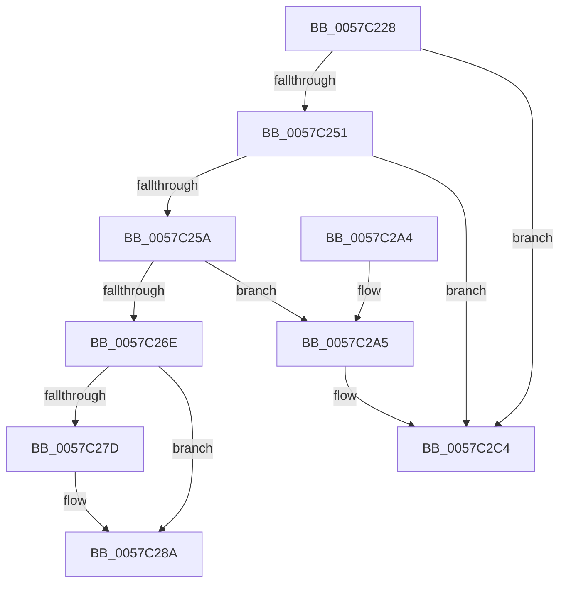

# CcRemoveExternalCache

- RVA: `0x0057C228`–`0x0057C2CB` (길이 `163` bytes)
- VA: `0x000000014057C228`
- 실행 섹션: `.text`
- PDB 이름 있음: `예`; PDB Function 태그: `아니요`
- unwind 정보 RVA: `0x00089E94`
- 디코드: `43`개 명령, `163/163` bytes 표시
- 미해석 바이트: `0` (있으면 어셈블리에 `.byte`로 보존)

> 이 문서는 커널 이미지의 기계어와 PDB 기호를 분석해 생성했습니다. 4번과 5번은 함수 원형과 자료형을 바이너리 사용 방식에서 추정한 C 해석이며 원본 소스 복구 결과는 아닙니다.

## 1. Dependencies

- 직접 호출 지점: **4**; 고유 호출 대상: **4**
- 직접 호출자로 확인된 함수: **1**
- RIP 상대 이미지 참조: **4**

### Outgoing calls
- `0x0057C23C` → [KeAcquireSpinLockRaiseToDpc](../20/KeAcquireSpinLockRaiseToDpc_function_00208470.md) (function, `0x00208470`)
- `0x0057C285` → [CcDereferencePartitionAndPrivateVolumeCacheMap](../38/CcDereferencePartitionAndPrivateVolumeCacheMap_function_0038B94C.md) (function, `0x0038B94C`)
- `0x0057C294` → [KeReleaseSpinLock](../39/KeReleaseSpinLock_function_00392BA0.md) (function, `0x00392BA0`)
- `0x0057C2BE` → [KeBugCheckEx](../4F/KeBugCheckEx_function_004FD660.md) (function, `0x004FD660`)

### Direct callers
- [CcUnregisterExternalCache](CcUnregisterExternalCache_function_0057C3A0.md) at `0x0057C3A9`

### Static image references
- `0x0057C235` → RVA `0x00F8F5D0` (`.data`; read)
- `0x0057C25A` → RVA `0x00F8F500` (`.data`; read)
- `0x0057C26E` → RVA `0x00E65B88` (`.data`; read)
- `0x0057C275` → RVA `0x00F8F500` (`.data`; write)

## 2. Other-region calls and transfers

- 다른 실행 섹션으로 향하는 call: **0**
- 별도 외부 분기/꼬리 이동을 확인하지 못했습니다.

## 3. Assembly (complete function range)

```asm
0057C228  48 89 5C 24 08                  mov qword ptr [rsp + 8], rbx
0057C22D  57                              push rdi
0057C22E  48 83 EC 30                     sub rsp, 0x30
0057C232  48 8B D9                        mov rbx, rcx
0057C235  48 8D 0D 94 33 A1 00            lea rcx, [rip + 0xa13394]
0057C23C  E8 2F C2 C8 FF                  call 0x140208470
0057C241  48 8D 53 20                     lea rdx, [rbx + 0x20]
0057C245  40 8A F8                        mov dil, al
0057C248  48 8B 0A                        mov rcx, qword ptr [rdx]
0057C24B  48 39 51 08                     cmp qword ptr [rcx + 8], rdx
0057C24F  75 73                           jne 0x14057c2c4
0057C251  4C 8B 42 08                     mov r8, qword ptr [rdx + 8]
0057C255  49 39 10                        cmp qword ptr [r8], rdx
0057C258  75 6A                           jne 0x14057c2c4
0057C25A  8B 15 A0 32 A1 00               mov edx, dword ptr [rip + 0xa132a0]
0057C260  49 89 08                        mov qword ptr [r8], rcx
0057C263  4C 89 41 08                     mov qword ptr [rcx + 8], r8
0057C267  8D 42 FF                        lea eax, [rdx - 1]
0057C26A  3B C2                           cmp eax, edx
0057C26C  73 37                           jae 0x14057c2a5
0057C26E  80 3D 13 99 8E 00 00            cmp byte ptr [rip + 0x8e9913], 0
0057C275  89 05 85 32 A1 00               mov dword ptr [rip + 0xa13285], eax
0057C27B  74 0D                           je 0x14057c28a
0057C27D  48 8B 53 38                     mov rdx, qword ptr [rbx + 0x38]
0057C281  48 8B 4B 30                     mov rcx, qword ptr [rbx + 0x30]
0057C285  E8 C2 F6 E0 FF                  call 0x14038b94c
0057C28A  40 8A D7                        mov dl, dil
0057C28D  48 8D 0D 3C 33 A1 00            lea rcx, [rip + 0xa1333c]
0057C294  E8 07 69 E1 FF                  call 0x140392ba0
0057C299  48 8B 5C 24 40                  mov rbx, qword ptr [rsp + 0x40]
0057C29E  48 83 C4 30                     add rsp, 0x30
0057C2A2  5F                              pop rdi
0057C2A3  C3                              ret
0057C2A4  CC                              int3
0057C2A5  48 83 64 24 20 00               and qword ptr [rsp + 0x20], 0
0057C2AB  45 33 C9                        xor r9d, r9d
0057C2AE  BA 69 1E 00 00                  mov edx, 0x1e69
0057C2B3  49 C7 C0 20 04 00 C0            mov r8, 0xffffffffc0000420
0057C2BA  41 8D 49 34                     lea ecx, [r9 + 0x34]
0057C2BE  E8 9D 13 F8 FF                  call 0x1404fd660
0057C2C3  CC                              int3
0057C2C4  B9 03 00 00 00                  mov ecx, 3
0057C2C9  CD 29                           int 0x29
```

## 4. C-style interpretation (structured pseudocode)

```c
__int64 __fastcall CcRemoveExternalCache(__int64 a1, __int64 a2, __int64 a3, int a4)
{
    __int64 result;
    __int64 v_rsp;
    unsigned __int64 v_stack_p20;
    unsigned __int64 v_stack_p8;

    v_stack_p8 = v_rbx;
    v_rsp = (v_rsp) - (48);
    result = KeAcquireSpinLockRaiseToDpc(v_rip + 10564500, a2, a3, a4);
    if ((*(unsigned __int64 *)(*(unsigned __int64 *)(a1 + 32) + 8)) != (a1 + 32)) goto loc_0057C2C4;
    if ((*(unsigned __int64 *)(*(unsigned __int64 *)(a1 + 32 + 8))) != (a1 + 32)) goto loc_0057C2C4;
    *(unsigned __int64 *)(*(unsigned __int64 *)(a1 + 32 + 8)) = *(unsigned __int64 *)(a1 + 32);
    *(unsigned __int64 *)(*(unsigned __int64 *)(a1 + 32) + 8) = *(unsigned __int64 *)(a1 + 32 + 8);
    if (((unsigned int)((unsigned int)(*(unsigned int *)(v_rip + 10564256)) - 1)) >= ((unsigned int)((unsigned int)(*(unsigned int *)(v_rip + 10564256))))) goto loc_0057C2A5;
    *(unsigned int *)(v_rip + 10564229) = (unsigned int)((unsigned int)(*(unsigned int *)(v_rip + 10564256)) - 1);
    result = (unsigned int)(*(unsigned int *)(v_rip + 10564256)) - 1;
    if ((*(unsigned __int8 *)(v_rip + 9345299)) != 0) {
        a2 = *(unsigned __int64 *)(a1 + 56);
        a1 = *(unsigned __int64 *)(a1 + 48);
        result = CcDereferencePartitionAndPrivateVolumeCacheMap(a1, a2, *(unsigned __int64 *)(a1 + 32 + 8), a4);
    }
    result = KeReleaseSpinLock(v_rip + 10564412, (unsigned __int8)((unsigned __int8)(result)), *(unsigned __int64 *)(a1 + 32 + 8), a4);
    v_rsp = (v_rsp) + (48);
    return result;
loc_0057C2A5:
    a4 = 0;
    result = KeBugCheckEx(a4 + 52, (unsigned int)(0x1E69ULL), 0xFFFFFFFFC0000420ULL, a4);
loc_0057C2C4:
    return result;
}
```

## 5. (Beta) C Style

```c
int64_t CcRemoveExternalCache(void *Arg1, int64_t Arg2, int64_t Arg3, int32_t Arg4)
{
    uint8_t *arg1 = (uint8_t *)Arg1;

    int64_t result;
    int64_t local_rsp;
    uint64_t v_stack_p20;
    uint64_t v_stack_p8;

    v_stack_p8 = local_rbx;
    local_rsp = (local_rsp) - (48);
    result = KeAcquireSpinLockRaiseToDpc(v_rip + 10564500, Arg2, Arg3, Arg4);
    if ((*(uint64_t *)(*(uint64_t *)(arg1 + 0x20) + 0x8)) != (Arg1 + 32)) goto loc_0057C2C4;
    if ((*(uint64_t *)(*(uint64_t *)(arg1 + 0x20 + 0x8))) != (Arg1 + 32)) goto loc_0057C2C4;
    *(uint64_t *)(*(uint64_t *)(arg1 + 0x20 + 0x8)) = *(uint64_t *)(arg1 + 0x20);
    *(uint64_t *)(*(uint64_t *)(arg1 + 0x20) + 0x8) = *(uint64_t *)(arg1 + 0x20 + 0x8);
    if (((uint32_t)((uint32_t)(*(uint32_t *)(v_rip + 0xA132A0)) - 1)) >= ((uint32_t)((uint32_t)(*(uint32_t *)(v_rip + 0xA132A0))))) goto loc_0057C2A5;
    *(uint32_t *)(v_rip + 0xA13285) = (uint32_t)((uint32_t)(*(uint32_t *)(v_rip + 0xA132A0)) - 1);
    result = (uint32_t)(*(uint32_t *)(v_rip + 0xA132A0)) - 1;
    if ((*(uint8_t *)(v_rip + 0x8E9913)) != 0) {
        Arg2 = *(uint64_t *)(arg1 + 0x38);
        Arg1 = *(uint64_t *)(arg1 + 0x30);
        result = CcDereferencePartitionAndPrivateVolumeCacheMap(Arg1, Arg2, *(uint64_t *)(arg1 + 0x20 + 0x8), Arg4);
    }
    result = KeReleaseSpinLock(v_rip + 10564412, (uint8_t)((uint8_t)(result)), *(uint64_t *)(arg1 + 0x20 + 0x8), Arg4);
    local_rsp = (local_rsp) + (48);
    return result;
loc_0057C2A5:
    Arg4 = 0;
    result = KeBugCheckEx(Arg4 + 52, (uint32_t)(0x1E69ULL), 0xFFFFFFFFC0000420ULL, Arg4);
loc_0057C2C4:
    return result;
}
```

### 관측된 메모리 오프셋

구조체 형식이 확인되지 않은 접근은 인자 기준의 오프셋으로만 기록했습니다.

| 기준 인자 | 오프셋 표현 | 폭 (bit) | 접근 |
|---|---:|---:|---|
| `Arg1` | `+ 0x0` | `64` | `R` |
| `Arg1` | `+ 0x8` | `64` | `R` |
| `Arg1` | `+ 0x20` | `64` | `R` |
| `Arg1` | `+ 0x30` | `64` | `R` |
| `Arg1` | `+ 0x38` | `64` | `R` |

## 6. Execution-region graph

[열기: 2D/3D 그래프와 함수 탐색 컨트롤 패널](../../../control-panel.html?section=text&rva=0x0057C228&view=graph)

- 2D 그래프는 위에서 아래로 흐르고, 3D 그래프는 빈 공간을 드래그해 회전합니다. Shift+드래그는 이동, 휠은 확대·축소, 함수 노드 선택은 대상 보고서 이동입니다.

### Static fallback


