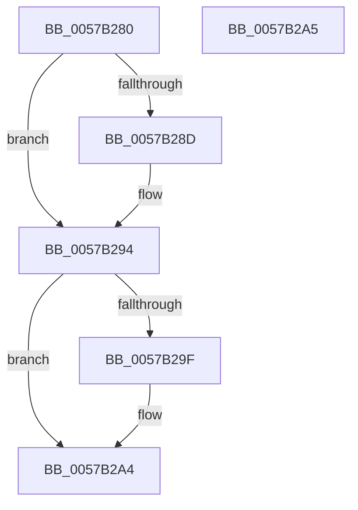

# CcSetDirtyPageThreshold

- RVA: `0x0057B280`–`0x0057B2A6` (길이 `38` bytes)
- VA: `0x000000014057B280`
- 실행 섹션: `.text`
- PDB 이름 있음: `예`; PDB Function 태그: `아니요`
- unwind 정보 RVA: `0x000DB714`
- 디코드: `13`개 명령, `38/38` bytes 표시
- 미해석 바이트: `0` (있으면 어셈블리에 `.byte`로 보존)

> 이 문서는 커널 이미지의 기계어와 PDB 기호를 분석해 생성했습니다. 4번과 5번은 함수 원형과 자료형을 바이너리 사용 방식에서 추정한 C 해석이며 원본 소스 복구 결과는 아닙니다.

## 1. Dependencies

- 직접 호출 지점: **0**; 고유 호출 대상: **0**
- 직접 호출자로 확인된 함수: **0**
- RIP 상대 이미지 참조: **0**

### Outgoing calls
- 직접 디코드된 call 명령이 없습니다.

### Direct callers
- 이 함수 시작 RVA로 연결되는 직접 call은 확인되지 않았습니다. 간접 호출은 완전히 역산할 수 없습니다.

### Static image references
- 디코드된 RIP-relative 메모리 참조가 없습니다.

## 2. Other-region calls and transfers

- 다른 실행 섹션으로 향하는 call: **0**
- 별도 외부 분기/꼬리 이동을 확인하지 못했습니다.

## 3. Assembly (complete function range)

```asm
0057B280  48 8B 41 28                     mov rax, qword ptr [rcx + 0x28]
0057B284  4C 8B 40 08                     mov r8, qword ptr [rax + 8]
0057B288  4D 85 C0                        test r8, r8
0057B28B  74 07                           je 0x14057b294
0057B28D  41 89 90 10 01 00 00            mov dword ptr [r8 + 0x110], edx
0057B294  48 8B 49 18                     mov rcx, qword ptr [rcx + 0x18]
0057B298  8A 41 04                        mov al, byte ptr [rcx + 4]
0057B29B  A8 04                           test al, 4
0057B29D  75 05                           jne 0x14057b2a4
0057B29F  0C 04                           or al, 4
0057B2A1  88 41 04                        mov byte ptr [rcx + 4], al
0057B2A4  C3                              ret
0057B2A5  CC                              int3
```

## 4. C-style interpretation (structured pseudocode)

```c
__int64 __fastcall CcSetDirtyPageThreshold(__int64 a1, int a2)
{
    __int64 result;

    if (*(unsigned __int64 *)(*(unsigned __int64 *)(a1 + 40) + 8) != 0) {
        *(unsigned int *)(*(unsigned __int64 *)(*(unsigned __int64 *)(a1 + 40) + 8) + 272) = a2;
    }
    result = *(unsigned __int8 *)(*(unsigned __int64 *)(a1 + 24) + 4);
    if ((((unsigned __int8)(*(unsigned __int8 *)(*(unsigned __int64 *)(a1 + 24) + 4))) & (4)) == 0) {
        result = (unsigned __int8)((*(unsigned __int8 *)(*(unsigned __int64 *)(a1 + 24) + 4)) | (4));
        *(unsigned __int8 *)(*(unsigned __int64 *)(a1 + 24) + 4) = (unsigned __int8)(result);
    }
    return result;
}
```

## 5. (Beta) C Style

```c
int64_t CcSetDirtyPageThreshold(void *Arg1, int32_t Arg2)
{
    uint8_t *arg1 = (uint8_t *)Arg1;

    int64_t result;

    if (*(uint64_t *)(*(uint64_t *)(arg1 + 0x28) + 0x8) != 0) {
        *(uint32_t *)(*(uint64_t *)(*(uint64_t *)(arg1 + 0x28) + 0x8) + 0x110) = Arg2;
    }
    result = *(uint8_t *)(*(uint64_t *)(arg1 + 0x18) + 0x4);
    if ((((uint8_t)(*(uint8_t *)(*(uint64_t *)(arg1 + 0x18) + 0x4))) & (4)) == 0) {
        result = (uint8_t)((*(uint8_t *)(*(uint64_t *)(arg1 + 0x18) + 0x4)) | (4));
        *(uint8_t *)(*(uint64_t *)(arg1 + 0x18) + 0x4) = (uint8_t)(result);
    }
    return result;
}
```

### 관측된 메모리 오프셋

구조체 형식이 확인되지 않은 접근은 인자 기준의 오프셋으로만 기록했습니다.

| 기준 인자 | 오프셋 표현 | 폭 (bit) | 접근 |
|---|---:|---:|---|
| `Arg1` | `+ 0x18` | `64` | `R` |
| `Arg1` | `+ 0x28` | `64` | `R` |

## 6. Execution-region graph

[열기: 2D/3D 그래프와 함수 탐색 컨트롤 패널](../../../control-panel.html?section=text&rva=0x0057B280&view=graph)

- 2D 그래프는 위에서 아래로 흐르고, 3D 그래프는 빈 공간을 드래그해 회전합니다. Shift+드래그는 이동, 휠은 확대·축소, 함수 노드 선택은 대상 보고서 이동입니다.

### Static fallback


